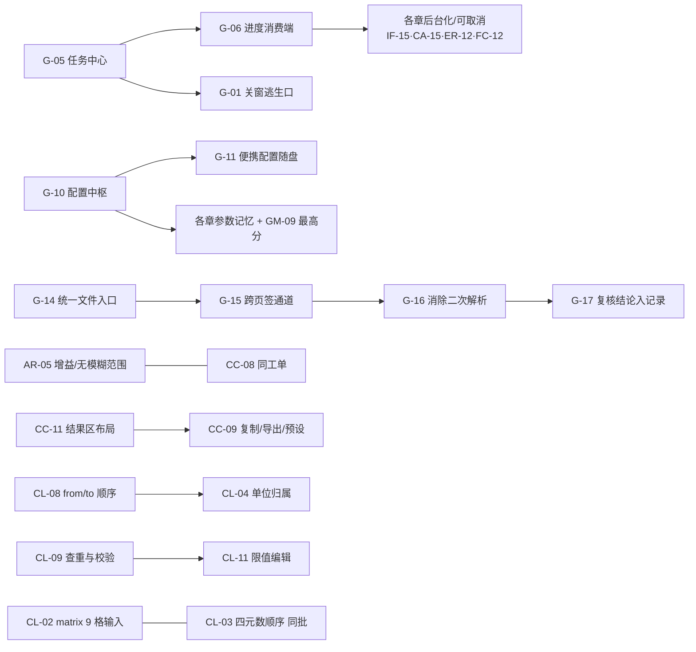

# 便携化工具箱 V1.1.1 使用体验优化建议书

> 对应版本：V1.1.1（PyQt5 + matplotlib 单机工具，Nuitka standalone 打包）
> 代码基线：`C:/xiaoye/5.research_data/13.code_git/work_tool/tool/tool/radar_tool/`
> 文档性质：开发工单来源。每条改点均绑定 `文件:行号` 与可验收判据。

## 阅读指南

**这份文档解决什么问题。** 产品已发布 V1.1.1，功能齐备（9 个可见页签、约 2.5 万行 Python），但"能不能用"和"好不好用"是两件事。本文档只回答后者：在**不推翻现有架构**的前提下，指出便携性、操作合理性、界面一致性三类问题，并给出可直接派给工程师的改点。用户原始诉求是"便携性和合理性还需要进一步核对，界面的优化"，故全篇以"上手成本、绕行成本、误操作成本"为唯一尺度，不讨论新增业务功能。

**本文档不替代原设计文档。** `docs/设计文档/` 下 11 份文档定义的是"系统要做什么"（设计意图）；本文档定义的是"现在哪里不好用、应该改成什么样、怎么验收"。二者冲突时，**以代码实际行为为准**，并在各模块章 `x.7` 与附录 B 中反向登记设计文档需要同步修正的条目（例如设计文档 5.7 宣称样式表覆盖"页签、表格、滚动条"，代码并未覆盖）。

**读者与用法。**

| 读者 | 用法 |
|---|---|
| 研发 | 按模块章 `x.6` 改点清单逐条建工单，**一条改点 = 一个工单**，验收标准列直接抄进工单的"完成定义" |
| 测试 | 按第 14 章验收总表回归；第 14 章的每一条都能追溯到某个改点 ID |
| 产品/项目 | 先读第 2 章与第 13 章：全局设施（任务中心、配置中枢、状态栏分层）是模块级改造的**前置条件**，顺序错了会返工 |

**三步阅读路径。**（1）第 1 章看评级口径，避免"什么算 P0"扯皮；（2）第 2 章 + 第 13 章定版本节奏，先把 G- 系列落地；（3）按第 3~12 章分派模块工单。首轮开发只需看第 2 章、第 13 章与你负责的那个模块章。

**术语表。**

| 术语 | 含义 |
|---|---|
| 页签 / 面板 | 页签是 `QTabWidget` 的一页；面板是该页对应的 `QWidget` 子类（如 `VisualizationPanel`）。二者在本文档中按此严格区分 |
| 数据集 | 一次加载产生、在内存中持有的表格数据（通常是一个 `DataFrame` + 元信息），不是磁盘文件 |
| 批次 / 方案 | 校正模块中的一次标定集合（"批次"）、阵列模块中的一组阵元配置（"方案"）。全文统一用词见 2.9 |
| 任务 | 通过 `TaskRegistry` 登记、跑在 `QThread` 上的后台工作单元（见 `background_tasks.py:76`） |
| 真值 / 参考值 | 由标准仪器或先验给出的对照数据。全文统一用"真值" |
| 便携性 | 见 1.1 的可测量定义，不是"感觉轻便" |
| S1~S4 / P0~P2 | 严重度与优先级，判定规则见 1.3 |

**复审状态。** 本文档的改点已通过一轮独立技术复审（抽检 32 条 P0，29 条事实成立），7 条事实修正与 8 条改法调整已并入正文，复审原文见同目录《技术复审意见》（`review.md`）。凡复审指出"以为有其实没有"的能力（`TaskSnapshot` 无时间戳、`snapshots()` 无清理接口、`fmt_sigma` 拿不到 `to` 系单位），正文均已改为"先补基础设施、再谈界面消费"的写法。

---

## 目录

- [阅读指南](#阅读指南)
- [第 1 章 现状诊断与优化方法论](#第-1-章-现状诊断与优化方法论)
  - [1.1 评价维度：便携性、合理性、界面一致性](#11-评价维度便携性合理性界面一致性)
  - [1.2 现状总体画像（10 条硬事实）](#12-现状总体画像10-条硬事实)
  - [1.3 痛点评级标准](#13-痛点评级标准)
  - [1.4 优化原则与边界](#14-优化原则与边界)
- [第 2 章 全局与跨模块优化](#第-2-章-全局与跨模块优化)
  - [2.1 全局问题清单](#21-全局问题清单)
  - [2.2 统一任务中心：进度条 / 取消 / 任务列表](#22-统一任务中心进度条--取消--任务列表)
  - [2.3 状态栏消息分层](#23-状态栏消息分层)
  - [2.4 启动与关闭体验](#24-启动与关闭体验)
  - [2.5 参数记忆与配置中枢（QSettings）](#25-参数记忆与配置中枢qsettings)
  - [2.6 统一文件入口：最近文件、拖拽导入、格式过滤器](#26-统一文件入口最近文件拖拽导入格式过滤器)
  - [2.7 跨模块数据流转](#27-跨模块数据流转)
  - [2.8 快捷键与菜单栏](#28-快捷键与菜单栏)
  - [2.9 视觉与术语一致性](#29-视觉与术语一致性)
  - [2.10 全局改点清单](#210-全局改点清单)
- [第 3 章 数据可视化处理](#第-3-章-数据可视化处理)
  - [3.3 痛点清单](#33-痛点清单)
  - [3.6 具体改点清单](#36-具体改点清单)
  - [3.7 与设计文档的偏差](#37-与设计文档的偏差)
- [第 4 章 数据真值复核](#第-4-章-数据真值复核)
  - [4.3 痛点清单](#43-痛点清单)
  - [4.6 具体改点清单](#46-具体改点清单)
  - [4.7 与设计文档的偏差](#47-与设计文档的偏差)
- [第 5 章 干涉仪测向仿真](#第-5-章-干涉仪测向仿真)
  - [5.3 痛点清单](#53-痛点清单)
  - [5.6 具体改点清单](#56-具体改点清单)
  - [5.7 与设计文档的偏差](#57-与设计文档的偏差)
- [第 6 章 测向校正自动化](#第-6-章-测向校正自动化)
  - [6.3 痛点清单](#63-痛点清单)
  - [6.6 具体改点清单](#66-具体改点清单)
  - [6.7 与设计文档的偏差](#67-与设计文档的偏差)
- [第 7 章 阵列设计助手](#第-7-章-阵列设计助手)
  - [7.3 痛点清单](#73-痛点清单)
  - [7.6 具体改点清单](#76-具体改点清单)
  - [7.7 与设计文档的偏差](#77-与设计文档的偏差)
- [第 8 章 指标计算器合集](#第-8-章-指标计算器合集)
  - [8.3 痛点清单](#83-痛点清单)
  - [8.6 具体改点清单](#86-具体改点清单)
  - [8.7 与设计文档的偏差](#87-与设计文档的偏差)
- [第 9 章 格式转换](#第-9-章-格式转换)
  - [9.3 痛点清单](#93-痛点清单)
  - [9.6 具体改点清单](#96-具体改点清单)
  - [9.7 与设计文档的偏差](#97-与设计文档的偏差)
- [第 10 章 试验记录助手](#第-10-章-试验记录助手)
  - [10.3 痛点清单](#103-痛点清单)
  - [10.6 具体改点清单](#106-具体改点清单)
  - [10.7 与设计文档的偏差](#107-与设计文档的偏差)
- [第 11 章 坐标系账本](#第-11-章-坐标系账本)
  - [11.3 痛点清单](#113-痛点清单)
  - [11.6 具体改点清单](#116-具体改点清单)
  - [11.7 与设计文档的偏差](#117-与设计文档的偏差)
- [第 12 章 摸鱼游戏栏](#第-12-章-摸鱼游戏栏)
  - [12.3 痛点清单](#123-痛点清单)
  - [12.6 具体改点清单](#126-具体改点清单)
  - [12.7 与设计文档的偏差](#127-与设计文档的偏差)
- [第 13 章 跨模块改造路线图](#第-13-章-跨模块改造路线图)
  - [13.1 总量核对](#131-总量核对)
  - [13.2 波次一：v1.1.2（39 条）](#132-波次一v11239-条)
  - [13.3 波次二：v1.2.0（106 条）](#133-波次二v120106-条)
  - [13.4 波次三：v1.3.0（72 条）](#134-波次三v13072-条)
  - [13.5 硬依赖](#135-硬依赖)
  - [13.6 工单打包规则](#136-工单打包规则)
  - [13.7 文档同步清单](#137-文档同步清单)
- [第 14 章 验收总表](#第-14-章-验收总表)
  - [14.1 使用方式](#141-使用方式)
  - [14.2 P0 验收表（33 条，逐条必须通过）](#142-p0-验收表33-条逐条必须通过)
  - [14.3 P1 验收策略（112 条）](#143-p1-验收策略112-条)
  - [14.4 发布前冒烟清单（10 分钟，11 条）](#144-发布前冒烟清单10-分钟11-条)
  - [14.5 验收记录模板](#145-验收记录模板)
- [附录 A 现状事实索引](#附录-a-现状事实索引)
  - [A.1 编号与前缀对照](#a1-编号与前缀对照)
  - [A.2 规模基线](#a2-规模基线)
  - [A.3 主窗口与全局设施](#a3-主窗口与全局设施)
  - [A.4 各模块关键位置](#a4-各模块关键位置)
  - [A.5 复现陷阱（易误判为"没问题"的三处）](#a5-复现陷阱易误判为没问题的三处)
- [附录 B 与设计文档的偏差清单](#附录-b-与设计文档的偏差清单)

> 第 3~12 章为统一骨架（x.1 模块画像 · x.2 现状界面结构 · x.3 痛点清单 · x.4 优化方案 · x.5 新界面布局 · x.6 具体改点清单 · x.7 与设计文档的偏差），目录中每章只列最常跳转的 x.3 / x.6 / x.7 三项，其余小节名见各章正文；第 12 章另有 12.0（本章 ID 前缀说明）。

全文共 14 章 + 2 个附录，217 条有效改点（P0 33 / P1 112 / P2 72），覆盖 10 个功能模块与 1 套全局设施；`G-23` 作废与 `AR-02b` 子条目的计数口径见 13.1 与附录 A.1。

---

## 第 1 章 现状诊断与优化方法论

### 1.1 评价维度：便携性、合理性、界面一致性

三个维度都必须可测量，否则无法验收。下表给出每个维度的操作性定义与本文档采用的测量方法。

| 维度 | 可测量定义 | 测量方法 | V1.1.1 实测 |
|---|---|---|---|
| **便携性** | 从"插入 U 盘"到"完成一次典型任务"的成本，由三项构成：① 典型任务操作步数（点击 + 键入 + 对话框轮次）；② 必须由用户手工记忆并在下次重填的参数个数；③ 配置与数据是否随盘迁移 | 对每个模块走一遍真实任务并记步；重启程序观察参数是否丢失；换一台机器观察配置是否跟随 | ② 极差：除校正批次库、试验记录、坐标系账本外，**其余面板参数重启全丢**（仅 3 处持久化，见 1.2-F9） |
| **合理性** | 界面呈现的操作顺序与用户心智顺序的匹配度。量化三项：① 无效/绕行操作占典型任务步数的比例；② 默认值可直接使用的比例（不改任何默认值就能出结果的任务占比）；③ 错误可恢复率（出错后用户能在界面内自行纠正的比例） | 逐模块拆解任务步骤，标记"为绕过缺陷而做的动作"；统计默认值；枚举全部错误出口并分类 | ① 数据互不通导致同一份文件加载两次（1.2-F7）；② 干涉仪的「应用到全部阵元」会整列覆盖手工填写的每阵元 SNR（`interferometer_sim.py:544-553`），默认值一经点按即不可信；③ 错误呈现三种范式并存（1.2-F8） |
| **界面一致性** | 同类元素表现统一的程度。量化三项：① 同类控件样式覆盖率（样式表选择器数 / 实际使用的控件类数）；② 同类交互的实现方式种类数（如"错误提示"有几种写法）；③ 术语一义多词条数 | 比对 `ui_theme.py` 选择器清单与全库 `Q*` 控件使用清单；grep 同类交互；抽取界面文案做词频比对 | ① 11 类选择器覆盖不到 `QTabWidget/QTableView/QScrollBar/QDoubleSpinBox`；② 错误提示 3 种范式；③ 页签名 4 个带 emoji、5 个不带 |

三个维度都必须有**目标值**，否则优化没有终点。目标值取"本版可达且用户可感知"的水平，不追求理论最优：

| 指标 | 现状 | v1.2.0 目标 | v1.3.0 目标 |
|---|---|---|---|
| 典型任务操作步数（加载→出结果→导出） | 未基线化，模块章逐页测 | 较现状减少 ≥ 30% | 减少 ≥ 45% |
| 重启后需重填的参数个数 | 各面板全部 | 0（关键参数全记忆） | 0 |
| 默认值可直接出结果的任务占比 | 未基线化（已知干涉仪「应用到全部」会覆盖手工 SNR） | ≥ 60% | ≥ 75% |
| 错误可恢复率（界面内可自行纠正） | 低：错误以内嵌文本或弹窗告知，多数只能改输入重来 | ≥ 70% | ≥ 85% |
| 样式覆盖率（主要控件类） | 11 类覆盖，缺 4 类高频控件 | 补齐 4 类 | 100% |
| 错误呈现范式数 | 3 种 | 1 种 | 1 种 |
| 术语一义多词条数 | 5 组 | 0 | 0 |

### 1.2 现状总体画像（10 条硬事实）

以下 10 条是全文的事实底座，后续所有痛点与改点均由此推导。每条均给出可直接核对的证据位置。

| 编号 | 事实 | 证据 |
|---|---|---|
| **F1** | **基础设施齐备但 UI 缺位**：全库无 `QProgressBar`、无 `QShortcut/QKeySequence`、无 `QSettings`、无 `setAcceptDrops`、无窗口级 `menuBar/QAction`、无 `QUndoStack`；然而已有 8 个 `progress(int, str)` 信号分布在 6 类任务上，进度数据一直在产生，却没有任何控件消费 | `calibration_panel.py:76`、`compare_core.py:403`、`compare_data.py:75`、`format_conversion_panel.py:59`、`simulation_service.py:63,173`、`visualization_panel.py:123,160`；UI 侧零命中 |
| **F2** | **状态栏是唯一全局反馈面，且被任务事件独占**：单个 `QLabel` 既承载业务消息（全库 49 处 `status_label.setText` 写入），又被 7 类任务信号改写为"后台任务：…"，任务事件后写，业务消息（如"已导出高清图: xxx"）被覆盖 | `main_window.py:120-121`（唯一 QLabel）、`main_window.py:208-212`（无条件覆盖）、`main_window.py:31-40`（绑定 7 个信号） |
| **F3** | **关闭窗口可能被后台任务卡死，且无逃生口**：先 `cancel_active` 再 `wait_for_tasks(3000)`；超时弹"请稍后重试关闭"并 `event.ignore()` **拒绝关闭**，界面无"强制退出" | `main_window.py:220-254`（`event.ignore()` 在 `:226`，拒绝分支在 `:249-254`） |
| **F4** | **页签懒加载在主线程同步构建，无任何等待反馈**：首次点击时直接调用工厂函数构造面板，期间无遮罩、无等待光标；构建失败时弹错误页并 `setCurrentIndex(0)` 强制跳回，而**占位空白页仍留在原索引**，用户再点仍是空白 | `main_window.py:129-145`（同步构建）、`main_window.py:112-113`（占位 `QWidget()`）、`main_window.py:153-157`（失败回跳） |
| **F5** | **页签标题 emoji 混用、无图标、无分组**：9 个标题中 4 个带 emoji（📡🧮📋📐）、5 个纯文字；全库无 `setTabIcon` / `setTabToolTip` 调用 | `main_window.py:94-105`；`setTabIcon` 零命中 |
| **F6** | **样式表覆盖有缺口**：`MAIN_STYLESHEET` 仅 11 类选择器（QMainWindow/QWidget/QGroupBox/QPushButton/QLineEdit/QComboBox/QSpinBox/QTextEdit/QListWidget/QCheckBox/QStatusBar），未覆盖 `QTabWidget/QTabBar/QTableView/QHeaderView/QScrollBar/QDoubleSpinBox`，而界面大量使用表格与双精度输入 | `ui_theme.py:11-78` |
| **F7** | **数据完全不互通**：同一份雷达数据在页签 1 与页签 2 需各加载、各解析一次；各面板独立持有数据，无跨面板 API、无共享数据集模型 | `visualization_panel.py:761-763`（页签 1 加载）与 `compare_data.py:279-327`（页签 2 独立加载对话框） |
| **F8** | **错误呈现三种范式并存**：仅弹窗（干涉仪）、弹窗 + 内嵌文本（校正）、仅内嵌文本无弹窗（阵列/计算器）；未知异常统一走错误页 + 12 位错误编号，栈只进日志 | `error_ui.py:18-39`；各面板错误处理分散 |
| **F9** | **无配置中枢，参数记忆几乎为零**：`app_config.py` 全文只有常量（颜色循环、matplotlib rcParams），不含任何读写逻辑；全库仅 3 处持久化（校正批次库 JSON、试验记录 `experiments.json`、账本 autosave + `last_ledger.txt`），窗口几何、页签位置、各面板参数重启全重置 | `app_config.py:1-38`；`main_window.py:44-50`（几何每次硬编码最大化） |
| **F10** | **文件入口过滤器窄于加载器能力**：页签 1 的打开对话框只给 `文本文件 (*.txt)`，而加载器明确支持 `.txt/.csv/.dat/.log/.xlsx/.xls`；用户必须切到"所有文件"才能看到自己的 CSV/XLSX | `visualization_panel.py:761-763` 对 `data_loader.py:20-21` |

补充三条贯穿全篇的背景事实：**日志只有文件出口**（`logger.py:18-21` 定义目录，`:95-114` 只有 File/Stream 两个 handler，应用内无查看入口）；**导出能力参差**——只有校正与真值复核有完整批量导出，指标计算器完全无导出，坐标系账本的 Word 报告函数已实现但无调用点；**文件大小完全没有上限**——`input_limits.py:12` 的 `MAX_FILE_SIZE = None` 让 `ensure_file_size()` 对全部 7 个调用点空操作（`data_loader.py:305,370,399` 三处尤其关键），`compare_data.py` 连检查都没有，2 GB 文件会被整块读进内存（见 `G-26`）。

**从这 10 条推出的结构性结论。** 这三句话决定了本建议书的组织方式，也决定了第 13 章的版本顺序。

1. **问题不在功能缺失，而在"已有能力没有出口"。** F1 与 F2 是同一件事的两面：后台任务已经能报进度、能取消、能去重，日志已经能记录完整栈，错误页已经有编号体系——但用户在界面上看不到、点不着。因此本轮优化**以接线为主、以新建为辅**，这也是为什么 1.4 只允许新增 4 个小文件。
2. **便携性的真实短板是"状态不随行"。** F9 说明参数不记忆，`runtime_paths.py:32-36` 说明配置按机器分开存。一个装在 U 盘里的工具，换个插座就变回出厂状态，"便携"就只剩"免安装"这一个字面意思。因此 2.5 与 G-11 是便携性维度的核心改点，优先级高于任何界面美化。
3. **合理性问题的根因是"模块自治过度"。** 每个面板自己加载文件、自己写错误处理、自己拼过滤器（F7/F8/F10 三者同源）。短期靠公共组件收敛（2.6/2.9），中期靠数据总线打通（2.7），但**不合并面板**——自治带来的独立性是这个工具能长期维护的原因，不能为了统一而牺牲。

### 1.3 痛点评级标准

判定规则必须唯一，否则工单排序会失控。严重度看"后果"，优先级看"何时修"。

| 级别 | 判定规则 | 典型示例 |
|---|---|---|
| **S1** | 数据错误、数据丢失、结果不可信。用户会拿着错的结论去做判断 | 保存失败却显示"✅ 已保存"，用户以为记录已落盘（`exp_recorder.py:915-928` 无条件写状态）；同一阵列在两个页签算出不同增益（`array_designer.py:582` vs `calc_formulas.py:230-237`） |
| **S2** | 流程被阻断，或必须绕行才能完成。用户无法在界面内达成目标 | 关闭窗口被后台任务拒绝（F3）；页签加载失败后该页永久空白（F4）；加载器支持 CSV 但对话框不给（F10） |
| **S3** | 高频但可忍受的低效/困惑。能做，但每次都要多想一步、多点两下 | 状态栏业务消息被覆盖（F2）；参数每次重填（F9）；同一文件加载两次（F7） |
| **S4** | 观感与一致性问题。不影响正确性，影响专业感与信任 | emoji 混用（F5）；表格无样式（F6）；页签命名风格不一 |

| 优先级 | 判定规则 | 版本归属 |
|---|---|---|
| **P0** | S1 全部 + 阻断类 S2（用户卡住、无法完成任务） | v1.1.2 补丁版必须修 |
| **P1** | 高频 S3 + 关键引导缺失（新手第一次就用不对） | v1.2.0 次版本 |
| **P2** | 体验提升与美观（S4 为主，低风险） | v1.3.0 及以后 |

两条裁定细则：(a) 同一现象既阻断又高频时按高者计，例如"参数全丢"若导致任务无法继续则按 S2 而非 S3；(b) 仅"看起来不专业"但零功能影响的条目不允许进 P0，避免补丁版被观感需求挤占。

### 1.4 优化原则与边界

1. **不推翻架构**：保留 `QTabWidget` 单窗口 + 各面板独立 `QWidget` 子类的结构，不重写面板、不换框架、不引入数据库、不做网络与多用户。
2. **最小侵入**：优先在 `MainWindow` 与公共模块层加能力，面板侧只做"接线"（新增信号连接、替换文案、补一个按钮），避免大段重排面板内部布局。例外是各模块章 `x.5` 明确标注"重排"的区块。
3. **复用已有公共设施**：`TaskRegistry`（已具备快照、取消、有界等待、同名去重）与 `error_ui`（已具备统一错误页 + 错误编号）不再另造轮子，只补 UI 出口。这是本文档最高性价比的方向。
4. **允许新增少量公共组件**：仅限 `radar_tool/data_bus.py`（进程内数据集总线）、`radar_tool/task_center.py`（任务中心对话框）、`radar_tool/settings_store.py`（QSettings 封装）、`radar_tool/file_filters.py`（过滤器常量）。新增文件必须有单一职责，不得成为杂物间。
5. **不做的事**：不做云同步、不做账号、不做插件体系、不做文件级工程模型（`x.prj` 统一工程包）——后者列入 v1.3.0 之后的再议项，不进本轮路线图。
6. **可回退**：所有新增持久化必须"读不到就用默认值、写失败只记日志"，不允许因配置损坏导致启动失败。

---

## 第 2 章 全局与跨模块优化

> 本章是全篇的杠杆点。第 3~12 章的模块改造中，凡涉及"进度、取消、参数记忆、打开文件、错误提示"的部分，都应调用本章建立的公共设施，而不是各面板自行实现。

### 2.1 全局问题清单

| 问题ID | 问题 | 证据 | 影响面 | 严重度 |
|---|---|---|---|---|
| GP-01 | 长任务无进度、无耗时、无统一取消入口，用户只能盯着不动的界面猜 | F1（8 个 progress 信号无消费端） | 全部 9 个页签 | S2 |
| GP-02 | 业务消息与任务消息共用同一 QLabel，互相覆盖，用户看不到导出/保存确认 | F2（`main_window.py:208-212`） | 全局 | S3 |
| GP-03 | 关闭窗口被任务拒绝，无强制退出；超时提示要求"稍后重试"，用户只能反复点关闭 | F3（`main_window.py:226,249-254`） | 全局 | S2 |
| GP-04 | 页签首次加载无反馈；加载失败后该页永久空白且无法重试 | F4 | 8 个懒加载页签 | S2 |
| GP-05 | 参数不记忆：窗口几何、页签位置、各面板输入每次重启全部重置 | F9 | 全局 | S3 |
| GP-06 | 无最近文件、无拖拽导入；页签 1 过滤器窄于加载器能力 | F10 | 页签 1/2/3/5/7 | S3 |
| GP-07 | 跨页签数据不互通，同一文件重复加载、重复解析、重复清洗 | F7 | 页签 1↔2↔8 | S3 |
| GP-08 | 全库零快捷键、零窗口级菜单，所有操作只能鼠标点 | F1 | 全局 | S3 |
| GP-09 | 视觉与术语不一致：emoji 混用、表格无样式、同类交互三种范式、空态无引导 | F5/F6/F8 | 全局 | S4 |
| GP-10 | 应用内无日志入口，排查问题需自行到 `var/日志/` 或 `%APPDATA%\PortableRadarToolbox\日志\` 翻文件 | `logger.py:18-21` | 全局（支持场景） | S3 |
| GP-11 | 文件大小无上限：`MAX_FILE_SIZE = None` 让全部大小检查空操作，超大文件整块读入内存，进程被杀时**其它页签未保存内容一起丢** | `input_limits.py:12`；`data_loader.py:305,370,399`；`compare_data.py` 无检查 | 页签 1/2/7 | S1 |

### 2.2 统一任务中心：进度条 / 取消 / 任务列表

**现状。** `TaskRegistry` 已经是一个相当完整的基础设施：它有不可变快照 `TaskSnapshot`（`background_tasks.py:53-73`）、7 个状态信号（`:79-85`）、协作式取消 `cancel_active`（`:278-301`）、有界等待 `wait_for_tasks`（`:303-313`）、同名任务去重 `ensure_can_start`（`:156-165`）。而 UI 侧只有一行文字（`main_window.py:208-212`）。**进度数据已经在流，只是没人接。** 这是全篇投入产出比最高的改点。

**但"六列表格"缺三块数据源（必须写成 G-05 的前置子任务）。** 快照的 `__slots__`（`background_tasks.py:56-59`）只有 11 个字段：`task_id/name/phase/progress/message/cancel_requested/completed/outcome/error/version/stale`——**没有 `started_at/finished_at`**（时间戳只存在于私有 `_records` 里的 `record` 对象，`:117`，不随快照外泄），`register()`（`:92`）**只记 `owner`（窗口对象），不记页签**，`snapshots()`（`:209-213`）**只增不删、没有清理 API**。因此"耗时""所属页签""清空已完成"三列/按钮在现状代码上**做不出来**，必须先补三个子任务：

| 子任务 | 改动点 | 内容 | 前置关系 |
|---|---|---|---|
| S-a | `background_tasks.py:56-59` | `TaskSnapshot.__slots__` 增 `started_at/finished_at`，并在 `register()`（`:92`）与完成回调里填值（`time.monotonic()`） | G-05 的前置 |
| S-b | `background_tasks.py:92` | `register()` 增 `tab_name` 参数（调用方传页签名或索引），快照同步增该字段 | G-05 的前置 |
| S-c | `background_tasks.py:209-213` | `TaskRegistry` 增 `clear_completed()`：仅移除 `completed=True` 的快照，不动进行中的 | G-05 的前置 |

**G-05 第一版只做四列**（任务名 / 阶段 / 进度 / 操作），S-a~S-c 落地后再追加"耗时""所属页签"两列与"清空已完成"按钮。这样任务中心可以在 v1.1.2 一次上线，不必等基础设施全部改完；反过来若硬凑六列，只能靠 `owner` 字符串猜页签、靠刷新时刻反推耗时，数据是假的。

**先盘清有多少任务需要被管。** 按 `progress` 信号归属清点，V1.1.1 至少有 6 类长任务，均以 `QThread` + 进度信号的形式运行，并经统一注册表登记——但没有一个在界面上有进度或取消按钮。这意味着任务中心不是"为未来预留"，而是**立刻就有 6 个存量用户场景**。

| 任务 | 触发页签 | 进度信号 | 耗时量级（估算，待模块章实测） | 现状可见性 | 现状可取消 |
|---|---|---|---|---|---|
| 数据文件加载（多文件） | 数据可视化处理 | `visualization_panel.py:123` | 秒级，大文件十秒以上 | 仅一行文字 | 无入口 |
| 数据加载 / 预处理 | 数据可视化处理 | `visualization_panel.py:160` | 秒级 | 仅一行文字 | 无入口 |
| 真值复核计算 | 数据真值复核 | `compare_core.py:403`、`compare_data.py:75` | 秒到十几秒 | 仅一行文字 | 无入口 |
| 蒙特卡洛仿真（1D/2D） | 干涉仪测向仿真 | `simulation_service.py:63,173` | 十几秒到分钟级（2D 次数硬编码） | 仅一行文字 | 无入口 |
| 校正优化迭代 | 测向校正自动化 | `calibration_panel.py:76` | 分钟级 | 仅一行文字 | 无入口 |
| 格式转换（批量） | 格式转换 | `format_conversion_panel.py:59` | 秒到十几秒 | 仅一行文字 | 无入口 |

**方案（三件套，缺一不可）。**

1. **状态栏常驻进度条**：`QProgressBar` 固定宽度 140px，放在 `addPermanentWidget` 区域（版本号左侧）。无任务时 `setVisible(False)`；有任务时显示当前最"靠前"任务的百分比，文本格式 `%p%`。多任务并发时进度条显示第一个活动任务，并在右侧显示 `+N`。
2. **任务中心对话框 `TaskCenterDialog`**（新增 `radar_tool/task_center.py`，非模态、可最小化、单例）：`QTableWidget` **本版四列**——任务名 / 阶段 / 进度 / 操作（S-a~S-c 完成后追加"耗时""所属页签"，届时才是六列）。阶段列直接用 `TaskRegistry.describe()` 的中文标签（`background_tasks.py:316-332` 已有映射，禁止另写一份）。操作列放"取消"按钮，点击调 `cancel_active` 并置灰，等待 `task_cancelled` 后变为"已取消"。
3. **状态栏入口**：进度条右侧加一个可点击的 `QLabel`（文案 `任务 (2)`），点击打开任务中心；无任务时隐藏。

**刷新策略。** 不要把 7 个信号各自连到表格刷新（会重复刷）。统一走"信号 → 置脏标记 → `QTimer` 100ms 合并刷新"：`task_progress` 是高频信号（蒙特卡洛会打上千次），直接刷新表格会造成界面卡顿。耗时列（S-a 落地后才有）由 `started_at` 与 `time.monotonic()` 计算，`QTimer` 1s 重算一次即可。

下图是 S-a~S-c 落地后的**目标形态**；本版先出四列（无"所属页签""耗时"），"清空已完成"按钮随 S-c 一起上。

```
┌─ 任务中心 ────────────────────────────────────────────[─][□][×]┐
│ 任务名              所属页签      阶段        进度    耗时  操作 │
│ 数据文件加载（3个） 数据可视化    运行中 62%  ▓▓▓▓░░  8.4s  [取消]│
│ 蒙特卡洛 2D 仿真    干涉仪测向    已请求取消 41% ▓▓░░░░ 12.1s [已取消]│
│ 批量导出            测向校正      成功完成  100% ▓▓▓▓▓▓ 3.2s  [关闭]│
├──────────────────────────────────────────────────────────────┤
│ [全部取消]                              [清空已完成]  [后台运行] │
└──────────────────────────────────────────────────────────────┘
```

**验收。** ① 启动任意 >3s 的后台任务，状态栏进度条出现且百分比单调递增，任务结束后 2s 内自动隐藏；② 任务中心打开期间主界面仍可操作（非模态）；③ 点"取消"后该行阶段在 1s 内变为"已请求取消"，Worker 真正退出后变为"已取消"；④ 同时跑 3 个任务时，任务中心 3 行齐全、进度条显示 `+2`。

### 2.3 状态栏消息分层

**现状。** 一个 `QLabel` 承担两种语义完全不同的消息（`main_window.py:120-121`），而任务事件无条件覆写（`:208-212`）。结果是用户点"导出高清图"→ 面板写入"已导出高清图: xxx.png"→ 任务信号随即用"后台任务：xxx: 成功完成（已完成）"盖掉，**用户永远看不到导出到哪了**。全库 49 处业务写入全部受害。

**被覆盖的具体场景（这些都是用户真实会做的动作）。**

| 用户动作 | 面板写入的业务消息 | 随即被覆盖成 | 后果 |
|---|---|---|---|
| 导出高清图 | `已导出高清图: xxx.png` | `后台任务：…: 成功完成（已完成）` | 不知道文件落在哪个目录 |
| 删除绘图页 | `已删除绘图页: 视图2` | 同上 | 不确定操作是否生效 |
| 保存批次 | `批次已保存` | 同上 | 反复保存，产生重复批次 |
| 数据校验失败 | 校验结论类消息（列出异常列与行数） | 任务"成功完成" | **误以为校验通过**（这条是 S1 级隐患） |

表中引号内为示意文案，具体字符串以各面板实际代码为准；但**覆盖机制与文案无关**，任何业务消息都会被无条件替换（`main_window.py:208-212` 不判断消息类型）。最后一行尤其危险：业务侧报告了数据问题，任务侧报告"成功完成"，状态栏最终停留的是后者，用户会拿着有问题的数据继续做真值复核。

**方案（分区，不共用控件）。**

| 区域 | 控件 | 内容 | 生命周期 |
|---|---|---|---|
| 左侧临时区 | `QLabel`（stretch=1） | 业务消息：导出路径、保存结果、校验结论、操作回执 | 显示后 `QTimer.singleShot(5000)` 清空；新消息到来则重置计时器（**同一控件重入要重置，不要叠加计时器**） |
| 右侧常驻区 | `QLabel` + `QProgressBar` + 任务入口 | 任务状态摘要：`1 个任务运行中 62%` | 由任务信号驱动，无任务时隐藏 |
| 最右 | 版本号 `QLabel` | `v1.1.1` | 常驻（现状保留） |

**关键改动。** 保留 `main_window.status_label` 这个名字与它现有的 `setText` 语义（49 处调用不动），只把 `_on_background_task_event` 从"写 `status_label`"改为"写新的 `task_status_label`"（`main_window.py:208-212` 单点替换）。这样面板代码零改动，风险最低。业务消息的 5s 自动清除通过重写一个 `show_status(text, timeout_ms=5000)` 方法实现，并在 `MainWindow` 上把 `status_label.setText` 的典型用法迁移过去——**第一版可不迁移**，仅做分区即可解决覆盖问题。

**一个可以少写代码的细节**：`QStatusBar` 自带 `showMessage(text, timeout)`，天然支持"临时消息 + 自动清除"，且不会与 `addWidget` 添加的常驻控件抢位置。因此左侧业务区不必自己写 `QTimer`，直接用 `self.statusBar().showMessage(text, 5000)` 即可；但要**注意与现状的差异**——现有 49 处是往 `status_label` 写，若改用 `showMessage`，需要把所有调用迁移到统一的 `show_status()`，迁移量比"保留 QLabel + QTimer"大。两种都可行，权衡点：`showMessage` 语义更正确但改动面大，`QLabel + QTimer` 改动面小但需要自己管计时器重入。**建议这一版选后者，明年重构时再换前者。**

**验收。** ① 触发导出后立即触发一次后台任务完成事件，5s 内状态栏左侧仍可见"已导出高清图: xxx.png"；② 5s 后左侧自动清空（或回到"就绪"），右侧任务摘要同步消失；③ 连续两次导出，第二次消息直接替换第一次，不出现两条并存或计时器失控。

### 2.4 启动与关闭体验

**启动时序与阻塞点。**

| 阶段 | 当前行为 | 阻塞主线程 | 用户感知 | 目标 |
|---|---|---|---|---|
| 进程启动 → 日志/路径 | `migrate_legacy_user_data()` + matplotlib rcParams（`run.py:50-51`） | 是（毫秒级） | 无 | 保留，不优化 |
| `MainWindow.__init__` | 建 9 个页签壳 + 立即构造可视化面板（`main_window.py:110-111`） | 是（可视化面板较重） | 空白窗口（约 0.5~1s，待实测） | 改为最小壳，可视化面板也走懒加载 |
| 首次点击页签 2~9 | 同步构造面板（`:129-145`） | 是（秒级） | 界面"假死" | 遮罩 + 等待光标（G-07） |
| 构造失败 | 弹错误页 + 跳回第 1 页（`:153-157`） | — | 被弹窗打断且被弹走 | 留在错误页可重试（G-02） |
| 关闭 | 取消 + 3s 有界等待（`:220-254`） | 是（最长 3s，阻塞） | 窗口无响应 | 三选一对话框（G-01） |

注意 `MainWindow.__init__` 里 `logger.info` 写的是"仅初始化可视化面板"（`main_window.py:73`），说明设计上已经把"只建一个面板"当作启动优化手段——方向是对的，只是缺了加载中的可见性。

**启动侧。** 现状是懒加载（只立即构造可视化面板，`main_window.py:110-113`），首屏较快，但**首次点击任一页签时会同步构建面板**（`:129-145`）。阵列设计助手、坐标系账本这类含 matplotlib 3D 与大量控件的面板，首次构建可达秒级，期间主线程阻塞：窗口不重绘、鼠标无反馈，用户会以为点空了而重复点击（重复点击无害但加重卡顿）。

改法：`_on_tab_changed` 进入时（`main_window.py:147` 之后）做三件事——① `QApplication.setOverrideCursor(Qt.WaitCursor)`；② 在页签内容区临时显示遮罩 `QLabel('正在初始化「阵列设计助手」…')`（用 `QStackedLayout` 或直接 `setCurrentWidget` 到占位提示页）；③ `try/finally` 恢复光标。构建完成后再 `removeTab/insertTab`（现有逻辑 `:158-162` 保留）。注意：因为构建是同步的，遮罩需要在构建前 `repaint()` 一次，否则遮罩本身来不及绘制——这是实现坑，必须写进工单。

**加载失败侧（阻断类）。** 现状 `:153-157` 失败后强制跳回第 1 页，但**空白占位页还在原索引上，`_tab_loaded[index]` 仍为 False**，用户再点会重新走一次构建并再次失败，且每次都要先被弹窗打断再被弹回。改法：引入第三态 `_tab_failed[index]`——失败时置真，把该页原地替换为内联错误页 `QWidget`（内含错误摘要 + `重试` 按钮 + `查看日志` 链接），**不再调 `handle_ui_exception` 弹模态**（否则每次切回都会再弹一次，因为 `_tab_loaded` 仍为 False，`:147-152` 会重跑工厂）；只有点"重试"才清标志重建。同时**不要强制跳回第 1 页**，让用户留在错误页看到原因。

**关闭侧（阻断类，与 `ER-06` 同一处代码）。** 现状 `main_window.py:220-254`：取消 → 等 3s → 超时则 `event.ignore()` 拒绝关闭。用户此时唯一出路是任务管理器杀进程，且**可能丢数据**。改法是把关闭做成**一次事务、三段固定顺序**：① **脏数据检查**（有未保存修改则三选一：保存并退出 / 不保存退出 / 取消关闭）→ ② **任务取消 + 有界等待**（超时后三选一：`继续等待`再等 3s / `取消任务并退出` / `强制退出`）→ ③ **逃生口**（`强制退出` 先把日志 handler `flush()` 落盘，再 `QApplication.quit()`）。**顺序不能颠倒**：若先 `wait_for_tasks(3000)` 再问保存，用户会先干等 3 秒才被问"要不要保存"；若把"强制退出"放在脏数据检查之前，它还会绕过保存询问，直接丢数据。该事务与第 10 章 `ER-06` 是同一张工单（`[G-01+ER-06]`，见 13.6），本文件不重复描述实现细节。

**被忽略的数据安全前提。** 三选一对话框在文案上必须说清"哪些工作会丢"：对话框正文列出的不应只是任务名，还要带上该任务的"已产出未落盘"状态（例如校正优化跑到 80% 时退出，已迭代的中间结果是全部丢失还是保留最好一轮）。这要求各任务在 `TaskSnapshot.message` 里维护一句可读的中间状态（现有多数任务只写"正在迭代"），属于模块章要配合的改点；**本版只需在对话框里保留一行"任务进度 80%，退出后需重新计算"的客观描述**，不承诺中间结果保留。

**验收。** ① 首次点击最重的页签，出现"正在初始化…"提示且光标为等待态，构建完成后提示消失；② 人为让某面板构造抛异常，错误页出现且含可点的"重试"，点击后重新尝试构建；③ 制造一个不响应取消的任务，关闭窗口时出现三按钮对话框，"强制退出"能在 1s 内真正退出且日志文件末尾有本次会话记录。

### 2.5 参数记忆与配置中枢（QSettings）

**现状。** `app_config.py` 只有常量，没有读写（`app_config.py:1-38`）；全库零 `QSettings`。窗口尺寸每次按屏幕比例硬编码并强制最大化（`main_window.py:44-50`），页签位置每次回到第 1 页。用户的实际工作方式是"每天打开、进同一个页签、填同样的 6 个参数"，现在每天要重做一遍。

**方案。** 新增 `radar_tool/settings_store.py`，对 `QSettings` 做薄封装（**不引入新依赖，PyQt5 自带**）：`get(key, default)` / `set(key, value)` / `sync()`，并在 `MainWindow.__init__` 末尾与 `closeEvent` 中调用 `sync()`。组织名 `PortableRadarToolbox`、应用名 `RadarTool`，保证打包与源码运行读到同一套键。

**三种存储位置的取舍（这张表决定"便携"是否成立）。**

| 方案 | 路径 | 优点 | 缺点 | 建议 |
|---|---|---|---|---|
| 源码运行默认 | `<repo>/var`（`runtime_paths.py:36`） | 调试方便，随仓库清理 | 仅开发态存在 | 保留现状 |
| 打包运行默认 | `%APPDATA%\PortableRadarToolbox`（`runtime_paths.py:33-35`） | 可写、不受 U 盘只读限制 | **换机器配置丢失，与便携定位冲突** | 作为默认 |
| 便携模式 | 程序目录 `settings.ini`（`QSettings.IniFormat`） | 拷走目录即拷走配置与历史 | U 盘只读时写失败 | 提供开关，启动时优先检测 |

**建议键空间。**

| 键 | 类型 | 用途 | 写入时机 |
|---|---|---|---|
| `window/geometry` | QByteArray | `saveGeometry()` 原始字节 | `closeEvent` |
| `window/state` | QByteArray | `saveState()`（含最大化状态） | `closeEvent` |
| `window/restore_maximized` | bool | 上次是否最大化，首次启动仍最大化 | `closeEvent` |
| `tabs/last_index` | int | 上次停留的页签，启动恢复 | `closeEvent` |
| `files/recent` | QStringList | 最近 10 个文件（路径 + 时间 + 来源页签） | 打开成功后 |
| `files/last_dir` | str | 各页签对话框的初始目录，按 `files/last_dir.<module>` 分开 | 每次文件对话框确认后 |
| `module.viz.*` | 混合 | 可视化面板：色标、图幅、导出 DPI、上次列映射 | 参数变化时（防抖 500ms） |
| `module.interferometer.*` | 混合 | 阵列类型、阵元数、半径、频率、蒙特卡洛次数 | 同上 |
| `module.array.*` | 混合 | 频率、阵型、间距 | 同上 |
| `module.calc.*` | 混合 | 上次选择的公式与单位制 | 同上 |
| `ui/font_scale` | float | 全局字号缩放（1.0 默认），供高分屏/投影场景 | 设置对话框 |
| `tasks/close_timeout_ms` | int | 关闭时等待上限，默认 3000 | 设置对话框 |

**存储位置的坑（必须写进工单）。** `runtime_paths.py:32-36`：源码运行写 `<repo>/var`，打包运行写 `%APPDATA%\PortableRadarToolbox`。这意味着**U 盘换机器后配置不跟随**——这与"便携"的产品定位直接冲突。建议：默认仍写 `%APPDATA%`（避免只读介质写失败），但提供一个 `设置 → 数据与配置 → 将配置保存到程序目录（便携模式）` 开关，落到 `settings.ini`（`QSettings.IniFormat` + 程序目录），并在启动时按"程序目录下有 `settings.ini` 则优先"的规则加载。这样"拷走整个文件夹 = 拷走全部配置"，才真正兑现便携。

**验收。** ① 改变窗口尺寸/位置并切到第 6 页签，关闭再开，尺寸与页签位置完全恢复；② 在干涉仪页改频率为 3 GHz、阵元数为 12，重启后仍为 3/12；③ 便携模式下整个程序目录拷到另一台机器，上述两项依然保持；④ 删除 `settings.ini` 后启动不报错，全部回落默认值。

### 2.6 统一文件入口：最近文件、拖拽导入、格式过滤器

**现状。** 三个缺口：① 全库无 `recent` 概念，用户每次从文件对话框的默认目录开始翻；② 无拖拽（`setAcceptDrops` 零命中），而桌面工具的用户习惯是把文件拖进窗口；③ 过滤器与加载器能力不一致——页签 1 只给 `文本文件 (*.txt)`（`visualization_panel.py:761-763`），但 `data_loader.py:20-21` 明确支持 `TEXT_EXTENSIONS = {'.txt','.csv','.dat','.log'}` 与 `EXCEL_EXTENSIONS = {'.xlsx','.xls'}`。用户拿一个 `.csv` 打开时看不到自己的文件，会以为"这个软件不支持 CSV"。

**方案。**

**先看现状有多乱。** 同一类"选择数据文件"的动作，全库至少 4 种写法，能力互不一致，且**全部漏掉 `.log`**（而 `data_loader.py:20` 明确支持 `.log`）：

| 页签 | 调用点 | 当前过滤器字面量 | 问题 |
|---|---|---|---|
| 1 数据可视化 | `visualization_panel.py:762` | `文本文件 (*.txt);;所有文件 (*.*)` | 最窄：CSV/Excel 全部隐藏 |
| 1 数据可视化（列名） | `visualization_panel.py:842` | `文本文件 (*.txt);;所有文件 (*.*)` | 列名文件通常是 CSV |
| 2 数据真值复核 | `compare_data.py:281,329` | `支持的数据 (*.txt *.csv *.dat *.xlsx *.xls);;所有文件 (*.*)` | 较宽，但缺 `.log` |
| 2 数据真值复核（列名） | `compare_data.py:292` | `文本文件 (*.txt);;所有文件 (*.*)` | 与上一行同页签内不一致 |
| 3 干涉仪 | `interferometer_sim.py:735` | `CSV文件 (*.csv);;文本文件 (*.txt);;所有文件 (*.*)` | 与页签 5 字面量完全相同，改一处必漏一处 |
| 5 阵列设计 | `array_designer.py:868` | `CSV文件 (*.csv);;文本文件 (*.txt);;所有文件 (*.*)` | 同上 |
| 4 测向校正（保存） | `calibration_panel.py:861` | `JSON 结果 (*.json)` | 无备用格式，无"所有文件" |
| 7 格式转换 | `format_conversion_panel.py:331` | 动态 `file_filter` 变量 | 唯一做对的，应作为范式推广 |

1. **统一过滤器常量**（新增 `radar_tool/file_filters.py`）：`DATA_OPEN = '雷达数据 (*.txt *.csv *.dat *.log *.xlsx *.xls);;文本 (*.txt *.csv *.dat *.log);;Excel (*.xlsx *.xls);;所有文件 (*.*)'`，`DATA_COLUMN = '列名文件 (*.txt *.csv);;所有文件 (*.*)'`，`IMAGE_SAVE = 'PNG (*.png);;JPEG (*.jpg);;PDF (*.pdf);;SVG (*.svg)'`，`JSON_SAVE`、`CSV_SAVE` 同理。全部对话框改用常量，禁止再写字面量。
2. **最近文件**：`文件 → 最近打开` 子菜单（依赖 2.8 的菜单栏），最多 10 条，每条显示 `文件名 — 目录`，`setStatusTip` 显示完整路径与时间；点击后按记录的来源页签**先切页签再加载**。持久化到 `files/recent`。
3. **拖拽导入**：`MainWindow.setAcceptDrops(True)`，`dragEnterEvent` 按扩展名判定是否接受（数据类/图片类接受，其他忽略并保持默认图标）；`dropEvent` 按扩展名路由——数据文件 → 页签 1 或当前页签（若当前页签支持加载），图片 → 无处理（v1.2 不做），多条数据文件 → 全部交给页签 1 的多文件加载路径（已有 `getOpenFileNames` 语义，可直接复用）。路由后弹一个 `QMessageBox` 确认"检测到 3 个数据文件，在「数据可视化处理」中加载？"，避免误拖打乱用户当前工作。

**验收。** ① 页签 1 打开对话框的默认过滤器列出 txt/csv/dat/log/xlsx/xls，`.csv` 文件直接可见可选；② 打开过的文件出现在"最近打开"顶部，重启后仍在，点击可复现加载；③ 从资源管理器拖 2 个 `.csv` 到窗口空白处，出现确认框，确认后在页签 1 完成加载且状态栏显示加载完成；④ 拖入 `.png` 时鼠标显示禁止图标且无任何提示弹窗。

### 2.7 跨模块数据流转

**现状。** 同一份实测数据，用户要在页签 1（可视化）加载一次看波形，再在页签 2（真值复核）加载一次做比对，最后在页签 8（试验记录）手工敲一遍结论。三次加载、两次重复解析，且**两次解析的列名映射可能不一致**——这是"结果不可信"的隐患，不只是效率问题。

**方案：进程内数据集总线（最小可行）。** 新增 `radar_tool/data_bus.py`，单例 `DataBus(QObject)`，两个信号 `dataset_changed(object)` 与 `dataset_cleared()`，一个状态 `current`（`{'df': DataFrame, 'meta': {...}, 'source': '页签名', 'filepath': str, 'loaded_at': float}`）。规则：

- **只有"加载成功"才写总线**，且写入是一次性赋值，不做深拷贝（2.5 万行规模的表格深拷贝代价高，且各面板已有自己的清洗逻辑）；
- 面板**不订阅**总线自动刷新（避免一侧清洗影响另一侧显示），而是提供显式按钮"从当前数据集导入"；
- 总线只做"传递引用 + 元信息"，不承担清洗、对齐、插值——那属于各模块自己的业务逻辑。

| 链路 | 起点 | 终点 | 触发方式 | 收益 |
|---|---|---|---|---|
| L1 | 页签 1 加载数据 | 页签 2 真值复核 | 页签 2 顶部新增按钮「从可视化导入当前数据」 | 省一次加载与解析；同一份数据只解析一次 |
| L2 | 页签 2 复核结论 | 页签 8 试验记录 | 结论区新增「写入试验记录」按钮，把指标与结论插入当前记录的步骤模板 | 省手工誊抄，避免抄错 |
| L3 | 页签 7 格式转换产物 | 页签 1 / 2 | 转换完成后「在可视化中打开」 | 转换→查看闭环 |
| L4（v1.3 再议） | 页签 4 校正结果 | 页签 3 仿真 | 用实测校正系数初始化仿真 | 需先统一单位口径（1.2 未列，见各模块章） |

**元信息必须带什么。** 只传 `DataFrame` 不够——下游页签要知道这份数据从哪来、该怎么解释，否则同样会出错。`meta` 建议固定为下表字段，缺字段时下游按"未知"处理而不是猜测：

| 字段 | 类型 | 用途 | 缺失后果 |
|---|---|---|---|
| `filepath` | str | 最近文件、导出默认文件名、日志溯源 | 导出时文件名退化为 `untitled` |
| `source_tab` | str | 判断"这份数据来自哪个页签"，防止跨模块循环导入 | 无法提示来源 |
| `loaded_at` | float | 任务中心与状态栏显示"几分钟前加载" | 无 |
| `row_count` / `col_count` | int | 下游做规模预检（如蒙特卡洛前提示行数） | 大文件直接卡住 |
| `column_map` | dict | 列名 → 语义（角度/幅度/频率/时间） | 页签 2 需用户重新映射，等于没打通 |
| `unit_hint` | dict | 各列的物理单位（长度单位三套、频率四种单位的问题见各模块章） | 单位错配导致结论错 |
| `warnings` | list | 加载阶段产生的告警（跳过的坏行、编码回退） | 下游把脏数据当真值 |

`column_map` 是整条链路的关键：页签 1 已经做过列名映射（用户手动指定过哪列是角度），把这个结果传下去，页签 2 就不必再让用户选一遍——**这才是"数据流转"省下的真实工作量，而不是省一次文件对话框**。

**明确不做**：不建文件级工程模型（`.prj` 包），不做跨进程共享，不做数据版本链。这三项都会把单机小工具推向"平台"，与 1.4 的边界冲突。

**验收。** ① 页签 1 加载一个 3 万行 CSV 后切到页签 2，点"从可视化导入"，表格直接填充且行数/列名与页签 1 一致，全程无第二次文件对话框；② 页签 2 结论区点"写入试验记录"，试验记录当前记录中新增一步，内容含指标数值与时间戳；③ 页签 1 加载新文件后，页签 2 若未主动导入，其内容**保持不变**（不静默替换用户正在核对的数据）。

### 2.8 快捷键与菜单栏

**现状。** 全库无 `QShortcut/QKeySequence`、无窗口级 `menuBar/QAction`（`QAction` 仅在试验记录里用于右键菜单，`exp_recorder.py:257-280`）。所有操作只能鼠标完成，对每天用 4 小时的重度用户是持续的效率损耗；对"这软件专业吗"的第一印象也有影响。

**菜单栏方案。** 在 `MainWindow._init_ui` 中新增 `self.menuBar()`，五个顶级菜单：`文件`（打开/最近打开/保存/导出/退出）、`编辑`（撤销/重做——**仅在有撤销栈的页签启用**，否则置灰并 `setStatusTip('当前页暂不支持撤销')`）、`视图`（显示任务中心/切换页签/重置布局）、`工具`（打开日志目录/设置）、`帮助`（快捷键一览/关于/版本）。菜单项全部指向 `QAction`，与快捷键共用同一批 `QAction` 对象——**不要"菜单一套、快捷键一套"**，否则改文案要改两处。

**首批 13 个快捷键（按可落地性排序）。**

| 键位 | 动作 | 落点 | 前提 |
|---|---|---|---|
| `Ctrl+O` | 打开数据文件 | 当前页签的加载入口；当前页签不支持则转页签 1 | 无 |
| `Ctrl+S` | 保存当前上下文 | 仅 3 个有保存语义的页签：试验记录当前记录、坐标系账本、校正批次库 | 无保存语义的页签给内联提示，见下方说明 |
| `Ctrl+E` | 导出当前结果 | 当前页签导出按钮 | 页签需有导出（计算器需先补，见 CC 章） |
| `Ctrl+1..9` | 切换到第 1..9 个页签 | `feature_tabs.setCurrentIndex` | 无 |
| `Ctrl+Tab` / `Ctrl+Shift+Tab` | 下一/上一页签 | 同上 | 无 |
| `F5` | 执行当前页主操作 | 仿真/计算/复核的"开始"按钮 | 需各面板暴露 `primary_action()` |
| `Esc` | 取消当前活动任务 | `task_registry.cancel_active` | 依赖 2.2 |
| `Ctrl+W` | 关闭窗口 | `close()` | 无 |
| `Ctrl+,` | 打开设置 | 设置对话框 | 依赖 2.5 |
| `Ctrl+L` | 打开日志目录 | `QDesktopServices.openUrl` | `logger.py:18` 路径已具备 |
| `F1` | 快捷键一览 / 帮助 | 帮助对话框 | 无 |
| `Ctrl+F` | 当前表格/列表内搜索 | 需面板提供搜索框 | **先有搜索框才有意义**，v1.3 |
| `Ctrl+Z` | 撤销 | `QUndoStack` | **当前无撤销栈**，仅阵列/账本值得投入，v1.3 |

**`Ctrl+S` 与 `Ctrl+E` 必须分工，不能都指"写磁盘"。** 本工具有真实保存语义的对象只有三类：试验记录的当前记录（`experiments.json`）、坐标系账本（`ledger.json`）、校正批次库。因此 `Ctrl+S` = **保存当前上下文**（覆盖写入既有对象），`Ctrl+E` = **导出当前结果**（生成一次性产物：图片、CSV、Word 报告）。无保存语义的页签（可视化、真值复核、干涉仪、阵列设计、指标计算器、格式转换、摸鱼栏）按 `Ctrl+S` 时给内联提示「当前页无保存对象，请用 `Ctrl+E` 导出」，**不静默无反应、不弹模态**。菜单文案随之区分「保存（Ctrl+S）」与「导出（Ctrl+E）」。这样第 10 章 `ER-19` 的"`Ctrl+S` 保存记录"与本表不再冲突，全库 `Ctrl+S` 只有"保存上下文"一个语义，不会触发 "Ambiguous shortcut"。

**三个实现约束（不做会在测试阶段返工）。**

1. **`QAction` 唯一实例**：每个动作只创建一个 `QAction`，同时 `addAction` 到菜单和 `setShortcut`。PyQt5 中重复创建同名 `QAction` 会导致快捷键歧义报警（"Ambiguous shortcut overload"），表现为有时生效有时不生效。
2. **快捷键上下文**：`Ctrl+1..9`、`F5` 这类全局键用 `Qt.ApplicationShortcut` 或挂在 `MainWindow` 上；但 `Ctrl+F`（搜索）必须限制在表格/列表控件内（`Qt.WidgetShortcut`），否则会在用户往输入框里打字时抢键。
3. **冲突检测**：落地时逐项检查是否与 `QLineEdit`/`QTextEdit` 的默认编辑键冲突（`Ctrl+A` 全选、`Ctrl+Z` 撤销、`Ctrl+C/V` 复制粘贴）。**不要覆盖标准编辑键**——这是最容易犯的低级错误，覆盖后用户无法在输入框里复制粘贴。

**验收。** ① 按 `Ctrl+3` 切到干涉仪页签并触发懒加载，提示行为与点击一致；② `F5` 在页签 3 触发仿真、在页签 6 触发计算，在其他页签无副作用（不误触发）；③ 任一菜单项与对应快捷键执行同一功能且同时置灰/启用；④ 帮助对话框列出全部已生效快捷键，与实际绑定一致（不允许列出未实现的项）。

### 2.9 视觉与术语一致性

**页签标识（S4）。** 现状 4 个带 emoji、5 个不带（`main_window.py:94-105`）。**已定调：页签标题一律保留原名，不改字。** 改名会破坏老用户的肌肉记忆（"干涉仪测向仿真"在培训材料、操作手册、既有截图附件里已固定），一旦改动，全部外部材料对不上；而 emoji 混用只是纯视觉噪音——emoji 在 Windows 10/11 字体下渲染尺寸不一，高 DPI 投影时更明显，语义也偏"消费级"，与该工具面向工程评审的定位不符。故只做三件事：

1. **去掉 emoji**：把 `📡 阵列设计助手`、`🧮 指标计算器`、`📋 试验记录助手`、`📐 坐标系账本` 四个标题的 emoji 前缀删掉，与另外五个对齐；
2. **补 16×16 页签图标**：统一用 `setTabIcon` 加载同一套线性图标（`ui_theme.py:123-133` 已有 `ICON_MAP` 可扩展）；图标资源缺失时 `setTabIcon` 静默跳过，不得抛异常；
3. **补 tooltip**：`setTabToolTip` 一句话说明该页能做什么（不是重复标题）。

| 页签 | 现标题（保留不改） | 建议图标（图形含义） | 备注 |
|---|---|---|---|
| 1 | 数据可视化处理 | 折线 + 坐标轴 | 7 字（最长之一），图标需在窄页签内可辨 |
| 2 | 数据真值复核 | 两条曲线叠合 + 对勾 | 6 字 |
| 3 | 干涉仪测向仿真 | 相位差波形 + 角度弧 | 7 字（最长之一） |
| 4 | 测向校正自动化 | 校准刻度 + 箭头 | 7 字（最长之一） |
| 5 | 📡 阵列设计助手 | 3×3 阵元点阵 | 去 emoji，名字不动 |
| 6 | 🧮 指标计算器 | 计算器键盘方块 | 去 emoji，名字不动 |
| 7 | 格式转换 | 双向循环箭头 | 4 字（最短），已达标，仅补图标 |
| 8 | 📋 试验记录助手 | 文档页 + 笔 | 去 emoji，名字不动 |
| 9 | 📐 坐标系账本 | 三维坐标轴（三向箭头） | 去 emoji，名字不动 |

**结论：9 个页签标题全部保持原名，不做"统一 4 字"的简化。** 视觉不齐的根因是 emoji 的有无与尺寸，不是字数——去掉 4 个 emoji、补齐 9 个同规格图标，页签栏的基线就一致了；改字数反而要在"省宽度"和"改记忆"之间做一次没有收益的交换。

**样式缺口（S4）。** `ui_theme.py:11-78` 覆盖 11 类选择器，缺 `QTabWidget/QTabBar`、`QTableView/QHeaderView`、`QScrollBar`、`QDoubleSpinBox`。后果：页签栏是系统默认灰、表格表头是默认浮雕样式、滚动条是 90 年代外观，与已美化的按钮/输入框形成明显割裂（截图对比最容易看出）。补法：为这 4 类各加 8~15 行 QSS，`QTabBar::tab` 至少定义 `padding/selected 背景色/未选中前景色`；`QHeaderView::section` 定义背景、边框、字重；`QScrollBar:vertical` 定义宽度 10px、圆角滑块。**同时必须修设计文档 5.7**（它已宣称覆盖这三类，见附录 B）。

**术语统一（S4→S3）。** 同一概念多个词会让用户在文档、界面、导出文件之间对不上。建议下表为唯一口径，界面文案、导出表头、日志文案三处同改。

| 概念 | 统一用词 | 现状存在的其他写法（需替换） |
|---|---|---|
| 一份加载进来的表格数据 | 数据集 | 数据、文件、表格、data |
| 一次标定集合 | 批次 | 方案、组、批次号（混用） |
| 试验记录中的一条 | 记录 | 条目、步骤、项 |
| 由标准源给出的对照数据 | 真值 | 参考值、标准值、理论值 |
| 阵元配置的一组参数 | 方案 | 配置、设计、模型 |
| 结果的图形输出 | 导出图片 | 保存图片、出图、存图 |

**空态引导（P1）。** 全库无空态体系：用户打开一个页签看到的是空白表格 + 一堆参数，不知道从哪开始。唯一"示例"是坐标系账本启动自动加载的示例账本，而它会被新手误当真实数据（更糟的空态：给了假数据却不标注）。改法：为 9 个页签各加一个空态面板（`QStackedWidget` 第二页），内容为"三步上手"：① 需要准备什么文件；② 点哪个按钮；③ 结果在哪里看。同时给账本示例数据加显式标注 `［示例数据·非真实测量］`（标题栏或状态栏常驻角标）——该条的具体改法已并入第 11 章 `CL-01`（示例账本置只读 + 顶部横幅 + 拦截编辑），本节不单列改点。

**验收。** ① 9 个页签全部有图标、无 emoji、有 tooltip，切换时视觉基线一致；② 表格表头与页签栏样式与按钮风格协调（同一底色体系，`#f5f7fb/#d7dee9`）；③ 界面与导出文件中不再出现"参考值/标准值"等 5 个旧词（grep 可验证）；④ 每个页签首次进入且无数据时显示三步引导，加载数据后自动切回主界面。

### 2.10 全局改点清单

> 一条改点 = 一个工单。`类型` 取值：新增 / 改造 / 修复。位置为代码基线当前行号。

| 改点ID | 位置（文件:行号） | 现状 | 改法 | 类型 | 优先级 | 验收标准 |
|---|---|---|---|---|---|---|
| G-01 | `main_window.py:220-254` | 关闭被任务拒绝，只有"稍后重试"，无逃生口；且与第 10 章 `ER-06` 各改一遍同一函数 | **与 `ER-06` 合为一次关闭事务**，三段顺序固定：① 脏数据检查（有未保存修改则三选一：保存并退出/不保存退出/取消关闭）→ ② 等任务（超时后三选一：继续等待/取消并退出/强制退出）→ ③ 退出前 `logger` handler `flush()`。脏数据检查必须在 `wait_for_tasks` 之前，否则用户先干等几秒才被问。**工单编号 `[G-01+ER-06]`，一张派**（见 13.6） | 改造 | P0 | 有未保存修改时先问保存；无修改时才进任务等待；制造不响应取消的任务后点"强制退出"，1s 内进程结束且日志末尾含本次会话 |
| G-02 | `main_window.py:147-162` | 加载失败强制跳回第 1 页，空白占位页残留，无法重试 | 新增第三态 `_tab_failed[index]`：失败时置真、原地渲染内联错误页（摘要 + 重试 + 查看日志），**不再调 `handle_ui_exception` 弹模态**；只有点"重试"才清标志重建。`_tab_loaded` 保持 False 会导致每次切回都重跑工厂并再弹一次框，故不能只靠它 | 修复 | P0 | 人为抛异常，错误页出现且不跳页；切走再切回**不再弹框**；点"重试"重建成功；连续失败 3 次不崩溃 |
| G-03 | `main_window.py:208-212` | 任务事件无条件覆写业务消息 | `_on_background_task_event` 改写新的 `task_status_label`；业务消息留 `status_label` | 改造 | P1 | 导出成功后立刻触发任务完成事件，5s 内"已导出…"仍可见 |
| G-04 | `main_window.py:120-127` | 状态栏单 QLabel，无分区 | 左侧业务区（stretch=1，5s 自动清除）+ 右侧任务区（进度条+摘要+入口）+ 版本号 | 改造 | P1 | 业务与任务消息可同屏共存，互不覆盖 |
| G-05 | 新增 `radar_tool/task_center.py`；`background_tasks.py:56-59,92,209-213` | 无任务列表，用户不知有几个任务在跑；且快照缺时间戳、缺页签、无清理 API，六列里有两列无数据源 | 先做三个前置子任务（S-a 补 `started_at/finished_at`、S-b `register()` 增 `tab_name`、S-c 增 `clear_completed()`，见 2.2 表）；再建非模态 `TaskCenterDialog`：QTableWidget **本版四列**（任务/阶段/进度/操作），S-a~S-c 完成后追加"所属页签""耗时"两列与"清空已完成" | 新增 | P1 | 同时 3 任务时表格 3 行；取消后 1s 内阶段变"已请求取消"；四列版不出现空白"耗时/页签"单元格 |
| G-06 | `background_tasks.py:53-73`（已有能力） | 进度数据已产生但无消费端 | 状态栏加 `QProgressBar`（140px，`%p%`），多任务显示 `+N` | 新增 | P1 | 任一 >3s 任务执行时进度条可见且单调递增，结束 2s 内隐藏 |
| G-07 | `main_window.py:147-162` | 懒加载同步构建，无等待提示 | 构建前 `setOverrideCursor(WaitCursor)` + 遮罩标签 + `repaint()`，`finally` 恢复。**与 `G-02` 同版（v1.1.2）交付**：两者都改 `_on_tab_changed` / `_lazy_create_or_get_panel` 与占位控件形态，分两版做要改两遍 | 改造 | P1 | 首次点最重页签出现"正在初始化…"，光标为等待态，完成后消失 |
| G-08 | `main_window.py:44-50` | 每次硬编码 88%/86% 并强制最大化 | 启动读 `window/geometry`、`window/state`；无记录时沿用现有默认 | 改造 | P1 | 改尺寸→关闭→重开，尺寸位置还原 |
| G-09 | `main_window.py:110-115` | 每次启动停在第 1 页 | 记录 `tabs/last_index`，启动后 `setCurrentIndex` 恢复（加载失败则回 0） | 改造 | P2 | 停在第 6 页关闭，重开仍在第 6 页 |
| G-10 | 新增 `radar_tool/settings_store.py` | 无 QSettings 封装，全库零配置持久化 | 薄封装 `get/set/sync`，org=`PortableRadarToolbox`，app=`RadarTool`；`closeEvent` 与参数变化（防抖 500ms）写入 | 新增 | P1 | 键值可在注册表/ini 中查到，读不到时回落默认且不报错 |
| G-11 | `runtime_paths.py:32-36` | 打包写 `%APPDATA%`，配置不随 U 盘走 | 增加"便携模式"：程序目录存在 `settings.ini` 时优先加载（`QSettings.IniFormat`） | 新增 | P1 | 便携模式下整目录拷贝到另一台机器，配置保持 |
| G-12 | `main_window.py:94-105` | 4 个页签带 emoji，5 个不带，无图标无 tooltip | 去 emoji，`setTabIcon` 统一线性图标（复用 `ui_theme.py:123-133` ICON_MAP），补 `setTabToolTip` | 改造 | P2 | 9 个页签视觉基线一致，均无 emoji，均有 tooltip |
| G-13 | `ui_theme.py:11-78` | 缺 QTabWidget/QTableView/QHeaderView/QScrollBar/QDoubleSpinBox 样式 | 补 4 类 QSS（页签、表头、滚动条、双精度框），沿用现有色板 | 新增 | P1 | 页签栏/表头/滚动条不再呈系统默认外观 |
| G-14 | `visualization_panel.py:762,842`、`compare_data.py:281,292,329`、`interferometer_sim.py:735`、`array_designer.py:868`、`calibration_panel.py:861` | 同类数据入口 4 种写法，能力不一，全部漏 `.log` | 新增 `file_filters.py` 常量（DATA_OPEN/DATA_COLUMN/JSON_SAVE 等），全部调用处替换；以 `format_conversion_panel.py:331` 的动态过滤器为范式 | 修复 | P1 | 页签 1/2/3/5 的数据对话框默认均列出 txt/csv/dat/log/xlsx/xls；全库不再出现过滤器字面量 |
| G-15 | 新增 `radar_tool/data_bus.py` | 面板各持数据，无跨页签通道 | 单例 `DataBus`：`current` + `dataset_changed/dataset_cleared` 信号，只传引用与元信息 | 新增 | P1 | 页签 1 加载后，页签 2 可读到同一对象（行数列名一致） |
| G-16 | `compare_data.py:279-327` | 页签 2 独立加载，同一文件二次解析 | 页签 2 顶部加「从可视化导入当前数据」按钮，走 G-15 | 新增 | P1 | 导入不弹文件对话框，表格填充与页签 1 一致 |
| G-17 | `compare_data.py`（复核结论区，精确行号待第 4 章 4.6 定位）+ `exp_recorder.py`（新增插入记录接口） | 复核结论需手工誊抄进试验记录 | 页签 2 结论区加「写入试验记录」按钮（依赖 G-15 元信息），插入含指标与时间戳的步骤 | 新增 | P2 | 点击后记录中出现新步骤，内容含数值与时间 |
| G-18 | 新增（`MainWindow.menuBar`） | 无窗口级菜单栏 | 五菜单（文件/编辑/视图/工具/帮助），菜单项与快捷键共用同一批 `QAction`；**前移到 v1.2.0，与 `G-19`、`G-21` 同版交付**（后两者都要往菜单里挂条目：`G-19` 建 `QAction`、`G-21` 要"文件→最近打开"子菜单，菜单晚一版就得改两遍） | 新增 | P1 | 菜单项与快捷键同源，启用/置灰状态一致；"最近打开"子菜单存在且点击可加载 |
| G-19 | 新增（`MainWindow` 快捷键表） | 全库零快捷键 | 先落 7 个无前置条件的：Ctrl+O / Ctrl+E / Ctrl+1..9 / Ctrl+Tab / Ctrl+W / F5 / F1；Esc 随 G-05 一起上 | 新增 | P1 | 7 个快捷键全部生效且不与文本输入冲突；Esc 在任务中心上线后可用 |
| G-20 | `main_window.py:75-127` | 无拖拽入口 | `setAcceptDrops(True)` + `dragEnterEvent/dropEvent`，按扩展名路由并弹确认 | 新增 | P2 | 拖 2 个 csv 出现确认框，确认后在页签 1 加载；拖 png 无反应 |
| G-21 | 新增（`files/recent`） | 无最近文件 | 文件菜单下"最近打开"10 条，含路径/时间/来源页签，点击先切页签再加载 | 新增 | P1 | 重启后列表仍在，点击可复现加载并切到正确页签 |
| G-22 | 各面板顶部区（9 处，逐条见各模块章 x.5） | 无空态引导，新手不知从何下手 | 每页 `QStackedWidget` 空态页：三步上手（准备什么/点哪里/结果在哪） | 新增 | P1 | 无数据时显示引导，加载后自动切回主界面 |
| G-23 | `coord_ledger_panel.py:583-598` | 示例账本无任何标识，被当真实数据继续编辑并保存 | **已并入 `CL-01`，不单独派工**（同一处状态文案、改法互斥，以 `CL-01` 的"只读 + 顶部横幅 + 拦截编辑"为准） | 修复 | 作废 | 打开真实账本后横幅消失——作为 `CL-01` 的子验收 |
| G-24 | `logger.py:18-21` | 日志只有文件出口，应用内无入口 | 工具菜单加"打开日志目录"（`QDesktopServices.openUrl`）+ 帮助菜单"最近错误日志" | 新增 | P2 | 点击后在资源管理器中定位到当日日志文件 |
| G-25 | 全库界面文案 | 术语一义多词（参考值/标准值/理论值等） | 按 2.9 术语表统一，界面、导出表头、日志三处同改 | 改造 | P2 | grep 5 个旧词零命中（导出文件抽样一致） |
| G-26 | `input_limits.py:12`、`data_loader.py:305,370,399`、`compare_data.py`（新增检查） | `MAX_FILE_SIZE = None` 使 `ensure_file_size()` 名义上被 7 处调用、实际全部空操作；`compare_data.py` 连检查都没有。后果不是"卡死"而是**整文件读入内存 → 内存线性增长 → 进程被 OOM 杀死，其它页签未保存内容一起丢** | ① 定可配默认上限（建议 512 MB，键 `limits/max_file_mb`，走 `settings_store`）；② 选文件后**立即**校验，超限直接拒绝、不启动加载线程；③ 三处 `ensure_file_size` 真正生效（`ensure_file_size` 自身在 `max_bytes is None` 时应取全局默认，而不是跳过）；④ `compare_data.py` 补同一检查。报错文案必须带具体数字："文件 2147 MB 超过上限 512 MB" | 修复 | P0 | 选一个 > 上限的文件，3 秒内出提示且进程内存不上升（任务管理器观察波动 < 50 MB）；≤ 上限的文件照常加载；上限改小后原文件被拒 |

> **`G-23` 的去向**：原 `G-23`（示例账本无标识，P0）与第 11 章 `CL-01` 改的是同一处（`coord_ledger_panel.py:583-598`）、改法互斥（只加角标 vs 只读 + 拦截编辑）。**本行保留以留下序号与追溯痕迹，但作废不派工**，实现一律以 `CL-01` 为准：示例账本置只读 + 顶部横幅 + 拦截编辑，`G-23` 原验收"打开真实账本后角标消失"作为 `CL-01` 的子验收。因此全局改点共 26 个编号、**有效 25 条**（`G-23` 不计）。

**改点之间的依赖（第 13 章排期的依据）。** 全局改点不是"独立的 25 件事"，其中 6 条是后续模块改造的前置设施，必须先行；否则模块章里"给蒙卡加进度条""给阵列记参数"这类改点会各自实现一遍，最后再拆一次。

| 全局改点 | 被谁依赖 | 不先做的后果 |
|---|---|---|
| G-05 / G-06（任务中心 + 进度条） | 第 3~8 章所有涉及长任务的改点 | 每个面板自己加一行文字提示，任务中心上线后全部作废 |
| G-10 / G-11（配置中枢 + 便携模式） | 第 3~11 章所有"参数记忆 / 预设"改点 | 每模块各写一套 json 读写，键名与路径互不一致 |
| G-14（统一过滤器） | 第 3、4、5、7 章的文件入口改点 | 同一批页面出现第 5、第 6 种过滤器写法 |
| G-15 / G-16（数据总线 + 导入按钮） | 第 4 章（真值复核）、第 10 章（试验记录）、第 11 章（账本） | 跨模块链路无法落地，只能各自再做一次文件加载 |
| G-02 / G-07（加载可重试 + 等待提示） | 第 7 章（阵列）、第 11 章（账本）这两个重面板 | 用户第一次点重面板就遇到"假死 + 永久空白" |
| G-22（空态三步上手） | 全部模块章 | 各面板空态文案风格不一，第 14 章无法统一验收 |

**优先级汇总**：P0 = G-01、G-02、G-26（3 条）；P1 = G-03、G-04、G-05、G-06、G-07、G-08、G-10、G-11、G-13、G-14、G-15、G-16、G-18、G-19、G-21、G-22（16 条）；P2 = G-09、G-12、G-17、G-20、G-24、G-25（6 条）。**有效合计 25 条**（`G-23` 作废不派工，见上）。

**最高性价比三条（若只做三件事）**：G-06（进度条，数据已就绪，纯 UI 接线）→ G-03（状态栏分层，单点替换即可保住 49 处业务消息）→ G-02（懒加载失败可重试，消除"某页签永久空白"这类不可恢复故障）。这三条合计约 200 行改动，却能覆盖用户最常抱怨的三类"软件像卡住了"。


---

## 第 3 章 数据可视化处理

### 3.1 模块画像

拿到一批实测数据的雷达/信号处理工程师，第一件事是把数据倒进来、挑几列看波形、把两条曲线叠在一起对比、导出一张能贴进报告的图。当前完成这一轮的代价是 **6~8 次点击 + 3 个模态对话框**（选文件 → 选列 → 添加到绘图 → 绘制 → 选文件名 → 选导出尺寸），且中途有三个按钮的行为与字面不符（"叠加绘制"等同"绘制"、"清除叠加"不清任何曲线、"重置"只重置视野）。**最大摩擦一句话：软件的默认假设是"你自己知道要点几下"，而用户的实际期待是"勾了列就该出图"。** 本模块是全工具使用频次最高的入口页，任何一步多余动作都会被每天重复几十次。

三类使用场景的诉求并不相同，同一套界面要同时照顾：

| 场景 | 频率 | 用户想要的 | 当前界面给的 |
|---|---|---|---|
| 首次上手（新同事/临时借用） | 一次性 | 明确的起点与示例 | 空白列表 + 一排图标按钮 |
| 日常出图（主力工程师） | 每天多次 | 少点击、批量套同一套格式 | 每次都重选尺寸/比例，且不生效（VZ-18） |
| 核对异常（怀疑数据有问题） | 每周 | 精确截取、逐段放大、看统计 | 范围/过滤调一次重算一次（VZ-10） |

### 3.2 现状界面结构

**关键控件清单（工程师定位用）**

| 控件 | 类型 | 默认值/约束 | 所属组 | 备注 |
|---|---|---|---|---|
| `btn_load` | QPushButton（主色） | — | 数据控制行1 `:287` | 文案含 emoji 📂，可多选 |
| `btn_load_cols` | QPushButton | — | 行1 `:293` | 列名文件 |
| 移除/清空数据集 | QPushButton（警示色） | — | 行1 `:298,304` | 无确认（VZ-02） |
| `btn_clear_overlay` | QPushButton（警示色） | — | 数据控制行2 `:317` | 「清除叠加」，实际不清（VZ-05） |
| 导出/重置 | QPushButton | — | 行2 `:322,328` | 导出走双对话框（VZ-12） |
| `btn_overlay` | QPushButton（内联橙底） | — | 绘图控制行1 `:547` | 「叠加绘制」等同"绘制"（VZ-04）；`:540-552` 的内联色随后被 `style_*_button` 覆盖，属无效代码 |
| 起/止样点 | QSpinBox | 0..999999，默认 0；结束 0=末尾 | 范围组 `:374-386` | (VZ-11) |
| 过滤列 | QComboBox | 默认第 0 列，minW 120 | 过滤组 `:411-449` | — |
| 过滤最小/最大 | QLineEdit | 占位"不限制"，maxW 110 | 过滤组 | 文本输入，无校验提示 |
| `list_columns` | QListWidget | MultiSelection + 每项可勾选 | 列选择组 `:452-484` | 双语义（VZ-17） |
| 「绘制到」 | QLabel（只读） | 文案"图1"，具 tooltip | 列选择组 `:474` | 长得像下拉（VZ-17） |
| `plot_tabs` | QTabWidget | `setMovable(True)` | 右区 `:518-521` | 顺序不同步（VZ-01） |
| `combo_fig_size` / `combo_aspect` | QComboBox | 默认/窄幅/宽幅/方形；自动/4:3/16:9/1:1 | 绘图控制 `:570-587` | 不作用于已建图（VZ-18） |

```
MainWindow
└─ VisualizationPanel (visualization_panel.py:231)
   └─ QVBoxLayout(margins 0)
      ├─ QGroupBox「数据控制」                      :281-335
      │  ├─ 行1: [📂加载数据文件(可多选)][📄加载列名文件][🗑️移除当前数据集][🧹清空全部数据集] 数据文件: xxx
      │  └─ 行2: [🗑️清除叠加][⬇导出高清图][🔄重置]
      └─ QSplitter(Horizontal) 不可折叠 stretch 2:3 setSizes([620,1500])   :238-251
         ├─ 左 QWidget minWidth 420，【无 QScrollArea】   :245,338-342   ← 问题③
         │  ├─「已加载数据集」QListWidget(minH 110) + [设为当前][重载当前]   :345-365
         │  ├─「数据范围(采样点索引)」起/止 QSpinBox + 总行数 + [保存范围预设][按当前范围重绘对比图]  :368-408
         │  ├─「数据过滤(按值筛选行)」列下拉 + 最小/最大 QLineEdit + [应用过滤][清除过滤]  :411-449
         │  ├─「选择要绘制的参数(可多选)」[全选][全不选][▶添加到绘图] 「绘制到: 图1」+ list_columns  :452-484
         │  └─「当前绘图项」QListWidget(minH 110) + [移除选中][清空所有]   :487-508   ← 问题②
         └─ 右 QWidget
            ├─ plot_tabs (setMovable(True))            :518-521   ← 问题①
            │  └─ 每页: NavigationToolbar → QStackedWidget(画布 | QTableView) → QTextEdit(maxH 150)  :605-627
            └─ QGroupBox「绘图控制」（在图表【下方】）   :524-587   ← 问题④
               ├─ 行1: [🆕新建图][🗑删除当前图][📊绘制][➕叠加绘制(保持上一幅)]
               └─ 行2: ☑显示统计信息 ☑网格 显示:[绘图▾] 图片尺寸:[默认▾] 比例:[自动▾]

问题区：① 页签可拖动但顺序未同步，拖动后曲线归属错位；②「当前绘图项」跨图显示、清空只清当前页；
       ③ 左栏 5 组控件单列堆叠且无滚动条；④ 主操作区在图表下方，视线与鼠标往返 1200px 以上。
```

### 3.3 痛点清单

| 痛点ID | 现象（用户视角） | 证据（文件:行号） | 用户影响 | 触发频次 | 严重度 |
|---|---|---|---|---|---|
| VZ-P01 | 拖动绘图页签改名/换序后，新画的曲线落到别的图里，导出的图与页签名不符 | `visualization_panel.py:519` 仅 `setMovable(True)`；`tabMoved` 未连接，`_plot_tab_order` 于 `:630,652-654` 维护 | 导出结果错配，且用户难以察觉 | 偶发（整理多图时） | S1 |
| VZ-P02 | 点「移除当前数据集」「清空全部数据集」无二次确认，数据与绘图项立即消失，无法撤销 | `:1021-1075`（删除路径无 QMessageBox） | 数据需重新加载，绘图项全丢 | 偶发 | S1 |
| VZ-P03 | 移除一个数据集后，其余图页画布仍留该数据集的旧曲线 | `:1021-1052` 只清当前视图 | 图上出现已删除数据的残留，结论不可信 | 偶发 | S1 |
| VZ-P04 | 点「➕ 叠加绘制(保持上一幅)」，结果与「📊 绘制」完全一样，上一幅被清掉 | `:1305-1309` 直接调用 `plot_data()` | 用户以为能做叠加对比，实际丢掉前一张图 | 高频 | S3 |
| VZ-P05 | 点「🗑️ 清除叠加」，曲线一条都没少，只是重画了一遍 | `:1374-1386` 有绘图项时调 `plot_data()` | 按钮承诺落空，用户反复点击 | 高频 | S3 |
| VZ-P06 | 点「🔄 重置」，数据范围、过滤条件、绘图项全都还在，只恢复了视野 | `:1543-1551` 仅 `relim()+autoscale_view()` | 用户对"重置"的理解与实现不一致 | 中频 | S3 |
| VZ-P07 | 勾选/取消「网格」「显示统计信息」界面无变化，必须再点一次「绘制」 | `:554-560` 两个 QCheckBox 未连任何槽 | 以为功能坏了 | 高频 | S3 |
| VZ-P08 | 「当前绘图项」把**所有**图的曲线混在一起列出；点「清空所有」只清了当前图的 | `:1252-1262` 未按 `chart_id` 过滤；`:1274-1286` 只清当前页 | 误删别的图的曲线 | 高频 | S2 |
| VZ-P09 | 移除/清空绘图项后，画布与统计文本不变，要等下次绘制才更新 | `:1265-1272`、`:1274-1286` 仅刷列表 | 图与列表不一致，判断依据失真 | 高频 | S3 |
| VZ-P10 | 长按范围 SpinBox 箭头，每跳一个值就全量重算统计并重绘，大文件直接卡住 | `:1080-1089` 连接 `valueChanged` | 无法连续调参，只能一格一格点 | 高频（大文件） | S3 |
| VZ-P11 | 结束样点填 0 表示"到末尾"，因此无法表达"截取到第 0 行" | `:374-386`（结束 0 = 末尾的约定） | 极短数据片段无法截取 | 低频 | S4 |
| VZ-P12 | 导出要点两次对话框：先选文件名，再选导出尺寸，且图像尺寸无实时预览；第二个框取消则前一次选择白做 | `:1406-1441` | 多一次模态打断，易误取消 | 高频 | S3 |
| VZ-P13 | 打开文件对话框只看到 `*.txt`，CSV/Excel 用户以为不支持 | `:762` 过滤器 vs `data_loader.py:20-21` 支持 6 种 | 能力不可发现，被迫切"所有文件" | 高频 | S2 |
| VZ-P14 | 部分曲线前景色异常发黑（单字母色名被当 QColor 解析） | `models.py:71-72` 存 `'b'/'g'` → `visualization_panel.py:1260` 构造 QColor | 图例/文字不可读（未实测确认范围） | 偶发 | S4 |
| VZ-P15 | 绘图控制在图表下方，改一次尺寸要在图与按钮之间来回移动 | `:518-587`（plot_tabs 先 addWidget，ctrl_group 后加） | 每次调图多一次长距离移动 | 高频 | S3 |
| VZ-P16 | 列列表既能"打勾"又能"选中"，两者取并集且无说明；「绘制到: 图1」是只读文字却画成下拉框样式 | `:1202-1206` 取并集；`:474` 只读 QLabel | 用户不知道到底画了哪几列 | 高频 | S3 |
| VZ-P17 | 640 高的窗口里左栏 5 组控件被压缩，列表只剩一两行高度 | `:338-508` 无 QScrollArea；`:245` 仅 minWidth | 常用控件点不到 | 中频（小屏/投影） | S2 |
| VZ-P18 | 新建图不继承当前的"图片尺寸/比例"，新图仍是固定 11×6.8 英寸，但下拉框仍显示上次选的值 | `plotting.py:109` 固定尺寸；`:598-647,720-726` 下拉未回写 | 显示与实际不符，导出尺寸反复错 | 中频 | S2 |
| VZ-P19 | 同一列加进多张图后，图例只有「文件主名 \| 字段」，分不清是哪张图 | `plotting.py:38-43` | 对比图贴进报告需手工改图例 | 中频 | S3 |
| VZ-P20 | 轴标签写死「采样点 (128ms/点)」「数值」「雷达数据曲线」，无法改标题/轴名 | `:1362-1364` | 出图不能直接用，需另开工具改 | 高频 | S3 |
| VZ-P21 | 提示永远只说"请先…"，不说怎么做；重复添加同一列被全部跳过时仍报"已添加 0 个参数"（无原因） | `:858,1152,1165,1194,1208,1213,1398`；`:1247-1249` | 新手卡在提示上无法前进 | 高频 | S3 |
| VZ-P22 | 重载数据集、加载列名、应用过滤、绘制四处在主线程跑，大文件界面假死 | `:997-1018`、`:840-876`、`:1096-1128`、`:1291-1369` | 以为程序崩溃，重复点击 | 高频（大文件） | S2 |
| VZ-P23 | 「保存范围预设」只写内存，重启即失效，也不能命名 | `:1149-1159` 写 `DatasetRecord.start/end` | 每次重设范围 | 中频 | S3 |

### 3.4 优化方案

按用户旅程归类，23 条痛点可归成 4 簇，改法必须成簇处理，单点修会互相打脸：

| 簇 | 包含痛点 | 根因一句话 | 处理顺序 |
|---|---|---|---|
| A 结果一致性 | VZ-P01/P03/P08/P09 | "界面某一处改了，其他地方不知道" | **最先做**：先修一致性，再谈效率，否则越快越错 |
| B 按钮语义 | VZ-P04/P05/P06/P16 | 按钮文案承诺的行为与实现不符 | 次之：改文案或改实现，二者必须选一 |
| C 操作效率 | VZ-P10/P12/P15/P17/P18/P22 | 每次操作都要等一次全量重算 | 第三：防抖 + 后台化 + 布局上移 |
| D 表达与引导 | VZ-P11/P14/P19/P20/P21/P23 | 文案只说现象不说动作，出图不能直接用 | 最后：属于打磨，但决定"专业感" |

#### (1) 流程重构

| 现状流程 | 步数 | 目标流程 | 步数 | 谁做掉了 |
|---|---|---|---|---|
| 加载→勾列→点"添加到绘图"→点"绘制"→导出→选文件名→选尺寸 | 7 步 / 3 框 | 加载→勾列（自动出图）→导出（单框含尺寸预览） | 4 步 / 2 框 | 勾选即绘制（防抖 300ms）；导出尺寸并入保存对话框 |

- **勾选即绘制**：`list_columns` 的 `itemChanged` 触发合并重绘（`QTimer` 300ms 防抖），保留「📊 绘制」作为手动强制刷新按钮但不作为必经步骤。绘图项列表随之实时更新。
- **合并"添加到绘图"与"绘制"**：`▶ 添加到绘图` 保留（它承担"跨图指定目标"的语义），但添加后立即绘制目标图并切到该图，用户不必再点一次。
- **导出单对话框**：用 `QFileDialog` 的 `setOption(DontUseNativeDialog)` 自绘导出对话框，右侧放 3 个下拉（尺寸/比例/DPI）+ 预览缩略图，一次确认完成。

#### (2) 界面重排

- **绘图控制上移**：`ctrl_group` 从 `plot_tabs` 之后改为之前（`:524` 之前插入），或改为图表上方的 `QToolBar` 风格横条（高度 ≤ 40px），使"改参数→看图"的视线移动距离从整屏降到 100px 内。
- **左栏加滚动与分组**：`QScrollArea(widgetResizable=True, horizontal=AlwaysOff)` 包住左栏内容；「数据范围」与「数据过滤」合并为一个可折叠「数据裁剪」组（`QToolButton` 箭头 + `setVisible` 切换），默认折叠，释放垂直空间。
- **修正误导性控件**：`:474` 的「绘制到: 图1」改为真正的 `QComboBox`（列出全部图页，选择即决定添加目标），这样 `add_selected_to_plot` 的"并集"语义消失——**勾选 = 选中要画的列，目标图由下拉决定**，不需要两套选择语义。
- **页签命名与顺序**：`tabMoved` 连接后同步 `_plot_tab_order`；页签标题改为 `图1 · 距离` 形式（自动带主字段名），拖动换序后标题里的序号同步刷新。
- **失效按钮清理**：删除「➕ 叠加绘制」（与「绘制」同义）或改为真正的叠加模式（新曲线加入现有轴、不清空）。建议**保留按钮但实现真叠加**，因为"两条实测曲线同图对比"是本模块的核心场景；`:1305-1309` 改为调用 `_do_plot(overlay=True)` 并复用已有 `overlay` 参数。

#### (3) 参数与默认值

| 参数 | 现状 | 改为 | 理由 |
|---|---|---|---|
| 结束样点 | 0 = 末尾 | 新增「末尾」勾选框，取消勾选后可填 0 | 消除"0 有两个含义" |
| 图片尺寸/比例 | 下拉值不作用到已建图 | 改变下拉即作用到当前图，并写入"新图默认值" | 显示与实际一致 |
| 网格/统计 | 默认勾选但不生效 | 默认勾选且即时生效 | 与直觉一致 |
| 范围预设 | 内存临时值 | 命名预设，存 `module.viz.range_presets`（接入 G-10） | 复用常用截取窗口 |
| 导出 DPI | 由导出尺寸对话框决定，与本仓其他模块的 600 dpi 基准未统一 | 统一走 `file_filters.IMAGE_SAVE` + 默认 600 dpi（可在对话框内改） | 报告图片清晰度一致 |

#### (4) 反馈与容错

- **危险操作确认**：`remove_active_dataset` / `clear_all_datasets`（`:1021-1075`）加确认框，文案含"将丢弃 N 个数据集与 M 条绘图项，且不可恢复"；数据集多于 3 个时要求输入数量确认（防误点）。
- **删除后全局刷新**：任何数据集或绘图项变更后，遍历所有图页执行 `_refresh_plot_target_indicator()` + 画布重绘（对无曲线页显示 `(无数据)`），不允许残留旧曲线。
- **长任务后台化**：重载、应用过滤、绘制三个动作超过 200ms 时切到后台（复用 `QThread` + `progress` 信号，`:123,160` 已有），进度接入 **G-06**，取消接入 **G-05**；主线程只做最终 `set_data`。
- **文案改造**：把「请先加载数据」改为「还没有数据：点左上『📂 加载数据文件』选择 .txt/.csv/.xlsx」。`add_selected_to_plot` 在 `added == 0` 时必须给出原因（"所选列已在当前图中"），不能只报数量（`:1247-1249`）。

现有 7 条"请先…"弹窗的逐条改写（原文已核对）：

| 位置 | 现文案 | 改为 | 类型 |
|---|---|---|---|
| `:858` | 请先加载一个数据文件，再单独加载列名文件。 | 列名文件是可选步骤：先点「📂 加载数据文件」载入数据（.txt/.csv/.xlsx），再点「📄 加载列名文件」指定表头。 | 补动作 |
| `:1152` `:1165` | 请先选择一个数据集 | 左侧「已加载数据集」里还没有选中项：点一下列表中的文件名，再点「设为当前」。 | 指位置 |
| `:1194` | 请先加载并选择一个数据集 | 还没有可用数据：点「📂 加载数据文件」载入后，在列表中点选一个再继续。 | 指位置 |
| `:1208` | 请先选择要绘制的参数列 | 勾选左侧「选择要绘制的参数」中的列（可多选），勾上即会绘图。 | 说清交互 |
| `:1213` | 当前没有可用绘图页，请先新建图。 | 还没有图页：点上方「🆕 新建图」创建一个，再勾选参数。 | 指位置 |
| `:1396` | 当前没有可导出的对比曲线，请先添加绘图项。 | 这个图里还没有曲线：勾选参数列或点「📊 绘制」后，再导出。 | 说清因果 |

### 3.5 新界面布局

```
┌ 数据控制 ─────────────────────────────────────────────────────────────┐
│ [📂加载数据][📄列名文件][⬇导出高清图][🔄重置视野]        数据文件: a.txt │  ← 危险操作移入"更多▾"
└──────────────────────────────────────────────────────────────────────┘
┌ 绘图控制（移动：图表下方 → 图表上方，压成一条工具栏）─────────────────┐
│ 图:[图1·距离▾][🆕][🗑]   ☑网格 ☑统计   尺寸:[默认▾] 比例:[自动▾]  [📊重绘] │
└──────────────────────────────────────────────────────────────────────┘
┌ QSplitter 2:3 ────────────────────────────────────────────────────────┐
│ 左（新增 QScrollArea）             │ 右                                  │
│ ▾ 已加载数据集 [列表 minH110]      │ plot_tabs（拖动后顺序同步，标题带字段）│
│   [设为当前][重载][更多▾(移除/清空)]│ ┌──────────────────────────────┐   │
│ ▸ 数据裁剪（新增折叠：范围+过滤）  │ │ 画布 / 表格（可切换、可导出） │   │
│   起[  ]止[  ]☑末尾 总行数 12345   │ └──────────────────────────────┘   │
│   列[▾] 最小[  ]最大[  ] [应用]    │ 统计文本（maxH150，可折叠）          │
│ [保存预设▾]                        │                                      │
│ 选择参数（勾选即绘制）             │                                      │
│   [全选][全不选] 绘制到:[图1▾]     │                                      │
│   ☑列A ☐列B ☑列C                   │                                      │
│ ▸ 当前图绘图项（仅本图）           │                                      │
│   [移除选中][清空本图]             │                                      │
└────────────────────────────────────┴──────────────────────────────────────┘
```

**控件归属变更表**

| 控件 | 现归属 | 新归属 | 变更类型 |
|---|---|---|---|
| 绘图控制组（4 按钮 + 5 下拉/勾选） | 右区图表下方 `:524-587` | 右区图表上方工具栏 | 移动 |
| 「移除当前数据集」「清空全部数据集」 | 数据控制行 1 直接暴露 | 「更多▾」菜单内，带确认 | 移动 + 改造 |
| 「清除叠加」 | 数据控制行 2 | **保留**，改名「清除本图曲线」，实现真清除（叠加模式上线后它是唯一的撤销入口，不能删） | 改造 |
| 数据范围 + 数据过滤 | 左栏两组独立 | 合并为「数据裁剪」折叠组 | 合并 |
| 「绘制到: 图N」只读 QLabel | 列选择组 `:474` | 改为可操作 QComboBox | 改造 |
| 「保存范围预设」 | 范围组 `:393` | 范围组内下拉（命名预设） | 改造 |
| 表格视图（QTableView） | 仅只读展示 `:621` | 增加「导出当前表」按钮 | 新增 |

**空态（首次进入、无数据）**——用 `QStackedWidget` 第二页承载，加载成功后自动切回主界面：

```
┌ 数据可视化处理 ────────────────────────────────────────────────┐
│                                                                │
│   三步开始                                                     │
│   ① 准备数据：.txt / .csv / .dat / .log / .xlsx / .xls          │
│      每列一列数值，首行可为列名（也可另给列名文件）             │
│   ② 点左上「📂 加载数据文件」选择文件（可多选）                 │
│   ③ 在左侧勾选参数列 —— 勾上即出图，无需再点"绘制"             │
│                                                                │
│   [打开最近文件]        [查看数据格式要求]                      │
│   （接入 G-21）                                                │
└────────────────────────────────────────────────────────────────┘
```

### 3.6 具体改点清单

| 改点ID | 位置（文件:行号） | 现状 | 改法 | 类型 | 优先级 | 验收标准 |
|---|---|---|---|---|---|---|
| VZ-01 | `visualization_panel.py:519,630,652-654` | 页签可拖动但 `tabMoved` 未连接，顺序缓存不更新 | 连接 `plot_tabs.tabMoved` → 重建 `_plot_tab_order` 并刷新页签标题；拖动后立即重绘所属图 | 修复 | P0 | 拖动图1到第2位后新增曲线，曲线出现在标题为"图1"的页；导出文件名与页签名一致 |
| VZ-02 | `:1021-1075` | 移除/清空数据集无确认，直接丢数据 | 加 `QMessageBox.question`，文案含将丢弃的数据集数与绘图项数；>3 个数据集需输入数量确认 | 改造 | P0 | 点移除出现确认框，取消后数据与绘图项数量不变；确认后列表与画布同步更新 |
| VZ-03 | `:1021-1052` | 移除数据集后其他图页仍显示其旧曲线 | 删除后遍历所有 plot view，剔除属于该 dataset 的 plot_items 并重绘 | 修复 | P0 | 移除数据集后，全部图页不再出现该数据集任何曲线，统计文本同步变"(无数据)" |
| VZ-04 | `:1305-1309` | 「叠加绘制」直接调 `plot_data()`，等同普通绘制 | 改为保留现有轴、以 `overlay=True` 追加绘制（`_do_plot` 已具备该参数，`:1312`），不再清空；按钮文案改「叠加到当前图（保留已有曲线）」 | 修复 | P1 | 先画列A再叠加列B，同一轴上同时可见两条曲线，图例两项齐全 |
| VZ-05 | `:1374-1386` | 「清除叠加」不删任何曲线，只重绘 | **必须保留并实现真清除**（叠加上线后它是唯一能退回"一张图"的入口，删了就只能新建图）：按钮改名「清除本图曲线」，点击后清空本图所有绘图项 + 曲线 + 图例，画布显示"(无数据)" | 改造 | P1 | 先叠加两条曲线，再点「清除本图曲线」：本图曲线归零、绘图项列表清空、画布显示"(无数据)"，且其他图不受影响 |
| VZ-06 | `:1543-1551` | 「重置」只做 relim+autoscale | 改为"重置视野"（仅视野），另加「恢复默认设置」（清范围/过滤/比例并确认）；按钮文案明确 | 改造 | P1 | 点「重置视野」不动数据与绘图项；点「恢复默认设置」需确认后全部复位 |
| VZ-07 | `:554-560` | 网格/统计复选框未连槽，勾了不生效 | 连接 `toggled` → 更新当前图 ax.grid 与统计文本可见性 → `draw_idle()` | 修复 | P1 | 取消勾选"网格"后网格立即消失，无需点绘制；切换图页后状态与新图同步 |
| VZ-08 | `:1252-1262`、`:1274-1286` | 绘图项列表跨图混杂；「清空所有」只清当前图 | 列表按 `pi.chart_id == current_view.view_id` 过滤；「清空所有」改名「清空本图」并只清本图 | 修复 | P1 | 图1有2项、图2有1项时，切到图1列表只显示2项；「清空本图」后图2仍保留 |
| VZ-09 | `:1265-1272`、`:1274-1286` | 删除/清空绘图项后画布与统计不刷新 | 两处末尾调用统一的 `_refresh_after_items_changed(view)`：剔除轴内线 + `draw_idle()` + 重算统计文本 | 修复 | P1 | 移除选中项后，图上对应曲线立即消失，统计行数同步减少 |
| VZ-10 | `:1080-1089` | 范围 `valueChanged` 每次都全量重算+重绘 | 改为"编辑期间只更新标签，停止输入 400ms 后重算"，或改为显式「应用范围」按钮（与过滤组一致） | 改造 | P1 | 长按箭头连续调整 10 格，仅在停止后重算一次；界面不出现卡顿 |
| VZ-11 | `:374-386` | 结束样点 0 兼作"末尾"，无法截取到第 0 行 | 增加 `chk_range_to_end`（默认勾选）；勾选时结束框禁用并显示"末尾"，取消勾选可填 0 | 改造 | P2 | 取消勾选后可输入 0 并生效；重新勾选后结束框灰化显示"末尾" |
| VZ-12 | `:1406-1441` | 导出两次对话框，第二框取消则前功尽弃 | 合并为单对话框：文件名 + 格式 + 尺寸 + 比例 + DPI + 预览；默认 600 dpi，复用 `file_filters.IMAGE_SAVE`（接入 **G-14**） | 改造 | P1 | 一次确认即完成导出；取消不产生空文件；DPI 默认 600，与其他模块导出基准一致 |
| VZ-13 | `:762,842` | 过滤器仅 `*.txt`，加载器支持 6 种 | 接入 **G-14**：`file_filters.DATA_OPEN` / `DATA_COLUMN` | 修复 | P1 | 打开对话框默认列出 txt/csv/dat/log/xlsx/xls，`.csv` 可直接选中 |
| VZ-14 | `models.py:71-72` → `:1260` | 单字母色名（`'b'/'g'`）传给 QColor，可能解析失败变黑 | 在 `models.py` 存储侧统一转 `#RRGGBB`（建立色名映射表），UI 侧只接受 hex | 修复 | P2 | 任选含 5 条以上曲线的数据集，图例与统计文字均为对应颜色，无全黑 |
| VZ-15 | `:518-587` | 绘图控制位于图表下方 | 控件组移到 `plot_tabs` 之前，或改为图表上方单行工具栏（≤40px） | 改造 | P1 | 图表上方可见「重绘/图选择/尺寸/比例/网格」，整屏 640 高时图表可视高度不减少 |
| VZ-16 | `:338-508` | 左栏无滚动区，5 组堆叠在 640 高窗口被压缩 | 包 `QScrollArea(widgetResizable=True, 横向 AlwaysOff)`；「数据裁剪」组折叠 | 改造 | P1 | 窗口高 640 时左栏出现纵向滚动条，两个列表各保持 ≥110px 高 |
| VZ-17 | `:474`、`:1202-1206` | 「绘制到」是只读 QLabel 却像下拉；勾选/选中取并集 | 改为真 QComboBox（列出全部图页），移除"选中"语义，只保留勾选 | 改造 | P2 | 下拉切到"图2"后勾选列A，列A出现在图2；列表不再有选中态与勾选态并存的歧义 |
| VZ-18 | `plotting.py:109`、`:598-647,720-726` | 新建图固定 11×6.8，下拉仍显示上次值 | 新建图读取当前下拉的尺寸/比例构造 Figure；下拉变更回写当前图并设为新图默认 | 修复 | P1 | 选"宽幅/16:9"后新建图，新图实际宽高比与下拉一致（`Figure.get_size_inches()` 校验） |
| VZ-19 | `plotting.py:38-43` | 图例仅为「文件主名 \| 字段」 | 图例增加图页序号或用户可编辑别名（双击图例项改名，存 `module.viz.legend_alias`，接入 **G-10**） | 改造 | P2 | 同一列加入图1与图2后，两图图例可区分（默认带图号，或用户改名后生效） |
| VZ-20 | `:1362-1364` | 轴标签写死（含"128ms/点"） | 轴标签/标题改为可编辑 QLineEdit，默认值与现状一致；采样间隔从数据推断或由用户填 | 改造 | P2 | 修改标题后导出图中标题为新值；未修改时与现状完全一致 |
| VZ-21 | `:858,1152,1165,1194,1208,1213,1398`、`:1247-1249` | 提示只说"请先…"；添加 0 个仍报成功 | 统一为"缺什么 + 在哪点 + 支持什么格式"三段式；`added==0` 时区分原因（已存在/未勾选）并给出下一步 | 改造 | P1 | 未加载数据点绘制，提示含"点『📂 加载数据文件』，支持 .txt/.csv/.xlsx"；重复添加提示"该列已在图1中" |
| VZ-22 | `:997-1018`、`:840-876`、`:1096-1128`、`:1291-1369` | 四处重操作在主线程，大文件假死 | 超过 200ms 的任务移交后台（复用 `:123,160` 的 progress 信号），接入 **G-06** 进度条与 **G-05** 取消 | 改造 | P1 | 加载 20 万行文件时界面可拖动，进度条可见，点取消后 3s 内回到可用态 |
| VZ-23 | `:1149-1159` | 范围预设仅内存、不能命名 | 命名预设存 `module.viz.range_presets`（**G-10**），下拉可选/删除 | 改造 | P2 | 保存"前2000点"预设，重启后仍在列表中并可一键套用 |

**实施顺序建议（23 条不是一批上）**

| 波次 | 改点 | 理由 |
|---|---|---|
| 第 1 波（v1.1.2 补丁） | VZ-01、VZ-02、VZ-03 | 三条都是"结果错但界面正常"，属必须止血的一类；改动集中在删除/拖动路径，风险可控 |
| 第 2 波（v1.2.0） | VZ-04~VZ-10、VZ-12~VZ-16、VZ-18、VZ-21、VZ-22 | 按钮语义 + 效率 + 引导；依赖 G-06/G-10/G-14 已落地 |
| 第 3 波（v1.3.0） | VZ-11、VZ-17、VZ-19、VZ-20、VZ-23 | 属打磨，需用户验证需求强度（如图例改名是否真被使用） |

### 3.7 与设计文档的偏差

1. 设计文档 5.1 称左右比例为"左 2 : 右 3"，代码为 `setSizes([620,1500])`（`:248-250`），实际约 1 : 2.4。代码行为更合理（图区需要宽度），**建议改文档**。
2. 设计文档 5.2 列出了"文本文件 (\*.txt)"过滤器，与本模块加载器实际支持 6 种格式的能力矛盾，属文档内部自相矛盾；本轮以 VZ-13 修正代码，同时文档需改写为"统一过滤器常量"。
3. 设计文档未描述"绘图控制"位于图表下方这一布局选择，属未记载的实现决策；本轮 VZ-15 改为上方后，文档需同步更新线框图。
4. 设计文档未提及页签可拖动与 `_plot_tab_order` 的同步约束，是 VZ-01 这类缺陷得以存在的文档侧原因，需补"拖动后顺序必须回写"的约束说明。

---

## 第 4 章 数据真值复核

### 4.1 模块画像

用户拿到一套被测设备的输出与一台标准源（GPS/差分基站）的同步数据，需要回答"我的设备偏了多少、偏得稳不稳"。当前流程：加载雷达 → 加载真值 → 映射 4 个维度 → 第 1 步粗对齐 → **看图上的"平均差值"，自己算相反数，手敲进 8 个修正框** → 第 2 步精对齐 → 导出，共 7 次点击 + 3 个模态框，且**必须手抄至少 1 个数字**。**最大摩擦一句话：软件已经算出了差值，却要用户自己把差值抄回输入框——这是全工具唯一一处"计算器算完让人用笔抄"的设计。**

### 4.2 现状界面结构

**关键控件清单**

| 控件 | 类型 | 默认值/约束 | 位置 | 备注 |
|---|---|---|---|---|
| 加载雷达/真值 | QPushButton（主色） | — | `:134,151` | 两次独立对话框 |
| 4 行映射勾选 | QCheckBox ×4 | 4 个维度，默认启用情况依 `METRIC_DEFINITIONS` | `:385-405` | 切换即作废结果（TR-06） |
| 雷达/GPS 字段 | QComboBox ×8 | 载入后自动匹配列 | `:385-405` | 匹配失败回落第 0 列 |
| 雷达/GPS 修正 | QDoubleSpinBox ×8 | ±1e9，6 位小数，步进 0.1，minW 88 | `:421-428` | 需手抄（TR-01） |
| 起/止样点 | QSpinBox | 0..0，结束 0=末尾 | `:335-345` | 与页签 1 约定相同 |
| GPS 时间单位 | QComboBox | 毫秒/秒（默认）/微秒 | `:194-202` | 静默错误源（TR-02） |
| 插值方式 | QComboBox | 线性（默认）/最近邻/三次样条 | `:205-210` | — |
| 对齐方法 | QComboBox | 6 项，默认 xcorr | `:222-231` | — |
| 参考维度 | QComboBox | 默认"距离" | `:233-239` | 影响阈值单位（TR-03） |
| 最大平移比例 | QDoubleSpinBox | 0.25 | `:242-248` | 无解释（TR-09） |
| 主维度野点阈值 | QDoubleSpinBox | 0 = 自动 MAD | `:254-261` | 位置误导（TR-08） |
| 两步按钮 + 导出 | QPushButton ×3 | 后两者初始禁用 | `:283-296` | 无前置说明（TR-09） |

```
CompareAnalysisMixin（挂载于 MainWindow，compare_analysis.py:70-104）
└─ QVBoxLayout(margins 10,8,10,8 spacing 8)
   └─ QSplitter(Horizontal) setSizes([720,680]) stretch 0:1，两侧均不可折叠   :76-103
      ├─ 左 QScrollArea(NoFrame, 横向滚动条强制关闭, minWidth 680)   :78-94
      │  ├─「数据导入」   [加载雷达数据][加载雷达列名][加载真值数据][预览][绘制原始数据]  :128-169
      │  ├─「复核项目与字段映射」表头5列 + 4行(距离/速度/方位角/俯仰角)  :374-418   ← 问题①
      │  │    每行: ☑ | 雷达列▾ | GPS列▾ | 雷达修正 QDoubleSpinBox | GPS修正 QDoubleSpinBox
      │  ├─「雷达对齐前处理：过滤与截取」起/止 QSpinBox + 过滤列/最小/最大 + [应用][清除]  :328-372
      │  └─「时间插值、两步对齐与数据统计」11 行 + 3 按钮   :171-326
      │     雷达采样间隔 128.000ms | GPS时间列▾ | 单位[秒▾] | 插值[线性▾]
      │     粗对齐偏移 | 对齐方法[xcorr▾] | 参考维度[距离▾] | 最大平移比例 0.25
      │     主维度野点阈值 0("自动MAD") | [设置备选维度] 备选:未启用     ← 问题③
      │     [第1步：粗对齐] [第2步：精对齐(灰)] [导出完整批次(灰)]        ← 问题②
      │     统计: 7 个 QLabel
      └─ 右 QTabWidget 10 页   :444-466
         原始数据 | 截取前后 | GPS时间插值 | 粗对齐差值 | 精对齐后对比 | 误差曲线
         | 误差分布 | 轨迹对比 | 算法对比 | 统计结果(10 列表 + 只读文本)

问题区：① 8 个修正框在中部，与底部"第1步"结果相隔 2 屏；② 三步按钮集中在最底部，无前置提示；
       ③ 野点阈值放在"第1步"按钮上方，但它只对第 2 步生效。
```

### 4.3 痛点清单

| 痛点ID | 现象（用户视角） | 证据（文件:行号） | 用户影响 | 触发频次 | 严重度 |
|---|---|---|---|---|---|
| TR-P01 | 粗对齐后图上给出"平均差值 X"，8 个修正框要用户自己算相反数手敲；符号搞反则精对齐结果反向且不报错 | `compare_analysis.py:390-401`（tooltip 明确要求输入相反数）；`compare_plot.py:276` 图内标注平均差值 | 每次复核必做；属设计诱导的错误陷阱，错符号后结果反向但界面一切正常 | 每次 | S1 |
| TR-P02 | GPS 时间单位默认"秒"，而雷达采样间隔以毫秒显示；选错不报错，静默产出错误对齐 | `compare_analysis.py:180-186`（128.000 ms）vs `:194-202`（默认秒） | 时间轴差 1000 倍，结果全错但界面正常 | 首次使用 | S1 |
| TR-P03 | 切换「参考维度」后，野点阈值后缀从 m 变 deg，但数值不变（0.5 m → 0.5 deg） | `compare_data.py:675-679` 仅改 suffix；`compare_analysis.py:254-261` | 阈值语义漂移，剔除点不同 | 中频 | S1 |
| TR-P04 | 1024 宽窗口下左 680 + 右最少 420 冲突，右区被压到约 344px，11×5.5 英寸图挤在里面且横向滚动条被强制关闭 | `compare_analysis.py:81,110-126`；主窗口最小宽 `main_window.py:45` | 缩小窗口即无法看图 | 中频（笔记本/投影） | S2 |
| TR-P05 | 精对齐后，「粗对齐差值」页被改画成"精对齐后差值"，页签名不变 | `compare_plot.py:47` | 用户以为看的是粗对齐结果 | 每次 | S2 |
| TR-P06 | 改映射/时间参数后：3 张图变提示文字，其余图页保留旧图，**而 10 列指标表仍显示上一次的数值**，看起来像"结果还是有效的" | `compare_data.py:409-431` 只清 `compare_last_metrics` 并设 3 张图消息，**未清表**；对比 `:432-456` 的精对齐路径有 `setRowCount(0)`（`:450-451`） | 用户拿着已失效的旧指标下结论 | 高频 | S1 |
| TR-P07 | 后台计算中，左侧预处理控件仍可操作；一改就作废旧结果，用户白等 | `compare_workers.py:171-182` 未禁用范围/过滤 | 计算被浪费 | 中频 | S2 |
| TR-P08 | 「主维度野点阈值」摆在「第1步」按钮正上方，却只对第 2 步生效 | `compare_core.py:240-243` 仅在精对齐阶段使用 | 用户在第 1 步前设阈值，误以为已生效 | 高频 | S2 |
| TR-P09 | 第 2 步按钮只靠置灰表达"需先做第 1 步"，无文字说明；点击才报错 | `compare_analysis.py:288-291`；`compare_workers.py:56-57` | 用户反复点灰按钮不知原因 | 高频 | S3 |
| TR-P10 | 「最大平移比例 0.25」与隐藏的 `scale_span`（固定 0.30 且 `hide()`）无解释 | `compare_analysis.py:242-251` | 参数不可解释，无法判断是否需调整 | 低频 | S3 |
| TR-P11 | 无"移除/更换数据"入口，只能重新加载覆盖；换数据后旧结果状态不明 | `compare_analysis.py:128-169` 仅"加载" | 需重启才能干净切换批次 | 中频 | S3 |
| TR-P12 | 每次新批次要重填 8 个修正值、范围、过滤、阈值；`09_复核配置.json` 只写不回读 | 写出点 `compare_export.py:291`；反序列化 `schemas.py:220,392` 全库无 UI 调用 | 重复劳动，易漏填 | 每次 | S3 |
| TR-P13 | 「导出完整批次」只能选目录，文件名/格式固定，PNG 固定 240 dpi，与页签 1 的 600 dpi 不一致 | `compare_export.py:206-216,332-336` | 报告图片清晰度不足 | 每次 | S3 |
| TR-P14 | 指标表 10 列仅 `ResizeToContents`，680px 内必横向滚动，列宽不记忆 | `compare_analysis.py:452-459` | 看全一行需左右拖动 | 每次 | S4 |
| TR-P15 | 左侧 4 组约 20 行 + 7 个统计标签单列堆叠，需 3~4 屏滚动才能从导入走到导出 | `compare_analysis.py:78-94` | 找不到下一步按钮 | 高频 | S3 |
| TR-P16 | 小于 2 MiB 的文件主线程同步解析；导出整批 9 PNG + 8 CSV 全在主线程 | `compare_data.py:166-204`；`compare_export.py:248-346` | 大文件与大导出时界面假死 | 中频 | S2 |
| TR-P17 | 精对齐时第 1 步按钮文案也变成"正在后台计算…"（不区分阶段），第 2 步只置灰 | `compare_workers.py:167` | 看不出到底在算哪一步 | 中频 | S3 |
| TR-P18 | 状态栏 7 个计数标签用"雷达过滤后/雷达过滤截取后"等近义词，且"交集保留"与左侧"原始起始/结束样点"不在同一坐标系 | 标签定义 `compare_analysis.py:305-306`；写入文案 `compare_data.py:550-552,580` | 样点数对不上，怀疑数据丢了 | 中频 | S3 |
| TR-P19 | 「GPS 时间列」下拉含 `[请选择]` 空项，但默认已自动选中首列；用户改动后无"这会影响全部对齐"的提示 | `compare_analysis.py:335-353` | 误改导致整体错位 | 低频 | S3 |

### 4.4 优化方案

19 条痛点按后果分为 4 簇，簇内必须成套改：

| 簇 | 包含痛点 | 根因一句话 | 处理顺序 |
|---|---|---|---|
| A 静默错误 | TR-P01/P02/P03/P06 | 参数错了不报错、结果失效不标记，用户无从察觉 | **最先做**：这四条直接导致错误结论 |
| B 首步摩擦 | TR-P05/P08/P09 | 页面/参数语义与实际不符，第一步就要试错 | 次之：决定每次复核要多花多少分钟 |
| C 边界崩溃 | TR-P04/P07/P16 | 窗口小、点得急、文件大就会坏 | 第三：属稳定性，按复现概率排序 |
| D 复用与表达 | TR-P10~P15、P17~P19 | 配置不能存、文案不解释、图不能直接用 | 最后：影响长期效率与专业感 |

#### (1) 流程重构

把"7 步 + 手抄"压成"5 步无手抄"，核心是**让第 1 步的结果直接流进第 2 步的输入**。

| 步骤 | 现状 | 目标 | 谁做掉了 |
|---|---|---|---|
| 1 加载 | 加载雷达 → 加载真值（2 次对话框） | 支持从**数据可视化**一键带入（**G-15/G-16**），真值仍单独加载 | 数据总线 |
| 2 映射 | 5 列下拉 + 8 个修正框同屏 | 拆成"映射（只选列）"与"修正（只填值）"两个子区，修正框后置到第 4 步 | 界面分组 |
| 3 粗对齐 | 点按钮 → 看图 → 记数字 | 点按钮 → 结果区出现「用平均差值填充修正值」按钮（一键，可撤销） | 自动回填 |
| 4 精对齐 | 手敲 8 个框 → 点按钮 | 确认修正值（默认已填好）→ 点按钮 | 自动回填 |
| 5 导出 | 选目录，固定格式 | 单对话框选格式/DPI/文件名 | 合并对话框 |

- **一键回填的实现依据**：第 1 步结果里已有参考维度的平均差值 `reference['metrics']['mean_error']`（`compare_plot.py:109` 用于图内标注）；差值定义为"雷达 − GPS"，校零需输入其相反数（`compare_analysis.py:390-393` tooltip 已写明）。因此"雷达修正" 回填 `-mean_error`，"GPS 修正" 保持 0。其余启用维度按同一规则，用粗对齐差值序列的 `np.mean` 现算（`compare_plot.py:270-276` 已有同逻辑，抽成公共函数复用，不要复制）。
- **可撤销**：回填前后保存 8 个框的值快照，按钮变为「已回填（撤销）」；不使用 `QUndoStack`（当前全库无撤销栈，引入成本高于收益），单步快照足够。
- **步骤条**：顶部横向 5 段（1 加载 → 2 映射 → 3 粗对齐 → 4 精对齐 → 5 导出），每段显示状态（未满足前置 / 待执行 / 已完成 / 已失效），点击可跳到对应组。这是把"按钮置灰"升级为"看得懂的状态机"。

**步骤状态机的判定条件（实现时直接照抄，不要各写一套）**

| 步骤 | 可执行前置 | 完成判据 | 何种变更会使其"失效" |
|---|---|---|---|
| ① 加载 | 无 | 雷达与真值均已加载且行数 >0 | 移除任一数据 |
| ② 映射 | ①完成 | 至少 1 个维度启用且雷达/GPS 字段均已选 | 换数据、改任一字段下拉、增删启用维度 |
| ③ 粗对齐 | ②完成 | `compare_coarse_output is not None` | 任何影响粗对齐的参数（范围/过滤/插值/单位/偏移/方法/参考维度） |
| ④ 精对齐 | ③完成 | `compare_last_result is not None` | 粗对齐失效，或任一修正值/野点阈值变更 |
| ⑤ 导出 | ④完成 | — | ④失效 |

判定依据全部来自 `MainWindow` 上已有的 `compare_*` 属性（`main_window.py:52-69`），**不需要新增状态变量**；`_invalidate_compare_result` / `_invalidate_fine_compare_result` 已分别在 `compare_data.py:409-431,432-456` 里置空对应属性，步骤条只需读这些属性刷新显示。

#### (2) 界面重排

- **顶部步骤条 + 左侧折叠组**：左栏 4 组改为 `QToolBox` 或 4 个可折叠组，默认只展开当前步骤对应的组；步骤条点击驱动展开，把"3~4 屏滚动"压到"1 屏 + 1 屏"。
- **修正框后置**：8 个 `QDoubleSpinBox` 从映射组移到"第 3 步结果"区内，紧邻「用平均差值填充」按钮，用户眼睛不需要在结果图与输入框之间跨两屏。
- **危险参数隔离**：「最大平移比例」「野点阈值」移入"高级"折叠区，并在标签后加 `(?)` 图标 → `setToolTip` 说明"仅在第 2 步生效"。隐藏的 `scale_span`（`:249-251`）建议**从代码中删除**（若确无用途）或显式暴露并说明；隐藏生效参数是最坏的一类设计。
- **页签更名**：精对齐完成后「粗对齐差值」页改名为「精对齐后差值」（或保留两页：粗、精各有独立的差值页），消除语义漂移（`compare_plot.py:47`）。**建议保留两页**，因为用户经常需要对照"修正前/修正后"两张差值图。
- **统计页列宽**：`table_cmp_metrics` 的列宽存入 `module.compare.col_widths`（**G-10**），首次按内容自适应但允许用户拖动并记忆。

#### (3) 参数与默认值

| 参数 | 现状 | 改为 | 理由 |
|---|---|---|---|
| GPS 时间单位 | 默认"秒" | 默认值与时间列量级自适配（首值 >1e6 判为毫秒/微秒），并在单位旁显示推断依据 | 消除 S1 级静默错误 |
| 参考维度 | 默认"距离" | 保持"距离"，但切换时同步**重置**阈值为该维度默认（如 0.5 m / 0.5 deg 各自独立记忆） | 消除单位漂移 |
| 野点阈值 | 0 = 自动 MAD | 保持 0=自动，但标签写明"(0=自动MAD，仅第2步生效)" | 消除位置误导 |
| 最大平移比例 | 0.25 | 保持默认，加 `(?)` 说明"允许的最大样点平移占序列长度的比例" | 可解释 |
| 映射与修正 | 每次重填 | 存 `module.compare.*`，并提供"另存为配置/载入配置"（**G-10**） | 复用批次配置 |
| 导出 DPI | 240 固定 | 默认 600，与页签 1 统一；可选 150/300/600 | 报告清晰度 |

#### (4) 反馈与容错

- **作废即标明（统一口径）**：`_invalidate_compare_result`（`compare_data.py:409-431`）当前只把 3 张图换成提示文字，**指标表没清**，于是"旧数值 + 失效提示"共存。统一为：清空指标表并写入一行"参数已变更，结果已失效"；9 个图页全部替换为失效提示；已有结果时先确认再执行。`_invalidate_fine_compare_result`（`:432-456`）已正确实现"保留粗对齐、只作废精对齐、给出文字说明"，**这套模式直接推广，不要另发明**。
- **计算期间冻结**：`compare_workers.py:171-182` 补 `setEnabled(False)` 到范围/过滤/映射控件，计算结束后恢复；同时禁用「第 2 步」并给出"正在执行第 1 步"的明确文案（区分阶段，`compare_workers.py:167`）。
- **进度与取消**：接入 **G-06**（状态栏进度条）与 **G-05**（任务中心），粗/精对齐各作为独立任务名登记，任务中心可见"第 1 步/第 2 步"两行。导出整批（9 PNG + 8 CSV）必须后台化，按文件逐个报进度。
- **样例与自检**：加载完成后在状态栏给出"雷达 12,345 点 · 真值 12,400 点 · 时间跨度 128.0 s"这类可核对摘要，替代当前易混的"过滤后/截取后"计数措辞（`compare_data.py:550-552`）。

关键错误文案的逐条改写（原文已核对，错误经 `compare_workers.py:267` 的「复核失败」框弹出，用户只看到一句话，无法自纠）：

| 位置 | 现文案 | 改为 |
|---|---|---|
| `compare_workers.py:53` | 请先加载雷达数据与真值数据 | 还缺数据：① 点「加载雷达数据」选被测文件；② 点「加载真值数据」选 GPS 文件。两个都要有才能复核。 |
| `compare_workers.py:57` | 请先运行第 1 步粗对齐 | 需要先完成第 1 步：点下方「第 1 步：粗对齐」，等进度走完再点第 2 步。 |
| `compare_workers.py:60` | 当前雷达截取范围的有效样点不足（至少需要 3 个点） | 截取后只剩 N 个点（至少需 3 个）：把「原始起始/结束样点」范围放宽，或清除过滤条件后重试。 |
| `compare_workers.py:75` | GPS 时间列未选择；默认应为真值文件第一列 | 没找到 GPS 时间列：在「GPS 时间列」下拉里选一列，通常是最左一列的时间戳。 |
| `compare_data.py:513` | 结束样点不能小于起始样点 | 结束样点（N）小于起始样点（M）：把结束改大，或勾选"末尾"。 |

### 4.5 新界面布局

```
┌ 步骤条（新增）────────────────────────────────────────────────────────────┐
│ ①加载 ✓ → ②映射 ✓ → ③粗对齐 ● → ④精对齐 ○ → ⑤导出 ○      耗时 4.2s   │
└──────────────────────────────────────────────────────────────────────────┘
┌ QSplitter ───────────────────────────────────────────────────────────────┐
│ 左（折叠组，只展开当前步骤）        │ 右（11 页，新增"精对齐差值"页）      │
│ ▾ ① 数据导入                        │ 原始数据 | 截取前后 | GPS插值       │
│   雷达: 未加载 [加载][从可视化导入] │ 粗对齐差值 | 精对齐差值 | 误差曲线  │
│   真值: 未加载 [加载]   [预览]      │ 误差分布 | 轨迹对比 | 算法对比      │
│ ▸ ② 字段映射（4 行×5 列，仅选列）   │ 统计结果                            │
│ ▸ ③ 预处理（范围+过滤）             │ ┌─────────────────────────────────┐ │
│ ▸ ④ 对齐参数（高级折叠: 平移比例/阈值）│ │ 图：差值曲线 + 平均差值标注      │ │
│ ▾ ④ 修正值（新增独立区）            │ └─────────────────────────────────┘ │
│   [用平均差值一键填充(可撤销)]      │ 指标表（列宽可拖、记忆）             │
│   距离 雷达[-12.345] GPS[0.000] m   │                                     │
│   速度 … 方位 … 俯仰 …              │                                     │
│ ▸ ⑤ 导出（格式/DPI/文件名）         │                                     │
└─────────────────────────────────────┴─────────────────────────────────────┘
```

**控件归属变更表**

| 控件 | 现归属 | 新归属 | 变更类型 |
|---|---|---|---|
| 8 个修正 QDoubleSpinBox | 映射组 `compare_analysis.py:385-405` | "④ 修正值"独立区，紧邻回填按钮 | 移动 |
| 「主维度野点阈值」 | 对齐组第 8 行 `:254-261` | 高级折叠区，标签加"(仅第2步)" | 移动 + 改造 |
| `spin_cmp_scale_span`（隐藏） | 对齐组 `:249-251` | 删除或暴露到高级区 | 删除 |
| 第 1/2 步与导出按钮 | 组底部 `:283-296` | 步骤条 + 各步骤组底部（保留一份主按钮） | 移动 |
| 「用平均差值一键填充」 | 无 | 修正值区顶部 | 新增 |
| 「从可视化导入」 | 无 | 数据导入组 | 新增（依赖 G-15/G-16） |
| 「另存配置 / 载入配置」 | 无 | 数据导入组底部 | 新增（依赖 G-10） |
| 步骤条 | 无 | 页面顶部 | 新增 |

**空态与首跑路径**（`QStackedWidget` 第二页，`steps` 条与主界面共用同一组件）：

```
┌ 数据真值复核 ──────────────────────────────────────────────────────┐
│  五步完成一次复核：                                                 │
│  ① 加载雷达数据  ② 加载真值(GPS)  ③ 粗对齐  ④ 精对齐  ⑤ 导出      │
│                                                                    │
│  提示：③ 完成后会出现「用平均差值一键填充」——不需要手算相反数。     │
│  [从「数据可视化」导入当前数据]（接入 G-15/G-16）                   │
└────────────────────────────────────────────────────────────────────┘
```

### 4.6 具体改点清单

| 改点ID | 位置（文件:行号） | 现状 | 改法 | 类型 | 优先级 | 验收标准 |
|---|---|---|---|---|---|---|
| TR-01 | `compare_analysis.py:390-401`、`compare_plot.py:109,270-276` | 用户手抄平均差值的相反数进 8 个框 | 第 3 步结果区加「用平均差值一键填充」：参考维度取 `metrics['mean_error']` 取负；其余启用维度用差值序列 `np.mean` 现算（抽公共函数）；保存快照以支持"撤销" | 新增 | P0 | 点按钮后所有启用维度的雷达修正框填入对应负均值（未启用维度保持 0），GPS 修正不变；点"撤销"完全还原填入前数值 |
| TR-02 | `compare_analysis.py:194-202`、`:180-186` | GPS 时间单位默认"秒"，选错静默出错 | 首载真值后按相邻样点时间差的量级推断单位（≈0.128 → 秒；≈128 → 毫秒；≈128000 → 微秒），并列旁显示"已按差值量级推断"；用户手动改动时写入配置 | 改造 | P0 | 载入以毫秒计时的时间列时自动选中"毫秒"并显示推断提示；手动改选后提示消失且选择被记忆 |
| TR-03 | `compare_data.py:675-679`、`compare_analysis.py:254-261` | 切换参考维度只改后缀，数值不变 | 每个维度独立记忆阈值（`module.compare.outlier.<dim>`）；切换时载入该维度上次值，无记录则用该维度默认 | 修复 | P0 | 距离阈值设 0.5 后切到方位角，阈值为方位角自身记忆值（默认非 0.5）；再切回距离仍为 0.5 |
| TR-04 | `compare_analysis.py:81,110-126`、`main_window.py:45` | 1024 宽时右区被压到约 344px，横向滚动被禁用 | **分期**：v1.1.2 只做"保可用"——左栏 `setMinimumWidth` 680→520、`left_scroll` 允许横向滚动（`ScrollBarAsNeeded`）、`_initialize_compare_splitter_sizes` 增加右区最小宽 420 约束；v1.2.0 再评估"映射表改上下两段式（雷达 4 行 / GPS 4 行）"以彻底取消横向滚动（见第 13 章波次表） | 修复 | P0 | 窗口 1024×640 时右区宽度 ≥420，图像完整可见且无横向裁切；左栏可横向滚动看到完整控件 |
| TR-05 | `compare_plot.py:47` | 精对齐后「粗对齐差值」页被改画成精对齐差值 | 新增独立「精对齐差值」页；「粗对齐差值」只显示第 1 步结果，永不被覆盖 | 修复 | P1 | 完成两步后，「粗对齐差值」页仍显示第 1 步曲线，新页显示精对齐曲线，两页数值不同 |
| TR-06 | `compare_data.py:409-431` | 参数变更后 3 张图变提示文字、其余图保留旧图，**指标表未清空仍显示旧数值**（对比 `:432-456` 的精对齐路径有 `setRowCount(0)`） | 统一失效处理：清空 `table_cmp_metrics` 并写入一行"参数已变更，结果已失效"；其余图页也替换为失效提示；已有结果时先确认再作废 | 修复 | P0 | 有结果时改任一映射下拉，指标表立即变空并显示失效说明，9 个图页不再残留旧图；取消操作则一切保持原样 |
| TR-07 | `compare_workers.py:171-182` | 后台计算中预处理控件仍可操作 | 计算开始时禁用范围/过滤/映射控件，结束后恢复；禁用期间控件旁显示"计算中" | 改造 | P1 | 粗对齐运行中尝试修改范围，控件不可编辑；计算完成后自动恢复可编辑 |
| TR-08 | `compare_analysis.py:254-261`、`compare_core.py:240-243` | 野点阈值位置暗示对第 1 步生效 | 移入高级区，标签改为「野点阈值（0=自动MAD，仅第 2 步生效）」，加 `(?)` tooltip | 改造 | P1 | 阈值控件位于"高级"折叠区；标签与 tooltip 明示仅第 2 步生效 |
| TR-09 | `compare_analysis.py:288-291`、`:249-251` | 第 2 步仅置灰；`scale_span` 隐藏生效 | 第 2 步按钮旁加状态文字（"需先完成第 1 步"）；`scale_span` 删除或暴露并加说明 | 改造 | P1 | 未做第 1 步时第 2 步旁显示前置条件文案；代码中不存在被 `hide()` 但参与计算的参数 |
| TR-10 | `compare_analysis.py:128-169` | 无移除/更换数据入口 | 导入组加「移除雷达数据」「移除真值数据」，移除时确认并同步作废结果 | 新增 | P1 | 点移除后标签回到"未加载"，相关图变提示文字，结果区清空且无残留 |
| TR-11 | `compare_export.py:291`、`schemas.py:220` | `09_复核配置.json` 只写不回读（`from_payload` 无 UI 调用） | 导入组加「另存配置 / 载入配置」，序列化映射/修正/范围/过滤/阈值到 `module.compare.profiles`（**G-10**），复用 `from_payload` 回读 | 新增 | P1 | 另存配置后新建会话载入，8 个修正值与 4 行映射完全恢复；载入后仍可正常跑两步对齐 |
| TR-12 | `compare_export.py:206-216,332-336` | 导出仅选目录、格式与 DPI 固定 240 | 改为单对话框：文件名 + 格式（PNG/PDF/SVG）+ DPI（150/300/600，默认 600），复用 `file_filters.IMAGE_SAVE`（**G-14**） | 改造 | P2 | 可选 PDF 与 600 dpi 导出；导出文件的实际 DPI 与选择一致（可用图像元数据校验） |
| TR-13 | `compare_data.py:166-204`、`compare_export.py:248-346` | <2 MiB 主线程解析；整批导出全主线程 | 统一后台化：解析阈值降至"任何超过 200ms 的文件"，导出按文件逐个上报进度，接入 **G-06/G-05** | 改造 | P1 | 导出 9 图 + 8 表时进度条按文件递增，界面可操作，可取消且取消后不留半截文件 |
| TR-14 | `compare_analysis.py:452-459` | 指标表 10 列仅 `ResizeToContents`，无列宽记忆 | 允许拖动列宽并存入 `module.compare.col_widths`（**G-10**）；提供"自适应"右键项 | 改造 | P2 | 拖动"RMSE"列加宽后重启仍保持；右键"自适应列宽"可恢复默认 |
| TR-15 | `compare_analysis.py:78-94` | 左栏 4 组单列堆叠，3~4 屏滚动 | 改为 4 个可折叠组（默认只展开当前步骤），配合 TR-16 的步骤条驱动 | 改造 | P1 | 1024×640 下从"加载"到"导出"最多 2 屏；点击步骤条自动展开对应组 |
| TR-16 | `compare_analysis.py:70-74` | 无步骤概念，按钮散落组底部 | 页面顶部加 5 段步骤条（加载/映射/粗对齐/精对齐/导出），显示状态并驱动折叠组展开 | 新增 | P1 | 步骤状态随操作实时更新（如完成粗对齐后③变✓、④变可点）；点击任一步展开对应组 |
| TR-17 | `compare_analysis.py:305-306`、`compare_data.py:550-552,580` | 7 个计数标签措辞近义，"交集保留"与左侧样点不在同一坐标系 | 统一为一行摘要："雷达 12,345 点（原始 20,000 → 过滤 15,000 → 截取 12,345）· 真值 12,400 点 · 对齐后 12,300 点"，并注明括号内为同一坐标系（原始样点） | 改造 | P2 | 加载后状态栏一行可读完三个数字；与统计页对应样点数完全一致 |
| TR-18 | `compare_workers.py:167` | 精对齐时第 1 步按钮文案也变"正在后台计算…" | 只改当前阶段按钮文案（"第 1 步执行中…"/"第 2 步执行中…"），另一按钮禁用并保持原文案 | 改造 | P2 | 执行第 2 步时，第 1 步按钮文案不变且为禁用态；第 2 步显示"执行中" |

**实施顺序建议（18 条分三波）**

| 波次 | 改点 | 理由 |
|---|---|---|
| 第 1 波（v1.1.2） | TR-01、TR-02、TR-03、TR-04、TR-06 | 前三条消除静默错误与手抄，后两条消除"窗口一缩就废"与"旧指标冒充新结果" |
| 第 2 波（v1.2.0） | TR-05、TR-07~TR-11、TR-13、TR-15、TR-16 | 步骤条与折叠组需一次性做完（只做一半比不做更乱）；配置复用依赖 G-10 |
| 第 3 波（v1.3.0） | TR-12、TR-14、TR-17、TR-18 | 导出格式、列宽、文案精修 |

**两章共同的一条硬约束**：VZ-22、TR-13 都要求后台化，而后台化的前提是 G-05/G-06 已具备（`TaskRegistry` 已有快照与取消，缺 UI）。若 v1.1.2 不做 G-05/G-06，这两条必须顺延到 v1.2.0，不能"先各写一个 QProgressDialog 顶上"——否则任务中心上线时又要拆一遍。

### 4.7 与设计文档的偏差

1. 设计文档 5.1 称初始分割为 `[720, 680]` 且"1400×900 下无滚动条"，未描述最小窗口（1024）时右区被压至约 344px、横向滚动条被强制关闭的实际情况（`compare_analysis.py:81,110-126`）。TR-04 修代码后，文档需补"最小宽度下的降级策略"。
2. 设计文档 2.1 称 `MainWindow` 持有"约 20 个 `compare_*` 字段"，实际为 18 个（`main_window.py:52-69`）。属计数误差，建议改为"18 个"或去掉具体数字。
3. 设计文档未说明"粗对齐差值"页在精对齐后会被覆盖重绘（`compare_plot.py:47`），这是 TR-05 的文档侧成因；需补充"每步结果各有独立页面"的约定。
4. 设计文档未记载 `spin_cmp_scale_span` 被 `hide()` 但仍参与计算（`compare_analysis.py:249-251`），属未文档化的隐藏参数；TR-09 处理后需在文档中明确该参数的去留。
5. 设计文档描述了 `09_复核配置.json` 的导出，但未说明其**只写不回读**（写出点 `compare_export.py:291`，反序列化 `schemas.py:220,392` 全库无 UI 调用），造成"配置可复用"的错误预期；TR-11 补 UI 入口后文档需同步。


---

## 第 5 章 干涉仪测向仿真

### 5.1 模块画像

用户要在没有实测条件时回答"这套阵型 + 这个算法在给定信噪比下能测到多准"。典型用法是：选阵列 → 填载频与目标 → 选算法 → 开始仿真 → 看空间谱与误差 → 换一组参数再来一次。当前一轮是 **4 次参数区点击 + 1 次运行 + 若干次滚动**，没有导出、没有预设、没有历史对比——**每换一组参数都要从头填一遍，且结果一旦重跑就永久消失**。**最大摩擦一句话：这是一个"做实验"的界面，却没有实验记录：参数不能存、结果不能导出、两次实验之间无法对比。**

三类实验场景的诉求不同，界面要同时照顾：

| 场景 | 频率 | 用户想要的 | 当前界面给的 |
|---|---|---|---|
| 快速验证（换个阵型看看） | 每天多次 | 一键切阵型、结果即刻可见 | 手填 5~8 个参数，跑完即弃 |
| 参数扫描（SNR/角度/频率趋势） | 每周 | 批量跑、结果可对比、可导出 | 无批量、无历史、重跑覆盖（IF-P14） |
| 出报告（给评审用） | 每月 | 参数与图一并归档、可复现 | 只能逐图点保存，参数需手抄（IF-P13） |

### 5.2 现状界面结构

**关键控件清单**

| 控件 | 类型 | 默认值/约束 | 位置 | 备注 |
|---|---|---|---|---|
| 阵列类型 | QComboBox（5 项） | 默认 **UCA** | `:150-154` | 与文档写的"默认 ULA 4 元"不符（5.7） |
| 阵元数 / 第二阵元数 | QSpinBox ×2 | 2–64 默认 8；2–32 默认 4（默认隐藏） | `:181-187` | 第二元数仅面阵用 |
| 间距 / 间距2 | QDoubleSpinBox | 0.001–10 m，4 位小数，默认 0.0625 | `:181-187` | 无 λ 归一化显示 |
| 半径 | QDoubleSpinBox | m，默认 0.15 | `:203-213` | 仅 UCA 生效 |
| 波长 | QLabel（只读） | 由载频推算，初值"0.1250 m" | `:216-219` | 不可直接输入 λ |
| 载频 | QComboBox + QLineEdit | 2.4/1.0/5.8/10 GHz/自定义；自定义默认 `'2400000000'`（Hz） | `:234-244` | 单位三种（5.3-IF-P10） |
| 默认 SNR | QSpinBox | −30–60，默认 20 | `:247-253` | 改动会覆盖全表（IF-P01） |
| 快拍数 | QSpinBox | 10–100000，默认 1000 | `:256-260` | — |
| 目标表 | QTableWidget 5 列 | 方位/俯仰/频率kHz/幅度/SNR，maxH 115 | `:262-267` | 默认值反直觉（IF-P18） |
| 非理想因素 | QGroupBox 4 组 | 相位 3 deg RMS / 幅度 0.5 dB RMS / 位置 1 mm RMS / 频偏 100 Hz RMS | `:285-319` | 四组均「勾选+数值+单位」 |
| 算法 / 2D / 源数 / 步长 | QComboBox + QCheckBox + 2×QSpinBox | MUSIC 默认；2D **默认勾选**；源数 1；步长 0.5° | `:428-453` | 2D 默认勾选放大 IF-P06 影响面 |
| 运行按钮组 | QPushButton ×3 | 开始 / 蒙特卡洛 / 清除结果 | `:95,102,107` | 无取消 |
| 结果区 | QTabWidget 3 页 | 阵列布局(3D)/空间谱/蒙特卡洛 | `:461-499` | 仅图内工具栏保存 |

```
InterferometerSimPanel (interferometer_sim.py:88)
└─ QVBoxLayout
   ├─ QGroupBox「仿真控制」  [▶开始仿真][🎲蒙特卡洛评估][🗑️清除结果] —— stretch ———   :91-113  ← 问题③
   └─ QSplitter(Horizontal) 左 stretch1 / 右 stretch2                                   :116-138
      ├─ 左 QWidget【无 QScrollArea】                                                    :119-127  ← 问题①
      │  ├─「阵列配置」QGridLayout：类型/阵元数/第二元数/间距/间距2/半径/波长/编辑坐标   :144-227
      │  ├─「信号参数」QGridLayout：载频/自定义/默认SNR/快拍/目标表/增删行               :229-323
      │  │   └─ 内嵌「非理想因素」子组：相位/幅度/位置/频偏 4 组                         :282-321
      │  └─「算法选择」QHBoxLayout：算法/☑二维估计/源数/扫描步长                          :424-455  ← 问题④
      └─ 右 QWidget
         ├─ result_tabs：阵列布局(3D) | 空间谱 | 蒙特卡洛分析（各带 NavigationToolbar）  :461-499
         └─ txt_stats（只读，maxH 150）                                                  :502-507  ← 问题②

问题区：① 三组参数单列堆叠，640 高时被压缩；② 无导出、无预设、无历史；
       ③ 清除结果会连"阵列布局"页一起清空且不重绘；④ 2D 默认勾选 → 默认就落在被静默改步长的分支上。
```

### 5.3 痛点清单

| 痛点ID | 现象（用户视角） | 证据（文件:行号） | 用户影响 | 触发频次 | 严重度 |
|---|---|---|---|---|---|
| IF-P01 | 改一次「默认 SNR」，目标表里我手工填过的 SNR 全被覆盖，且无提示 | `interferometer_sim.py:544-553` 全行覆写；tooltip 只说"同步到 SNR 列"（`:251`） | 手工配置的数据静默丢失 | 中频 | S1 |
| IF-P02 | ESPRIT 下"空间谱"页画的其实是 MUSIC 谱；统计文本里的"估计峰"来自 MUSIC，而状态栏角度来自 ESPRIT，两者可能不一致 | `simulation_service.py:139-145`（ESPRIT 求角后仍调 `music_doa_1d` 生成 P）；`interferometer_sim.py:984` | 用错误的谱图解释 ESPRIT 结果 | 高频（选 ESPRIT 时） | S1 |
| IF-P03 | 选 UCA/矩形阵 + ESPRIT 仍能跑，结果无物理意义，无任何警告 | `simulation_service.py:139-141` 只校验 `d>0`，不校验阵型 | 得出看似成立的错误结论 | 中频 | S2 |
| IF-P04 | 「自定义坐标」未编辑时，3D 页仍画出一个 4 元 ULA 的假布局，点仿真才报错 | `interferometer_sim.py:634-638` 回落 `create_ula(4,...)`；报错在 `:796-798` | 先看到假图，误以为配置生效 | 中频 | S2 |
| IF-P05 | 点「清除结果」后，连"阵列布局 (3D)"页也变空白且不重绘，直到下次改参数才恢复 | `:1199-1201` 对 3 个 figure 一并 `clear()` | 阵列视图消失，需重启或乱点恢复 | 中频 | S3 |
| IF-P06 | 勾选**蒙特卡洛 + 2D** 时我把步长设成 0.5°，统计实际按 2.0° 跑，界面不告诉我；单次 2D 仿真不受影响（`:825` 用真实步长） | `:1052` `mc_step = max(theta_step, 2.0) if do_2d`；显示值仍是 `spin_scan_step`（`:448-453`） | MC 的 RMSE 与设定不符，且无法从界面察觉；影响 30 次统计的置信度，不影响单次测向结果 | 中频（需同时勾 MC 与 2D） | S2 |
| IF-P07 | 蒙特卡洛次数写死：2D 30 次、1D 200 次，界面不能调，两种模式置信度差 6 倍 | `:1050` `N_trials = 30 if do_2d else 200` | 想提高置信度只能改代码 | 高频 | S2 |
| IF-P08 | 单次仿真还在跑，可以再点「蒙特卡洛评估」，两个长任务并行；想停只能关窗口 | `:862-867` 与 `:1079-1082` 各自只管自己的按钮 | 只能强行关窗，已算部分全丢 | 中频 | S2 |
| IF-P09 | 1D 模式下我改第 2 行的俯仰角，结果毫无变化——1D 只取第一行目标的俯仰 | `:822` `phi_true = primary_target['phi']`，primary 取首行（`simulation_service.py:133`） | 参数改了不生效，怀疑程序坏了 | 中频 | S2 |
| IF-P10 | 频率单位三套：目标表 kHz、载频下拉 GHz、自定义框 Hz | 表头 `:264`；内部 ×1000 于 `:399`；自定义框默认值 `:240-244` | 填错量级 1000 倍，结果离谱 | 高频 | S3 |
| IF-P11 | 采样率 100 MHz 写死在代码里，界面看不到也改不了 | `:813,1031` `fs = 100e6` | 与真实设备采样率不符时结论无意义 | 低频 | S3 |
| IF-P12 | 扫描范围固定 ±90°；步长 0.7° 时按 `arange(-90, 90+step, step)` 末点约 90.6°，可能超出边界 | `:824`、`simulation_service.py:105`、`doa_estimation.py:128` | 边界处出现异常值 | 低频 | S3 |
| IF-P13 | 结果无法导出：只能逐个点图上的保存按钮，参数与统计无法带走；重跑即覆盖 `sim_result` | `:469,481,493`（仅工具栏）；`:949-957,978-983` | 报告要素要手工截图重排 | 每次 | S2 |
| IF-P14 | 无参数预设、无历史结果、无 SNR/频率/角度批量扫描 | 全库无相应控件；`self.sim_result` 单份 | 做趋势分析只能反复手填 | 每次 | S3 |
| IF-P15 | 进度只有状态栏一行文字（单次仅 5%/35% 两点，MC 每 5% 一次），没有取消按钮；2D 双重循环内无取消检查 | `simulation_service.py:75,100`；`doa_estimation.py:537-545`（外层）；`:406-411,436-441`（内层无检查） | 长任务只能等或关窗 | 高频 | S2 |
| IF-P16 | 运行中参数控件仍可编辑，改了看似生效，实际用的是运行前快照 | `:862-867` 只禁按钮；`:837-860` `_sim_context` 快照 | 误以为新参数已计入 | 中频 | S3 |
| IF-P17 | 目标数 ≥ 阵元数、ESPRIT+2D、自定义坐标未编辑，都只在点运行后弹窗告知 | `:831-833`、`:828-830`、`:796-798` | 试错式点按钮 | 高频 | S3 |
| IF-P18 | 目标表默认 θ=30+15·row、f=100·(row+1) kHz；「信号源数」与行数双向联动，改成 2 自动多出一行 45° 目标 | `:367-378`、`:336-339,445` | 表里凭空多出一行，误认为是自己加的 | 中频 | S3 |
| IF-P19 | 左列三组无滚动容器，640 高时控件被压缩；统计文本 150px 装 10+ 行需内部滚动 | `:119-127`、`:503` | 常用参数点不到、统计看不全 | 中频 | S3 |

**正面样例（可直接引用的好设计）**：2D 扫描总量超 1,000,000 点时，程序会估算并建议一个可行步长（`:898-914`），这是全库少见的"错误可操作性"实现。5.4 的步骤预检与它同源，应保持同一套措辞风格。

### 5.4 优化方案

19 条痛点按"错在哪一层"分成 4 簇，簇内必须成套改：

| 簇 | 包含痛点 | 根因一句话 | 处理顺序 |
|---|---|---|---|
| A 结果与设定不符 | IF-P01/P02/P06 | 界面显示一个值，程序按另一个值算 | **最先做**：这类错误用户无法察觉 |
| B 能力与约束不匹配 | IF-P03/P04/P07/P08/P09 | 程序允许做无意义的事，又禁止做必要的事 | 次之：加约束、开参数 |
| C 无沉淀 | IF-P13/P14 | 结果与参数都留不下来 | 第三：预设 + 导出 + 历史 |
| D 反馈与口径 | IF-P05/P10~P12/P15~P19 | 进度看不见、单位不统一、约束靠试错发现 | 最后：影响效率与信任 |

#### (1) 流程重构

| 现状 | 步数 | 目标 | 步数 | 谁做掉了 |
|---|---|---|---|---|
| 填参数 → 运行 → 看图 → 截图 → 换参数重填 → 再运行 | 每轮 ≈ 8 步，且上一轮不可回溯 | 选方案 → 微调 → 运行 → 结果入历史 → 一键导出 | 每轮 ≈ 4 步 | 方案预设 + 结果历史 + 一键导出 |

- **方案预设**：把"阵列配置 + 信号参数 + 算法选择"整组存为一个命名方案（JSON，落 `module.interferometer.profiles`，**接入 G-10**）。顶栏加 `方案:[下拉▾][保存][另存]`，与页签 6 的批次库同一交互范式——**两个模块用同一套"选/存/改/删"手势，减少学习成本**。
- **结果历史**：不引入数据库，进程内保留最近 5 次结果（参数快照 + 指标 + 图 PNG 字节），顶栏下拉可切回查看并"设为当前对比"。刻意不做持久化：仿真是探索性工作，跨会话价值低于成本。
- **一键导出**：输出一个文件夹，内含 `参数.json`、`统计.csv`、`阵列布局.png`、`空间谱.png`、`蒙特卡洛.png`，命名规则 `YYYYMMDD_HHMM_<方案名>`。复用 `file_filters`（**G-14**），不做单文件选择。

#### (2) 界面重排

- **左列加滚动 + 折叠**：`QScrollArea(widgetResizable=True, 横向 AlwaysOff)`；三组默认只展开「信号参数」（最常改），「阵列配置」「算法选择」折叠但标题栏显示关键值摘要（如"UCA 8元 r=0.15m"），折叠不丢信息。
- **顶栏承载"运行与结果"**：把「开始/蒙特卡洛/清除」从顶部独立组改为右区图表上方的工具条，与结果页签同一水平线；运行中的进度条与取消按钮也放这里（**接入 G-06**），形成"操作—反馈—结果"三者在同一视觉带。
- **统计文本可折叠**：`txt_stats` 改为图表下方可折叠面板（`QToolButton`），默认展开 150px，可一键收起换取图表高度。
- **目标表增强**：表头右键提供「从 CSV 导入」「粘贴多行」；`信号源数` 与行数解耦——源数只决定仿真取前 N 行，不再自动增删行（消除 IF-P18 的"凭空多一行"）。

#### (3) 参数与默认值

| 参数 | 现状 | 改为 | 理由 |
|---|---|---|---|
| 2D 扫描步长（MC） | 界面 0.5°，MC 实际 `max(step,2.0)` | v1.2.0：不动共享控件下限（会连带抬高单次仿真），只在 MC 结果区标注实算步长；或给 MC 单开一个"MC 步长"框；彻底解法是解除下限按真实步长算 | 先让"显示=实际"，且不误伤单次仿真 |
| 蒙特卡洛次数 | 硬编码 30/200 | 暴露为 `QSpinBox`（10–2000，默认 2D 100 / 1D 500），随方案保存 | 置信度应由用户决定 |
| 默认 SNR | 改动覆盖全表 | 改为"仅作用于选中行；无选中时询问『应用到全部 N 行？』" | 消除静默覆盖 |
| 频率单位 | kHz / GHz / Hz 三套 | 目标表与载频统一用 **MHz**（表头写明 `频率(MHz)`），自定义框后缀同步；内部仍换 Hz | 一个模块一种频率单位 |
| 采样率 | 硬编码 100e6 | 暴露为 `采样率(MHz)`，默认 100，随方案保存 | 与真实设备对齐 |
| 扫描范围 | 固定 ±90 | 暴露"方位范围/俯仰范围"两个双框，默认 −90/90 | 小角度精扫需要 |
| 阵列默认 | UCA / 8 元 / r=0.15 / 间距 0.0625 | 保留 UCA，但把"间距"改为按 λ 显示（`0.5 λ`），m 值在 tooltip 里给 | 与阵列章口径一致 |

#### (4) 反馈与容错

- **运行前面板预检**（把 IF-P17 从"点后报错"改成"点前可见"）：目标数 ≥ 阵元数 → 运行按钮置灰 + 按钮下方红字"目标数须小于阵元数（8）"；ESPRIT + 2D → 灰 + "ESPRIT 不支持二维估计"；自定义坐标未编辑 → 灰 + "请先点『✏️ 编辑坐标』"。
- **运行中只读 + 可取消**：进入运行时，除「取消」外整块参数区 `setEnabled(False)`（不是只灰按钮），顶部显示"第 2 步/共 3 步 · 38%"；`Esc` 与按钮均可取消（**接入 G-05**）。
- **2D 内层循环补取消检查**：`doa_estimation.py:406-411,436-441` 的双重循环内每处理一行调用一次 `ensure_not_cancelled()`，否则取消要等整轮扫完。
- **ESPRIT 的谱图诚实化**（二选一，推荐前者）：① 选 ESPRIT 时隐藏「空间谱」页，改为「ESPRIT 估计」页显示极坐标散点（角度估计值 + 真值）；② 保留原页但在图内加红字"ESPRIT 不生成空间谱，本图为 MUSIC 谱，仅示意"。**不允许两个算法共用一张谱图却不标注。**
- **清除结果的边界**：`clear_results`（`:1199-1204`）只清「空间谱」「蒙特卡洛」两页与统计文本，随后立即重绘「阵列布局」——阵列是配置的可视化，不属于"结果"。

**提示文案对照（原文已核对，改后统一为"缺什么 + 在哪改 + 改成什么"）**

| 位置 | 现文案 | 改为 |
|---|---|---|
| `:797` | 请先点击「编辑坐标」设置自定义阵元坐标 | 自定义阵型还没有坐标：点「阵列配置」里的「✏️ 编辑坐标」，至少填 2 行 (Y, Z)，或点「导入 CSV」。 |
| `:801` | 请先配置阵列 | 阵列配置不完整：先选阵列类型并确认阵元数与半径，再开始仿真。 |
| `:803` | 仿真正在运行，请稍候。 | 已有仿真在运行（第 N 步/共 3 步，38%）：可在上方工具条点「取消」，或等它结束。 |
| `:829` | ESPRIT不支持二维估计，请切换到 Bartlett 或 MUSIC。 | ESPRIT 只能做一维：取消勾选「二维估计」，或在算法里换 MUSIC / Bartlett。 |
| `:832` | MUSIC/ESPRIT要求目标数小于阵元数，请减少目标或增加阵元。 | 目标数（N 个）须小于阵元数（M 个）：删掉一个目标，或把阵元数加到 N+1 以上。 |
| `:751` | CSV文件至少需要2列数据 (Y, Z) | 这个 CSV 只有 N 列：需要至少 2 列，第 1 列 Y、第 2 列 Z（单位 m）。 |
| `:758` | 至少需要2个阵元 | 阵元数不足：至少 2 个阵元才能测向，请在坐标表里增加行。 |

**唯一不需要改的是** `:905-914` 的"扫描步长过小"提示——它给出了当前网格点数量与推荐步长，用户读完即可自行修正。5.4(4) 的预检文案应沿用这个结构（现状值 + 具体建议值）。

### 5.5 新界面布局

```
┌ 仿真控制 ────────────────────────────────────────────────────────────────┐
│ 方案:[暗室A01▾][保存][另存]        结果:[最近1▾][导出结果]                │  ← 新增
│ [▶开始仿真] [🎲蒙特卡洛] [🗑清除结果]                                      │
└──────────────────────────────────────────────────────────────────────────┘
┌ QSplitter ───────────────────────────────────────────────────────────────┐
│ 左（新增 QScrollArea）            │ 右                                      │
│ ▸ 阵列配置  [UCA 8元 r=0.15m]     │ ┌ 工具条: 第2步/共3步 [▓▓▓░░] 38% [取消]┐│ ← 新增
│ ▾ 信号参数                        │ ├ result_tabs ────────────────────────┤│
│   载频[2.4 GHz▾] 采样率[100 MHz]  │ │ 阵列布局(3D) | 空间谱 | 蒙特卡洛    ││
│   默认SNR[20]dB 快拍[1000]        │ │ ┌────────────────────────────────┐  ││
│   [目标表 5 列]  freq 单位 MHz    │ │ │ 图（自适应宽度）               │  ││
│   [从CSV导入][粘贴][+行][-行]     │ │ └────────────────────────────────┘  ││
│   ▸ 非理想因素（4 项，默认折叠）   │ └──────────────────────────────────────┘│
│ ▸ 算法选择  [MUSIC | ☑2D | 源1]   │ ▾ 统计文本（可折叠，默认 150px）         │
└───────────────────────────────────┴─────────────────────────────────────────┘
```

**控件归属变更表**

| 控件 | 现归属 | 新归属 | 变更类型 |
|---|---|---|---|
| 开始/蒙特卡洛/清除 | 顶部「仿真控制」独立组 `:91-113` | 位置保留；进度条与取消按钮加到右区工具条 | 新增 |
| 方案下拉 + 保存/另存 | 无 | 顶部「仿真控制」左侧 | 新增 |
| 结果历史下拉 + 导出结果 | 无 | 顶部「仿真控制」右侧 | 新增 |
| 非理想因素 4 组 | 信号参数内嵌子组 `:282-321` | 信号参数下独立折叠组 | 移动 |
| 蒙特卡洛次数 | 无（硬编码 `:1050`） | 算法选择组新增 QSpinBox | 新增 |
| 采样率 / 扫描范围 | 无（硬编码 `:813,1031,824`） | 信号参数组新增输入 | 新增 |
| 阵列「间距」显示 | 仅 m | 主显 λ、m 入 tooltip | 改造 |

**空态**：无结果时右区三页显示统一引导——"① 选阵列 ② 填至少 1 个目标 ③ 点『▶ 开始仿真』"，并把预检不通过的原因直接写在该页上（而不是藏在弹窗里）。

```
┌ 空间谱 ───────────────────────────────────────────────┐
│                                                       │
│   还没有仿真结果                                       │
│   ① 选阵列：当前 UCA / 8 元 / r=0.15 m                 │
│   ② 填目标：目标表 1 行（方位 30°，俯仰 0°）           │
│   ③ 点「▶ 开始仿真」                                   │
│                                                       │
│   ⚠ 目标数须小于阵元数（当前 1 < 8，满足）             │
└───────────────────────────────────────────────────────┘
```

### 5.6 具体改点清单

| 改点ID | 位置（文件:行号） | 现状 | 改法 | 类型 | 优先级 | 验收标准 |
|---|---|---|---|---|---|---|
| IF-01 | `interferometer_sim.py:544-553,251` | 改「默认 SNR」静默覆盖全表 SNR | 改为"仅作用于选中行"；无选中时弹确认"应用到全部 N 行？"；tooltip 与确认文案都写明覆盖范围 | 修复 | P0 | 手工把第 2 行 SNR 改为 35 后，改默认 SNR 并选"否"，第 2 行仍为 35；选"是"时全部行更新 |
| IF-02 | `simulation_service.py:139-145`、`interferometer_sim.py:984` | ESPRIT 复用 MUSIC 谱，峰位与估计角可能不一致 | 选 ESPRIT 时隐藏「空间谱」页，改为「ESPRIT 估计」页（角度估计 vs 真值散点/极坐标）；统计文本不再显示"估计峰" | 修复 | P0 | 选 ESPRIT 后结果区无"空间谱"页，新页显示估计角与真值；统计文本不出现"估计峰"字样 |
| IF-03 | `simulation_service.py:139-141` | UCA/面阵 + ESPRIT 可运行，无警告 | 前置校验阵型：非均匀线阵时，选 ESPRIT 立即在按钮下方红字提示并置灰「开始仿真」 | 修复 | P1 | 选 UCA 后再选 ESPRIT，「开始仿真」置灰且下方显示"ESPRIT 仅支持均匀线阵" |
| IF-04 | `interferometer_sim.py:634-638,796-798` | 未编辑自定义坐标时画 4 元 ULA 假布局 | 自定义坐标为空时，3D 页显示"尚未设置阵元坐标 + [✏️ 编辑坐标]"，不伪造阵型；仿真按钮同步置灰 | 修复 | P1 | 选"自定义坐标"后 3D 页显示提示与按钮，不出现任何假阵元 |
| IF-05 | `:1199-1201` | 清除结果把阵列布局页也清空且不重绘 | 只清空间谱/蒙特卡洛与统计文本，随后调用阵列重绘 | 修复 | P1 | 点清除后 3D 页阵元仍在，另两页显示"结果已清除" |
| IF-06 | `:1052`、`:825`、`:448-453`、`:898-914` | MC 分支用 `max(step,2.0)`，单次 2D 用真实步长，两者共用同一个 `spin_scan_step` 控件，界面只显示设定值 | **只改 MC 侧呈现，不动共享控件下限**（`setMinimum(2.0)` 会把单次 2D 从 0.5° 一起抬到 2.0°，并让 `_validate_scan_load` 推荐的≈0.18° 变成永不可达的死逻辑）：① 统计文本首行写"MC 实算步长 2.0°（设定 0.5°）"；或 ② 给 MC 单开"MC 步长"框，与 `spin_scan_step` 解耦；彻底解法（解除下限）放到 v1.3.0 与精度评估一起做 | 修复 | P1 | 勾 MC+2D、步长 0.5°：统计区明确写出实算 2.0°；**取消 MC 只跑单次 2D 时步长仍为 0.5°**；`_validate_scan_load` 的推荐值仍可达 |
| IF-07 | `:1050` | 蒙特卡洛次数硬编码 30/200 | 新增「蒙特卡洛次数」QSpinBox（10–2000），默认 2D 100 / 1D 500，随方案保存（**G-10**） | 新增 | P1 | 设 300 次后运行，进度按 300 计算（完成时显示"300/300"）；重启并载入方案后仍为 300 |
| IF-08 | `:862-867,1079-1082` | 单次仿真与蒙特卡洛可同时运行 | 运行任一任务时禁用另一个入口，并提示"已有任务运行中" | 修复 | P1 | 仿真运行中点蒙特卡洛，按钮不可点且有 tooltip 说明原因 |
| IF-09 | `:822`、`simulation_service.py:133` | 1D 模式静默取首行目标的俯仰 | 1D 模式下俯仰输入框旁加只读标签"俯仰取自第 1 行（30°）"；或改为"1D 俯仰"独立输入，默认取首行 | 改造 | P1 | 1D 模式界面明确显示俯仰来源；修改第 2 行俯仰时，界面提示该值不参与 1D |
| IF-10 | `:264,399,240-244` | 频率 kHz/GHz/Hz 三套 | 目标表与自定义输入框统一为 MHz 并写明后缀，载频下拉仍显示 GHz 但选中后同步换算；内部换算集中到一个 `to_hz()` | 改造 | P2 | 目标表表头为"频率(MHz)"，自定义输入框后缀为" MHz"；全模块不再出现 kHz 输入 |
| IF-11 | `:813,1031` | 采样率硬编码 100 MHz | 新增「采样率(MHz)」输入，默认 100，写入方案 | 新增 | P2 | 改为 50 MHz 后统计文本显示采样率 50 MHz，且结果随之变化 |
| IF-12 | `:824`、`simulation_service.py:105` | 扫描范围固定 ±90° | 新增方位/俯仰范围输入（默认 −90/90）；`arange` 末点裁剪到上限 | 改造 | P2 | 设 0–30° 后空间谱只覆盖该区间，无越界点（末点 ≤ 上限） |
| IF-13 | `:469,481,493` | 无整批导出 | 新增「导出结果」：选目录 → 生成 `参数.json` + `统计.csv` + 3 张 PNG，命名 `YYYYMMDD_HHMM_<方案>` | 新增 | P1 | 点导出后目录内 5 个文件齐全，PNG 为 600 dpi，JSON 可回读为方案 |
| IF-14 | 全库无 | 无方案预设 | 顶栏「方案」下拉 + 保存/另存，JSON 存 `module.interferometer.profiles`（**G-10**） | 新增 | P1 | 保存"暗室A01"后重启仍可载入，阵列/信号/算法参数完全恢复 |
| IF-15 | `simulation_service.py:75,100`、`doa_estimation.py:537-545` | 进度仅状态栏文本，无取消 | 接入 **G-06** 状态栏进度条 + **G-05** 任务中心；右区工具条显示"第 N 步/共 3 步 + 百分比 + 取消" | 改造 | P1 | 运行中工具条进度平滑递增；点取消后 3s 内回到可编辑态 |
| IF-16 | `doa_estimation.py:406-411,436-441` | 2D 双重循环内无取消检查 | 内层每行调用 `ensure_not_cancelled()` | 修复 | P1 | 2D 任务运行中取消，2s 内退出（原需等整轮扫完） |
| IF-17 | `:831-833,828-830,796-798` | 前置条件点运行后才报错 | 参数变化即预检，运行按钮置灰并在其下方显示原因（与 `:898-914` 的措辞风格一致） | 改造 | P1 | 设 8 个目标 + 8 阵元时按钮置灰并显示"目标数须小于阵元数（8）"，无需点击 |
| IF-18 | `:367-378,336-339,445` | 目标表默认值与行数联动反直觉 | 源数与行数解耦（源数只决定取前 N 行）；新增「从 CSV 导入」「粘贴多行」 | 改造 | P2 | 源数改为 2 不再自动增删行；粘贴 3 行数据后表内立刻出现 3 行 |
| IF-19 | `:119-127,503` | 左列无滚动、统计框固定 150px | 左列包 `QScrollArea`；三组可折叠；统计框可折叠 | 改造 | P1 | 窗口 1024×640 时左列可滚动，三个组标题均可见；统计框可收起 |

**实施顺序建议**

| 波次 | 改点 | 理由 |
|---|---|---|
| v1.1.2 | IF-01、IF-02 | 两条 S1：改的是"用户以为的结果"与"实际算的结果"不一致（`IF-06` 已降 P1、移入 v1.2.0） |
| v1.2.0 | IF-03~IF-05、**IF-06**、IF-07~IF-09、IF-13~IF-17、IF-19 | 预设/导出/进度/取消是"能不能当工具用"的分水岭，且依赖 G-05/G-06/G-10；IF-06 只影响 MC 统计，与精度评估口径一起改 |
| v1.3.0 | IF-10~IF-12、IF-18 | 口径统一与便利性，改动分散但风险低 |

### 5.7 与设计文档的偏差

1. 文档验收条目写"默认 4 元 ULA 单目标"（doc:379），代码默认为 **UCA / 8 元 / r=0.15 m**（`:150-154,181-187,203-213`）。以代码为准，文档需改。
2. 文档宣称"界面可随时取消"（doc:38,326），实际无任何取消控件，取消只能靠关闭主窗口（`main_window.py:220-254`）。IF-15 落地后文档方可保留此表述。
3. 文档验收写"蒙特卡洛 100 次可取消、进度条平滑"（doc:382），实际次数硬编码 30/200（`:1050`）且无进度条。IF-07/IF-15 落地前，该条验收标准应标记为"未实现"。
4. 文档未记载"MC 2D 分支步长下限 2.0°"这一实现约束（`:1052`；单次 2D 走 `:825`，无此下限），属未文档化的静默规则；IF-06 处理后需在文档中写明"该下限只作用于蒙特卡洛统计"及其分期。

---

## 第 6 章 测向校正自动化

### 6.1 模块画像

用户拿到一批"真值角度 + 实测角度"的标定数据，需要拟合出一组几何修正参数，让后续测向结果对准。典型流程：选批次 → 选数据文件 → 填/确认 5 个固定参数 + 3×3 变换矩阵 → 设初值与迭代上限 → 开始校正 → 看误差曲线与指标 → 导出结果。**这是一个"批次化资产"型模块**——同一套设备会反复标定，参数应当可复用、可对比、可追溯。**最大摩擦一句话：它已经具备批次库（这是全工具唯一做对持久化的地方），但批次之外全是断点：跑完不能与上一批对比，改完参数切页签就丢，导出的不是文件而是文件夹。**

两类使用节奏，决定了批次资产的形态：

| 场景 | 频率 | 用户想要的 | 当前界面给的 |
|---|---|---|---|
| 首次标定（新设备/新暗室） | 一次性 | 从零建立一组可信参数并归档 | 批次姓名示例很友好（`:229-231`），但跑完不知与"上次"差别 |
| 复标（季节/维修后再标） | 每季度 | 载入旧批次 → 只改必要项 → 与上次对比 | 无对比（CA-P14）、迭代次数不随批次（CA-P09） |

### 6.2 现状界面结构

**关键控件清单**

| 控件 | 类型 | 默认值/约束 | 位置 | 备注 |
|---|---|---|---|---|
| 批次下拉 | QComboBox | 首项「新建 / 未保存」 | `:209` | 启动回填首个已存批次（6.3-CA-P17） |
| 新建/保存修改/另存为/删除 | QPushButton ×4 | — | `:213-226` | 三处均有脏数据拦截 |
| 批次名 | QLineEdit | 占位"例如：2026-08 暗室 A01" | `:229-231` | 好的示例文案 |
| 数据路径 + 浏览 | QLineEdit + QPushButton | — | `:239-244` | 手改路径即清空已加载数据（CA-P04） |
| 固定参数 5 项 | QDoubleSpinBox ×5 | `rho_obj/xx_r4/BS14/BS24/BS34 (mm)` | `:258-267` | **BS* 完全不参与计算**（CA-P03） |
| 变换矩阵 | QTableWidget 3×3 | 固定高 128 | `:270-276` | 行列表头 X/Y/Z |
| yy/zz 初值 | QDoubleSpinBox ×2 | **无单位** | `:286-289` | 实际单位 mm |
| 最大迭代次数 | QSpinBox | 50–100000，默认 1000 | `:290-291` | 不入批次资产 |
| 摘要卡 ×3 | QFrame | `yy_r4_ZT` / `zz_r4_ZT` / **成本下降** | `:312-314` | 第三张极易误读（CA-P01） |
| 指标表 | QTableWidget 8×5 | 角度/指标/前/后/变化 | `:330-334` | — |
| 预览表 | QTableWidget 0×4 | 方位真值/俯仰真值/方位实测/俯仰实测 | `:342-347` | 仅前 200 行且无提示 |

```
CalibrationPanel (calibration_panel.py:156)
└─ QVBoxLayout(margins 6)
   ├─ QHBoxLayout: 标题(18px) ——— stretch ——— [开始校正][复制参数][应用为初值][导出结果]  :159-184
   └─ QSplitter(Horizontal) 不可折叠 setSizes([560,1100]) stretch 1:2                      :186-194
      ├─ 左 QScrollArea(minW390/maxW540, 水平滚动强制关闭)                                  :196-201  ← 问题③
      │  ├─「批次参数库」下拉 + 4 按钮 + 名称 + 状态                                        :206-234
      │  ├─「标定数据」路径 + 浏览 + 状态                                                    :236-248
      │  ├─「固定参数（当前批次）」5 个 mm 框 + 3×3 矩阵                                     :250-278  ← 问题①
      │  ├─「优化设置」yy/zz 初值（无单位）+ 最大迭代次数                                    :280-292
      │  └─「批次备注」maxH82                                                              :294-300
      └─ 右 QWidget
         ├─ 摘要卡 ×3：yy_r4_ZT | zz_r4_ZT | 成本下降                  :311-315  ← 问题②
         ├─ result_tabs：误差曲线 | 统计指标 | 数据预览                 :317-350
         └─ txt_result（maxH126）                                      :352-356

问题区：① BS14/24/34 可编辑却从不参与计算，是纯误导；② 第三张卡"成本下降"不是精度指标；
       ③ 左栏 390~540px 硬限且禁横滚，3×3 矩阵 9 位小数可能被裁切（未实测）。
```

### 6.3 痛点清单

| 痛点ID | 现象（用户视角） | 证据（文件:行号） | 用户影响 | 触发频次 | 严重度 |
|---|---|---|---|---|---|
| CA-P01 | 摘要卡第三张写「成本下降」，我读成"精度提升 30%"，实际是优化目标函数下降了 30% | `calibration_panel.py:314`、`:741-745` | 对外汇报写错结论 | 每次 | S2 |
| CA-P02 | BS14/BS24/BS34 三个框能填、能存进批次，但**完全不参与计算**；模型只读 rho_obj/xx_r4/矩阵 | `calibration_model.py:35-43`；UI 在 `calibration_panel.py:261-267` | 用户以为改了 BS 就改了模型，实际白改 | 每次 | S1 |
| CA-P03 | yy/zz 初值输入框没有单位，同屏其它参数都标 mm | `calibration_panel.py:286-289` | 填错量级（0.5 还是 500） | 每次 | S3 |
| CA-P04 | 手改数据路径文本框会立即清空已加载数据，状态只写"配置路径尚未加载"，必须再点开始校正才真正加载 | `:458-469`、`:671-676` | 以为数据还在，跑出来是旧结果 | 中频 | S3 |
| CA-P05 | 已有任务运行时点「开始校正」什么也不发生（静默 return） | `:669-670` | 反复点击，以为按钮坏了 | 中频 | S3 |
| CA-P06 | 加载数据后视图自动跳「数据预览」，跑完又自动跳「误差曲线」，无提示 | `:653`、`:757` | 正在看的页面被切走 | 每次 | S4 |
| CA-P07 | 「导出结果」选的是文件名，实际生成同名**文件夹**；已存在则自动加 `_02` | `:866-873` | 找不到导出物，或在错误目录里找单个文件 | 每次 | S3 |
| CA-P08 | 改完参数直接切主窗口页签或关程序，无任何"未保存"拦截；批次切换/新建/删除有拦截 | `_confirm_discard` 仅 `:499` 一处调用，另在 `:415`（切批次）、`:600`（删除）单独询问；无 closeEvent/页签钩子 | 参数静默丢失 | 中频 | S2 |
| CA-P09 | 「最大迭代次数」不属于批次资产，换批次后仍是手改值 | `_collect_profile` 不含该项（`:544-560`） | 换批次后迭代上限意外沿用 | 低频 | S3 |
| CA-P10 | 每次改路径或重启都重新解析 Excel/CSV，无缓存 | `:635-656` | 大文件重复等待 | 中频 | S3 |
| CA-P11 | 左栏宽度硬限 390–540 px 且禁水平滚动，3×3 矩阵 9 位小数可能显示不全 | `:199-201`、`:270-276` | 看不到完整矩阵值（未实测） | 中频 | S3 |
| CA-P12 | 数据预览只显示前 200 条，界面没有"已截断"提示；loader 返回的源列名从未使用 | `:659-666`；`calibration_data_loader.py:100` | 以为全部数据都参与了校正 | 中频 | S3 |
| CA-P13 | 摘要卡没有样本数、没有 RMSE，判读只能翻到「统计指标」页 | `:311-315`、`:330-334` | 每次多一步切换 | 每次 | S3 |
| CA-P14 | 无历史对比：`self.result` 只存一份，重跑即覆盖，无法与上一批次比 | `:737` | 无法回答"这次比上次好在哪" | 每次 | S3 |
| CA-P15 | 进度只有状态栏文字；面板内无百分比/迭代计数；无取消按钮（优化器与 worker 都支持取消） | `calibration_optimizer.py:75-81`、`:55-57,64`、`:86-87`（worker cancel） | 长优化只能等或关窗 | 高频 | S2 |
| CA-P16 | 优化器固定 Nelder-Mead + `tol=1e-8`，界面不可调 | `calibration_optimizer.py:86-92` | 收敛异常时无手段 | 低频 | P2 |
| CA-P17 | 启动不是"重置默认"，而是回填上次保存的第一个批次，用户不知道当前参数来自哪个批次 | `:137-142` | 误以为是自己上次手填的值 | 每次启动 | S3 |

**正面样例**：样本数 < 30 时给橙色提示"结果可能不稳定"但不阻断（`:648-651`），这是正确的"提示但不越权"设计；6.4 的预检应沿用这一风格（黄提示 + 可继续，红阻断 + 不可继续）。

### 6.4 优化方案

17 条痛点分 4 簇，按"影响结论 → 影响数据 → 影响效率 → 影响观感"排序：

| 簇 | 包含痛点 | 根因一句话 | 处理顺序 |
|---|---|---|---|
| A 无效与误导 | CA-P02/P01/P03 | 改了不生效、读错含义、单位缺失 | **最先做**：CA-P02 让用户以为改了模型 |
| B 资产会丢 | CA-P08/P09/P14 | 参数不随批次、切页签就丢、结果被覆盖 | 次之：批次化模块最怕丢 |
| C 反馈缺失 | CA-P15/P05/P04/P12 | 运行看不见、状态含糊、截断不说明 | 第三：可观测性 |
| D 交互与文案 | CA-P06/P07/P10/P11/P13/P16/P17 | 页签乱跳、导出语义错、无缓存 | 最后：打磨，但导出语义属"会返工"类 |

#### (1) 流程重构

| 现状 | 问题 | 目标 |
|---|---|---|
| 选批次 → 填 5 参数 + 矩阵 → 设初值 → 跑 → 看指标 → 导出到"文件名" | 导出语义错、跑完不可对比、改完会丢 | 选批次 → 预检 → 跑（可取消）→ 看摘要（含 RMSE）→ 与上一批对比 → 导出到目录 |

- **预检前置**：按 6.4(4) 的预检规则表执行四类检查（样本数/矩阵/初值/路径），结果直接显示在按钮下方（不弹窗）。这与 `:898-914`（干涉仪的点数保护）是同一范式，措辞保持一致。
- **跑完自动比对**：`self.result` 之外保留 `self.previous_result`（同一会话内上一批次结果），「统计指标」页增加"与上批差值"列；摘要区显示 `ΔRMSE`。
- **导出语义修正**：改为"选择目录 + 可编辑批次名"，对话框标题写明"将创建文件夹 `<批次名>/`，内含 JSON/CSV/PNG"；重名时在对话框内提示"已存在，将创建 `_02`"，而不是事后悄悄加后缀。

#### (2) 界面重排

- **左栏 5 组按"资产 → 数据 → 几何 → 优化 → 备注"重排**，并把 BS* 三框从「固定参数」主区移入折叠子组「归档参数（不参与计算）」——保留读取旧批次的能力，但视觉上明确其非计算属性。更好的做法是**先查清 BS* 的业务含义**：若确无用途，直接从 UI 移除并在文档中记为废弃参数（见 6.7）。
- **摘要卡改为 4 张**：样本数 / 优化前 RMSE / 优化后 RMSE / 迭代次数；「成本下降」降级为指标表的一列（名称改为"目标函数下降"并加 tooltip 说明定义）。
- **矩阵表可读性**：3×3 单元格改为 `QLineEdit` + `QDoubleValidator`（允许输入 9 位小数、显示时按需缩略），或提供"展开查看"按钮弹出大窗；左栏允许横向滚动。
- **进度内嵌**：`txt_result` 上方加一行"第 128 / 1000 次迭代 · 成本 0.00213"的实时文本 + 细进度条（**接入 G-06**），不依赖状态栏。

#### (3) 参数与默认值

| 参数 | 现状 | 改为 | 理由 |
|---|---|---|---|
| yy/zz 初值 | 无单位 | 标签补 `(mm)`，范围与步长按 mm 设定 | 与同屏参数一致 |
| BS14/24/34 | 可编辑但不参与计算 | 折叠为「归档参数（不参与计算）」或移除（取决于业务确认） | 消除误导 |
| 最大迭代次数 | 不入批次 | 纳入 `_collect_profile`，随批次保存 | 批次资产完整性 |
| 变换矩阵 | 无有效性反馈 | 实时显示 `det` 与"近似奇异"警示 | 提前发现病态输入 |
| 启动行为 | 回填首个已存批次 | 保持回填，但批次名后加"（上次使用）"，并在状态栏显示来源 | 让来源可见 |

#### (4) 反馈与容错

**预检规则表（三档，颜色与阻断行为固定，不允许各写一套）**

| 检查项 | 判定 | 表现 | 阻断 |
|---|---|---|---|
| 样本数 | ≥ 30 | 无提示 | 否 |
| 样本数 | 3 ~ 29 | 橙色提示"样本 N 条偏少，结果可能不稳定"（沿用 `:648-651` 现有实现） | 否 |
| 样本数 | < 3 | 红字"样本不足（需 ≥3）" | 是 |
| 变换矩阵 | \|det\| 不低于阈值 | 无提示，矩阵下方常显 `det=…` | 否 |
| 变换矩阵 | 低于阈值（近似奇异） | 红字"变换矩阵近似奇异（det=…），请检查输入" | 是 |
| 初值 | 在默认值 1/10 ~ 10 倍区间内 | 无提示 | 否 |
| 初值 | 越界 | 橙色提示"初值偏离默认值 10 倍以上，可能不收敛" | 否 |
| 数据路径 | 存在且后缀受支持 | 状态行显示"已识别 N 条（未加载）" | 否 |
| 数据路径 | 不存在 / 后缀不支持 | 红字"文件不存在"或"仅支持 .xlsx/.xls/.csv" | 是 |

阈值集中定义在一张常量表里（与 `DEFAULT_INIT_PARAMS` 同文件），便于后续调整只改一处。**红阻断必须同时置灰「开始校正」**，不能只显示文字——否则用户点了没反应，又回到 CA-P05 的老问题。

- **统一脏数据拦截**：把 `_confirm_discard`（`:487-497`）从"仅新建批次"扩展到三处——切换主窗口页签、关闭主窗口、切换批次（后者已有 `:415`，收编为同一函数）。实现要点：面板暴露 `has_unsaved_changes()` 与 `confirm_discard()`，`MainWindow._on_tab_changed` 与 `closeEvent` 统一调用；**顺序必须放在现有后台任务等待之前**，否则用户要等 3 秒才被问是否保存。
- **路径变更即时反馈**：手改路径后立即做"文件是否存在 + 后缀是否支持"校验，状态行写"已识别：xxx.xlsx（未加载，点『开始校正』载入）"，而不是当前的"配置路径尚未加载"。
- **运行中状态清晰**：`_set_busy` 时把左栏整块置灰（含批次下拉），顶部「开始校正」文案变"校正中…（可取消）"，旁加取消按钮；`txt_result` 实时输出迭代行（`:749-753` 目前只在结束时写 4 行）。
- **预览截断显式化**：表头上方写"预览前 200 条，共 N 条（校正在全量上执行）"，并把 `source_columns` 显示为列名提示。

### 6.5 新界面布局

```
┌ 测向校正自动化 ────────────────────────────────────────────────────────────┐
│ [开始校正（可取消）] [复制参数] [应用为初值] [导出结果]      校正中 128/1000 │ ← 新增进度
└────────────────────────────────────────────────────────────────────────────┘
┌ QSplitter ─────────────────────────────────────────────────────────────────┐
│ 左（可横向滚动）                       │ 右                                  │
│ ▾ 批次参数库                           │ ┌ 样本数 │ 前RMSE │ 后RMSE │ 迭代 ┐│ ← 改为 4 卡
│   批次[暗室A01▾] [新建][保存][另存][删]│ └ 1240   │ 0.812° │ 0.196° │ 1000 ┘│
│   名称[2026-08 暗室A01]  状态: 已保存  │ ├ result_tabs ──────────────────────┤│
│ ▾ 标定数据                             │ │ 误差曲线 | 统计指标 | 数据预览     ││
│   路径[........][浏览]                 │ │ ┌────────────────────────────────┐││
│   状态: 已识别 1240 条（未加载）       │ │ │ 图 / 表                        │││
│ ▾ 几何参数(mm)                         │ │ └────────────────────────────────┘││
│   rho_obj[ ] xx_r4[ ]                  │ └────────────────────────────────────┘│
│   ▸ 归档参数（不参与计算）:            │ ▾ 运行日志（maxH126，实时迭代输出）   │
│     BS14[ ] BS24[ ] BS34[ ]            │   第 128/1000 次 · 成本 0.00213       │
│   矩阵 det=0.998   [展开]              │                                      │
│ ▸ 优化设置  yy(mm)[ ] zz(mm)[ ] 迭代[ ]│                                      │
│ ▸ 批次备注                              │                                      │
└────────────────────────────────────────┴──────────────────────────────────────┘
```

**控件归属变更表**

| 控件 | 现归属 | 新归属 | 变更类型 |
|---|---|---|---|
| BS14/BS24/BS34 | 固定参数主区 `:261-267` | 「归档参数（不参与计算）」折叠组 | 移动 |
| 最大迭代次数 | 优化设置 `:290-291` | 保留位置，纳入批次序列化 | 改造 |
| 摘要卡第三张「成本下降」 | 摘要区 `:314` | 指标表新增一列「目标函数下降」 | 移动 + 改名 |
| 样本数 / 前后 RMSE / 迭代次数 | 无（散落在统计表） | 摘要区 4 张卡 | 新增 |
| 「与上批差值」列 | 无 | 统计指标表末列 | 新增 |
| 取消按钮 + 迭代进度 | 无 | 标题行右侧 | 新增 |
| 导出对话框 | 选文件名 `:860-863` | 选目录 + 可编辑批次名 | 改造 |

**空态**：未载入数据时，右区三页统一显示"① 选或新建批次 ② 选标定数据（.xlsx/.xls/.csv）③ 确认几何参数后点『开始校正』"，并把预检结果列在第三行下方（红/黄分色），替代现在"载入后自动跳到数据预览页"的强制行为（CA-P06）。

```
┌ 误差曲线 ─────────────────────────────────────────────────┐
│  还没有校正结果                                            │
│  ① 批次：[暗室A01 ▾] 或点「新建」                          │
│  ② 数据：尚未选择 → [浏览]                                 │
│  ③ 几何：rho_obj=__ xx_r4=__ 矩阵 det=__                   │
│                                                            │
│  ✗ 尚未选择标定数据，无法开始校正                           │
└────────────────────────────────────────────────────────────┘
```

### 6.6 具体改点清单

| 改点ID | 位置（文件:行号） | 现状 | 改法 | 类型 | 优先级 | 验收标准 |
|---|---|---|---|---|---|---|
| CA-01 | `calibration_model.py:35-43`、`calibration_panel.py:261-267,548-556`、`calibration_batch_store.py:34-36,232-233` | BS14/BS24/BS34 可编辑但模型从未引用；且 `FIXED_SCALAR_PARAMS` 在校验时 `fixed[key]` 强取，`_collect_profile` 少写一个键旧批次就读不进来 | **决策前置型工单（与 `GM-01` 同类）：先确认 BS14/BS24/BS34 的业务含义——保留为「归档参数（不参与计算）」并加说明，或直接移除并在文档记为废弃——业务结论出来后才动代码。** 无论选哪条，工单必须同时纳入 `calibration_batch_store.py`：校验改 `fixed.get(key, 默认)` + schema 迁移，否则「移除输入框」会让历史批次反序列化直接抛 `KeyError` | 决策 | P1 | 主参数区不再出现 BS* 输入框（或明确标注"不参与计算"）；**改动前保存的旧批次仍能正常打开**；结论回写设计文档 3.2 |
| CA-02 | `calibration_panel.py:314,741-745` | 摘要卡写「成本下降」，读作"精度提升" | 改为指标表一列，名称「目标函数下降」，tooltip 明确"优化目标值的相对下降，不等同于角度精度提升"；摘要区改放前后 RMSE | 改造 | P1 | 摘要区无「成本下降」字样；指标表该列含 tooltip；摘要区显示前后 RMSE |
| CA-03 | `calibration_panel.py:311-315,330-334` | 摘要卡缺样本数与 RMSE | 摘要区改为 4 卡：样本数 / 优化前 RMSE / 优化后 RMSE / 迭代次数 | 改造 | P1 | 跑完后 4 卡均有值；与「统计指标」页对应数值一致 |
| CA-04 | `:286-289` | yy/zz 初值无单位 | 标签补 `(mm)`，范围/步长按 mm 设定，tooltip 说明"平面内坐标初值" | 修复 | P2 | 两个输入框标签含 (mm)，与同屏其它参数单位一致 |
| CA-05 | `:487-497,499,415,600` | 脏数据拦截只覆盖批次切换/新建/删除，切主页签与关窗无拦截 | 面板暴露 `has_unsaved_changes()/confirm_discard()`，`MainWindow._on_tab_changed` 与 `closeEvent` 统一调用；拦截位置放在后台任务等待**之前** | 修复 | P1 | 改参数后直接切页签/关窗，出现保存确认；选"取消"则停留在原页签、程序不关闭 |
| CA-06 | `calibration_optimizer.py:75-81,55-57,64`、`calibration_panel.py:352-356` | 进度仅状态栏；无取消按钮 | 标题行加细进度条与取消按钮（**G-06/G-05**）；`txt_result` 上方实时输出"第 N/max 次 · 成本 x"；运行中左栏整块置灰 | 改造 | P1 | 运行中可见迭代计数递增；点取消后 3s 内回到可编辑态，且结果不被写成"成功" |
| CA-07 | `:860-873` | 选文件名却生成同名文件夹，重名自动 `_02` | 改为选目录 + 可编辑批次名，对话框明示"将创建文件夹 `<批次名>/`"；重名在对话框内提示 | 改造 | P1 | 导出对话框标题与正文均写明创建文件夹；重名时对话框内出现 `_02` 提示；导出后目录内 JSON/CSV/PNG 齐全 |
| CA-08 | `:458-469,671-676` | 手改路径即时清空数据，状态文案含糊 | 路径变化时校验存在性与后缀，状态行改为"已识别 N 条（未加载，点开始校正载入）"；不立即清空旧数据但标记"路径已变更" | 改造 | P1 | 改路径后状态行显示识别结果；旧数据仍可查看且标为"路径已变更" |
| CA-09 | `:669-670` | 已有任务时点开始校正静默 return | 改为按钮置灰 + tooltip"已有校正任务运行中"，或弹一次轻提示 | 修复 | P2 | 运行中「开始校正」不可点且 tooltip 说明原因 |
| CA-10 | `:544-560` | 迭代次数不入批次 | 纳入 `_collect_profile`/`_apply_profile` | 改造 | P2 | 批次 A 设 500、批次 B 设 2000，切换后各自保持 |
| CA-11 | `:635-656` | 无数据缓存，每次重解析 | 以"路径 + 文件修改时间 + 大小"为 key 缓存解析结果（进程内，上限 3 份） | 改造 | P2 | 同一文件二次加载耗时显著下降（<100ms）；文件变更后自动失效重解析 |
| CA-12 | `:659-666`、`calibration_data_loader.py:100` | 预览仅前 200 条无提示；`source_columns` 未使用 | 预览区顶部写"前 200 / 共 N 条（校正用全量）"，并用 `source_columns` 显示源列名 | 改造 | P2 | 预览上方出现截断说明；列名与源文件一致 |
| CA-13 | `:737` | 结果单份，重跑覆盖，无批次对比 | 保留 `previous_result`；统计表加"与上批差值"列；摘要显示 ΔRMSE | 新增 | P1 | 连续跑两批后，统计表末列显示差值，符号方向正确（负值=变好） |
| CA-14 | `:199-201,270-276` | 左栏 390–540 硬限且禁横滚，矩阵可能裁切 | 允许横向滚动（`ScrollBarAsNeeded`）；矩阵提供「展开」大窗 | 改造 | P2 | 1024 宽下 3×3 矩阵 9 位小数完整可见，无裁切 |
| CA-15 | `:648-651`（既有正面实现） | 小样本只给橙色提示 | 扩展为统一预检：样本数/矩阵行列式/初值越界三类（路径校验见 CA-08），黄提示或红阻断，显示在按钮下方 | 改造 | P1 | 载入 2 条数据时按钮置灰并显示"样本不足（需 ≥3）"；矩阵 det≈0 时阻断并说明原因 |
| CA-16 | `:137-142` | 启动静默回填首个批次 | 保留回填，批次名后加"（上次使用）"，状态栏显示"已载入批次：xxx" | 改造 | P2 | 启动后状态栏显示批次来源；下拉项带"（上次使用）"标记 |
| CA-17 | `:653,757` | 页签自动跳转无提示 | 首次加载/完成后不自动切页，改为在目标页标题上加角标"●"，由用户点击查看 | 改造 | P2 | 加载完成后当前页不跳转，目标页标题出现角标；点击后角标消失 |

**与第 5 章共享的两处组件（避免两次实现）**

1. **"方案/批次"下拉的手势**：页签 5 的「方案」与页签 6 的「批次」用同一套"下拉 + 新建/保存/另存/删除 + 名称框 + 状态行"布局与同一套文案，只是在页签 5 叫"方案"、页签 6 叫"批次"（术语表 2.9 已定）。两处共用同一个可复用小部件（放在 `radar_tool/profile_widget.py`），键空间分别落 `module.interferometer.profiles` 与 `module.calibration.profiles`（**G-10**）。
2. **进度与取消**：两章都依赖 **G-05/G-06**。若 v1.1.2 尚未落地任务中心，则 IF-15、CA-06 顺延到 v1.2.0，**不允许各自先写一个 `QProgressDialog`**——理由同 part02 的硬约束（见 4.6 末段）。

**实施顺序建议**

| 波次 | 改点 | 理由 |
|---|---|---|
| 决策前置（不占补丁版工时） | CA-01 | 唯一 S1：用户改的参数从未进入模型，属"无效操作 + 错误预期"。但它**产不出可验收的代码改动**，必须先定 BS* 的业务含义（保留为「归档参数」/ 直接移除），故降为 P1 并按「决策前置」处理（与 `GM-01` 同类）。交付物三件：业务结论 + 折叠或移除 + 批次兼容（`calibration_batch_store.py` 校验改 `.get(key, 默认)` + schema 迁移） |
| v1.2.0 | CA-01（决策后实现）、CA-02、CA-03、CA-05~CA-08、CA-13、CA-15 | 摘要可信、脏数据不丢、导出语义正确、可对比可预检，构成"能当资产用"的闭环；CA-01 的代码部分随本波落地 |
| v1.3.0 | CA-04、CA-09~CA-12、CA-14、CA-16、CA-17 | 单位、缓存、预览、布局等打磨项 |

### 6.7 与设计文档的偏差

1. 文档 5.1 称三张摘要卡为"样本数 / 优化前 RMSE / 优化后 RMSE"（doc:266），实际为 `yy_r4_ZT` / `zz_r4_ZT` / **成本下降**（`calibration_panel.py:312-314`）。代码与文档都"有理由但都不完整"：文档的指标是对的（CA-03 按其实现），卡片内容是错的。
2. 文档称预览显示"样本数、源列名、小样本警告"（doc:270），实际预览只有 4 列数据行，源列名从未使用（`calibration_data_loader.py:100` 返回值未被消费）。
3. 文档 4.3 写 `maxiter` 固定 1000（doc:242），实际 UI 可调 50–100000（`calibration_panel.py:290-291`）。代码更灵活，**建议改文档**。
4. 文档 3.2 记录 BS14/BS24/BS34 为"几何参数"，但实现中模型从不读取这三项（`calibration_model.py:35-43`）。这是本模块最需要澄清的一条：**要么补进模型，要么在文档中标记为废弃**——CA-01 的处理结果必须回写此处。


---

## 第 7 章 阵列设计助手

### 7.1 模块画像

用户在布阵之前先算一算：给定阵型、阵元数、间距和频率，波束有多宽、副瓣多高、增益多少、有没有栅瓣。典型用法是"改一个参数 → 看方向图变不变 → 再改一个"，属于**探索型、高频、短周期**的操作。当前实现把全部参数压在一行控制栏里，改参数即实时重算，没有"计算"按钮——这个设计方向是对的。**最大摩擦一句话：它是一台实时响应参数的仪器，却没有"锁定"概念——只要动一下任何参数，手工调过的阵元坐标就被模板静默重建，用户辛苦摆的阵型直接消失。**

### 7.2 现状界面结构

**关键控件清单**

| 控件 | 类型 | 默认值/约束 | 位置 | 备注 |
|---|---|---|---|---|
| 阵列模板 | QComboBox（6 项） | ULA/UCA/矩形/L 型/十字/自定义 | `:92` | 切换即重建坐标 |
| 阵元数 | QSpinBox | 2–128，默认 8 | `:98-102` | 十字阵下语义不符（AR-P04） |
| 间距 | QDoubleSpinBox | 0.1–5 **λ**，默认 0.5 | `:105-110` | 上限 5λ 可直接出栅瓣 |
| UCA 半径 | QDoubleSpinBox | 0.1–100 λ，默认 2.0 | `:113-119` | — |
| 行 / 列 | QSpinBox ×2 | 1–128，默认 2 / 4 | `:122-135` | 矩形阵用 |
| X/Y 间距 | QDoubleSpinBox ×2 | λ，默认 0.5 | `:138-153` | — |
| 频率 | QComboBox + QLineEdit | 10/2.4/5.8/1 GHz/自定义，**默认 10 GHz** | `:165-176` | 自定义框需回车/失焦才生效（AR-P10） |
| 加权 | QComboBox（5 项） | 均匀/余弦/汉明/切比雪夫 −30/−40 | `:178-182` | −30 与 −40 结果相同（AR-P05） |
| 编辑自定义 | QPushButton | 仅"自定义"时显示 | `:184-194` | 与主表双入口（AR-P09） |
| 阵元坐标表 | QTableWidget 4 列 | X(m)/Y(m)/幅度/相位(°)，可编辑 | `:213-219` | 手改后会被覆盖 |
| 极坐标 / 切面 | QCheckBox + QComboBox | 直角/极坐标；方位面(XY)/俯仰面(XZ) | `:237-241` | 俯仰面实际用 y（AR-P03） |
| 指标文本 | QTextEdit（只读） | maxH 130 | `:248-252` | 13 行需滚动 |

```
ArrayDesignerPanel (array_designer.py:81)
└─ QVBoxLayout(margins 6)
   ├─ 标题「📡 阵列设计助手」(18px)                                                  :85-87
   ├─ QHBoxLayout 单行控制栏【约 20 个控件，无换行】                                   :90-196  ← 问题①
   │  模板[▾] 阵元数[8] 间距[0.5]λ 半径[2.0]λ 行[2] 列[4] X间距[0.5] Y间距[0.5]
   │  频率[10 GHz▾] 加权[均匀▾] [✏️编辑自定义]  ← 一行排到底
   └─ QSplitter(Horizontal) stretch 1:2                                              :199-256
      ├─ 左 QWidget【无 QAscrollArea、无 NavigationToolbar】                          :207-219  ← 问题③
      │   ├─「阵列俯视图」QLabel + array_canvas (3×3 in)
      │   └─「阵元坐标」QLabel + 4 列表（X/Y/幅度/相位，可编辑）                      ← 问题②
      └─ 右 QWidget
          ├─ NavigationToolbar + pattern_canvas (5×3.5 in)                           :229-233
          ├─ 显示控制行：☐极坐标  切面[方位面(XY)▾]                                  :236-245  ← 问题④
          └─ metrics_text（只读，maxH 130）                                          :248-252

问题区：① 单行 20 控件，1024px 下挤压；② 手改坐标会被参数变化静默覆盖；
       ③ 俯视图无工具栏，只能保存方向图；④ 切面切换只重绘图、不更新指标文本。
```

### 7.3 痛点清单

| 痛点ID | 现象（用户视角） | 证据（文件:行号） | 用户影响 | 触发频次 | 严重度 |
|---|---|---|---|---|---|
| AR-P01 | 我手工调好 8 个阵元的坐标与相位，随手改了频率，坐标全被模板重建覆盖，无提示 | `_on_param_change → _generate_template`（`:333-337,339-393`）重建 `self.elements` | 手工阵型丢失，需重做 | 中频 | S1 |
| AR-P02 | 切到「俯仰面 (XZ)」后，方向图变了，但下方指标（波束宽度/副瓣/增益）还是上一个切面的值 | `:630-631` 只调 `_plot_pattern`，未刷新指标；指标由 `_update_metrics` 独立计算 | 拿错切面的波束宽度去设计 | 每次 | S1 |
| AR-P03 | 「俯仰面 (XZ)」的方向图其实用 y 坐标投影，不是 z 或 x | `:444` `u = elem['x'] if cut == 0 else elem['y']` | 切面定义与标注不符，结论错 | 每次 | S1 |
| AR-P04 | 十字阵输入 8 个阵元，表格只有 7 行，指标区写"阵元数 7" | `:382-391`（`Nh=4, Nv=4` 生成 4+3）；指标在 `:720` | 设计值对不上，误差分析全偏 | 中频 | S2 |
| AR-P05 | 加权选"切比雪夫(−30dB)"与"(−40dB)"，方向图完全一样，副瓣没有区别 | `:421-431`：`sidelobe_db` 只进入 `x0`，而 `x0` 从未参与 `amps` 计算 | 以为约束了副瓣，实际没约束 | 中频 | S1 |
| AR-P06 | 阵列增益永远是 `10log10(N)+3`，换加权、改幅相、改口径都不变 | `:582` 固定公式；未使用 `amps`/口径 | 增益指标形同常数，无法用于链路预算 | 每次 | S1 |
| AR-P07 | 同一副阵列，本页"无模糊范围"给 90.0°，页签 6 给 `asin(1/2d)`（d=1λ 时 30°） | `:532` vs `calc_formulas.py:230-233` | 两页签结论矛盾，无法判断以谁为准 | 每次 | S1 |
| AR-P08 | 「✏️ 编辑自定义」只在选"自定义"时出现，但主表任何时候都能改；改完对话框点确定，动一下参数又被覆盖 | `:308`（显示条件）、`:213-219`（主表可编辑） | 两个入口互相打架 | 中频 | S2 |
| AR-P09 | 自定义频率填完不回车/不失焦就不生效，界面无提示 | `:170-176` | 以为改了频率，图没变 | 中频 | S3 |
| AR-P10 | 1024px 窗口下控制栏被挤压，部分控件显示不全 | `:90-196` 单行 QHBoxLayout，约 20 个 widget | 找不到参数 | 中频（小屏） | S2 |
| AR-P11 | 指标区 13 行挤在 130px 里，要滚动；Consolas 9 与中文混排导致冒号不对齐 | `:249,716-730` | 读数费劲 | 每次 | S3 |
| AR-P12 | 阵列俯视图没有工具栏，无法保存；只有方向图能存 | `:207-210` 无 NavigationToolbar；`:229-233` 有 | 报告缺阵列示意图 | 每次 | S3 |
| AR-P13 | 算好的阵列不能存、不能导出，也不能直接送进干涉仪仿真 | 全库无导出；坐标平面 X-Y/Z=0（`:444,788-791`）与干涉仪 Y-Z（`doa_estimation.py:227-230`）不同 | 手工誊抄坐标，易错 | 每次 | S2 |
| AR-P14 | 极坐标模式下把 dB 负值直接当极径，没有 −3dB 线；直角坐标才有 | `:643` vs `:665` | 极坐标图看不出波束宽度 | 中频 | S3 |
| AR-P15 | 间距填到 2λ、5λ 也不警告栅瓣风险 | `:105-110` 上限 5λ | 设计出有栅瓣的阵 | 中频 | S3 |
| AR-P16 | 极坐标生成 −180..180° 数据，但绘图范围限 ±90°，多余数据被裁掉 | `:640-647` | 无极坐标全向视图 | 低频 | S3 |
| AR-P17 | `_custom_coords` 写进去之后没有任何地方读取 | `:906` | 死代码，误导维护者 | — | S3 |

**正面样例（应保留并推广到全库）**：表格输入非法时，指标区显示 `❌ 原因` 并把表格回滚到上一有效值（`:756-771`）；频率输入非法时输入框变红 + tooltip + 保留上次有效值（`:288-300`）。这两处是"输入即校验、不弹窗打断"的正确做法，第 8 章的错误呈现规范应以此为准。

### 7.4 优化方案

#### (1) 流程重构

| 现状 | 问题 | 目标 |
|---|---|---|
| 选模板 → 调参数（实时刷新）→ 看图 → 想微调 → 手改表格 → 再调参数 → 手改被覆盖 | 手工成果无法保留 | 模板模式 ↔ 手工模式显式切换，互不越权 |

**核心是引入"坐标来源"状态机**（这是本章最重要的一条设计，一次解决 AR-P01/P08）：

| 状态 | 触发 | 参数变化时 | 表格 | 界面提示 |
|---|---|---|---|---|
| **模板态** | 选模板/改参数 | 重建坐标 | 只读（灰） | 表格上方"由模板生成，[解锁手工编辑]" |
| **手工态** | 点「解锁手工编辑」或编辑表格 | **不重建**，参数仅影响频率/加权等非几何项 | 可编辑 | 表格上方"手工坐标，改模板参数不会重建，[恢复模板]" |
| **冲突提示** | 手工态下改了模板参数 | 不重建，在参数栏旁黄字"模板参数已改，坐标仍为手工值，[用模板重置]" | 可编辑 | 保留用户成果，但明确告知不一致 |

这样既守住"实时响应"，又不销毁用户工作。切换模板（6 项下拉）时若处于手工态，需二次确认"切换将丢弃手工坐标"。

#### (2) 界面重排

- **控制栏拆三行**（`QGridLayout` 或三个 `QHBoxLayout`）：① 构型行（模板/阵元数/间距/半径/行列/X-Y 间距）；② 频率行（频率 + 自定义框）；③ 加权行（加权 + 切面 + 极坐标开关）。每行高度 ≤ 36px，1024px 下不挤压。同时按模板类型隐藏无关控件（ULA 隐藏行列与半径，UCA 隐藏行列与间距），减少"填了不生效"的困惑。

**目标可见性矩阵（AR-07 的实现依据，实现时照此表 `show()/hide()`）**

| 模板 | 阵元数 | 间距 d | UCA 半径 | 行/列 | X/Y 间距 | 编辑坐标 |
|---|---|---|---|---|---|---|
| 均匀线阵 | ✓ | ✓ | — | — | — | — |
| 均匀圆阵 | ✓ | — | ✓ | — | — | — |
| 矩形面阵 | ✓（=行×列，只读显示） | — | — | ✓ | ✓ | — |
| L 型阵列 | ✓ | ✓ | — | — | — | — |
| 十字阵 | ✓ | ✓ | — | — | — | — |
| 自定义 | — | — | — | — | — | ✓ |

矩阵里"✓（=行×列，只读显示）"这一格是 AR-03 与 CC-01 的共同结论：**阵元数在矩形/面阵类构型下不是输入，是派生值**，两个页签都必须这样呈现，否则用户总会去改一个不生效的框。

- **左栏加滚动 + 俯视图工具栏**：左栏包 `QScrollArea`；`array_canvas` 补 `NavigationToolbar`（或至少一个「保存阵列图」按钮），与右侧方向图对称。
- **指标区结构化**：`metrics_text` 由 13 行文本改为 6 行 `QFormLayout`（阵元数/口径/增益/波束宽度/副瓣/无模糊范围），数值用等宽字体单独一列，避免中文混排错位；详细推导保留在可展开的文本区。
- **双入口收编**：删除「✏️ 编辑自定义」独立对话框的"另一个真相"，改为**同一个表格 + 一个「批量编辑」对话框**（对话框只是表格的放大编辑视图，确定后回写同一份数据）。

#### (3) 参数与默认值

| 参数 | 现状 | 改为 | 理由 |
|---|---|---|---|
| 十字阵阵元数 | 输入 N 实得 N−1 | 生成规则改为"中心 + 四臂"，使实际数 = 输入数；若坚持原规则，界面标注"实际阵元数 7" | 输入与结果必须一致 |
| 切比雪夫 −30/−40 | 两者相同（`x0` 未用） | 二选一：① 实现真实副瓣约束（用 `x0` 参与 `amps` 计算）；② 合并为一项并标注"当前未实现副瓣约束" | 不能让选项骗人 |
| 频率默认 | 10 GHz | 保留 10 GHz，但在频率旁显示对应 λ（如"λ=30.0 mm"） | 10 GHz 偏雷达常用但非全部场景 |
| 间距上限 | 5λ | 保留 5λ，但 >0.5λ 时在指标区加"⚠ 可能出现栅瓣/模糊" | 不限制自由，只提示后果 |
| 阵列增益 | `10log10(N)+3` | 见 (4) 的口径统一；先给"理论增益（理想）+ 实际加权损失"两行 | 常数无法反映加权影响 |
| 无模糊范围 | 90.0（d>0.5λ） | 与页签 6 统一为 `asin(1/(2d))`，并给出 d=0.5λ 时为 90°、d=1λ 时为 30° 的对照 | 跨页签必须同口径 |

#### (4) 反馈与容错

**跨页签口径统一（AR-06/AR-07 与第 8 章 CC-08 共用一条）**。现状是三处各写一套：

| 指标 | 页签 7（本页） | 页签 6（计算器） | 差异 |
|---|---|---|---|
| 阵列增益 | `10log10(N)+3`（`:582`） | `element_gain + 10log10(N)`（`calc_formulas.py:237`） | 相差 `element_gain−3`，阵元增益设 5 dBi 时差 2 dB |
| 无模糊范围 | d>0.5λ → 90.0（`:532`） | `asin(1/(2d))`（`calc_formulas.py:230-233`） | d=1λ 时 90° vs 30°，差 60° |
| 波束宽度 | 数值测量（`:578` 附近） | 经验公式（`calc_formulas.py` 内） | 测量值 vs 公式值，需在界面注明 |

处理办法：把这两项**下沉为 `calc_formulas.py` 的公共函数**（如 `array_gain_db(N, element_gain=None)`、`unambiguous_fov_deg(spacing_lam)`），页签 7 与页签 6 都调用；页签 7 额外显示"公式值 vs 数值测量值"两行，差异大时给提示（说明加权或幅相在起作用）。**这一条是本章唯一需要动两个模块的改点，必须与 CC-08 同一工单交付。**

- **切面切换全量刷新**：`_replot` 与切面 `currentIndexChanged` 都调用统一 `_refresh_all()`（重绘 + 重算指标 + 更新极坐标数据），杜绝"图新指标旧"。
- **俯仰面定义修正**：`cut == 1` 时改用 `elem['x']`（与 XZ 面一致），或把下拉项改名为「俯仰面 (YZ)」并保留 y 投影——**两者选一，不能让标签和实现继续说两套话**。推荐前者（XZ 是行业常用面）。
- **导出与流转**：新增「导出阵列配置」（JSON 含模板/参数/坐标 + CSV 含坐标表），并加「发送到干涉仪仿真」（**接入 G-15 数据总线**）。坐标平面不同（本页 X-Y/Z=0，干涉仪 Y-Z）必须显式转换或至少弹一次说明，不允许静默传错平面。

### 7.5 新界面布局

```
┌ 阵列设计助手 ───────────────────────────────────────────────────────────────┐
│ 构型: 模板[均匀圆阵▾] 阵元数[8] 半径[2.0]λ 间距[0.5]λ        λ=30.0 mm      │ ← 拆三行
│ 频率: [10 GHz▾] [自定义 10000000000] 加权:[均匀▾]                             │
│ 显示: ☐极坐标  切面[方位面(XY)▾]           [导出配置][发送到干涉仪]            │ ← 新增
└─────────────────────────────────────────────────────────────────────────────┘
┌ QSplitter 1:2 ──────────────────────────────────────────────────────────────┐
│ 左（新增 QScrollArea）             │ 右                                       │
│ ┌ 阵列俯视图 ─────────────────┐   │ ┌ NavigationToolbar ────────────────┐    │
│ │ 3×3 in 画布                 │   │ │ 方向图 5×3.5 in                   │    │
│ │ [保存图]（新增）            │   │ └───────────────────────────────────┘    │
│ └─────────────────────────────┘   │ ┌ 指标（6 行 QFormLayout，新增）────┐   │
│ 坐标来源: 由模板生成 [解锁手工]    │ │ 阵元数 8   增益 12.0 dBi (公式)   │   │
│ ┌ 阵元坐标（模板态只读/灰）───┐   │ │ 波束宽 8.2° 副瓣 −13.2 dB         │   │
│ │ X(m) Y(m) 幅度 相位         │   │ │ 无模糊 ±90°（d=0.5λ）            │   │
│ └─────────────────────────────┘   │ └───────────────────────────────────┘   │
│ [批量编辑…] [恢复模板]             │ ▸ 推导明细（可展开）                      │
└────────────────────────────────────┴──────────────────────────────────────────┘
```

**控件归属变更表**

| 控件 | 现归属 | 新归属 | 变更类型 |
|---|---|---|---|
| 模板/阵元数/间距/半径/行列/X-Y 间距 | 单行控制栏 `:90-196` | 「构型」行 | 移动 |
| 频率 + 自定义框 + 加权 | 同一行 | 「频率/加权」行 | 移动 |
| 极坐标 / 切面 | 右区显示控制行 `:236-245` | 顶部「显示」行 | 移动 |
| ✏️ 编辑自定义（独立对话框入口） | 控制栏 `:184-194` | 左栏「批量编辑…」按钮（同一份数据） | 改造 |
| 指标文本（13 行） | 右区 `metrics_text` | 6 行 QFormLayout + 可展开明细 | 改造 |
| 坐标来源指示 + 解锁/恢模板 | 无 | 坐标表上方 | 新增 |
| 导出配置 / 发送到干涉仪 | 无 | 顶部「显示」行右侧 | 新增 |

**空态与首次进入**：本模块无"无数据"状态（参数即结果），但有"参数不合理"状态。建议右区图表上方常驻一条状态带，按优先级显示最高级别的一条：

| 状态 | 触发 | 文案 | 颜色 |
|---|---|---|---|
| 正常 | 无异常 | "阵元数 8 · d=0.5λ · f=10 GHz · λ=30.0 mm" | 灰 |
| 栅瓣风险 | d > 0.5λ | "间距 2.0λ > 0.5λ，可能出现栅瓣，无模糊范围收窄至 30°" | 橙 |
| 手工坐标 | 手工态 | "当前为手工坐标，改模板参数不会重建坐标" | 蓝 |
| 输入非法 | 表格/频率校验失败 | 沿用 `:756-771`、`:288-300` 的既有做法（回滚 + 红框），不再重复提示 | 红 |

这样用户在任何时刻都能从一条横带读出"当前配置是否可信"，而不必去指标区里翻。

### 7.6 具体改点清单

| 改点ID | 位置（文件:行号） | 现状 | 改法 | 类型 | 优先级 | 验收标准 |
|---|---|---|---|---|---|---|
| AR-01 | `array_designer.py:333-337,339-393`、`:213-219` | 参数变化即重建 `self.elements`，手改坐标被静默覆盖 | 引入「模板态/手工态」状态机（见 7.4）：手工态下参数变化不重建，表格上方显示来源与「恢复模板」；切模板时若为手工态需确认 | 修复 | P0 | 手工改 3 个坐标后改频率，坐标不丢且表格旁显示"手工坐标"；点「恢复模板」后按新参数重建 |
| AR-02 | `:630-631,236-245` | 切面切换只重绘图不刷指标（`AR-P02`）：方向图变了，下方波束宽度/副瓣/增益仍是上一个切面的值 | 切面变更调 `_refresh_all()`（重绘 + 重算 `_update_metrics` + 更新极坐标视图），下拉、图、指标三者同源 | 修复 | P0 | 切到另一切面后指标区波束宽度随之变化且与图一致；连续来回切 3 次指标不串值 |
| AR-02b | `:444` | 两个切面都按 `sin(θ)` 单轴投影（`u = elem['x'] if cut == 0 else elem['y']`），XZ 只是在 Y 轴投影，下拉文案"俯仰面(XZ)"与几何含义不符（`AR-P03`） | 两条**互斥**路径，任选一条，不得混做：**路径 A（推荐，v1.2.0）真三维投影**——方位面用 `x·sinφ + y·cosφ`，俯仰面固定 φ=0 用 `x·sinθ`，并按切面重算指标；**路径 B（v1.1.2，最小改动）**——不动投影轴，只把下拉项文案改准（「XZ 切面（沿 Y 投影）」）并在 tooltip 写明"单轴投影，非真实俯仰面"。**明确禁用"`cut==1` 改成取 `elem['x']`"**：同一 `sin(θ)` 投影换一根轴，两个切面在数学上完全相同，下拉变成空操作 | 修复 | P0（与 `AR-02` 同条，不单独计数） | 路径 B：下拉文案与 tooltip 如实描述投影轴，无"假俯仰面"表述；路径 A：8 元半波长 ULA 两切面 3dB 宽度与解析值偏差 ≤5%，且两切面曲线不相同 |
| AR-03 | `:382-391,720` | 十字阵输入 N 实得 N−1 | 改为"中心 + 四臂对称"生成，使实际数 = N；或保留算法但在阵元数旁常显"实际 7" | 修复 | P1 | 输入 8 时表格 8 行、指标区显示 8；输入奇数时行为有明确规则（中心+对称臂） |
| AR-04 | `:419-431` | `sidelobe_db` 只进入未使用的 `x0`，−30/−40 结果相同；`_chebyshev` 里 `beta=0.5` 硬编码 | **走「合并 + 标注」**：把 −30/−40 两个选项**合并为一项**，文案标注「副瓣约束暂未实现，当前为均匀/余弦近似」；`_chebyshev` 的 `beta=0.5` 只保留一处定义并注释说明固定窗。**不要走「让 `x0` 参与 `amps`」**——那实质是实现完整 Dolph-Chebyshev 权（`beta` 反解 + 零点配置），属新功能而非缺陷修复，**另立 P2（不新增编号，列入 v1.3.0 备选）** | 修复 | P0 | 界面不再出现"−30/−40 两档可选但结果相同"的假选项；`beta` 只剩一处定义；文案明确「副瓣约束暂未实现」 |
| AR-05 | `:582,528-532`、`calc_formulas.py:230-237` | 增益固定 `10log10(N)+3`；无模糊范围在 **0.5λ<d≤1λ** 区间恒为 90°，与页签 6 的 `asin(1/2d)` 冲突（d=1λ 时 90° vs 30°；d>1λ 两处同式，不分叉） | 把 `array_gain_db()` 与 `unambiguous_fov_deg()` 下沉到 `calc_formulas.py`，页签 7/6 共用；页签 7 显示「公式值 / 数值测量值」两行。**改法只影响 0.5λ<d≤1λ 区间**，d>1λ 的既有结果不变 | 修复 | P0 | **验收必须用 d=1λ**（改前 90°、改后 30°）：同一阵列在页签 7 与页签 6 的增益、无模糊范围完全一致。若用 d=2λ 验收，改前改后都会通过，掩盖未修复 |
| AR-06 | `:170-176` | 自定义频率不回车/失焦不生效 | `editingFinished` + `returnPressed` 双绑定，校验失败红框 + tooltip 并保留上次有效值（沿用 `:288-300` 既有做法） | 修复 | P1 | 输入 `3.5e9` 回车后 λ 与方向图立即更新；输入非法值时红框且图不变 |
| AR-07 | `:90-196` | 单行约 20 个控件，1024px 下挤压 | 拆为"构型/频率加权/显示"三行 `QGridLayout`；按模板类型隐藏无关控件 | 改造 | P1 | 1024×640 下三行完整显示、无横向裁切；ULA 模式下不再显示行列与半径 |
| AR-08 | `:308,213-219,782-846` | 两个编辑入口（对话框 / 主表）语义重叠且优先级不同 | 合并为"同一份数据 + 一个批量编辑对话框"，对话框确定后回写主表，主表编辑即生效 | 改造 | P1 | 对话框改 3 行确定后主表同步；主表改值后打开对话框看到同样数值 |
| AR-09 | 全库无 | 无导出、无法流转到仿真 | 新增「导出配置」（JSON+CSV）与「发送到干涉仪仿真」（**G-15**）；坐标平面 X-Y→Y-Z 显式转换，弹一次说明 | 新增 | P1 | 导出 JSON 可回读；发送后干涉仪阵元数与坐标一致，且界面提示坐标平面已转换 |
| AR-10 | `:207-210` | 俯视图无工具栏 | 补 `NavigationToolbar`，或加「保存阵列图」按钮 | 新增 | P2 | 俯视图可保存 PNG，且与方向图导出风格一致 |
| AR-11 | `:249,716-730` | 指标 13 行挤 130px，等宽与中文混排错位 | 改为 6 行 `QFormLayout`（标签/值两列），明细移入可展开区 | 改造 | P2 | 1024×640 下 6 项指标全部可见无需滚动；数值列右对齐 |
| AR-12 | `:643,665` | 极坐标把 dB 负值当极径，无 −3dB 线 | 极坐标按 `dB−max` 归一化后映射半径，并画 −3dB 圆环 | 修复 | P2 | 极坐标图出现 −3dB 环，据此可读出波束宽度；与直角坐标读数一致（±0.5°） |
| AR-13 | `:105-110` | 间距到 5λ 无栅瓣提示 | 超 0.5λ 时指标区加黄字"间距 X λ > 0.5λ，可能出现栅瓣/模糊" | 改造 | P2 | 间距设 2λ 时指标区出现栅瓣提示；设 0.5λ 时提示消失 |
| AR-14 | `:640-647` | 极坐标数据生成 ±180 但显示限 ±90 | 极坐标模式下范围放开至 ±180；直角模式保持 ±90 | 改造 | P2 | 切到极坐标可见全向图，无数据被裁 |
| AR-15 | `:906` | `_custom_coords` 无读取方 | 删除该属性，或接入 AR-01 的手工态作为坐标来源 | 修复 | P2 | 代码中不存在"写入但无人读取"的坐标字段（静态检查可验证） |
| AR-16 | 全库无 | 无方案保存与多方案对比 | 顶栏加「方案」下拉 + 保存/另存（`module.array.profiles`，**G-10**），支持并排对比两个方案的方向图 | 新增 | P2 | 保存两个方案后重启仍可载入；对比模式下一图两曲线、图例显示方案名 |

**实施顺序建议**

| 波次 | 改点 | 理由 |
|---|---|---|
| v1.1.2 | AR-01、AR-02、AR-02b（路径 B：只改标签与 tooltip）、AR-04、AR-05 | 四条 P0 加一条诚实标注：覆盖用户成果、指标与图不符、选项无效、跨页签矛盾；AR-02b 走最小改动，先让界面不说假话 |
| v1.2.0 | AR-03、AR-06~AR-09 | 一致性修正 + 导出/流转，依赖 G-10/G-15 |
| v1.3.0 | AR-10~AR-16 | 观感、提示、方案库 |

**一条跨章约束**：AR-05（增益与无模糊范围下沉公共函数）必须与第 8 章的 **CC-08** 同一工单交付。若只改页签 7，页签 6 仍用旧公式，两处继续分叉；若只改页签 6，页签 7 仍是 `10log10(N)+3`。验收时**必须同时在两个页签输入同一组参数并比对结果**，这是唯一能证明"统一"完成的方法。

### 7.7 与设计文档的偏差

1. 文档 §1.3 称"仅 matplotlib 工具栏保存"，但左栏**阵列俯视图没有任何工具栏**（`:207-210`），只有右侧方向图能保存。文档描述需修正，AR-10 落地后再恢复。
2. 文档未记载"十字阵输入 N 得 N−1"的生成规则（`:382-391`），也未记载切比雪夫权重中 `x0` 未被使用（`:421-431`）。这两条是功能缺陷而非设计选择，建议在文档中登记为"已知缺陷"，待 AR-03/AR-04 修正后删除。
3. 文档未说明阵列增益与无模糊范围的公式来源，导致与页签 6 的口径分叉无人察觉（AR-05）。修正后文档需写明"两者共用 `calc_formulas.py` 的公共函数"。

---

## 第 8 章 指标计算器合集

### 8.1 模块画像

用户在方案论证、链路估算、现场答疑时，需要快速算一个数：这个口径多少增益、这条链路余量多少、这个基线能测多准。特征是**单次、零散、随时插入**，不是长时间连续作业——所以"7 个计算器塞进一个页签、左侧切换"的组织方式是对的。**最大摩擦一句话：算完的数带不走——没有复制、没有导出、没有历史，用户只能对着屏幕手抄，而这类结果几乎全都要粘进别的文档里。**

七个计算器的分工与当前状态：

| 计算器 | 解决什么问题 | 输入项数 | 结果可带走 | 参数是否有效 |
|---|---|---|---|---|
| 单位转换器 | λ/m、dB/倍、GHz/m 等互换 | 3 | 否 | 是 |
| 天线增益估算 | 给定口径与效率算增益、波束宽度 | 4 | 否 | **口径形状无效**（CC-P04） |
| 作用距离估算 | 雷达方程反解距离 | 9 | 否 | **dB 类无法输入负值**（CC-P06） |
| 链路预算 | 收发增益/损耗/噪声算余量 | 11 | 否 | 是 |
| 测向精度估算 | 基线/SNR 估测角误差 | 6 | 否 | **θ 允许 ±180 但公式只收 ±90**（CC-P03） |
| 阵列参数计算 | 阵型/间距算增益与无模糊范围 | 8 | 否 | **矩形模式阵元数被忽略、单位框隐藏仍生效**（CC-P01/02） |
| 信噪比计算 | 带宽/NF/接收功率算 SNR | 4 | 否 | **环境温度不影响 SNR**（CC-P05） |

### 8.2 现状界面结构

```
CalcPanel → CalcUI (calc_ui.py:36)
└─ QVBoxLayout(margins 6)
   ├─ 标题「🧮 指标计算器合集」(18px)                                         :40-42
   └─ QSplitter(Horizontal) stretch 1:2, setSizes([300,1400]), 不可折叠        :45,85-88
      ├─ 左 nav_widget：「📂 计算器分类」QLabel + QListWidget(min180/max320)   :48-74
      │    7 项：单位转换 / 天线增益 / 作用距离 / 链路预算 / 测向精度 / 阵列参数 / 信噪比
      └─ 右 QStackedWidget 7 页                                               :77-83
         每页 _BaseCalc：标题(15px) → QScrollArea(widgetResizable,NoFrame)   :121-128
                        → formula_label(28px, minH48, wordWrap)                :131-145
                        → QGroupBox「计算结果」+ result_text(只读,maxH200)      :148-155
```

**关键控件清单**

| 计算器 | 关键控件 | 默认值/约束 | 位置 | 备注 |
|---|---|---|---|---|
| 单位转换 | 类型/输入/从/到 + 3 按钮 | 输入默认 `'10'`，6 类单位 | `:204-280` | "从/到"同列表可跨域（CC-P17） |
| 天线增益 | 频率 + 口径直径 + 效率 + **形状** | 10 GHz / 0.5 m / 60%；形状圆形/矩形/椭圆 | `:339-377` | 形状不参与计算 |
| 作用距离 | 9 个 QDoubleSpinBox | **共用 0.001–1e6** | `:435-441` | dB 项不能为负 |
| 链路预算 | 11 个 spin | 普通 −100–200；码率 ±1e12 且 0 位小数 | `:525-535` | — |
| 测向精度 | 基线/阵元/SNR/快拍/**θ**/算法 | d=0.5λ、N=4、SNR=20、K=100、θ=0（−180..180） | `:612-642` | θ 约束未前置 |
| 阵列参数 | 构型/阵元数/间距+单位/半径/行列/X-Y/频率/阵元增益 | 默认 8 元、0.5λ、10 GHz、5 dBi | `:719-802` | 矩形模式三处隐患 |
| 信噪比 | 带宽/NF/接收功率/温度 | 10 MHz / 3 dB / −80 dBm / 290 K，**共用 −200–200** | `:924-947` | 温度不参与 SNR |

### 8.3 痛点清单

| 痛点ID | 现象（用户视角） | 证据（文件:行号） | 用户影响 | 触发频次 | 严重度 |
|---|---|---|---|---|---|
| CC-P01 | 选"矩形面阵"后，「阵元数」输入框还在、还能改，但计算用的是"行×列"，我设的 8 完全没生效 | `_on_config_change` 未隐藏 `spin_N`（`:804-830`）；计算用 `rows*cols`（`:845-858`） | 填了不生效，结果与预期阵元数不符 | 中频 | S2 |
| CC-P02 | λ/m 单位下拉在矩形模式下被隐藏，但它仍在参与 dx/dy 换算——用"m"时同一个 0.5 会被当成 0.5 m（10 GHz 下 = 16.7λ） | 单位框隐藏于 `:809-817`；`_spacing_lam` 仍读它（`:833-838`），矩形分支调用在 `:856-857` | 间距错一个量级，增益/无模糊范围全错且无从发现 | 中频 | S1 |
| CC-P03 | 「来波方向」可以填 120°，点了才报错"必须 −90<θ<90" | 控件 −180..180（`:619`）；函数校验 `calc_formulas.py:116-117` | 先填后错，多一次往返 | 中频 | S2 |
| CC-P04 | 「口径形状」能选矩形/椭圆，但增益恒按圆形口径计算 | 选项 `:367-369`；计算 `:394` 固定 `π(d/2)²` | 矩形口径用户拿到偏高的增益 | 中频 | S2 |
| CC-P05 | 改「环境温度」，SNR 与噪声功率一点不变（只有噪声电压那行变了） | `:956`（温度仅入 `noise_voltage`）vs `:959-960`（Pn 用固定 `N0=-174`） | 以为做了温度修正，实际没有 | 中频 | S2 |
| CC-P06 | 作用距离的 9 个输入共用 `0.001–1e6`，负增益/负损耗填不进去 | `:435-441` 统一 `setRange(0.001,1e6)` | 无法表达负 dB 项 | 中频 | S2 |
| CC-P07 | 链路预算里距离/带宽/频率填成负值也能输，靠函数报错兜底 | `:525-535`（−100 起） | 输入合法性靠"点了才知道" | 低频 | S3 |
| CC-P08 | 阵列参数算出的增益/无模糊范围与页签 7 不一致 | `calc_formulas.py:230-237` vs `array_designer.py:532,582` | 两处结论互相打脸 | 每次 | S1 |
| CC-P09 | 结果无法复制、无法导出、无法保存为预设；7 个计算器全部如此 | 全库无导出；仅内存 `last_result`（`:501,605,712`） | 手抄进报告，易错 | 每次 | S2 |
| CC-P10 | 改输入后结果区仍显示上一次的数值，不标"已过期" | 必须点按钮才计算（`:193` 连接方式） | 拿旧结果当新结果 | 高频 | S3 |
| CC-P11 | 公式标签 28px，测向精度 3 段、链路预算 4 段在窄栏折成一大片；结果区 200px 装 17 行要滚动 | `:139`、`:152` | 看不清公式，读不全结果 | 每次 | S3 |
| CC-P12 | 多数输入框没有单位后缀，单位只写在左边标签里 | 仅效率/阵元增益有 suffix（`:363,792`） | 填 10 还是 0.01 靠猜 | 高频 | S3 |
| CC-P13 | 结果渲染按 `':'` 切分成"灰键 + 粗值"，任何含冒号的文本都会被误判 | `:182-184` | 排版错乱 | 低频 | S4 |
| CC-P14 | `T0=290K`、`N0=−174`、`50Ω`、`R=10km`、`−13.2dB` 等假设硬编码进结果文案 | `:468,475,955,960,412` | 用户不知道这些是假设值，无法替换 | 每次 | S3 |
| CC-P15 | 错误只在结果区显示 `❌ 文本`，与页签 3/4 的弹窗风格不一致 | 7 处 `_show_result(['❌ ...'])`（`:324,399,481,560,654,876,961`） | 用户不知道哪种弹窗才要紧 | 每次 | S4 |
| CC-P16 | 7 个计算器无搜索、无收藏，只能按固定顺序找 | `:48-74` 单一 QListWidget | 找"链路预算"要扫一遍 | 中频 | S3 |
| CC-P17 | 单位转换的"从/到"是同一列表，可以选 Hz→m（实际做的是频率→波长） | `:311-312`、`:103-116` | 看起来像非法组合，不敢用 | 低频 | S3 |

### 8.4 优化方案

17 条痛点分 4 簇。注意本章的特殊性：**7 个计算器共享同一个基类**，所以"共性簇"（复制/导出/预设/单位）改一次就覆盖 7 处，边际成本极低，应优先于任何单计算器的修补。

| 簇 | 包含痛点 | 根因一句话 | 处理顺序 |
|---|---|---|---|
| A 结果错 | CC-P02/P08 | 隐藏参数仍在生效、两页签两套公式 | **最先做**：两条都是 S1 |
| B 参数无效 | CC-P01/P03/P04/P05/P06 | 控件能改但不影响结果，或允许非法值 | 次之：让界面承诺 = 实现 |
| C 带不走 | CC-P09/P10 | 无复制/导出/预设，结果还会过期 | 第三：基类一次改 7 个 |
| D 可读性 | CC-P11~P17 | 公式挡视线、无单位后缀、风格不统一 | 最后：纯打磨 |

#### (1) 流程重构

**在基类一次性解决 7 个计算器的共性问题**——这是本章性价比最高的改法，改一处等于改七处：

| 共性能力 | 落点 | 覆盖计算器 |
|---|---|---|
| 复制结果（纯文本 + Markdown 表格） | `_BaseCalc` 增加「📋 复制结果」按钮 | 7/7 |
| 导出（PNG 截图 / CSV 键值表） | `_BaseCalc` 增加「⬇ 导出」菜单 | 7/7 |
| 保存为预设（命名 + 载入） | `_BaseCalc` 增加「保存预设 / 载入预设」，键空间 `module.calc.<calc_id>.presets`（**G-10**） | 7/7 |
| 输入变更标脏 | 任一输入 `valueChanged` → 结果区加"⚠ 输入已变更，结果需重算"灰条 | 7/7 |
| "计算过程"折叠 | 在结果下方插入"代入值：G = 4π·A·η/λ² = …"，由公式函数返回中间量 | 7/7（可分步） |

#### (2) 界面重排

- **左侧导航加搜索与收藏**：`QLineEdit` 搜索框（按名称与关键词过滤，如输入"链路"只剩 1~2 项）+ 收藏项置顶（★ 图标，存 `module.calc.favorites`）。7 项虽少，但用户记不住"阵列参数"还是"天线增益"里能算波束宽度。
- **公式区默认折叠**：`formula_label` 改为可折叠（默认显示 1 行摘要，点击展开完整公式），把纵向空间让给输入与结果。
- **结果区结构化**：`result_text` 的**键值行**改为 `QTableWidget`（键/值/单位三列），自由文本行（说明、警告）保留在下方 QTextEdit。这样"复制/导出"有了稳定的数据源，也顺带解决 CC-P13 的冒号误判。
- **单位后缀统一**：所有数值输入一律 `setSuffix(' 单位')`，标签里不再重复单位（见 8.4(3) 对照表）。

#### (3) 参数与默认值

| 计算器 | 参数 | 现状 | 改为 |
|---|---|---|---|
| 阵列参数 | 阵元数（矩形模式） | 显示但被忽略 | **隐藏**，改为只读标签"实际阵元数 = 2×4 = 8" |
| 阵列参数 | λ/m 单位（矩形模式） | 隐藏但仍生效 | **显式显示**（`combo_d_unit` 在矩形分支也 `show()`），因为 dx/dy 确实用它换算 |
| 阵元参数 | 来波方向 θ | −180..180 | 改为 −89.9..89.9，并在标签加"(±90° 内)" |
| 天线增益 | 口径形状 | 3 项，不参与计算 | 二选一：实现矩形/椭圆的等效面积计算；或移除该项 |
| 信噪比 | 环境温度 | 只影响噪声电压 | 二选一：让温度进入 `Pn = kTB·NF` 并同步调整 `N0` 展示；或移除该项 |
| 作用距离 | 9 个参数 range | 统一 0.001–1e6 | 按语义分级：功率/频率/带宽/面积 0.001–1e9；增益/损耗 −100–200；SNR −50–100 |
| 链路预算 | 距离/带宽/频率 | −100 起 | 非负项改为 `0.001` 起，负值靠控件拦截而不是函数报错 |
| 单位转换 | 从/到列表 | 同一全量列表 | 按 `combo_type` 过滤；跨域（如 Hz↔m）单独作为"频率↔波长"类型项，不混在长度里 |

**数值输入 range 分级建议（CC-06/CC-07 的实现依据）**

| 参数语义 | 涉及计算器 | 现 range | 建议 range | 说明 |
|---|---|---|---|---|
| 功率（W / dBm） | 作用距离、链路预算、信噪比 | 0.001–1e6 / −100–200 | 0.001–1e9（W）/ −150–100（dBm） | 分成线性值与 dB 值两类，别混用一个 |
| 增益 / 损耗（dBi、dB） | 作用距离、链路预算、阵列参数 | 0.001–1e6（作用距离）/ −100–200 | −100–200 | **必须允许负值**（负增益、负损耗常见） |
| SNR（dB） | 作用距离、测向精度 | 0.001–1e6 / −200–200 | −50–100 | 超出即视为输入错误 |
| 距离（m/km） | 作用距离、链路预算 | 0.001–1e6 / −100–200 | 0.001–1e7 | 非负 |
| 频率（GHz/MHz） | 全部 | 0.001–1000 / −100–200 | 0.001–1000 | 非负，上限 1000 GHz 足够 |
| 带宽（MHz） | 链路预算、信噪比 | −100–200 | 0.001–1e6 | 非负 |
| 面积（m²） | 作用距离 | 0.001–1e6 | 0.0001–1e6 | 非负 |
| 温度（K） | 信噪比 | −200–200 | 1–1000 | 非负，且若保留则须参与 Pn 计算 |
| 角度（°） | 测向精度 | −180–180 | −89.9–89.9 | 与公式约束一致 |

这张表的价值在于：**range 是"输入校验的第一道防线"**，range 对了，函数里的 `ValueError` 就只在真正异常时才出现，用户不会在正常使用中撞到报错。

#### (4) 反馈与容错

- **统一错误呈现**：本章 7 处 `_show_result(['❌ ...'])` 的**内联风格应作为全局规范**（不打断、可对照输入），而不是改成弹窗去迁就页签 3/4。理由：计算器是高频短操作，弹窗会打断节奏。反过来，应在第 13 章登记"页签 3/4 的弹窗式错误逐步改为内联"，把规范统一到内联一侧。
- **假设值显式化**：`T0=290K`、`N0=−174dBm/Hz`、`50Ω`、`R=10km` 等常量不再写死在文案里，改为结果区末尾的「计算假设」小节，逐条列出并可点击查看出处；若后续允许修改，则升级为输入项。
- **容错边界**：作用距离与链路预算的输入范围前置到控件（CC-P06/P07），函数内的 `ValueError` 保留作为最后一道防线，但正常情况下用户不应看到它。

### 8.5 新界面布局

```
┌ 🧮 指标计算器合集 ─────────────────────────────────────────────────────────┐
│ 左（新增搜索）                     │ 右（_BaseCalc 统一骨架）                 │
│ ┌ 搜索 [链路______] ────────────┐  │ 链路预算                                │
│ │ ★ 链路预算                    │  │ ┌ 公式摘要（可折叠）───────────────┐   │
│ │   📶 链路预算                 │  │ │ 余量 = Pr − (Pn + 损耗) …  [展开] │   │
│ │   天线增益估算                │  │ └───────────────────────────────────┘   │
│ │   …                           │  │ 发射功率[__ dBm] 发射增益[__ dBi] …     │
│ └───────────────────────────────┘  │ ┌ 计算结果 ─────────────────────────┐  │
│                                    │ │ 项      | 值        | 单位        │  │
│                                    │ │ 接收功率 | −72.4     | dBm         │  │
│                                    │ │ 链路余量 | 8.2       | dB          │  │
│                                    │ └───────────────────────────────────┘  │
│                                    │ [📋复制][⬇导出▾][保存预设][载入预设]    │ ← 新增
│                                    │ ▸ 计算假设：T0=290K, N0=−174dBm/Hz …    │ ← 新增
└────────────────────────────────────┴─────────────────────────────────────────┘
```

**控件归属变更表**

| 控件 | 现归属 | 新归属 | 变更类型 |
|---|---|---|---|
| 结果键值文本 | `result_text` 单一 QTextEdit `:148-155` | 三列表格（键/值/单位）+ 下方说明文本 | 改造 |
| 公式标签 | 常驻 28px `:131-145` | 可折叠摘要（默认 1 行） | 改造 |
| 复制/导出/预设 | 无 | `_BaseCalc` 底部统一动作条 | 新增 |
| 搜索框 / 收藏 | 无 | 左侧导航顶部 | 新增 |
| 计算假设 | 混在结果文案里 | 结果下方独立小节 | 移动 |

**空态**：计算器没有"无数据"状态，但首次进入每个计算器时结果区是空的。建议统一填一段"待计算"占位，而不是空白：

```
┌ 计算结果 ───────────────────────────────────────────┐
│ 尚未计算。填好上方参数后点「📶 计算链路」。          │
│ 参数已按常用默认值预填（可直接算出结果后再改）。     │
│ 计算假设：T0=290 K · N0=−174 dBm/Hz · 50 Ω          │
└─────────────────────────────────────────────────────┘
```

三句话分别回答"怎么开始""默认值能直接用吗""这些常数哪来的"——正好对应本章三个高频困惑（CC-P10/P12/P14）。


### 8.6 具体改点清单

| 改点ID | 位置（文件:行号） | 现状 | 改法 | 类型 | 优先级 | 验收标准 |
|---|---|---|---|---|---|---|
| CC-01 | `calc_ui.py:804-830,845-858` | 矩形模式下「阵元数」显示但被忽略 | 矩形分支隐藏 `spin_N`，加只读标签"实际阵元数 = 行×列 = 8" | 修复 | P1 | 切到矩形面阵后阵元数输入框不可见，出现"实际阵元数 8"；切回线阵后恢复 |
| CC-02 | `:809-817,833-838,856-857` | λ/m 单位框在矩形模式被隐藏，但仍在换算 dx/dy | 矩形分支同时 `show()` 该单位框；或在隐藏期间锁定为 λ 并在标签注明 | 修复 | P0 | 矩形模式下能看到并切换 λ/m；同一 dx 值在两种单位下结果不同且与手算一致 |
| CC-03 | `:619`、`calc_formulas.py:116-117` | θ 允许 ±180，公式只收 ±90 | 控件改 −89.9..89.9，标签加"(±90° 内)"；保留函数校验为兜底 | 修复 | P1 | θ 无法输入 100（控件夹到 89.9）；不存在"填完点按钮才报错"的路径 |
| CC-04 | `:367-369,394` | 口径形状可选但不参与计算 | 二选一：实现矩形/椭圆等效面积（矩形需边长、椭圆需两轴，需补输入）；或移除该选项 | 修复 | P1 | 选"矩形"时计算结果与圆形不同（或该选项不存在）；结果区不再出现"形状不影响结果"的隐性行为 |
| CC-05 | `:924-947,950-960` | 环境温度不影响 SNR/Pn | 二选一：`Pn = kTB·NF` 真正用 T（`N0` 改为由 T 推算并显示）；或移除温度输入 | 修复 | P1 | 改温度后噪声功率与 SNR 同步变化（或温度项不存在）；"计算假设"里写明 T |
| CC-06 | `:435-441` | 作用距离 9 参数共用 0.001–1e6，dB 项不能为负 | 按语义分级 range：功率/频率/带宽/面积 0.001–1e9；增益/损耗 −100–200；SNR −50–100 | 改造 | P1 | 发射增益可输入 −5 dBi；距离不能输入负数（控件拦截） |
| CC-07 | `:525-535` | 链路预算非负项允许负值，靠函数兜底 | 距离/带宽/频率 range 改 0.001 起；负值输入被控件拒绝 | 改造 | P2 | 距离输入框无法输入 −10；不再出现"输入合法但计算报错"的组合 |
| CC-08 | `calc_formulas.py:230-237` | 与页签 7 的增益/无模糊范围口径不一致 | 与 **AR-05** 同一工单：下沉公共函数，两页签共用；本页显示函数名与参数来源 | 修复 | P1 | 同一组参数在本页与页签 7 结果完全一致（偏差 0） |
| CC-09 | 全库无（`:148-155` 仅有只读文本） | 结果不能复制/导出/存预设 | `_BaseCalc` 底部统一加「📋复制」「⬇导出(PNG/CSV)」「保存预设/载入预设」（**G-10**），7 个计算器一次覆盖 | 新增 | P1 | 7 个计算器均有三个动作；复制内容为"键=值 单位"多行文本；预设重启后可载入 |
| CC-10 | `:193` | 改输入后结果区仍是旧值，无过期提示 | 任一输入变更 → 结果区顶部加灰条"⚠ 输入已变更，结果需重算"；重算后消失 | 改造 | P2 | 改任一输入后灰条出现；点计算后消失且数值更新 |
| CC-11 | `:131-145,148-155` | 公式 28px 折行严重；结果 200px 需滚动 | 公式默认折叠为 1 行摘要；结果改三列表格（键/值/单位） | 改造 | P2 | 链路预算页公式默认占 1 行；17 行结果在 200px 内可见（表格支持滚动条） |
| CC-12 | `:363,792` 等 | 多数输入无单位后缀 | 全部数值输入加 `setSuffix`，标签去掉重复单位（对照表见 8.4(3)） | 改造 | P2 | 抽查 7 个计算器共 40+ 输入，均带单位后缀，无"标签+后缀"重复 |
| CC-13 | `:182-184` | 结果按 `':'` 切分渲染，含冒号文本会误判 | 改为结构化数据（键/值/单位三元组）渲染，自由文本单独通道 | 修复 | P2 | 结果中出现含冒号的说明文字时，排版不再错乱 |
| CC-14 | `:468,475,955,960,412` | T0/N0/50Ω/R_10km/−13.2dB 等假设写在文案里 | 结果区末尾加「计算假设」小节，逐条列出；能从输入推导的（如 T）以输入为准 | 改造 | P2 | 每个计算器结果下方有"计算假设"小节，条目与代码常量一一对应 |
| CC-15 | `:324,399,481,560,654,876,961` | 错误内联显示，与页签 3/4 弹窗风格不一致 | 保留内联（作为全局规范），在第 13 章登记"3/4 逐步改为内联"；本章不改弹窗 | 改造 | P2 | 本章 7 处错误均为内联 + 输入框高亮；第 13 章有对应条目 |
| CC-16 | `:48-74` | 导航无搜索、无收藏 | 顶部加搜索框（按名称/关键词过滤）+ ★ 收藏置顶（`module.calc.favorites`，**G-10**） | 新增 | P2 | 输入"链路"只剩 1~2 项；收藏项置顶且重启后保持 |
| CC-17 | `:311-312,103-116` | "从/到"同列表，可跨域选 Hz→m | 按 `combo_type` 过滤列表；"频率↔波长"作为独立类型项而非混在长度里 | 改造 | P2 | 长度类型下"到"列表不含 Hz；频率↔波长换算作为单独一类可正常使用 |

**实施顺序建议**

| 波次 | 改点 | 理由 |
|---|---|---|
| v1.1.2 | CC-02 | 唯一 S1：隐藏的单位框仍在换算，间距可差一个量级且用户无从发现 |
| v1.2.0 | CC-01、CC-03~CC-06、CC-08、CC-09 | 参数有效性 + 结果可带走；CC-08 与 AR-05 同工单 |
| v1.3.0 | CC-07、CC-10~CC-17 | 结构化、假设显式化、导航与文案打磨 |

**一条实施约束（基类的次序问题）**：CC-09（复制/导出/预设）与 CC-11（结果表格化）都动 `_BaseCalc`，必须**先做 CC-11 再做 CC-09**——因为"复制/导出"需要一个稳定的结构化数据源；若先把复制按钮加上去、结果还是 `QTextEdit` 文本，复制出来的内容会随排版变化而不可控，等于返工。CC-10（脏标记）、CC-12（单位后缀）可与两者并行，因为它们只动输入侧。

### 8.7 与设计文档的偏差

1. 文档 2.2 写 `calc_ui.py（883 行）`，实际 **978 行**。属规模描述过时，建议改为"约 980 行"或删去具体行数。
2. 文档未记录"矩形面阵模式下阵元数输入框仍可见却被忽略"（CC-01），也未记录"λ/m 单位框在此模式下隐藏但仍参与换算"（CC-02）。后者影响计算结果，应作为缺陷登记。
3. 文档未说明"口径形状"的选择不参与增益计算（`:367-369` vs `:394`），也未说明环境温度不影响 SNR（`:956` vs `:959-960`）。两项均属"界面承诺与实现不符"，需在文档中标注为待实现或待移除。
4. 文档未记载本模块与页签 7 的公式分叉（增益、无模糊范围）。AR-05/CC-08 统一后，文档需写明公共函数所在文件与调用关系，避免下次再分叉。


---

## 第 9 章 格式转换

### 9.1 模块画像

格式转换是一次性、低频、后果重的工具：用户把 MATLAB 导出的三列幅相 TXT 变成 270 字节帧的注入 BIN，或把设备回读的 BIN 还原成 TXT 逐行核对。它一周只用几次，但一旦转错，错误参数会直接进设备。当前实现的工程底子在九个页签里是最扎实的一批——严格校验、逐帧预检、错误定位到行/块/通道、原子写盘、后台解析可取消，这些在同类小工具里不常见。问题几乎全部集中在**界面语义**这一层：预检通过和文件已生成共用同一种绿色反馈，预检结果只按路径缓存而不校验文件是否变过，写盘失败又被状态徽标判成成功。**最大摩擦一句话：它把"检查过"和"已经生成"说成同一句话，而且这句话在下次点按钮之前一直有效——哪怕源文件已经被改过。**

### 9.2 现状界面结构

**关键控件清单**

| 控件 | 类型 | 默认值/约束 | 位置 | 备注 |
|---|---|---|---|---|
| 状态徽标 | QLabel | 四态：等待/解析中/预检通过/失败 | `:148-152`、`:299-311` | 预检与转换共用 |
| 转换方向 | QComboBox（2 项） | TXT→BIN（默认）/ BIN→TXT | `:177-183` | 标签写的是"格式:"（FC-P07） |
| 输入路径 | QLineEdit（只读）+ 按钮 | 空 | `:185-194` | 选完即自动预检（FC-P03） |
| 输出路径 | QLineEdit（可编辑）+ 按钮 | 空 | `:196-205` | 默认落源目录（FC-P05） |
| 预检 / 执行转换 / 取消 | QPushButton ×3 | 解析中禁用前两个 | `:207-224` | 主次不分（FC-P14） |
| 协议摘要 | QGroupBox + 5 行静态标签 | 固定文案 | `:227-244` | 不随方向变化（FC-P08） |
| 日志区 | QTextEdit（只读） | Consolas 9，占满左栏剩余高度 | `:246-250` | 唯一的错误落点 |
| 汇总卡 ×4 | QLabel | 有效行/帧数/BIN 字节/协议状态 | `:258-270` | — |
| 帧预检表 | QTableWidget 5 列 | 包序号/类型/温度字节/累加和/说明 | `:272-284` | 失败时整表清空（FC-P15） |
| 数据预览表 | QTableWidget 4 列 | 块/通道/幅度 dB/相位 °，固定前 128 行 | `:286-296`、`:565` | 总量不可见（FC-P10） |

```
FormatConversionPanel (format_conversion_panel.py:111)
└─ QVBoxLayout(margins 8)
   ├─ 标题行〔格式转换 / TR 幅相参数协议转换与回读校验〕………[等待选择文件]      :138-153
   └─ QSplitter(H) 拉伸 1:2，初始 [520,1000]                                  :155-163
      ├─ 左 QWidget（minW 370 / maxW 520，无 QScrollArea）                     ← 问题①（1024×640 下协议摘要+日志纵向溢出）
      │   ├─ QGroupBox「转换任务」                                            :172-225
      │   │    格式: [TR 幅相 TXT → 合并 BIN ▾]                               ← 问题②
      │   │    输入: [只读路径………………………………][📂]     ← 选中即解析          ← 问题③
      │   │    输出: [可编辑路径……………………………][💾]
      │   │    [预检] [执行转换] [取消]                                       ← 问题④
      │   ├─ QGroupBox「协议摘要」5 行静态文本（不随方向变）                     ← 问题⑤
      │   └─ log_text（只读，占满剩余高度）                                    ← 问题⑥
      └─ 右 QWidget
          ├─ 4 张摘要卡：有效行 / 帧数 / BIN 字节 / 协议状态
          ├─ QGroupBox「帧预检」5 列表
          └─ QGroupBox「数据预览（前 128 行）」4 列表
```

### 9.3 痛点清单

| 痛点ID | 现象（用户视角） | 证据（文件:行号） | 用户影响 | 触发频次 | 严重度 |
|---|---|---|---|---|---|
| FC-P01 | 在 Excel 里改完 TXT 存盘，回到软件直接点"执行转换"，生成的 BIN 还是改之前的值 | `format_conversion_panel.py:603-609`（只比路径）、`:488-489` | 错误参数进设备，全程无提示 | 每次"改完再转" | S1 |
| FC-P02 | 点"预检"看到绿色"预检通过"，去目录里找 BIN 找不到——原来还要再点一次"执行转换" | `:491`、`:633`、`:148-152` | 白跑一趟暗室，或现场才发现没文件 | 首次使用必现 | S2 |
| FC-P03 | 刚在文件对话框点了"打开"，软件立刻开始解析，按钮组全部置灰；旁边还有个"预检"按钮，不知道何时该点 | `:342`、`:208-211`、`:384-389` | 无法预料的操作，且与显式按钮冲突 | 每次选文件 | S2 |
| FC-P04 | 输出目录只读（U 盘写保护）时点"执行转换"，弹出的是全局异常框，左栏日志空白、徽标仍写"预检通过" | `:626`（只捕获 `FormatConversionError`）、`format_conversion.py:387`（抛 `ExportError`） | 无法判断是否写成功，重试也无从下手 | 写保护/磁盘满时 | S2 |
| FC-P05 | 连续转三个文件，第二个把第一个覆盖了（都叫 `tr_all_inject.bin`，都在源目录） | `:336-341`、`:592-601` | 前一版结果丢失，且默认名与输入无关联 | 批量转换 | S2 |
| FC-P06 | 500 MB 的日志文件转了两分钟提示"解析超时：允许 0~30 秒"，没有任何地方能改这个 30 | `:128`、`:442-445`、`format_conversion.py:51-57` | 大文件永远转不了，文案也读不懂 | 大文件 | S3 |
| FC-P07 | 想切换方向，切完输入输出两个框都被清空，得重新选两次文件 | `:313-322` | 误触即重来 | 每次切方向 | S2 |
| FC-P08 | BIN→TXT 方向下，"协议摘要"仍写"输入结构：每块 64 行，通道严格 1~64"——这个方向根本没有行 | `:229-235` | 用户按错误前提准备文件 | 每次切方向 | S3 |
| FC-P09 | 从资源管理器把 TXT 拖进窗口，没有任何反应，只能走两次文件对话框 | `:324-342`（无 `dragEnterEvent`） | 与页签 2/3 的拖拽习惯不一致 | 每次使用 | S2 |
| FC-P10 | 想确认第 300 行的相位，预览表只有 128 行，标题写着"前 128 行"却不说总共多少行 | `:286`、`:565` | 无法核对后半段数据，只能转完再看 | 长文件 | S3 |
| FC-P11 | 误选一个 2 GB 的文件，软件把它整个读进内存，内存占用随文件线性上涨，最终被系统 OOM 杀掉 | `format_conversion.py:172`（`MAX_FILE_SIZE=None` 时 `ensure_file_size` 直接返回）、`:174-175`（**整文件一次性 `source.read()`**）、`input_limits.py:12` | 进程被杀即丢失本次会话全部未保存内容；**注意解析本身在 `QThread`（`format_conversion_panel.py:426-430`），界面不会"卡死十几秒"，真正的问题是整读 + 无上限导致的内存爆炸** | 误选大文件 | S1 |
| FC-P12 | 解析几百 MB 文件时只有一句"正在后台解析"，没有进度、没有百分比 | `:76`、`:107`（worker 发 `progress`）、`:430-440`（面板未连接） | 无法判断卡住还是正常 | 大文件 | S3 |
| FC-P13 | 解析还没完点了"执行转换"，日志说"解析完成后将自动执行"，但按钮不变，想撤掉这个自动动作只能关窗口 | `:610-613` | 无法取消排队 | 解析中误点 | S3 |
| FC-P14 | "预检"和"执行转换"并排同样大小，看不出哪个是终点动作 | `:207-224` | 首次使用点错 | 每次 | S4 |
| FC-P15 | 帧预检失败时整张表被清空，只剩一行错误文字，看不出前几帧是通过的 | `:456-466` | 无法判断是第 1 帧就错还是第 18 帧才错 | 每次失败 | S4 |
| FC-P16 | 错误只出现在左栏日志里，输入框不标红、不定位到行，和页签 8 的内联提示风格不同 | `:463` | 需要在两处之间来回看 | 每次失败 | S4 |
| FC-P17 | 转换完成的弹窗只说"1 帧，270 字节"，不说存到哪；关掉后要自己去资源管理器找 | `:636-642` | 交付时要多一步找文件 | 每次成功 | S4 |

### 9.4 优化方案

17 条痛点分 4 簇。本章的特殊性在于**它是九个页签里唯一"错一次就把错误参数直接送进设备"的工具**，因此"结果可信"排在"好用"之前，四簇就按这个顺序推进。

| 簇 | 包含痛点 | 根因一句话 | 处理顺序 |
|---|---|---|---|
| A 结果不可信 | FC-P01/P04/P11 | 缓存不看内容、写盘失败不归本面板管、读文件无上限 | **最先做**：三条全部 P0，其中 P01 与 P11 属 S1（写错数据 / 进程被杀丢未保存内容） |
| B 语义混淆 | FC-P02/P03/P13/P14 | "检查过"与"已生成"共用同一种绿色反馈 | 次之：直接决定用户是否白跑一趟 |
| C 路径与入口 | FC-P05/P07/P09 | 默认名互相覆盖、切方向清空、不能拖入 | 第三：日常摩擦，改动面小 |
| D 边界与诊断 | FC-P06/P08/P10/P12/P15/P16/P17 | 上限不可见、错误只进日志、失败清表 | 最后：可观测性 |

#### (1) 流程重构

**把"预检"和"生成"拆成两个事实。** 当前两者共用一个 `status_badge`（`format_conversion_panel.py:148-152`）和一个 `preview_result`：`_on_parse_finished` 一成功就把徽标置"预检通过"（`:491`），而真正写盘在 `_perform_convert`（`:616`）。用户看到绿色就以为文件在了。改法三步：

1. 状态拆双徽标——`precheck_badge`（未开始/通过/失败）与 `artifact_badge`（未生成/已生成 14:32），后者只在 `_perform_convert` 返回 True 时变色；
2. 主按钮文案由"执行转换"改为"生成文件"，与"开始预检"形成"检查 → 产出"的动作链；
3. 预检结果加文件指纹：`_preview_signature = (abspath, st_mtime_ns, st_size)`，`_convert` 的缓存判断（`:603-609`）从"比路径"改为"比签名"，不一致就丢弃并重解析，日志首行写"源文件已变动（修改时间 14:32:07），正在重新校验"。

**去掉隐式自动预检。** `_choose_source` 末尾直接调 `_preview`（`:342`），意味着用户在文件对话框点"打开"的瞬间就启动了后台解析，按钮组立即置灰（`:384-389`），用户还没想好要做什么就已经不能改方向了。改为选完文件只填路径并显示"待预检：xxx（12.3 KB）"，由用户点"开始预检"启动；这条同时消掉了"旁边还有个预检按钮不知道干什么"的困惑（FC-P03）。

**排队动作显式化。** 解析中再点生成会置 `_pending_convert=True` 并在日志追加一句（`:610-613`），但界面没有任何改变，用户无法撤回。改为按钮在同一位置变"取消排队"，点击后清 `_pending_convert` 并写"已取消排队"；或直接禁用生成按钮，解析结束后由用户再点一次——后者实现更简单，也不会产生"自动执行了但我没准备好"的意外。

#### (2) 界面重排

- **方向从下拉变卡片**：`direction_combo`（`:177-183`）承担的是"我要做什么"这个最主要决策，却藏在"格式:"标签下的二级控件里。改为左栏顶部两张并列卡片，选中态蓝边 + 勾，卡片内直接写清输入输出形态（"三列幅相 → 270B 帧流，每块 64 行 ≤24 块"）。
- **按钮主次分明**：现状三个按钮等宽并排（`:207-224`），"预检"和"执行转换"视觉权重相同。改为"开始预检"降级成输入卡内的图标按钮，"生成文件"独占动作行右侧并保持主色，"取消"只在解析中出现于同一位置。
- **协议摘要改为按方向切换的折叠块**：现状五行静态标签（`:229-235`）在 BIN→TXT 方向下仍写"输入结构：每块 64 行"，方向相反。改为随方向渲染两套条目，每条前面标"硬校验（会拒绝）/提示（仅提醒）"，预检完成后右侧回填 ✓/✗，失败项高亮——把"协议约束"从说明书变成检查单。
- **帧表加结果列**：现在 5 列（`:274-276`），失败时整表 `setRowCount(0)`（`:464-465`），用户看不到出错位置。改为 6 列（增加"结果"✓/✗），失败时保留已检帧、红色标出出错帧并自动滚动到该行。
- **数据预览加总量与分页**：标题由"数据预览（前 128 行）"改为"已显示前 128 行 / 共 N 行"，右侧加"显示更多"（每次 +512，上限 5000）与"跳到行号"。

#### (3) 参数与默认值

| 项 | 现状 | 改为 | 影响 |
|---|---|---|---|
| 解析超时 | `parse_timeout_seconds = 30.0` 硬编码（`:128`） | `module.format.timeout_seconds`，默认 120，可在设置中改 | 大文件从"永远失败"变为"可调" |
| 输入大小上限 | `MAX_FILE_SIZE = None`，等于不限（`input_limits.py:12`） | 解析前卡 200 MB（可配），超限直接拒绝 | 避免整文件读入导致 OOM |
| 默认输出位置 | 源目录 + 固定名 `tr_all_inject.bin`（`:337`） | 源目录 `转换结果\` 子目录 + `<输入主名>_inject.bin` | 批量转换不再互相覆盖 |
| 默认输出名（反向） | `{stem}_decoded.txt`（`:340`） | 保持，但同落 `转换结果\` | 与正向一致 |
| 预览行数 | 固定 128（`:565`） | 128 起，可"显示更多"至 5000 | 长文件可核对后半段 |
| 方向默认值 | 每次启动都是 TXT→BIN | 保持默认，但记住上次选择（`QSettings` 键 `module.format.last_direction`） | 主用途不变，回头客少点一次 |
| 量化步进 0.1 | 固定（`format_conversion.py:209`） | **不改**，属协议基线；但在协议约束块中显式写出"幅度/相位按 0.1 量化，舍入对齐 MATLAB" | 让用户知道为什么回读值会变 |

#### (4) 反馈与容错

- **异常面收全**：`_perform_convert` 只 catch `FormatConversionError`（`:626`），而 `write_bytes_atomic` 失败抛 `ExportError`（`format_conversion.py:387`）。改为 `except (FormatConversionError, ExportError)`，并按 `OSError.errno`（`EACCES`/`ENOSPC`）分两套文案；失败后徽标回"写入失败"、输出行描边红色、日志保留完整原因。
- **错误内联**：解析错误消息本身就带行号/块号（如"第 12 行的幅度不是数字：abc"，`format_conversion.py:99-101`），信息是够的，缺的是呈现位置。按全局规范改为输入行下方 `❌ <消息>` + 输入框描边，日志保留全文；弹窗只留给磁盘满/权限拒绝。
- **进度可见**：worker 已发 `progress`（`:76`、`:107`）但面板从未连接（`:430-440`）。接 G-06 公共进度条，parser 每 4096 行发一次百分比；同时日志区顶部常驻一行"已用 12s / 上限 120s"。
- **成功可见**：成功弹窗（`:636-642`）只报"1 帧，270 字节"，不报路径。改为非模态成功条："已生成 转换结果\xxx_inject.bin（1 帧 / 270 字节）[打开所在文件夹]"，用 `QDesktopServices.openUrl` 打开目录。

**错误文案对照（改写前后）**

| 场景 | 现状文案 | 改为 | 依据 |
|---|---|---|---|
| 超时 | 解析超时：允许 0~30 秒 | 解析超过 120 秒已中止；可在 设置 → 格式转换 中调大 | `format_conversion.py:51-57` |
| 写盘失败 | 无法写入输出文件，请检查目录权限和磁盘空间 | 无法写入 D:\...\out.bin：目录不可写（或：磁盘空间不足 2.1 GB 需求）。换目录或释放空间后重试 | `format_conversion.py:387` |
| 体积超限 | 大小超限：允许 0~209715200 字节，当前 2147483648 字节 | 文件 2.0 GB，超过 200 MB 上限。可在设置中调大上限，或先拆分文件 | `input_limits.py:39-42` |

**两条分期约束**：①FC-01（签名）与 FC-02（双徽标）都改 `_convert` 的状态机，必须同一次提交——若先上双徽标再加签名，用户会看到"产物：已生成 14:32"挂在旧数据上，比现状更难判断；②FC-12（进度）依赖 G-06 的公共进度条，若 G-06 未在 v1.2.0 落地则顺延至该版本末，不得在 panel 内自建第二套进度控件。

### 9.5 新界面布局

```
FormatConversionPanel（改造后）
└─ QVBoxLayout
   ├─ 标题行〔格式转换 / TR 幅相参数协议转换与回读校验〕
   │                                    [预检：未开始] [产物：未生成]   ← 双徽标
   └─ QSplitter(H) 拉伸 1:2
      ├─ 左 QScrollArea（minW 400，可滚动）
      │   ├─ 方向卡片行（两张并列，选中态蓝边 + 勾）
      │   │    ┌ TXT → BIN ────────────┐  ┌ BIN → TXT ────────────┐
      │   │    │ 三列幅相 → 270B 帧流   │  │ 270B 帧流 → 三列幅相   │
      │   │    └ 每块 64 行 · ≤24 块   ┘  └ 逐帧校验后还原        ┘
      │   ├─ 输入卡：拖拽区「拖入文件或点此选择」 + 路径 + 大小/行数摘要
      │   ├─ 输出卡：路径 + [💾] + ☑ 输出到「转换结果\」子目录
      │   ├─ 动作行：[开始预检]                    [生成文件]（主按钮）
      │   └─「协议约束」可折叠块（按方向切换，逐行 ✓/✗ 回填）
      └─ 右
          ├─ 4 张汇总卡：有效行 / 帧数 / 产物字节 / 校验结论
          ├─ 帧预检表（6 列：包序号 / 类型 / 温度 / 累加和 / 结果 / 说明）
          └─ 数据预览（标题「已显示前 128 行 / 共 N 行」+ 表 + [显示更多]）
```

**控件归属变更表**

| 控件 | 现状位置 | 新位置 | 变更说明 |
|---|---|---|---|
| `direction_combo` | 转换任务组第 0 行 | 顶部两张并列卡片 | 由下拉改为可见卡片，选中态常驻 |
| 左栏容器 | QWidget 固定 370~520（`:165-168`） | QScrollArea（minW 400） | 1024×640 下协议摘要与日志纵向溢出，改滚动 |
| `preview_button` | 按钮行左侧 | 输入卡右下角的图标按钮 | 降级，避免与主按钮争视觉 |
| `convert_button` | 按钮行中间 | 动作行右侧，独立一行 | 文案改"生成文件"，独占主色 |
| `status_badge` | 标题行右侧单个 | 拆为 `precheck_badge` + `artifact_badge` | 预检结论与产物状态分离 |
| 协议摘要 | 左栏固定 5 行 | 「协议约束」折叠块，按方向渲染 | 支持 ✓/✗ 与硬/软约束标注 |
| `log_text` | 左栏底部占满 | 保留，顶部加"已用 12s / 上限 120s" | 超时可见 |
| `data_table` | 右栏底部 | 保留，标题加总量 + [显示更多] | 分页 |
| `frame_table` | 右栏中部 5 列 | 6 列，加"结果"列，失败不清表 | 逐帧可见 |

**空态（未选文件）线框**

```
右区（未选文件时）
┌──────────────────────────────────────────────────┐
│ 有效行 --  │  帧数 --  │  产物字节 --  │  校验结论 --  │
├──────────────────────────────────────────────────┤
│ 帧预检                                            │
│      拖入或选择一个 TR 幅相 TXT，                   │
│      这里会逐帧列出 24 帧的类型、温度与累加和        │
├──────────────────────────────────────────────────┤
│ 数据预览                                          │
│      预检通过后显示「前 128 行 / 共 N 行」          │
└──────────────────────────────────────────────────┘
```

三条约束：①两处空态文案都要写"下一步做什么"（拖入或选择），不再只显示 `--`；②未选文件时"生成文件"置灰、"开始预检"可用（点了给内联提示"请先选择输入文件"）；③空态与失败态不得共用同一视觉——空态用浅灰说明文字，失败用红色 `❌` + 具体行号，二者混用会让"还没开始"看起来像"出错了"。

### 9.6 具体改点清单

| 改点ID | 位置（文件:行号） | 现状 | 改法 | 类型 | 优先级 | 验收标准 |
|---|---|---|---|---|---|---|
| FC-01 | `format_conversion_panel.py:603-609`、`:488-489` | 预检缓存只比对绝对路径 | 预检通过时记录 `(abspath, st_mtime_ns, st_size)`；`_convert` 前比对，不一致则丢弃 `preview_result` 并重新预检，日志首行写明"源文件已变动" | 修复 | P0 | 预检后修改源文件再点"生成文件"，日志出现"源文件已变动"，产物字节数与新内容一致；不改动文件时不重复解析 |
| FC-02 | `:491`、`:633`、`:148-152` | 预检与产物共用绿色"通过" | 状态拆双徽标；"预检通过"不再暗示文件存在；只在 `_perform_convert` 成功后置"产物：已生成 14:32" | 改造 | P1 | 只点预检时产物徽标仍为"未生成"；生成成功后变为"已生成 HH:MM" |
| FC-03 | `:342` | 选完文件自动预检 | 去掉自动预检，改为显示"待预检：xxx（12.3 KB）"+ 输入卡上的"开始预检"；或自动前给 2s 可取消提示 | 改造 | P1 | 选完文件后不自动开始解析；必须显式点击才开始，按钮在解析中变"取消" |
| FC-04 | `:626`、`format_conversion.py:387` | 只捕获 `FormatConversionError` | 改为 `except (FormatConversionError, ExportError)`；按 `errno` 分"目录不可写/空间不足"两文案；失败后徽标回"写入失败"、输出行描边红色 | 修复 | P0 | 把输出指到只读目录，点生成后左栏有明确原因，徽标为红色"写入失败"，不出现全局异常框 |
| FC-05 | `:336-341` | 输出固定 `tr_all_inject.bin` 落源目录 | 默认落到源目录 `转换结果\` 子目录，名 `<输入主名>_inject.bin` / `<输入主名>_decoded.txt`；目录不存在则创建 | 改造 | P1 | 连续转 A.txt 与 B.txt，得到两个不同名的文件，互不覆盖 |
| FC-06 | `:128`、`:442-445` | 超时 30 秒硬编码 | 改为 `module.format.timeout_seconds`（默认 120）；解析中显示"已用 Ns / 上限 120s"；文案改"解析超过 120 秒已中止，可在设置中调大" | 改造 | P1 | 设置里改 300 后，同一文件不再在 30 秒被中止；日志能读到已用时长 |
| FC-07 | `:313-322` | 切方向清空输入输出 | 保留路径；方向与扩展名不匹配时在路径行下方给黄字提示，不阻断 | 改造 | P1 | 切方向后两个路径框内容不变；选 .txt 切到 BIN→TXT 时出现不匹配提示 |
| FC-08 | `:229-235` | 协议摘要固定 5 行 | 按方向渲染两套内容；每行标"硬校验/提示"；预检后回填 ✓/✗ | 改造 | P1 | BIN→TXT 方向下不再出现"每块 64 行"；预检失败的那条显示 ✗ 并高亮 |
| FC-09 | `:324-342`（无拖拽） | 只能文件对话框 | `setAcceptDrops(True)` + `dragEnterEvent/dropEvent`，接入 **G-14**；按扩展名自动定方向并提示 | 新增 | P1 | 拖入 .txt 自动切到 TXT→BIN 并开始预检；拖入 .bin 反之 |
| FC-10 | `:565`、`:286` | 固定显示前 128 行，无总量 | 标题改"已显示前 128 行 / 共 N 行"；加"显示更多"（每次 +512 行，上限 5000）；可跳转到指定行号 | 改造 | P2 | 1536 行文件标题显示"共 1536 行"；点两次"显示更多"后能看到第 300 行 |
| FC-11 | `input_limits.py:12`、`data_loader.py:38,305,370,399`、`calibration_data_loader.py:54`、`format_conversion.py:172,347`、`compare_data.py`（无 size 检查） | `MAX_FILE_SIZE=None`，`ensure_file_size` 因此对全部 7 个调用点都是空操作，所有入口都整读 | **接入 `G-26`，不另立一套上限**：`G-26` 把 `input_limits.MAX_FILE_SIZE` 由 `None` 改为可配默认值（512 MB，键 `limits/max_file_mb`），7 个既有调用点自动生效，`compare_data.py` 补一次检查；如确需按类型分档，作为 `G-26` 的子配置（`limits/max_file_mb.txt` 等），本章不重复定义；派工并入 `G-26` 工单，本条只保留页签 7 侧的验收。**补丁版只做"上限 + 明确报错"**；`source.read()` 的流式逐行解析属重构，另立 v1.2.0 | 修复 | P0 | 页签 1/2/4/7 各选一个超限文件：均被拒并给出"文件 X MB，超过上限 Y MB"，不进入解析、进程内存不上升；≤ 上限文件照常加载。**不得把"内存不随文件增大线性上升"写进本版验收**——上限只挡大文件，不改变内存曲线斜率 |
| FC-12 | `:430-440` | `progress` 信号未连接 | `worker.progress.connect(self._on_progress)`；parser 每 4096 行发一次百分比，接 **G-06** 进度条 | 改造 | P1 | 解析过程中进度条随时间前进；完成后回到 0 或隐藏 |
| FC-13 | `:610-613` | 排队自动转换不可撤 | 解析中把"生成文件"改为"取消排队"；或解析中禁用该按钮，只允许解析结束后再点 | 改造 | P2 | 解析中点按钮可撤掉排队，日志出现"已取消排队"；不出现无法撤销的自动动作 |
| FC-14 | `:207-224` | 三按钮等宽并排 | 主按钮"生成文件"独占一行右对齐；"开始预检"降为输入卡内的图标按钮；"取消"仅在解析中出现在主按钮位置 | 改造 | P2 | 首屏只有一处主色按钮；解析中主按钮文案变"取消解析" |
| FC-15 | `:456-466`、`:272-284` | 失败清空帧表 | 帧表加"结果"列；失败时保留已检帧并标 ✓，出错帧标 ✗ 并滚动到该行 | 改造 | P2 | 第 5 帧累加和错误时，前 4 帧显示 ✓、第 5 帧红色 ✗；表格不被清空 |
| FC-16 | `:463` | 错误只写日志 | 按全局内联规范：日志保留全文，同时输入行下方 `❌ <消息>` + 路径框描边；弹窗仅留磁盘满/权限 | 改造 | P2 | 参数错误一律内联呈现；本章不再出现参数类 `QMessageBox` |
| FC-17 | `:636-642` | 成功弹窗只报帧数与字节 | 改内联成功条："已生成 转换结果\xxx_inject.bin（1 帧 / 270 字节）" + [打开所在文件夹] | 改造 | P2 | 成功后可一键打开产物目录；不弹模态框 |

**实施顺序建议**

| 波次 | 改点 | 理由 |
|---|---|---|
| v1.1.2 | FC-01、FC-04、FC-11 | 两条 S1（写旧数据、无上限整读致 OOM 丢未保存内容）+ 写盘失败被静默。`FC-11` 虽记在本章，实为**全局改点**（`input_limits.py` 一处开关影响 7 个调用点），派工时按 G-26 的全局优先级排，勿当成"格式转换专属" |
| v1.2.0 | FC-02、FC-03、FC-05、FC-06、FC-07、FC-08、FC-09、FC-12 | 语义与路径重构；FC-09/FC-12 依赖 G-14/G-06 |
| v1.3.0 | FC-10、FC-13、FC-14、FC-15、FC-16、FC-17 | 诊断与观感打磨 |

### 9.7 与设计文档的偏差

1. 文档 5.2 写"预检=完整解析+全量校验，结果存 `preview_result` 并记 `_preview_source_path`"，5.3 写"`preview_result` 存在且 `_preview_source_path`==当前输入才直接写"——文档把这条描述为优化（"不二次解析"），但它同时构成了 FC-P01 的成因：**"同一路径"被当作"同一份内容"**。文档需补一句"预检结果以文件指纹（mtime+size）为有效期"，否则这条设计会被下一个维护者当成正确行为继续沿用。
2. 文档 8.2 已如实登记"写盘异常捕获面偏窄"与"`progress` 信号未消费"，但都归在"后续计划"。这两条的实际后果分别是"写盘失败被判为成功"与"大文件无进度"，建议从 8.2 移入缺陷清单，并按本章 FC-04/FC-12 处理。
3. 文档 3.1 写"大小 `ensure_file_size`（`MAX_FILE_SIZE` 默认 `None`）"，即"默认不限"是已知设计。但界面没有任何"当前不限大小"的提示，且超时机制无法中断 `source.read()`，因此 FC-11 不是"文档写错"，而是"文档记录的限制在 UI 层完全不可见"。建议文档补一节"用户可见的边界"，把 24 块 / 6480 字节 / 200 MB 三档上限列成用户语言。
4. 文档 1.2 目标⑥写"落盘安全（原子替换、覆盖确认、输出≠输入）"，实现对得上；但 `_invalidate_preview`（`:361-364`）的注释说"clear a stale success banner"，代码却把徽标重新设为"预检通过"。这是注释与实现相反，建议连同 FC-02 一起修。

## 第 10 章 试验记录助手

### 10.1 模块画像

试验记录助手是九个页签里唯一"每天都会用、一次用几小时"的模块：暗室或外场边做边记，一个项目下挂若干任务，一个任务下十几条记录，每条记录若干步骤，每步带数据与截图，最后整包导出 Word 归档。它的产品判断是对的——把"Word 排版"换成"骨架填空 + 一键导出"，收益直接落在交付环节。问题出在**数据安全的最后一公里**：保存是显式按钮，但按下后失败会被吞掉，界面仍然写"✅ 已保存 14:32"；关主窗口时面板既不保存也不提示；加载失败时把 JSON 改名隔离后列表变空，界面上一个字都不说。**最大摩擦一句话：它把"我以为存了"和"真的存了"做成了同一个界面状态。**

### 10.2 现状界面结构

**关键控件清单**

| 控件 | 类型 | 默认值/约束 | 位置 | 备注 |
|---|---|---|---|---|
| 新建项目/任务/记录 | QPushButton ×3 | 工具栏左侧 | `:229-241` | 三级各一套不同交互（ER-P07） |
| 保存状态标签 | QLabel | 10px 灰字，"未保存"/"✅ 已保存 HH:MM" | `:244-246`、`:917`、`:989` | 保存失败也写"✅"（ER-P01） |
| 保存 | QPushButton | 无快捷键 | `:247-250` | 全库无 `QShortcut` |
| 导出 | QPushButton + QMenu | 记录/任务/项目三档 | `:253-266` | 另有树右键三档（`_export_tree_selected:1305`） |
| 项目树 | QListWidget | minW 200，前导空格缩进 | `:294`、`:640-655` | 不能折叠、无搜索（ER-P08/P10） |
| 删除选中 | QPushButton | 工具栏下沿 | `:301-304` | 与右键"删除"同一函数 |
| 右侧容器 | QTabWidget | 「欢迎」/「编辑记录」两页 | `:314` | 当 QStackedWidget 用（ER-P20） |
| 标题 / 日期 / 人员 / 地点 | QLineEdit / QDateEdit | 空 | `:409-436` | — |
| 模板选择 | QComboBox（4 项） | 默认第 0 项 | `:439-442` | 只存字符串（ER-P15） |
| 试验内容 / 结论 | QTextEdit | minH 100 / 80 | `:455-480` | — |
| 步骤卡 | QFrame ×N | 描述 maxH 60、数据 maxH 80、截图列表 maxH 80 | `:484-550` | 不可拖拽排序（ER-P11） |
| 步骤删除 ✕ | QPushButton 24×24 | 步骤标题右侧 | `:502-506` | 无确认（ER-P13） |

```
ExpRecorderPanel (exp_recorder.py:204)
└─ QVBoxLayout(margins 6)
   ├─ 顶部工具栏                                                             :223-283
   │  📋 试验记录助手 [📁新建项目][📂新建任务][📝新建记录] … [10px 灰字] [💾保存] [📤导出▼]
   ├─ QSplitter(H) 拉伸 1:3                                                  :286-401
   │   ├─ 左 QWidget                                                         :289-306
   │   │   「📁 项目结构」
   │   │   tree_projects = QListWidget（3 级靠前导空格缩进）                  ← 问题①
   │   │   [🗑️ 删除选中]
   │   └─ 右 QWidget
   │       └─ stacked = QTabWidget                                          ← 问题②
   │           ├─ Tab「欢迎」= page_empty（8 张功能卡，无滚动区）              :317-385
   │           └─ Tab「编辑记录」= QScrollArea > edit_container               :388-394
   │               edit_title「记录标题」                                     :409-413
   │               「基本信息」日期 / 人员 / 地点 / 模板▾ / 环境条件           :416-450
   │               「试验内容」QTextEdit                                     :453-460
   │               「试验步骤」step_widgets[]                                 ← 问题③
   │                  每步：〔步骤 N: 标题…… ✕〕/ 描述(60) / 数据(80) / 截图列表 ← 问题④
   │               「结论与问题」
   │   └─ 底部：无保存状态带、无未保存拦截                                   ← 问题⑤
```

### 10.3 痛点清单

| 痛点ID | 现象（用户视角） | 证据（文件:行号） | 用户影响 | 触发频次 | 严重度 |
|---|---|---|---|---|---|
| ER-P01 | 磁盘满时点"保存"，右上角照样显示"✅ 已保存 14:32"，关掉软件后内容全没了 | `:1333-1373`（只 `logger.error`，仅 `RuntimeError` 重抛）、`:915-928`（无条件写 ✅） | 整场试验记录丢失且毫无察觉 | 磁盘满/权限异常时 | S1 |
| ER-P02 | 删掉一个任务后表单还显示着那条记录，继续改再点保存，界面没反应也没报错 | `:962-964`（删任务不清 `current_*`）、`:899-902`（`except KeyError: return False`） | 十几分钟的补充记录白写 | 删任务后 | S1 |
| ER-P03 | 正在写记录 A，想先建记录 B，点"新建记录"后 A 的内容不见了 | `:738-783`（未调 `_save_current_record`）、`:782`（随后 `_load_record` 覆盖表单） | 未保存内容直接丢弃 | 常用操作 | S1 |
| ER-P04 | 在树上右键另一条记录选"导出此记录"，当前正在编辑的那条被整表单替换，改动丢失 | `experiment_word_export.py:1317`（导出前先 `_load_record`） | 导出动作顺带丢数据 | 导出他人记录时 | S1 |
| ER-P05 | 某次启动后左侧一个项目都没有，以为数据被清了；实际上 JSON 被改名成 `.corrupt-xxx`，界面没提" | `:1375-1396`（失败仅 `logger.error`）、`experiment_storage.py:30-45`（改名隔离） | 用户以为数据全丢，可能重录或误删隔离文件 | JSON 损坏/超 10MB 时 | S1 |
| ER-P06 | 录了两小时，直接点窗口右上角关闭，重开发现最后一条记录没了 | `:978-981`（面板 `closeEvent` 只在自身关闭时触发）、`main_window.py:220-254`（主窗口关闭只处理后台任务） | 关窗即丢未保存记录，且无任何提示 | 每次关窗 | S1 |
| ER-P07 | 新建记录要先在左边点中任务，否则弹"请先在左侧选中一个任务"；新建任务又要在弹窗里挑项目；新建后树里也不选中新节点 | `:744-754`、`:711-722`、`:688-693`、`:781-782` | 三级三种交互，新建完还要自己找 | 每次新建 | S2 |
| ER-P08 | 一百多条记录时左边一长条，分不清哪层是哪层；没有折叠，也不能改名 | `:294`、`:640-655`、`:269-282`（右键菜单只有导出/删除） | 定位靠肉眼，笔误只能删了重建 | 项目变大后 | S2 |
| ER-P09 | 记录在树里按标题字母序排，"记录10"跑到"记录2"前面，与试验先后顺序相反 | `:639`、`:647`、`:652` | 找记录要按名字猜，不能按时间找 | 每条目 ≥10 条记录 | S2 |
| ER-P10 | 没有搜索框，几十个项目只能一层层翻 | 全文无检索控件（`_refresh_tree:631-663`） | 历史记录检索退化为翻列表 | 长期使用 | S2 |
| ER-P11 | 漏了一步要插在中间，只能把后面的全删了重写 | `:622-627`（只有 `_renumber_steps`） | 补一步代价是重录后面所有步骤 | 每次补录 | S2 |
| ER-P12 | 导出 30 条记录的项目时窗口整个卡死，进度条没有，也不知道能不能取消 | `experiment_word_export.py:437-609`（全程主线程）、该文件无 `QThread` | 误以为崩溃而强杀，导出作废 | 项目级导出 | S2 |
| ER-P13 | 步骤标题右边那个小 ✕ 手一抖就点了，整步描述和数据立刻消失 | `:552-559`（无确认）、`:502-506`（24×24 紧贴标题） | 误删一步的内容不可恢复 | 每次编辑步骤 | S3 |
| ER-P14 | 步骤里"操作描述""数据记录"两个框分别只有 3 行和 4 行高，粘贴一段 Excel 数据后完全看不清 | `:511-520`、`:513`、`:519` | 长时间滚动编辑，易串行 | 每步都用 | S3 |
| ER-P15 | 模板下拉选"暗室天线测试"和选"通用试验记录"，下面的字段一模一样 | `:439-442`、`:769`、`:806-808`（仅存取字符串） | 模板形同虚设，与欢迎页"填空式录入"不符 | 每次新建 | S3 |
| ER-P16 | 现场用 Win+Shift+S 截了图，只能先存成文件再"添加截图"；想给整条记录放一张现场合影，得先造一个假步骤 | `:564-566`（仅 `QFileDialog`）、`_add_step_screenshot(frame)` 必须绑定步骤 | 每张图多三步操作，或数据被迫嵌进假步骤 | 每张截图 | S3 |
| ER-P17 | 想加一张 62 MB 的手机照片，提示"图片文件大小必须在 1 到 52428800 字节之间" | `experiment_images.py:197-198`、`:107-108`、`exp_recorder.py:570-573`（再套一层"所选图片不能使用"） | 看不懂提示，不知道该怎么处理 | 用手机拍照时 | S3 |
| ER-P18 | 删除确认永远是"确定要删除吗？此操作不可恢复！"，删单条记录和删整个项目一样 | `:951-952` | 删大节点时无法判断影响范围，误删风险高 | 每次删除 | S3 |
| ER-P19 | 只有右上角 10px 灰字提示"未保存"，切页签、切记录都可能把它盖掉 | `:244-246`、`:986-989` | 不知道当前是否已存、上次存于何时 | 全程 | S3 |
| ER-P20 | 每次进这个页签先看到一整页功能宣传卡，1024×640 下第 4 行被截掉；顶上还有"欢迎/编辑记录"两个页签可点 | `:317-385`（无滚动区）、`:314`（QTabWidget 当 stack） | 首屏浪费，且页签语义混乱 | 每次进入 | S4 |
| ER-P21 | 勾了"水印"，导出后整篇正文都变浅灰，打印几乎读不清 | `experiment_word_export.py:581-585`（把正文所有 run 改成水印色） | 归档件不可用，须重新导出 | 每次用水印 | S4 |
| ER-P22 | 导出完成后只弹"Word文档已保存到: xxx.docx"，不知道在哪个目录；且"导出设置"和"另存为"两个框接连弹 | `experiment_word_export.py:615-623`、`:305-340`、`:432-435` | 交付时多一步全盘搜索 | 每次导出 | S4 |

### 10.4 优化方案

22 条痛点分 4 簇。这个模块的痛点几乎全部指向同一件事：**持久化的结果必须对用户可见且不可静默**，因此 A 簇（6 条 P0）必须先于一切界面改造，其余三簇可以并行。

| 簇 | 包含痛点 | 根因一句话 | 处理顺序 |
|---|---|---|---|
| A 静默丢数据 | ER-P01/P02/P03/P04/P05/P06 | 失败不回报、动作前不保存、关窗不问 | **最先做**：6 条全部 S1/P0，全篇 P0 密度最高的一章 |
| B 导航失效 | ER-P07/P08/P09/P10 | QListWidget 拍平 + 字母序 + 无检索 | 次之：记录数一多就没有可用入口 |
| C 录入摩擦 | ER-P11/P13/P14/P15/P16/P17 | 步骤不可排、框太矮、截图要绕三步 | 第三：每天都要重复的动作 |
| D 导出与状态 | ER-P12/P18/P19/P21/P22 | 主线程导出、确认不分级、水印错位 | 最后：交付环节，但 D 里的 ER-P12 是 S2 阻塞 |

#### (1) 流程重构

**保存契约是本章的根。** 现状的失效链条很清晰：`_save_data`（`:1333-1373`）把所有非 `RuntimeError` 异常吞进 `logger.error`，`_save_current_record`（`:915-928`）随后无条件调 `setText('✅ 已保存 ' + HH:MM)`。于是磁盘满、目录只读、`experiments.json` 被别的进程占用——用户看到的都是绿色成功。改法：

1. `_save_data` 改为返回 `(ok, error)`（或抛 `PersistenceError`），调用方必须判断；
2. `_save_current_record` 据结果决定状态：成功写"✅ 已保存 14:32"，失败写"⚠️ 保存失败：磁盘空间不足"，同时状态带变红、主按钮旁出现"重试"，**表单数据保留在内存不清空**；
3. `except KeyError: return False`（`:899-902`）改为提示"当前记录已被删除，请重新选择"并清空 `current_*`；
4. `_load_data`（`:1383-1392`）把隔离文件名返回给面板，由面板显示常驻横幅，而不是只写日志。

**三个破坏性路径统一到"先保存后动作"。** 现状是三条路各走各的：`_new_record`（`:738-783`）不保存当前记录就 `_load_record` 覆盖表单；`_export_tree_selected`（`experiment_word_export.py:1317`）导出前先 `_load_record`，把正在编辑的表单整体换掉；关闭主窗口时面板的 `closeEvent`（`:978-981`）根本不会被触发（`main_window.py:220-254` 只处理后台任务）。改为：新建记录、右键导出、关窗三处都先 `if self._record_dirty: self._save_current_record()`，失败即中止该动作；关窗这一条需要在 `main_window.closeEvent` 里增加一个"询问各页签是否有未保存内容"的钩子（与第 2 章 G-01 的关闭改造合并做），面板对外暴露 `has_unsaved_changes()` 与 `confirm_close()`。

**删除后的引用清理。** `_delete_selected` 删 task（`:962-964`）时不清 `current_task_id/current_record_id`，文件里的记录没了、表单还显示着它，再点保存就撞上 `KeyError` 静默返回。改为 task/project 两个分支都无条件校验并清理 `current_*`，切回空态。

#### (2) 界面重排

- **左树换控件**：`tree_projects` 是 `QListWidget`（`:294`），三级层级靠两个/四个前导空格模拟（`:648`、`:653`），既不能折叠也无法识别选中层级。换 `QTreeWidget`，三列"名称 / 日期 / 条数"，支持折叠、双击重命名（右键菜单目前只有导出与删除，`:269-282`）、拖拽调整顺序。
- **三级新建合并**：现状新建项目是两个连续 `QInputDialog`（`:688-693`），新建任务是"先下拉选项目再输名字"（`:711-722`），新建记录要求先在树上选中任务（`:744-754`）——三种交互、三套失败提示。合并为工具栏一个"＋ 新建 ▾"，在当前选中节点下直接创建，创建后 `setCurrentItem` 并展开父节点（现状 `:781-782` 只刷新树，选中态丢失）。
- **状态带上移下沉**：把 10px 灰字（`:244-246`）升级为底部常驻状态带 `[● 未保存] 最后保存 12:04 [立即保存]`，未保存为红点、保存成功为绿勾、失败为红底；顶部工具栏只留一个同色小圆点做呼应。
- **首屏改造**：右区 `QTabWidget`（`:314`）实际当 `QStackedWidget` 用，用户能看到"欢迎 / 编辑记录"两个页签。换 `QStackedWidget`；"欢迎"页 8 张功能卡（`:317-385`）在 1024×640 下第 4 行被截断且无滚动区，改为空态页：居中一句"还没有项目"+ 一个"新建项目"按钮。
- **步骤卡结构**：步骤区改为一列可拖拽列表（`InternalMove` 或每卡左侧 drag handle），拖拽后写回 `steps` 数组并重编号；删除 ✕ 从 24×24 紧贴标题（`:502-506`）移到卡片右上角并只在 hover 时显色；描述/数据框限高（`:513` 60px、`:519` 80px）改为自适应（上限 400px）。

#### (3) 参数与默认值

| 项 | 现状 | 改为 | 影响 |
|---|---|---|---|
| 树排序 | 全部按名称字母序（`:639`、`:647`、`:652`） | 记录按 `date` 倒序、任务按创建时间、项目按 `updated` 倒序，允许切换"按时间/按名称" | "记录10"不再跑到"记录2"前面 |
| 自动草稿间隔 | 无 | dirty 且 30 秒无操作写 `experiments.json.autosave` | 强杀/断电可恢复 |
| 步骤文本框高度 | 60 / 80 固定 | 自适应，上限 400 | 粘贴表格可读 |
| 记录默认模板 | `'通用试验记录'`（`:769`） | 改为"记录类型"标签，沿用当前选中任务上次类型 | 去掉虚假的模板承诺 |
| 图片上限 | 50 MB / 5000 万像素（`:86-87`） | 数值不变，但错误提示改为 MB 与文件名 | 用户看得懂 |
| 导出默认目录 | `DATA_DIR`（`experiment_word_export.py:433`） | 记住上次导出目录（`module.exp.last_export_dir`） | 交付时少点几层 |
| 导出文件名 | `{标题}.docx` / `{任务}_汇总.docx` / `{项目}_完整报告.docx` | 保持，但冲突时自动加日期后缀 `_20261114` | 避免覆盖上一版报告 |

#### (4) 反馈与容错

**保存状态文案改写**（`_save_current_record:915-928` 与 `_save_data:1365-1373` 两处改，本章最重要的一张表）：

| 状态 | 现状文案 | 改为 | 触发条件 |
|---|---|---|---|
| 成功 | ✅ 已保存 14:32 | ✓ 已保存 14:32 | `_save_data` 返回 ok |
| 失败 | ✅ 已保存 14:32（错误只进日志） | ⚠️ 保存失败：磁盘空间不足，数据仍在内存，请释放空间后点"重试" | 返回 not ok |
| 记录已失效 | 无提示，静默返回 False | ⚠️ 当前记录已被删除，请重新选择 | `KeyError` |
| 截图入库失败 | ✅ 已保存（⚠️ 2 张截图入库失败） | ⚠️ 已保存，但 2 张截图未入库：xxx.png（源文件已移动） | `dropped_images > 0` |
| 加载失败 | 无提示，列表为空 | ⚠️ 试验数据加载失败，原文件已备份为 experiments.json.corrupt-20261114…，当前列表为空 [打开数据目录] | `_load_data` 异常 |

- **图片错误人话化**：`experiment_images.py:197-198` 抛的是"图片文件大小必须在 1 到 52428800 字节之间"，面板再包一层"所选图片不能使用"（`:570-573`）。改为"图片 `IMG_2031.jpg` 有 62 MB，超过 50 MB 上限，请压缩后重试"。
- **删除确认分级**：现状一律"确定要删除吗？此操作不可恢复！"（`:951-952`）。改为按类型生成——"将删除项目『XX』：3 个任务、27 条记录、58 张截图"；记录数 > 10 时要求输入项目名二次确认。
- **导出异步化**：`_export_to_word` 全程主线程（`experiment_word_export.py:437-609`），30 条记录的项目导出期间界面完全无响应。改为 `ExportWorker(QObject)` + `QThread` 接 G-05/G-06，进度"已处理 12/30 条"，可取消，取消后删除半成品 `.docx`。
- **导出前后的一致性**：`_export_to_word('record')` 在 `pid/tid/rid` 为空时先 `_save_current_record()`（`:355`）但不检查返回值——保存失败仍继续导出旧数据。与 ER-01 同批改为"保存失败即中止导出并提示"。

**两个前置依赖**：①`ER-12`（Word 后台化）必须等 `G-05` 的 `TaskRegistry` 公共接入方式确定后再做，否则会出现第三套线程封装；②`ER-19` 的 `Ctrl+S` 与 `G-19` 的快捷键表同源（2.8 已定：**`Ctrl+S` = 保存当前上下文，`Ctrl+E` = 导出当前结果**），不能在本面板内单独 `QShortcut`——否则焦点在本面板时同一个键会被本地短路，用户切到别的页签按同一个键得到不同结果。

**一条不可拆的顺序**：ER-01（保存失败可见）必须先于 ER-12（导出后台化）与 ER-19（状态带）。理由：后两者都会引入"失败发生在别处、结果回到界面"的路径，若保存失败的回报链路还没接通，后台失败会以更隐蔽的方式丢数据——现状的"✅ 已保存"已经演示过一次。

### 10.5 新界面布局

```
ExpRecorderPanel（改造后）
└─ QVBoxLayout
   ├─ 顶部：[＋ 新建 ▾] [🔍 搜索项目/任务/记录…] ……… [● 未保存 · 上次保存 12:04] [💾 保存 Ctrl+S] [📤 导出 Ctrl+E ▾]
   ├─ QSplitter(H) 拉伸 1:3
   │   ├─ QTreeWidget（3 列：名称 / 日期 / 条数；可折叠、双击重命名、拖拽排序）
   │   └─ QStackedWidget
   │       ├─ 页 0 空态：居中一句「还没有项目」+ [新建项目]（不再铺 8 张功能卡）
   │       └─ 页 1 记录编辑（QScrollArea）
   │           标题行：[记录标题…………………………]  记录类型▾
   │           基本信息 2×3（日期 / 人员 / 地点 / 环境条件）
   │           试验内容（自适应高）
   │           试验步骤 ┌ ⣿ 步骤1 标题……  [🗑] ┐
   │                    │ 操作描述（自适应，上限 400px）│
   │                    │ 数据记录（自适应，上限 400px）│
   │                    │ 截图缩略图行（Ctrl+V 可直接粘贴）│
   │                    └──────────────────────────┘
   │           记录附件（不属于任何步骤的合影/截图）
   │           结论与问题
   │           底部常驻状态带：[● 未保存]  最后保存 12:04  [立即保存]
```

**控件归属变更表**

| 控件 | 现状位置 | 新位置 | 变更说明 |
|---|---|---|---|
| `tree_projects` | QListWidget | QTreeWidget（3 列） | 折叠 / 重命名 / 拖拽 / 按列排序 |
| 新建项目 / 任务 / 记录 | 工具栏三个按钮 | 合并为「＋ 新建 ▾」 | 在当前选中节点下创建，创建后自动选中 |
| `lbl_save_status` | 工具栏右侧 10px 灰字 | 底部常驻状态带 + 顶部小圆点 | 未保存变红点，保存失败变红底 |
| `btn_save` | 工具栏右侧 | 状态带右侧 + `Ctrl+S`（2.8 已定：`Ctrl+S` = 保存当前上下文、`Ctrl+E` = 导出，见 `G-19`） | 文案带快捷键提示 |
| `stacked`（QTabWidget） | 右侧两页签 | QStackedWidget + 欢迎页入滚动区 | 去掉可点的"欢迎"页签 |
| 步骤卡 | QVBoxLayout 堆叠 | 可拖拽列表（含 drag handle） | 支持重排、删除确认 |
| 步骤描述 / 数据框 | maxH 60 / 80 | 自适应高（上限 400px） | 粘贴表格可读 |
| 步骤 ✕ 按钮 | 24×24 紧贴标题 | 卡片右上角，hover 才显色 | 降低误触 |
| 记录附件区 | 无 | 步骤列表下方新增 | 承载整条记录的图片 |

### 10.6 具体改点清单

| 改点ID | 位置（文件:行号） | 现状 | 改法 | 类型 | 优先级 | 验收标准 |
|---|---|---|---|---|---|---|
| ER-01 | `:1333-1373`、`:915-928` | `_save_data` 吞异常，随后无条件写"✅ 已保存" | `_save_data` 返回 `(ok, error)`；失败时状态带红字"⚠️ 保存失败：<原因>" + "重试"按钮，禁止出现 ✅ | 修复 | P0 | 把数据目录设为只读后保存，界面显示红字失败原因，不出现"已保存"；恢复权限后点重试成功 |
| ER-02 | `:962-964`、`:899-902` | 删任务不清 `current_*`；保存遇 `KeyError` 静默 `return False` | 删 task/project 时无条件校验并清理 `current_*` 并切回空态；`except KeyError` 改为提示"当前记录已不存在" | 修复 | P0 | 删除含当前记录的任务后，表单切回空态并提示；不存在"改了没反应"的路径 |
| ER-03 | `:738-783` | 新建记录前不保存当前记录 | `_new_record` 开头：若有 dirty 记录先 `_save_current_record()`，返回 False 则中止新建 | 修复 | P0 | 在 A 中输入文字后点新建，A 的内容保留在树与 JSON 中 |
| ER-04 | `experiment_word_export.py:1317` | 导出前 `_load_record` 覆盖当前表单 | 右键导出直接从 `self.projects` 取数据传给 `_export_to_word`，不改动编辑表单；必要时先静默保存 | 修复 | P0 | 在 A 中改动后右键导出 B，A 的改动仍在表单且已落盘 |
| ER-05 | `:1375-1396`、`experiment_storage.py:30-45` | 加载失败仅 `logger.error`，列表变空 | 顶部红色横幅："试验数据加载失败，原文件已备份为 `experiments.json.corrupt-<时间>`，当前列表为空。[打开数据目录]"；横幅常驻直到用户手动关闭 | 修复 | P0 | 故意写坏 JSON 后启动，横幅出现且给出去向；点按钮能打开含隔离文件的目录 |
| ER-06 | `:978-981`、`main_window.py:220-254` | 关主窗口不保存、不提示 | 主窗口关闭前遍历页签调用 `has_unsaved_changes()/confirm_close()`；有改动时三选一"保存 / 放弃 / 取消"。**与 `G-01` 合成一张工单 `[G-01+ER-06]`**：脏数据检查必须排在 `wait_for_tasks` 之前，顺序与逃生口见 2.4 与 13.6 | 修复 | P0 | 改动后直接关窗会弹询问；选"保存"后重开内容在，选"取消"窗口不关；有任务在跑时**先问保存、再等任务**（不会先干等 3 秒） |
| ER-07 | `:686-703`、`:705-736`、`:738-754` | 三级各一套新建交互 | 合并为「＋ 新建 ▾」，在当前选中节点下创建；创建后 `setCurrentItem` 并展开父节点 | 改造 | P1 | 在任务上点新建记录不再报"请先选中任务"；新建后树自动选中新节点 |
| ER-08 | `:294`、`:640-655`、`:269-282` | QListWidget + 前导空格；无折叠/重命名 | 换 `QTreeWidget` 三列；双击重命名写回 JSON；右键菜单加"重命名/新建子项" | 改造 | P1 | 100 条记录的树可折叠；重命名后树与 Word 标题同步更新 |
| ER-09 | `:639`、`:647`、`:652` | 全部按名称字母序 | 记录按 `date` 倒序，任务按创建时间，项目按 `updated` 倒序；提供"按时间/按名称"切换 | 改造 | P1 | 同一任务下"记录10"排在"记录2"之后（按日期）；切换为按名称时顺序反转 |
| ER-10 | `_refresh_tree:631-663`（无检索） | 无搜索 | 树上方加 `QLineEdit` + `QSortFilterProxyModel`，匹配名称并高亮命中；接入 **G-14** | 新增 | P1 | 输入"暗室"只剩相关节点；清空恢复全量 |
| ER-11 | `:622-627`、`:484-550` | 步骤不可排序 | 步骤区改可拖拽列表（`InternalMove`），拖拽后写回 `steps` 数组并重编号 | 改造 | P1 | 把步骤 3 拖到第 1，保存后重开顺序一致，Step 编号连续 |
| ER-12 | `experiment_word_export.py:437-609` | 导出全程主线程，无进度无取消 | `ExportWorker(QObject)` + `QThread` 走 **G-05**，进度按记录数，支持取消并删除半成品 | 改造 | P1 | 导出 30 条记录时界面可操作；取消后 `.docx` 不存在 |
| ER-13 | `:552-559`、`:502-506` | 删步骤无确认 | 删除前确认："删除『步骤 3：xxx』？该步骤含 2 张截图"；✕ 改为 hover 显色并移到卡片右上角 | 改造 | P1 | 点 ✕ 出现确认框；取消后步骤与原内容完整保留 |
| ER-14 | `:511-520`、`:513`、`:519` | 描述/数据框固定 60/80 高 | 改自适应高（按 `document().size()` 动态 `setFixedHeight`，上限 400px，超出才内部滚动）；支持粘贴 TSV 自动转表格 | 改造 | P2 | 粘贴 20 行 Excel 数据时框自动增高到上限内可读；不再需要反复滚动 |
| ER-15 | `:439-442`、`:769`、`:335` | 模板只存字符串，不改字段 | 二选一：实现四套字段集（暗室：频点/极化/距离/增益；外场：架次/航路/天气）；或把标签改"记录类型"并删除欢迎页"填空式录入"表述 | 改造 | P1 | 选不同模板后表单字段不同（或该表述不存在）；导出的"模板类型"行与下拉一致 |
| ER-16 | `:564-566`、`:484-550` | 截图仅文件对话框，且在步骤内 | 加 Ctrl+V 粘贴（`clipboard().mimeData().hasImage()` 存 PNG 入库）与拖入；新增记录级"记录附件"区 | 新增 | P1 | Ctrl+V 后截图出现在当前步骤；记录附件区的图导出时单独成节 |
| ER-17 | `experiment_images.py:197-198`、`exp_recorder.py:570-573` | 报错抛字节数 | 换算成人话："图片 62 MB，超过 50 MB 上限，请压缩后重试"；文件名一并给出 | 改造 | P1 | 添加 62 MB 图片时提示含 MB 与文件名，不出现 52428800 |
| ER-18 | `:951-952` | 删除确认不说明范围 | 按类型生成文案："将删除项目『XX』：3 个任务、27 条记录、58 张截图"；记录数 > 10 时要求输入项目名确认 | 改造 | P2 | 删项目时确认框列出统计；输入名不符时不执行 |
| ER-19 | `:244-246`、`:986-989` | 仅 10px 灰字"未保存" | 底部常驻状态带：[● 未保存] / [✓ 已保存 12:04]；脏且 30 秒无操作写 `experiments.json.autosave`，下次启动提示恢复；快捷键用 `Ctrl+S`（2.8 已定 **`Ctrl+S` = 保存当前上下文、`Ctrl+E` = 导出当前结果**，同键不再有两义；两者都由 `G-18/G-19` 的同一批 `QAction` 提供） | 改造 | P1 | 任一输入改动后状态带立刻变红点；保存后变绿勾并显示时间；`Ctrl+S` 保存、`Ctrl+E` 导出，两键互不干扰；强杀进程后重开提示恢复草稿 |
| ER-20 | `:314`、`:317-385` | QTabWidget 当 stack；欢迎页溢出 | 换 `QStackedWidget`；欢迎页放入 `QScrollArea`，空态只留一个"新建项目"按钮 | 改造 | P2 | 1024×640 下首屏内容不被截断；右上不再有"欢迎/编辑记录"页签 |
| ER-21 | `experiment_word_export.py:581-585` | "水印"把正文所有 run 改浅灰 | 改页眉文本框或页脚灰色小字（如"内部资料 请勿外传"）；至少不得修改正文颜色 | 修复 | P2 | 开启水印后正文保持黑色；页眉/页脚出现水印文字 |
| ER-22 | `experiment_word_export.py:615-623`、`:305-340`、`:432-435` | 成功只报文件名；两个对话框串行 | 成功给完整路径 + [打开所在文件夹]；导出设置内合并输出位置字段 | 改造 | P2 | 成功提示可读完整路径；导出全程只弹一个设置框 |

**实施顺序建议**

| 波次 | 改点 | 理由 |
|---|---|---|
| v1.1.2 | ER-01、ER-02、ER-03、ER-04、ER-05、ER-06 | 六条全部是"静默丢数据"：保存失败伪装成功、删除后保存失效、新建/导出/关窗覆盖未保存内容、加载失败无声。本章 P0 密度全篇最高 |
| v1.2.0 | ER-07、ER-08、ER-09、ER-10、ER-11、ER-12、ER-13、ER-15、ER-16、ER-17、ER-19 | 导航与录入效率；ER-12 依赖 G-05/G-06，ER-10 依赖 G-14，ER-19 依赖 G-19 |
| v1.3.0 | ER-14、ER-18、ER-20、ER-21、ER-22 | 编辑手感、确认强度、空态与导出版式打磨 |

**跨章约束**：本章 6 条 P0 里有 1 条（ER-06）改的是 `main_window.py:220-254` 的 `closeEvent`，与第 2 章 `G-01` 是同一个函数——两者合成**一张工单 `[G-01+ER-06]`**，事务三段顺序（① 脏数据检查 → ② 任务取消与有界等待 → ③ 逃生口）与验收判据见 2.4 与 13.6，本章不再重复描述，以免两处写法漂移。其余：ER-05 的红色横幅建议直接复用 G-22 的空态/告警组件，不要再写一套；ER-19 的自动草稿写到 `试验数据\experiments.json.autosave`，与 G-11 便携模式（`settings.ini` 落程序目录）不是同一套路径策略——**试验数据体积大且必须跟随用户漫游，不随 U 盘便携**，落地时不要顺手把数据目录也改成程序目录。

### 10.7 与设计文档的偏差

1. 文档 1.2 目标 4 写"图片/JSON 异常均有明确提示与日志，**不静默丢数据**"。这一条在实现上没有兑现：`_save_data`（`:1365-1373`）吞掉除 `RuntimeError` 外的全部异常，`_save_current_record`（`:915-928`）随后仍写"✅ 已保存"；`_load_data`（`:1383-1392`）在失败时只写日志。目标与实现直接冲突，建议要么按 ER-01/ER-05 补齐，要么在文档里把这条目标降级并注明。
2. 文档 2.3 与 4.x 写"切换保护：`_on_tree_selection` 切换记录前 `_save_current_record(quiet=True)`；`closeEvent` 同样静默保存"。前半句成立，后半句只在面板自身关闭时成立——**主窗口关闭不会触发面板 `closeEvent`**（`main_window.py:220-254` 只处理后台任务），因此"关窗即保存"这条保护实际不存在。文档需更正，并登记 ER-06。
3. 文档 6.3 已如实列出模板系统、数据表格组件、截图增强、检索与统计、多格式导出均"未落地"。因此 ER-15/ER-16/ER-10 不是"文档与实现不符"，而是"文档承诺的收益在欢迎页仍在宣传"（`:333-342` 的 8 张功能卡把未落地能力写成已完成特性）。建议欢迎页文案与 6.3 对齐，或按 ER-20 直接简化空态。
4. 文档 3.1 明确记录"`_refresh_tree` 把树拍平进 `QListWidget`，按项目名/任务名/记录标题排序"——即 ER-P08/P09 是**有意设计**而非缺陷。但这条设计在记录数超过约 30 条后就不再成立（无折叠、无搜索、字母序与时间序冲突），建议文档补一句容量前提："项目数 × 任务数 × 记录数 合计 ≤ 50 时可用；超过需升级为 QTreeWidget + 搜索"。
5. 文档未记载 `_export_tree_selected` 在导出前调用 `_load_record`（`experiment_word_export.py:1317`）这一副作用。这是 ER-P04 的直接成因，属于文档遗漏，应补入导出流程说明。


---

## 第 11 章 坐标系账本

> **文件缩写**（本章统一使用）：`CL` = `coord_ledger_panel.py`（1463 行）；`SCH` = `coord_core/schema.py`；`FMT` = `coord_core/formatting.py`；`CONV` = `coord_core/conventions.py`；`TRF` = `coord_core/transforms.py`；`STO` = `coord_core/storage.py`；`CMP` = `coord_core/compare.py`；`RP` = `coord_core/report.py`；`LDG` = `coord_core/ledger.py`；`CCLI` = `coord_ledger_cli.py`。

### 11.1 模块画像

坐标系账本是全篇唯一带完整领域模型的模块：`coord_core` 十一个文件约 4000 行，把这件事做全了——坐标系登记与轴向约定、任意两系之间按"最小误差/最少跳数"搜路径、4×4 齐次矩阵与逆变换、误差预算的方差分解、design 与 calibrated 逐分量对比、环路闭合自检、限值符合性、Word 报告、批量转换、载荷指向、姿态反算。这些能力都写完了，多数还有测试。

问题不在领域层，在**入口**：报告函数写好了没有调用点，批量转换、指向计算、姿态反算写好了没有调用点，限值只能删不能建，坐标系与变换只能"新建"和"删除"。用户录错一个平移量，唯一的路是删掉这条变换再重建——而它可能已被三条环路引用。**最大摩擦一句话：界面上只有"新建"和"删除"两个动词，没有"修改"，于是这套账本的日常维护全变成了删了重建。**

它的使用节奏也很特殊：项目初期密集录入（一次几十条坐标系与变换），之后按周查询与复核。所以"录入阶段的容错"和"查询阶段的信任"是两件不同的事，本章按这个顺序排优先级。

### 11.2 现状界面结构

**关键控件清单**

| 控件 | 类型 | 默认值/约束 | 位置 | 备注 |
|---|---|---|---|---|
| 工具栏按钮 ×9 | QPushButton | 打开/新建/生成模板/保存/另存为/新建坐标系/新建变换/批量导入CSV/删除选中 | `CL:342-364` | 单行常驻，无图标、无 tooltip |
| 视图切换 | QComboBox | 层级树 / 平铺 | `CL:375-379` | 切换即重建树 |
| 项目树 | QTreeWidget（单列） | 表头「条目」，列宽 200 | `CL:381-383` | 每次刷新 `expandAll()` |
| 源系 / 目标系 | QComboBox ×2 | 空 | `CL:461-462` | 复核页与误差预算都借用它 |
| 状态 / 策略 | QComboBox ×2 | 当前有效值 + design/calibrated/as_built/obsolete；min_error/min_hops | `CL:463-468` | 策略只作用于"查询变换" |
| 查询 / 误差预算 | QPushButton ×2 | — | `CL:469-470` | — |
| 齐次矩阵表 | QTableWidget 4×4 | 表头 `r1..r4` / `c1..c4`，maxH 140 | `CL:489-495` | 无 X/Y/Z 语义 |
| 误差预算表 | QTableWidget 6 列 | 路径段/平移σ(mm)/旋转σ(″)/方差占比/贡献(″)/标注 | `CL:497-503` | — |
| 矢量页 | QLineEdit + QComboBox + 表 4 列 | 默认 `0, 0, 1`；坐标系/x/y/z | `CL:513-528` | — |
| D7 对比 | 2 下拉 + 2 按钮 | 基准 / 对比 / 对比两条记录 / 对比当前 design-calibrated | `CL:537-549` | 后两个按钮读查询页 |
| 对比表 | QTableWidget 6 列 | 分量/偏差 δ/σ/z=δ/σ/判定/备注 | `CL:551-553` | — |
| 三个自检 | QPushButton ×3 | D8 环路 / D9 限值 / 账本健康度 | `CL:556-563` | 共用一张结果表 |
| 共享结果表 | QTableWidget 5 列 | 类型/对象/计算值/限值·阈值/判定 | `CL:567-570` | 后动的覆盖先动的 |
| 属性 / 结果 | QPlainTextEdit ×2（只读） | 拉伸 2:1 | `CL:420-428` | 无滚动容器 |
| 状态标签 | QLabel | 初始「未加载账本」 | `CL:444-445` | 一行文本 |

```
CoordLedgerPanel (coord_ledger_panel.py:299)
└─ QVBoxLayout(margins 8)
   ├─ 工具栏（单行 9 按钮 + 标题）                                          :332-365  ← 问题①
   ├─ QSplitter(H) 权重 [280, 660, 320]（仅首次 showEvent 设置）            :315-326、:440
   │   ├─ QGroupBox「账本结构」                                            :371-386
   │   │   [视图 层级树▾]
   │   │   QTreeWidget 单列「条目」列宽 200，刷新后 expandAll()             ← 问题②
   │   ├─ QGroupBox「功能」                                                :389-394
   │   │   QTabWidget：查询 / 矢量 / 复核 / 3D                              :414-417
   │   │   ├─ 查询：源系▾ → 目标系▾ 状态▾ 策略▾ [查询变换][误差预算]        :460-482
   │   │   │        齐次矩阵 4×4（r/c 表头）                               :489-495
   │   │   │        误差预算 6 列表                                        :497-503
   │   │   ├─ 矢量：[0, 0, 1] 所在系▾ [矢量跨系表达] + 4 列表                :513-528
   │   │   ├─ 复核：D7 两下拉 + 2 按钮 / 对比表 6 列                        :536-553
   │   │   │        [D8][D9][健康度] → 共享 5 列表                          :556-570  ← 问题③
   │   │   └─ 3D：提示 label + [刷新 3D] + 动态视口                         :399-417
   │   └─ QGroupBox「属性 / 结果」                                         :420-429  ← 问题④
   │       attribute_text（拉伸 2）/「结果 / 结论」/ conclusion_text（拉伸 1）
   └─ status_label「未加载账本」                                           :444-445
```

### 11.3 痛点清单

先给一张判断表：把领域层已经写好的能力与界面入口逐条对齐，"有没有实现"和"能不能用到"是两件事，这张表里 6 项是"有实现、无入口"。

| 领域能力 | 函数 | 界面入口 | 状态 |
|---|---|---|---|
| 任意两系路径查询 | `LDG:220` `query` | 查询页「查询变换」 | 有 |
| 误差预算分解 | `LDG:459` `error_budget` | 查询页「误差预算」 | 有（忽略策略与状态） |
| 环路闭合 | `LDG:496` `loop_closure` | 复核页「D8」 | 有 |
| 限值符合性 | `LDG:500` `check_limits` | 复核页「D9」 | 有（限值无法新建） |
| 账本健康度 | `LDG:504` `health_summary` | 复核页「账本健康度」 | 有 |
| 批量点转换 | `LDG:274` `transform_points_table` | — | **无** |
| 载荷指向 | `LDG:316` `pointing` | — | **无** |
| 姿态反算 | `LDG:341` `required_body_attitude` | — | **无** |
| Word 变换报告 | `RP:310` | — | **无** |
| Word 复核报告 | `RP:440` | — | **无** |
| 3D 截图 | `CL:1457` | — | **无** |
| 批量导出 CSV | `CCLI:165-175` | 仅命令行 | 半 |

| 痛点ID | 现象（用户视角） | 证据（文件:行号） | 用户影响 | 触发频次 | 严重度 |
|---|---|---|---|---|---|
| CL-P01 | 一进页签就有一整套 `body/camera/laser/sar` 的账本，看不出是示例，改完保存以为做了自己的项目 | `CL:583-598`（`:596` 载入 `Ledger.sample()`、`:598` 只说"示例账本已加载"） | 示例值被当成实测值交付 | 首次使用 | S1 |
| CL-P02 | 新建变换时旋转类型选 `matrix`，填完必报「rotation.value 矩阵必须是行优先 9 元」——因为默认值只有 3 个数，而对话框没有 9 格输入 | `CL:99-101`（默认 `0,0,0`）、`CL:174-197`（无 matrix 分支）、`TRF:96-102` | 一种旋转表达形式完全不可用 | 每次选 matrix | S1 |
| CL-P03 | 选 `quaternion` 必报「四元数顺序非法: 'intrinsic'」——"欧拉顺序 / 旋转方式"这一格被直接当成四元数顺序 | `CL:102-107`、`CL:182-183`、`CONV:107-117` | 四元数录入完全不可用 | 每次选 quaternion | S1 |
| CL-P04 | 坐标系的单位选了 mm，属性面板里那条变换的平移放大 1000 倍；**误差预算里的平移 σ 同样放大 1000 倍**（`FMT:131-135` 的 `fmt_sigma` 也硬编码 ×1000，且不接受单位参数） | `SCH:6`（平移单位取 `to` 系 unit）、`CL:151`（标签写死 m）、`FMT:232-235`、`FMT:131-135`、`CL:1099`（未传 meta） | 平移与 σ 同时错 1000 倍，误差预算的结论直接错，且界面看不出错 | 有 mm 系时 | S1 |
| CL-P05 | 文档里的 `type`（body/payload/sensor）存进去就没了，示例里的 `"type": "payload"` 读进来自动消失 | `SCH:180-214`（`Frame` 无该字段）、`SCH:613` | 载荷/本体分层信息丢失 | 每次存盘 | S2 |
| CL-P06 | 新建账本只问一句名称，文件在哪不知道；再新建一个又覆盖同一个工作账本 | `CL:619-625`（不设 path）、`CL:690-698`（无 path 落工作账本）、`STO:53-57` | 两份账本互相覆盖 | 每次新建 | S2 |
| CL-P07 | 点「生成模板」，得到的是一份含 4 系 5 变换 1 限值的示例，不是空骨架 | `CL:636`（`sample=True`）、`STO:165-168` | 用户拿到"别人的数据"当起点 | 每次用模板 | S2 |
| CL-P08 | 新建变换的对话框先问"被变换系（to）"再问"结果系（from）"，和 id 里 `T_from_to` 的方向相反，只有一行灰字提示 | `CL:138-147`、`CL:163-172` | 方向填反，整条链路误差爆炸 | 每次新建 | S2 |
| CL-P09 | 新建变换不查重，id 冲突 / 引用悬空要等自动保存时才弹"账本校验失败" | `CL:769-778`（`validate()` 返回值丢弃）、`STO:145` | 错误在提交后才发现，且记录已在内存 | 每次新建 | S2 |
| CL-P10 | 参数写错了没有"编辑"，只能删掉重建；坐标系、变换、限值都一样 | `CL:342-364`、`CL:814-887`（只有删除分支） | 改一个数等于重录一条 | 每次修正 | S2 |
| CL-P11 | 限值没有新建入口，只能查看、删除；D9 只对模板/示例/手改 JSON 有效 | `CL:556-563`、`CL:1100-1103`、`SCH:325-333` | 限值符合性无法在界面上建立 | 每次要检查限值 | S2 |
| CL-P12 | 复核页点「对比当前 design/calibrated」提示"请先在查询页选择存在变换关系的两系"——可复核页根本没有那两个下拉 | `CL:1241-1249` | 必须来回切子页才能对比 | 每次复核 | S2 |
| CL-P13 | 环路自检、限值检查、健康度共用一张表，后点的把先点的结论冲掉 | `CL:567-570`、`CL:1291`、`CL:1316` | 三份结论不能同屏对照 | 每次自检 | S2 |
| CL-P14 | 左树以 `body` 为根（没有 body 才取首系），3D 场景以 `frames()[0]` 为根，两个视图的"根"可能不是同一系 | `CL:934`、`CL:1407` | 树与 3D 对不上，核对时怀疑数据 | 账本首个系不是 body | S2 |
| CL-P15 | 术语全不自解释："条目"、"账本结构"、状态值 `design/calibrated/as_built/obsolete`、策略 `min_error`，全文件**零 tooltip** | `CL:127-128`、`CL:381-383`、`CL:463-468`、`FMT:139-142` | 新人靠猜，猜错就录错 | 全程 | S2 |
| CL-P16 | 空账本只有状态栏一句"已新建空白账本"，没有任何"下一步做什么" | `CL:619-625` | 新手不知道先建坐标系还是先建变换 | 首次新建 | S2 |
| CL-P17 | 树里变换记录挂在 `to` 节点下，而"安装关系 from=父系"的直觉是挂在 from 下 | `CL:955-972` | 找一条变换要猜它挂在谁下面 | 每次查 | S3 |
| CL-P18 | 9 个按钮一字排开，不分组、无图标、无 tooltip，窗口一窄就溢出 | `CL:353-364` | 找不到"另存为"在哪 | 窄窗 | S3 |
| CL-P19 | 树是单列（只有名称），看不出状态与更新时间；每次刷新全展开，无折叠记忆 | `CL:381-383`、`CL:913` | 大账本滚不完 | 账本变大后 | S3 |
| CL-P20 | 齐次矩阵表头是 `r1..r4 / c1..c4`，用户要自己数第几列是 X | `CL:489-493` | 读数易错行错列 | 每次查 | S3 |
| CL-P21 | 窗口缩小后右栏两块只读文本互相挤压，没有滚动条 | `CL:420-428`（无 QScrollArea） | 属性看不全 | 小屏/分屏 | S3 |
| CL-P22 | σ 输入框标"σ 平移(m)"，但没人知道存的是 1σ 还是 3σ、CSV 导入的 `sigma_t` 是什么单位 | `CL:152`、`SCH:223-236`、`LDG:439` | 误差预算量级判断错 | 每次填 | S3 |
| CL-P23 | 旋转值默认 `0,0,0`，而账本 value 顺序与 order 字母**逆序**（`ZYX` → `[绕X,绕Y,绕Z]`），界面无说明 | `CL:99-101`、`CONV:49-53`、`CL:236`（仅新建坐标系对话框提了一句） | 三个角填反，姿态全错 | 每次填 | S3 |
| CL-P24 | 判定阈值 `warn=1.0σ / fail=3.0σ` 只能改 JSON；单位默认、角度默认、四元数顺序同样无 UI | `SCH:96-101`、`SCH:131-137` | 项目口径无法在界面落地 | 项目启动 | S3 |
| CL-P25 | 「误差预算」读的是查询页的 from/to，且忽略"策略"下拉（固定 min_error、不带状态过滤） | `CL:1151-1156`、`LDG:459-464` | 换页就改不了，也看不出用的哪条路径 | 每次预算 | S3 |
| CL-P26 | 文档规定 ≤200 坐标系 / ≤500 变换，运行期没有任何校验 | 设计文档 `:797`；`SCH` 全文无规模检查 | 超规模后性能塌方才发现 | 大账本 | S3 |
| CL-P27 | 没有最近文件列表（只记一条 `last_ledger.txt`）、没有撤销、没有搜索、没有快捷键、三栏比例不持久化 | `STO:20-50`、`CL:315-326` | 切项目要重新找文件 | 日常 | S3 |
| CL-P28 | 有批量 CSV 导入，却没有批量导出——导出只能走 CLI（Markdown / CSV / 代码生成），界面上没有入口 | `CL:795-812`、`CCLI:165-175` | 交付物要手工转格式 | 交付时 | S2 |
| CL-P29 | 文档承诺"导出报告（Word，含 3D 截图）"，界面上不存在：`write_transform_report_word`、`write_review_report_word`、`export_3d_screenshot` 三个函数**有实现、零调用** | `RP:310`、`RP:440`、`CL:1457` | 归档报告只能手工拼 | 每次交付 | S2 |
| CL-P30 | 3D 首次加载 PyVista 是同步的，没有进度；失败降级 matplotlib 时提示写得清楚（这条是正面样例，见下） | `CL:1348-1373` | 首次进 3D 页短暂卡顿 | 首次 | S3 |
| CL-P31 | D3 批量转换 / D4 载荷指向 / D5 姿态反算三个领域函数齐全，界面上一个入口都没有 | `LDG:274-361`（`transform_points_table` / `pointing` / `required_body_attitude`） | 一半的专业能力对用户不可见 | 需要时 | S2 |

**本章的正面样例（建议原样保留，不要在后继改造中丢掉）**

1. **保存即自检**：`STO:145` 在落盘前 `document.validate().raise_if_failed()`，保存后自动跑一遍环路并把结论写进结论区（`CL:676-688`）——"存进去了"和"存进去的是对的"是两件事，这里做对了。
2. **3D 降级说明**：PyVista 不可用时提示里直接写明原因与 `pip install pyvista pyvistaqt`（`CL:1366-1373`），不是一句"加载失败"。
3. **删坐标系前报关联**：删除确认里列出将被连带删除的变换与限值条数与 id（`CL:852-870`）——比第 10 章的删除确认强，可作为全局参照。

### 11.4 优化方案

31 条痛点分 4 簇。这个模块的排序原则与前面几章不同：**它的错误是"静默的数值错误"，不是"操作失败"**，所以 A 簇（会算错）必须先于 B 簇（不好改），B 簇必须先于 C 簇（找不到入口），D 簇最后。

| 簇 | 包含痛点 | 根因一句话 | 处理顺序 |
|---|---|---|---|
| A 数值与可用性 | CL-P01/P02/P03/P04/P05 | 示例冒充真实、两种旋转形式不可用、单位口径不落地 | **最先做**：4 条 S1 + 1 条字段缺失 |
| B 只能增不能改 | CL-P06/P07/P08/P09/P10/P11/P24/P28/P29 | 缺"修改"这个动词，缺文件路径概念，导出链路悬空 | 次之：直接决定维护成本 |
| C 入口与流程 | CL-P12/P13/P14/P16/P31 | 复核页依赖查询页、三份结论挤一张表、能力无入口 | 第三：结构性改法，改动面中等 |
| D 术语与观感 | CL-P15/P17/P18/P19/P20/P21/P22/P23/P25/P26/P27/P30 | 全无解释、全无分组、无滚动、无记忆、3D 同步加载 | 最后：可与 B 簇并行 |

#### (1) 流程重构

**入口三分：示例 / 空白 / 打开。** 现状把三者揉成一条路径：`__init__` 里直接 `self._open_sample()`（`CL:309`），"新建"只是换个名字的空白账本（`CL:619-625`），"生成模板"又写出一份示例（`CL:636`）。改为三条互不重叠的入口：

1. **示例账本**只在首次使用（无 `last_ledger.txt`）时载入，且必须**只读 + 常驻黄色横幅**：「示例数据（只读）——这是 body/camera/laser/sar 的演示账本。点此清空并开始我的账本」；任何编辑动作先弹"示例账本不可编辑，是否另存为你的账本？"。
2. **新建账本**必须选保存位置（`QFileDialog.getSaveFileName`，默认目录 `%APPDATA%\PortableRadarToolbox\坐标系账本\`），或在标题栏明确标"未命名草稿"，首次保存时再询问。这一条同时修掉 CL-P06 的覆盖问题：没有 path 就不写工作账本，改为写一个带时间戳的 `ledger_draft_<时间>.json`。
3. **生成模板**改为 `export_template(filepath, sample=False)`（`STO:165-168` 已支持该参数），产出真正的空骨架；示例另设「导出示例账本」菜单项。

**入口对照**（改造后每个入口只做一件事）：

| 入口 | 当前产出 | 应产出 | 是否落盘 |
|---|---|---|---|
| 启动 | 上次账本；无则示例（可编辑） | 上次账本；首次才示例且**只读** | 否 |
| 新建 | 空白 + 只有名称 | 空白 + 名称 + 路径（或标"未命名草稿"） | 是（草稿文件） |
| 生成模板 | 4 系 5 变换 1 限值（示例内容） | 0 系 0 变换 0 限值（空骨架） | 是 |
| 打开 | 指定 JSON | 同，并记入最近列表 | 是 |

**新建变换对话框重做。** 现状 12 行表单平铺（`CL:138-156`），两个方向下拉的顺序与 `T_from_to` 相反（`CL:139-140`），旋转类型变了但下方字段不动。改为：

- 首行一行只读文本实时显示将生成的 id：`T_body_camera（camera → body）`，跟 `_update_relation_hint`（`CL:163-172`）同一处逻辑，但放到表单**最上面**，且字段顺序改为「从（from）→ 到（to）」；
- 旋转类型改三选一分段按钮，选中后**动态替换**下方字段：`rpy` → 三角度 + 顺序（ZYX/ZYZ/…）+ 内/外旋；`quaternion` → 四分量 + `wxyz/xyzw` 下拉；`matrix` → 3×3 九格（或"从剪贴板粘贴 9 个数"）；
- 每种类型的默认值必须**开箱合法**：`rpy` 给 `0,0,0`；`quaternion` 给 `1,0,0,0` 且下拉默认 `wxyz`；`matrix` 给单位阵 9 个数。这一条直接消灭 CL-P02 与 CL-P03。
- 对话框内即时校验：`TransformRecord.from_dict(...)` + `attitude()` 通过才允许"确定"，错误显示在对话框底部红字，不再等到自动保存才弹（修 CL-P09）；同时查重 id（`T_from_to` 已存在时提示"已有同名变换，请改用编辑"）。

**补"修改"这个动词。** 属性面板当前是纯只读（`CL:422-428`）。改为：双击树节点或属性面板条目 → 复用 `_FrameDialog` / `_RecordDialog` 并预填（两个对话框的构造函数已经支持传入 `record`，`CL:79-136`），确定后原位替换并 `_autosave()`。限值同样补「新建限值」「编辑限值」两个入口（`Limit` 结构见 `SCH:325-333`，只有一个 kind、两系、期望值、容差、单位）。

**复核页自给自足。** 复核页缺 from/to，只能借用查询页（`CL:1241-1249`）。改为在 D7 区上方加一组独立选择器（默认取树上选中的变换），`_run_status_pair_compare` 与 `_run_budget` 都读它；查询页那组只服务"查询变换"。

**能力入口补齐。** D3 批量转换、D4 载荷指向、D5 姿态反算三个函数（`LDG:274-361`）在"功能"区新增一个「工具」子页承接：批量转换走 CSV 进 CSV 出，指向计算给"视轴系 + 目标方向 + 参考系 → Az/El/偏离角"，姿态反算给"目标指向 → 本体四元数"。

**导出中心。** 把三个零调用的函数接上：`write_transform_report_word`（`RP:310`）、`write_review_report_word`（`RP:440`）、`export_3d_screenshot`（`CL:1457`），做成工具栏「导出 ▾」三项（Word 报告 / Markdown / 批量 CSV）+ 一项 3D 截图；导出走后台线程接 **G-05/G-06**，与第 10 章 ER-12 用同一套 worker 范式。

#### (2) 界面重排

- **工具栏分组**：9 个按钮按 [文件] 打开·新建·保存·另存为·生成模板 / [录入] 新建坐标系·新建变换·批量导入 / [输出] 导出 ▾ / [删除] 删除选中，组间加 `QFrame` 竖线分隔，每个按钮配图标与 tooltip（`set_button_icon` 已在 `ui_theme` 中可用）。删除按钮右移独立，避免误点（现状它与录入按钮相邻，`CL:347-350`）。
- **左树多列**：`setHeaderLabels(["名称", "状态", "更新时间"])`，列宽 200/90/110；记录节点显示 `T_from_to` + 状态徽标；展开状态按 `QSettings`（`module.coord.expanded`）记忆，刷新时不再无条件 `expandAll()`（`CL:913`）。
- **统一根节点**：树与 3D 用同一个根——`body` 存在用 `body`，否则用 `frames()[0]`，把这段判定抽成 `Ledger.root_frame_id()` 由两处共用（现分别写在 `CL:934` 与 `CL:1407`）。
- **自检结果分表**：三个自检各占一个 `QTabWidget` 子页（环路 / 限值 / 健康度），或保留单表但加"来源"列并在表头显示"最近一次：D9 限值（14:32）"。前者更清楚，代价是多两个控件。
- **矩阵表头**：`r1..r4 / c1..c4` 改为 `X/Y/Z/T` × `X/Y/Z/T`，右下角标 `1`（`CL:489-493`）。
- **三栏加滚动**：左右两栏各包一层 `QScrollArea`（`CL:420-428` 的挤压问题），三栏比例写入 `QSettings`（`module.coord.splitter`），不再每次启动重算（`CL:315-326`）。
- **3D 加载**：首次切到 3D 页时先显示"正在加载 3D 视口…"占位，PyVista 初始化放后台（`QThread` + `TaskRegistry`），完成后替换占位控件；失败仍保留现有文案（`CL:1348-1373`）。

#### (3) 参数与默认值

| 项 | 现状 | 改为 | 影响 |
|---|---|---|---|
| 平移单位 | 标签写死 m（`CL:151`），显示恒按 m→mm 换算（`FMT:124-128`），实际语义取 `to` 系 unit（`SCH:6`） | 内部统一按 m 存储，显示按 `to` 系 unit；标签动态显示"平移（mm，逗号分隔）"；`transform_detail` 传入 `meta`（`CL:1099`） | 修掉 1000 倍错误 |
| 旋转类型默认 | 三选一但字段不随类型变 | 分段按钮 + 动态字段；`matrix` 默认单位阵、`quaternion` 默认 `1,0,0,0` | 两种形式从不可用变为可用 |
| 四元数顺序 | 与欧拉"旋转方式"共用一格，默认 `intrinsic` | 独立下拉，默认 `wxyz` | 修掉必错 |
| 判定阈值 | `warn=1.0 / fail=3.0` 只能改 JSON（`SCH:96-101`） | 设置页加"复核阈值"两项，存 `module.coord.judge`，保存时写回 meta | 项目口径可落地 |
| 账本默认值 | `unit_default / angle_default / quaternion_order / euler_rotation` 无 UI（`SCH:131-137`） | 新建账本对话框里给一组"默认值"，之后可在设置页改 | 新建账本即符合项目口径 |
| σ 口径 | 只标单位，不标 1σ/3σ | 标签改"σ 平移（1σ, mm）/ 旋转（1σ, ″）"，CSV 导入帮助里同步说明 | 误差预算量级不再靠猜 |
| 旋转值顺序 | 无说明 | 表单下方常驻一行"value 顺序：[绕 X, 绕 Y, 绕 Z]，对应 order 逆序（ZYX → Rz·Ry·Rx）" | 三个角不再填反 |
| 规模上限 | 文档写 ≤200 系 / ≤500 变换，运行时无校验 | 新建/导入前检查，超限给"当前 213 系，超过 200 上限"并拒绝 | 避免超规模后失速 |

**单位口径三处对照**（CL-04 的实现依据，三处必须同时改，只改一处会得到"显示对了、算的还是错的"）：

| 位置 | 现状 | 应统一为 |
|---|---|---|
| 存储 | `translation` 语义是"`to` 系原点在 `from` 系中的坐标，单位取 `to` 系 unit"（`SCH:6`）；`sigma.t` 注释写"内部单位 m"（`SCH:224`） | 内部**一律 m**；mm 只在录入与显示时换算 |
| 录入 | 标签写死"平移（m，逗号分隔）"（`CL:151`）；坐标系对话框的"坐标原点（父系下，m）"也写死（`CL:232`） | 标签随所选 `to` 系 unit 变化；单位在字段右侧以只读后缀显示 |
| 显示 | `fmt_translation` 恒按 m→mm ×1000（`FMT:124-128`）；`fmt_sigma` 同样恒 ×1000 且**没有 unit 参数**（`FMT:131-135`）；`transform_detail` 只读 `meta.unit_default`（`FMT:232-237`），**拿不到 `to` 系 unit**，调用点 `CL:1099` 也没传 frame | 两条格式化函数都加显式 `unit` 参数（`CL-04`/`CL-29`）；调用点用 `record.to` 查 `frame.unit` 传入，**不能只传 meta**；`unit` 缺省回落 `"m"` 保持旧行为 |

#### (4) 反馈与容错

- **示例横幅**：顶栏下插一条 `QLabel`（黄底 `#fef9c3`、左侧 ⚠），点击执行"清空并新建"；横幅在三处入口都要正确显示/隐藏（启动载入、打开、新建）。
- **未保存标记**：标题 `坐标系账本` 右侧加 `◆`，有任何变更即亮，`_write_ledger` 成功后熄灭；状态栏常驻完整路径（现在只有文件名，`CL:680`）。
- **术语就地解释**：9 个按钮、4 个子页、4 个下拉、树表头全部补 `setToolTip`（当前全文件 `setToolTip` 计数为 **0**）；状态值在界面显示为"设计值/标定值/实测值/作废"并在括号里保留英文（`FMT:139-142` 已有中英并列的实现，直接复用）；策略下拉显示"最小误差 / 最少跳数"。
- **错误内联**：新建变换的校验错误显示在对话框底部（而非 `handle_ui_exception` 弹窗），保存类错误仍用弹窗（属阻断性，符合全局规范）。
- **空态引导**：新建空白账本后，中间"功能"区显示三步卡片——① 登记坐标系（body 先建）② 登记变换（相邻两系）③ 查询验证（任意两系）；每张卡片带一个直达按钮。这一条同时解决 CL-P16 与 CL-P15 的一半。

**一条不可拆的顺序**：CL-02（matrix 字段）与 CL-08（对话框重做）必须同一次提交。matrix 的 9 格输入只能长在新对话框的"动态字段"里，若先在旧对话框上补一个 9 格 `QLineEdit`，重做时又要拆掉。

### 11.5 新界面布局

```
CoordinateLedgerPanel（改造后）
└─ QVBoxLayout
   ├─ 工具栏：[文件] 打开 ▾ · 新建 · 保存 · 另存为 · 模板 ▾ │ [录入] ＋坐标系 · ＋变换 · 导入CSV │ [输出] 导出 ▾ │ [删除]
   ├─ 示例横幅（仅示例账本时显示）：⚠ 示例数据（只读），点此清空并开始我的账本
   ├─ QSplitter(H) 比例持久化 [280, 660, 320]
   │   ├─ QScrollArea > 「坐标系与变换」                          ← 术语中文化
   │   │   [视图：层级 / 平铺]
   │   │   QTreeWidget 3 列：名称 / 状态 / 更新时间（折叠记忆、双击编辑）
   │   ├─ 「功能」QTabWidget：查询 │ 矢量 │ 复核 │ 工具 │ 3D
   │   │   ├─ 查询：[源系▾][→ 目标系▾][状态▾][策略▾][查询][误差预算]
   │   │   │        矩阵 4×4（X/Y/Z/T）+ 误差预算 6 列
   │   │   ├─ 复核：[基准▾][对比▾][对比两条][对比 design/calibrated]   ← 自带 from/to
   │   │   │        [D8 环路][D9 限值][健康度] → 三个结果 Tab
   │   │   ├─ 工具：批量转换（CSV 进 → CSV 出）/ 载荷指向 / 姿态反算
   │   │   └─ 3D：占位「正在加载…」→ 视口（失败降级 matplotlib）
   │   └─ QScrollArea > 「属性」/「结果与结论」（拉伸 2:1）
   └─ 状态栏：完整路径 · 校验 0 错 1 警 · 环路 3/3 · ◆ 未保存
```

**控件归属变更表**

| 控件 | 现状位置 | 新位置 | 变更说明 |
|---|---|---|---|
| 9 个工具栏按钮 | 单行无分组（`CL:342-364`） | 四组 + 图标 + tooltip | 文件/录入/输出/删除 |
| `tree` | 单列（`CL:381-383`） | 三列 + 展开记忆 | 名称/状态/更新时间 |
| `review_table` | 复核页单表（`CL:567`） | 三个结果子 Tab | 环路/限值/健康度互不覆盖 |
| 查询 from/to | 兼供复核与预算（`CL:461-462`） | 仅服务"查询变换" | 复核页自有选择器 |
| 属性面板 | 只读文本框（`CL:422-424`） | 只读 + 双击进入编辑 | 补"修改"动词 |
| 限值 | 只能看/删 | 树节点右键 + 「新建限值」 | 补齐录入能力 |
| 导出 | 无 | 工具栏「导出 ▾」四项 | Word/Markdown/CSV/3D 截图 |
| 3D 页 | 同步加载（`CL:1348`） | 占位 + 后台加载 | 首次不卡 |

**空态（新建空白账本）线框**

```
┌──────────────────────────────────────────────────────┐
│  还没有坐标系。按顺序做三步：                          │
│                                                      │
│  ① 登记根坐标系（通常是 body）          [新建坐标系]   │
│  ② 登记它到相邻系（camera / laser）的变换 [新建变换]   │
│  ③ 选任意两系查询，确认链路能走通        [去查询]     │
│                                                      │
│  提示：变换的 from 是父系、to 是子系；id 形如          │
│        T_body_camera（camera → body）                │
└──────────────────────────────────────────────────────┘
```

三条约束：①空态必须给出**顺序**而不是并列三个按钮——坐标系不先建，变换就没有下拉可选；②提示里的方向说明要写"from 是父系"，这是全模块最容易填反的一处（CL-P08）；③示例账本不显示这张空态卡，显示示例横幅（两者互斥）。

### 11.6 具体改点清单

| 改点ID | 位置（文件:行号） | 现状 | 改法 | 类型 | 优先级 | 验收标准 |
|---|---|---|---|---|---|---|
| CL-01 | `CL:583-598`、`CL:667-675`、`CL:690-698` | 启动直接载入示例，仅状态栏一句提示（**原全局 `G-23` 已并入本条，不再单列改点**） | 示例账本置只读 + 顶部黄色常驻横幅 + 「清空并开始」按钮。只读**不做逐入口拦截**（面板 1463 行、写路径分散在新建坐标系/新建变换/限值编辑/表格编辑四处）——在 `Ledger` 上加 `read_only` 标志，由 `_write_ledger`（`:667-675`）与 `_autosave`（`:690-698`）**两个单点统一拒绝并抛 `ReadOnlyLedgerError`**，各入口捕获后引导"另存为新账本"；`Ledger.sample()` 返回的实例默认 `read_only=True` | 改造 | P0 | 启动即见横幅；在示例上改任一字段被拦并引导另存，且**磁盘上的示例文件未被改写**；点「清空并开始」后账本为空、横幅消失；打开真实账本后横幅消失（原 `G-23` 验收） |
| CL-02 | `CL:99-101`、`CL:174-197`、`TRF:96-102` | 选 matrix 无 9 格输入，默认 3 个数，必报错 | 对话框按类型动态替换字段，matrix 给 3×3 九格（默认单位阵）；`result_payload` 增加 matrix 分支输出 9 元 | 修复 | P0 | 选 matrix 可填 9 个数并成功保存；查询得到正交矩阵；不再出现"必须是行优先 9 元" |
| CL-03 | `CL:102-107`、`CL:182-183`、`CONV:107-117` | 四元数顺序取"旋转方式"框，默认 intrinsic | 独立"四元数顺序"下拉（wxyz/xyzw，默认 wxyz），仅 quaternion 显示 | 修复 | P0 | 选 quaternion 默认即可保存；切换 wxyz/xyzw 后姿态结果对应变化 |
| CL-04 | `CL:151`、`FMT:131-135`、`FMT:232-235`、`CL:1099`、`SCH:6` | 单位标签写死 m；`transform_detail` 未传 meta，且**即使传了 meta 也只读 `meta.unit_default`**（`FMT:233-235`），拿不到 `to` 系 unit；`fmt_sigma` 更是完全不接受单位参数、恒 ×1000 | 内部统一存 m。两条格式化函数都加显式单位参数：`transform_detail(record, meta=None, unit=None)`、`fmt_sigma(sigma_t, sigma_r_arcsec, unit="m")`；`CL:1099` 调用点用 `record.to` 查 frame 取 `unit` 传入（**不能只传 meta**）；未传时回落 `meta.unit_default` 保持兼容。**`fmt_sigma` 的同类缺陷单列为 `CL-29`，与本条同批交付**（同一处单位口径，分开做会两次改同一批调用点） | 修复 | P0 | `to` 系为 mm 时：属性面板平移值与录入值一致（不再 ×1000），**误差预算页的平移 σ 也与录入值一致**；`to` 系为 m 时数值与改前完全相同（不回退） |
| CL-05 | `SCH:180-214` | `Frame` 无 `type` 字段，读入即丢 | 补 `type: str = ""`（body/payload/sensor/其他）并透传；或从文档删除该字段 | 修复 | P1 | 存盘后 `type` 仍在；示例账本的 `payload` 不再消失 |
| CL-06 | `CL:619-625`、`CL:690-698`、`STO:53-57` | 新建账本不问路径，`_autosave` 在无 path 时自动 `path = default_work_ledger_path()`，**第一次编辑就把工作账本补上了** | 新建即选保存位置；未选则标"未命名草稿"并写 `ledger_draft_<时间戳>.json`。**工单必须同时改 `_autosave`（`:694-696`）**：无 path 时写草稿文件并**回填 `self._path`**，否则第二次编辑又落回工作账本，"连续新建两次得两个文件"的验收不可能通过 | 改造 | P1 | 连续新建两次得到两个不同的草稿文件（文件名含时间戳）；状态栏显示完整路径；两次新建之间互不覆盖 |
| CL-07 | `CL:627-640`、`STO:165-168` | 模板导出的是示例（`sample=True`） | 改 `sample=False` 输出空骨架；另设"导出示例账本" | 修复 | P1 | 生成模板得到 0 系 0 变换；示例另存时内容完整 |
| CL-08 | `CL:138-147`、`CL:163-172` | 先 to 后 from，与 `T_from_to` 相反 | 顺序改「从(from) → 到(to)」，顶部常驻只读 id 预览 | 改造 | P1 | 下拉顺序与 id 方向一致；改任一下拉，预览 id 即时更新 |
| CL-09 | `CL:769-778`、`STO:145` | 不查重、`validate()` 返回值丢弃 | 对话框内即时 `from_dict + attitude()` 校验并查重；错误显示在表单底部 | 修复 | P1 | 输入非法值无法点"确定"；重复 id 立即提示，不产生半成品记录 |
| CL-10 | `CL:342-364`、`CL:814-887` | 只能新建/删除 | 树节点双击 + 属性面板「编辑」→ 复用两个对话框预填 | 新增 | P1 | 改一个平移量后保存，树与属性面板同步更新，引用关系不变 |
| CL-11 | `CL:556-563`、`CL:1100-1103`、`SCH:325-333` | 限值只能看/删 | 补「新建限值」「编辑限值」对话框（kind、两系、期望值、容差、单位） | 新增 | P1 | 界面上可新建一条限值并立即被 D9 检查到 |
| CL-12 | `CL:1241-1249`、`CL:1151-1156` | 复核页与预算借用查询页 from/to | 复核页独立 from/to 选择器；预算同时读它并遵循策略下拉 | 改造 | P1 | 不切到查询页即可对比与算预算；切换策略后路径与预算同步变化 |
| CL-13 | `CL:567-570`、`CL:1291`、`CL:1316` | 三个自检共表互相覆盖 | 三个结果子 Tab 或加"来源"列 + 表头显示最近一次 | 改造 | P1 | 依次跑 D8/D9/健康度，三份结论可同时查看 |
| CL-14 | `CL:934`、`CL:1407` | 树根取 body-or-first，3D 根取 first | 抽 `root_frame_id()` 两处共用 | 修复 | P1 | 账本首系不是 body 时，树根与 3D 视图参考系一致 |
| CL-15 | `CL:127-128`、`CL:353-364`、`CL:463-468`、`FMT:139-142` | 术语英文混排、零 tooltip、按钮无分组 | 状态值中英并列显示；9 按钮 + 4 下拉 + 树表头补 tooltip；工具栏分组 | 改造 | P1 | 悬停任一按钮有中文说明；状态下拉显示"设计值(design)" |
| CL-16 | `CL:619-625`、`CL:444-445` | 空账本只一行状态文字 | 中间区显示三步卡片（见 11.5 空态线框） | 新增 | P1 | 新建空白账本后出现三步卡片，点①直达新建坐标系 |
| CL-17 | `CL:955-972` | 变换挂在 `to` 节点下 | 改挂 `from` 节点，节点标签写 `T_from_to（to → from）` | 改造 | P2 | 安装关系在父系下可见，与"from=父系"直觉一致 |
| CL-18 | `CL:381-383`、`CL:913` | 单列 200px，刷新即全展开 | 三列（名称/状态/更新时间）；展开状态存 `module.coord.expanded` | 改造 | P2 | 折叠某节点后刷新仍保持；能按状态一眼筛出 obsolete |
| CL-19 | `CL:489-493` | 表头 `r1..r4 / c1..c4` | 改 `X/Y/Z/T` × `X/Y/Z/T`，右下角 1 | 改造 | P2 | 矩阵表头可读出哪列是 X |
| CL-20 | `CL:420-428`、`CL:315-326` | 无滚动容器，比例不持久 | 左右栏包 `QScrollArea`；比例存 `module.coord.splitter` | 改造 | P2 | 窗口缩到 1024×640 时属性区可滚动；重启保持比例 |
| CL-21 | `CL:152`、`SCH:223-236`、`LDG:439` | σ 单位与口径不明 | 标签改"σ 平移（1σ, mm）/ 旋转（1σ, ″）"，CSV 帮助同步说明 | 改造 | P2 | 录入界面明确 1σ；CSV 导入说明与界面一致 |
| CL-22 | `CL:99-101`、`CONV:49-53`、`CL:236` | 顺序说明只在新建坐标系对话框 | 变换对话框常驻一行"value 顺序 = [绕 X, 绕 Y, 绕 Z]，对应 order 逆序" | 改造 | P2 | 表单可见顺序说明，不再需要去翻设计文档 |
| CL-23 | `SCH:96-101`、`SCH:131-137` | 阈值与 meta 默认值只能改 JSON | 设置页"坐标系账本"分组：复核阈值、unit/angle 默认、四元数顺序、欧拉默认 | 新增 | P2 | 设置页改阈值后 D7 判定随之变化；重开仍生效 |
| CL-24 | `RP:310`、`RP:440`、`CL:1457`、`CCLI:165-175` | 三个导出函数零调用；批量导出仅 CLI | 工具栏「导出 ▾」：Word 报告 / Markdown / 批量 CSV / 3D 截图；后台执行接 G-05/G-06 | 新增 | P1 | 四个导出都有界面入口；30 条变换导出时界面不卡且有进度 |
| CL-25 | `LDG:274-361` | `transform_points_table`/`pointing`/`required_body_attitude` 无 UI | 新增「工具」子页承接 D3/D4/D5 | 新增 | P2 | 批量 CSV 转换可进出；指向计算给出 Az/El；反算给出本体四元数 |
| CL-26 | 设计文档 `:797`；`SCH` 无校验 | 规模上限无运行时检查 | 新建/导入前检查 200 系 / 500 变换，超限拒绝并提示当前值 | 改造 | P2 | 第 201 个坐标系被拒绝，提示含当前数量与上限 |
| CL-27 | `STO:20-50` | 只记一条最近账本 | 最近 5 个账本菜单（`module.coord.recent`）、树内搜索框、Ctrl+O/S/Shift+S（G-19） | 新增 | P2 | 文件菜单列出最近 5 条；搜索"camera"只剩相关节点 |
| CL-28 | `CL:1348-1373` | PyVista 同步初始化 | 先显示占位，后台初始化完成后替换；失败保留现有降级文案 | 改造 | P2 | 首次进 3D 页先见"正在加载…"，界面不冻结；失败提示不变 |
| CL-29 | `FMT:131-135`、`CL:1099`、`SCH:6` | `fmt_sigma(sigma_t, sigma_r_arcsec)` **恒按 ×1000 显示、且不接受单位参数**：单位口径与 `to` 系脱节，`to` 系为 mm 时 σ 平移显示比录入值大 1000 倍，**误差预算的结论直接错**，而界面看不出错（CL-P04 的后半，独立成条以免被 `CL-04` 的"标签"改动掩盖） | 与 `CL-04` 同批：签名改 `fmt_sigma(sigma_t, sigma_r_arcsec, unit="m")`，内部按 `{"m":1,"mm":1000,"cm":100}` 换算并按 unit 输出后缀；调用点用 `record.to` 查 frame 取 `unit` 传入；`unit` 缺省按 `"m"` 保持旧行为，不破坏既有调用 | 修复 | P0 | ① `to` 系为 mm、录入 σ=500 → 显示 `500 mm`（改前 `500000 mm`）；② `to` 系为 m、录入 σ=0.5 → 显示 `0.5 m`（改前 `500 mm`）；③ 误差预算页 σ 列随 `to` 系单位变化而变化，结论随之改变；④ `to` 系为 m 的历史账本打开后数值与改前一致 |

**实施顺序建议**

| 波次 | 改点 | 理由 |
|---|---|---|
| v1.1.2 | CL-01、CL-02、CL-03、CL-04、CL-29 | 5 条 S1：示例冒充真实 + 两种旋转形式不可用 + 单位错 1000 倍（平移与 σ 两处，同一批调用点）。CL-02/CL-03 是同一张对话框的两块，必须同批；CL-04/CL-29 改同一组格式化函数，也必须同批 |
| v1.2.0 | CL-05、CL-06、CL-07、CL-08、CL-09、CL-10、CL-11、CL-12、CL-13、CL-14、CL-15、CL-16、CL-24 | 补"修改"与"限值"两个动词，补导出入口；CL-24 依赖 G-05/G-06，CL-15 依赖 G-19 的 tooltip 规范 |
| v1.3.0 | CL-17~CL-23、CL-25、CL-26、CL-27、CL-28 | 树结构、术语、滚动、设置页、工具子页等打磨项 |

**两条硬约束**：①CL-08（对话框重做）必须先于 CL-10（条目编辑）——编辑复用同一个对话框，对话框没定稿就做编辑入口等于做两遍；②CL-09（即时校验）必须先于 CL-11（限值）——限值对话框要复用同一套"表单底部红字 + 确定置灰"的校验反馈组件。

**跨章约束**：①CL-24 的四个导出与 CL-28 的 3D 异步化都走 **G-05/G-06**，与第 10 章 ER-12 共用同一套 `ExportWorker` 范式，不要各写一份；②CL-27 的 `Ctrl+O/S` 与 **G-19** 的快捷键表同源；③账本文件继续放 `%APPDATA%\PortableRadarToolbox\坐标系账本\`（`STO:20-24`），**不随 G-11 便携模式迁到程序目录**——账本是项目资产，需要跟随用户而不是跟随 U 盘；④CL-04 修完后需核对第 4 章真值复核的对比视图是否也做长度换算，若做则两处口径必须一致（同为"内部 m、显示按系单位"）。

### 11.7 与设计文档的偏差

1. 文档 8.x 的界面示意图（`:773`）状态栏写"账本名/版本 │ 校验 0 错 1 警 │ 环路 3/3 闭合 │ **后台任务进度**"——本模块**没有任何后台任务**（`CL` 全文无 `QThread`、无 `TaskRegistry`、无 `QProgressBar`），进度区不存在。要么在 CL-24/CL-28 落地后补上，要么从示意图删掉。
2. 文档 9.2②（`:781`）写"点击坐标系 → 属性面板显示**相对父系变换 + status/source**"。实际 `frame_detail`（`FMT:203-212`）只输出 id/名称/轴向/单位/定义/备注，`status/source` 是**变换记录**的字段，坐标系本身没有。属文档把两个对象混为一谈。
3. 文档 9.2⑤（`:785`）写"一键账本自检 → 环路闭合表 + 限值符合性表"，实际是三个独立按钮（`CL:556-563`）共用一张 5 列表（`CL:567-570`），后跑的清掉先跑的。见 CL-P13。
4. 文档 9.2⑦（`:786`）写"导出报告（Word，含 3D 截图与复核结论）"，UC-11（`:144`）标为 P0。实际三个函数有实现、零调用：`RP:310`、`RP:440`、`CL:1457`。这是本章最完整的"实现了但用户摸不到"。
5. 文档 D3（批量转换，`:457`）、D4（载荷指向，`:458`）、D5（姿态反算，`:459`）均标 P1，对应的 `transform_points_table` / `pointing` / `required_body_attitude` 都已实现（`LDG:274-361`），但界面无入口；D10（视场锥投影）、D11（历元/轨道）则**完全未实现**（全库无对应函数）。文档应把五条分成"已实现缺入口"与"未实现"两类。
6. 文档 3.x 字段表（`:103`）定义了 `手性 right/left`，但 schema 的 `LedgerMeta`（`SCH:129-160`）没有该字段，全库该词只出现在文档里一次。要么实现，要么删掉——现在它是一条会误导实现的"纸面需求"。
7. 文件命名：文档（`:279`、`:978`）规定 `ledger_<型号>_<分系统>_v<版本>.json`，实际是 `ledger_{meta.name}_v{meta.version}.json`（`CL:655`）与工作账本 `ledger_work_v1.0.json`（`STO:53`）。三者并存会让归档时找不到同类文件。
8. 文档 D7 要求"参数视图（RPY/四元数/平移的**设计值 vs 实测值并列**）"，实际 `ComponentRow.design_value` 与 `measured_value` 恒为 `None`（`CMP:57-58`，赋值处 `CMP:159-160` 传 None），对比表只给 δ 与 z，没有"设计值/实测值"两列。CL-P12 改造时应顺带补这两列，否则 D7 的"参数视图"永远缺一半。


---

---

## 第 12 章 摸鱼游戏栏

### 12.0 关于本章 ID 前缀

第 2 章 2.1 的"全局问题清单"已占用 `GP-01…GP-10`，本章若沿用 `GP-` 会产生同前缀、不同含义的两套编号，合并后无法机器校验。故本章统一改用 **`GM-`**：痛点 `GM-P01…GM-P14`，改点 `GM-01…GM-14`。全篇前缀对照见附录 A.1。

### 12.1 模块画像

摸鱼游戏栏是九个页签里唯一**在 V1.1.1 中用户不可达**的模块：`main_window.py:92` 的 `_create_game_tab` 与 `:104` 的 `'🎮 摸鱼游戏'` 均处注释状态，两张注册表各 9 项一一对应，`game_panel.py` 的 1027 行完整保留却没有任何调用者。唯一能构造它的是 `tests/test_qt_panels.py:70`，而测试绕过主窗口直接 `GamePanel()`，于是「单测全绿」与「用户摸不到」同时成立。

四款游戏是四个互不继承的 `QWidget` 子类，无共享基类、无引擎抽象、无资源文件，由 `GamePanel` 用内层 `QTabWidget`（`GP:80`）装载。全部状态是实例属性，**全文件零 `QSettings`、零序列化**（grep `QSettings|save|load|json|pickle` 命中 0 行）。

**最大摩擦一句话：它是一份没有任何用户能到达的 1027 行代码，而 README 和界面文案都在承诺它已经能用。**

这决定了本章与其他章的写法不同：其他章修"现有入口后面的东西"，本章第一步是决定这个入口的存废。故 12.4 给两条路线，`GM-01` 是**决策型工单**（产出结论与文档改动，不产出代码），其余 13 条全部挂在"若选路线 A"之下。

### 12.2 现状界面结构

```
main_window.py:80  feature_tabs
 ├─ [0] 数据可视化处理 … [8] 📐 坐标系账本          九项，MW:94-105
 └─ [—] 🎮 摸鱼游戏   ← 问题① 两表末项均为注释     MW:92 / MW:104

GamePanel (game_panel.py:56)   ← 仅 tests/test_qt_panels.py:70 可构造，问题②
└─ QVBoxLayout(6)                                                   :65
   ├─ 🎮 摸鱼游戏栏（18px bold）  「"科研狗的精神避难所"」10px 斜体     :70 / :73
   ├─ game_tabs : QTabWidget (stretch=1)                             :80
   │   ├─ 🧩 频谱2048    Game2048      4×4 固定 80px 方块             :88 / :155
   │   ├─ 🐍 阵列贪吃蛇  ArraySnake    自绘 canvas，事件挂实例属性     :89 / :568-572
   │   ├─ 📡 信号源猎手  SignalHunter  第N关｜⏱60s｜得分｜🎯0/1｜[开始] :90 / :537
   │   └─ 💣 干扰源扫雷  MineSweeper   剩余标记｜⏱｜难度3档｜[新游戏]  :91 / :773
   └─ lbl_hint 9px 灰                                                 :96
        "💡 摸鱼提示：游戏进度自动保存，切换页签/关闭程序不丢失"   ← 问题③
未注册入口 → 问题④：1027 行零调用者，README.md:31,113 仍列为已有功能
```

**关键控件清单**

| 控件 | 类型 | 默认值/约束 | 位置 | 关联问题 |
|---|---|---|---|---|
| `feature_tabs` 第 10 页 | QTabWidget 页 | 未注册 | `MW:92,104` | GM-P01 |
| `lbl_hint` 底部提示 | QLabel | 静态文案，9px 灰 | `GP:96` | GM-P02 |
| `game_tabs` 四个页签名 | 字符串常量 | 全部带 emoji | `GP:88-91` | GM-P11 |
| 2048 方块 | QLabel ×16 | `setFixedSize(80,80)`，不随窗口缩放 | `GP:155` | GM-P10 |
| 终局弹窗（三处） | QMessageBox | 关闭后立即 `reset_game`/`start_game`/`_new_game` | `GP:228-229,414-415,988` | GM-P07 |
| 猎手计时 + 关卡配置 | QLabel + dict | 初始 `⏱ 60s`；`time_left` 恒 60，`cfg['time']` 从不读取 | `GP:541`、`GP:505,506-516` | GM-P04 |
| 扫雷难度单选 | QRadioButton ×3 | 未连接任何信号 | `GP:785-795` | GM-P08 |
| 扫雷提示行 | QLabel | "右键标记 🚩"，实现为 Shift+左键 | `GP:810,877` vs `GP:918-920` | GM-P03 |
| 扫雷网格 | QGridLayout | 每局新建并 `insertLayout(1,…)` | `GP:828,865` | GM-P05 |
| 输入与暂停 | `keyPressEvent`；无 `hideEvent` | 仅键盘无按钮替代；切页签不停表 | `GP:209/465/737/1019` | GM-P12、GM-P06 |

### 12.3 痛点清单

| 痛点ID | 现象 | 证据 | 用户影响 | 触发频次 | 严重度 |
|---|---|---|---|---|---|
| GM-P01 | 页签入口被注释，1027 行实现零调用者；`_create_game_tab` 成为死代码；README 仍列为功能 | `MW:92,104,199-201`；`README.md:31,113` | 用户看 README 找功能找不到；维护者不敢删 | 每位新用户 1 次 | S2 |
| GM-P02 | 底部提示"游戏进度自动保存，切换页签/关闭程序不丢失"，实际零持久化 | `GP:96`；全文件 `QSettings/save/load/json/pickle` 命中 0 | 明确的**虚假承诺**，按提示关机后进度全丢 | 每次使用 | S1 |
| GM-P03 | 扫雷两处提示"右键标记 🚩"，实现是 Shift+左键（`if modifiers == Qt.ShiftModifier`） | `GP:810,877` vs `GP:918-920` | 按提示操作无反应，判定为"游戏坏了" | 每局 | S2 |
| GM-P04 | 猎手 8 关配了 45/50/60s 三种时限，但 `time_left` 硬编码 60，`cfg['time']` 从未被读 | `GP:505,506-516` | 难度曲线失效，第 2/5/7 关失去"限时更紧"的设计意图 | 每次进入对应关 | S2 |
| GM-P05 | 扫雷 `_new_game` 每局新建 `QGridLayout` 并 `insertLayout(1,…)`，旧布局不移除 | `GP:803,828,865`；`:847-861` 死代码 | 父布局项累积，内存与重排开销线性增长；首次构造即有 2 个网格布局 | 每局 | S2 |
| GM-P06 | 无 `hideEvent`/`showEvent`，切到别页签时四款游戏的 `QTimer` 继续跑 | 全文件无 `hideEvent`；`GP:496,874` | 猎手/扫雷倒计时在用户离开时继续扣，回来已超时 | 每次切页签 | S2 |
| GM-P07 | 2048 结束、贪吃蛇结束、扫雷胜利三处弹窗后**立即自动重开** | `GP:229,415,988` | 分数与盘面一闪而过，无法截图/复盘 | 每局 | S3 |
| GM-P08 | 扫雷三个难度单选未连接信号，切换难度后必须手点"新游戏"才生效 | `GP:785-795`（无 `buttonClicked`） | 静默无效：选了"困难"，盘面不动，用户以为单选坏了 | 每次换难度 | S3 |
| GM-P09 | 零持久化：无最高分、无局内快照、无关卡进度 | 全文件零序列化；`GP:96` 反向承诺 | 每次打开从零开始，长期使用无积累感 | 每次 | S3 |
| GM-P10 | 2048 方块 `setFixedSize(80,80)`，窗口放大不跟随，1024 宽时四块挤在一起 | `GP:155,147-162` | 高 DPI 屏格子偏小，小屏留白过多 | 每次 | S4 |
| GM-P11 | 四个内层页签名全部带 emoji，与第 2 章 `G-12` 去 emoji 口径冲突 | `GP:88-91` vs `MW:94-105` | 恢复入口后出现"4 带 + 4 不带"的第二处不一致 | 恢复入口后 | S4 |
| GM-P12 | 四款游戏全靠 `keyPressEvent` + `Qt.StrongFocus`，无方向按钮；焦点在输入控件上时按键失效 | `GP:166,209`；`GP:307,465`；`GP:500,737`；`GP:1019` | 无键盘环境完全不可玩；焦点丢失时"按键没反应" | 每次 | S3 |
| GM-P13 | 猎手把 `paintEvent`/`mouseMoveEvent` 赋给 `QWidget` 实例属性，而非子类重写 | `GP:568-572` | 依赖 Python 属性查找，PyQt 升级或 C++ 直投事件时可能失效 | 低（潜在） | S4 |
| GM-P14 | 测试仅 1 条（2048 重开），另三款零覆盖；冒烟因入口隐藏不触及本模块 | `tests/test_qt_panels.py:70` | 任何修复都无法用测试证明未回归 | 每次改动 | S3 |

### 12.4 优化方案

| 簇 | 主题 | 覆盖痛点 | 改点 |
|---|---|---|---|
| **A 入口与对外口径** | 决定存废，统一 README/设计文档/主窗口三处说法 | GM-P01 | GM-01 |
| **B 状态一致性** | 文案说的≠代码做的：承诺、操作说明、关卡配置、布局对象 | GM-P02、P03、P04、P05 | GM-02~GM-05 |
| **C 交互完整性** | 暂停、终局、难度、输入方式四个断点 | GM-P06、P07、P08、P12 | GM-06、GM-07、GM-08、GM-12 |
| **D 观感与可维护性** | 自适应、emoji、猴子补丁、持久化、测试 | GM-P09、P10、P11、P13、P14 | GM-09~GM-11、GM-13、GM-14 |

**(1) 流程重构：先做存废决策，再谈体验。** 本章的"流程"不是游戏内操作流程，而是**产品决策流程**。当前最坏的地方在于它既不是"有"也不是"没有"：代码在、文档在、README 在，唯独入口不在。任何体验优化在决策落定前都是空转。两条路线对比：

| 维度 | 路线 A：保留并给出可控入口 | 路线 B：整体移除 |
|---|---|---|
| 代码改动量 | 恢复 2 行 + 修 13 条改点 | 删 1027 行 + `MW:199-201` + 测试 1 条，约 −1035 行 |
| 对外口径 | README 保持，设计文档 §6.2 改为"开关控制" | README 删 5 处（`:11,31,113,197,231`），设计文档归档 |
| 风险 | 工程工具里出现娱乐模块，可能引发合规/评审质疑 | 用户若已知该功能，视为"功能被砍"；违背已发布承诺 |
| 维护成本 | 长期维护四款游戏 + 1 条测试基线 | 一次清理，长期为零 |

**推荐 A-2（默认隐藏 + 设置项开关）**：① 产品已发布，README 已写进功能表，静默删除等于收回承诺，属"非缺陷性减少功能"，需走发布说明；② 设计文档 §8.3 自身已提出"设置里提供'显示摸鱼游戏'开关（比注释可运维）"，与 A-2 一致；③ 开关把"是否可见"从**代码注释**变成**用户配置**，正是 `G-10` 配置中枢的天然用例，可顺带验证 `settings_store` 的注册与回读链路。若选 A-2，`GM-01` 验收为：设置中存在 `ui/show_game_tab`（默认 `false`）且三处文档口径一致；若选 B，验收为全仓零 `game_panel` 引用，`GM-02~GM-14` 全部作废。

**(2) 界面重排：恢复入口后不应是"多一个页签"。** 入口放"设置 → 界面 → 显示摸鱼游戏栏"，勾选后 `feature_tabs` 追加第 10 页（懒加载）。不建议默认显示：工程工具的第一屏应当是业务页签，9→10 会让"打开就干活"的主路径多一格噪音。页签标题与 `G-12` 同口径去 emoji、补图标与 tooltip，内层四个游戏页签同步处理——两者同屏相邻，两套风格会被一眼看出。

**(3) 参数与默认值：把"配置"从代码常量搬到可读数据。** `GP:506-515` 的 8 关配置是函数体里的 dict 字面量，`time` 字段已存在却未被消费——典型的"配置写了、读取漏了"。修法不是补一行赋值，而是让 `_init_level` 只从 `cfg` 取值、**不允许任何字段有字面量兜底**，下次加字段（`moves`、`drift`）就不会重演同一个漏读。2048 方块尺寸改由可用区计算（`min(w,h)/4 − spacing`），去掉 `setFixedSize(80,80)`。难度单选（`GP:785-795`）接 `buttonClicked`，有进度时先确认"切换难度将放弃当前局"。

**(4) 反馈与容错：终局不抢跑，离开即暂停。** `GP:229/415/988` 三处"弹窗后立即重开"改为**终局态停留**：盘面保留，`lbl_hint` 换成终局摘要（分数/用时/最高分），按钮区显示 `[再来一局]`——这与第 5 章 `IF-*`、第 10 章 `ER-*` 的"结束态要可停留、可截图"是同一条原则。暂停（`GM-06`）用 `hideEvent`/`showEvent`：`hideEvent` 停表并记 `_was_running`，`showEvent` 恢复并按真实耗时补算；内层 `QTabWidget` 切页与主窗口切页签是两层事件，只写在 `GamePanel` 上不够。

### 12.5 新界面布局（路线 A-2 恢复后）

```
设置 → 界面                                       ← 新增
  ☐ 显示摸鱼游戏栏（默认关闭；不依赖代码注释）

MainWindow.feature_tabs（勾选后）
└─ … [8] 坐标系账本 │ [9] 摸鱼游戏  ◀ 图标+tooltip，无 emoji，懒加载

GamePanel（改造后）
├─ 标题行：🎮 摸鱼游戏栏 │ 四款游戏均支持暂停（切页即暂停）
├─ game_tabs
│   ├─ 频谱2048      4×4 自适应方块；终局停留 [再来一局]
│   ├─ 阵列贪吃蛇    方向键 或 屏幕方向按钮；撞墙/撞己分开文案
│   ├─ 信号源猎手    第N关｜⏱ 45s（按关卡）｜得分｜🎯 0/1｜[开始]
│   └─ 干扰源扫雷    剩余标记｜⏱｜难度3档（切换需确认）｜[新游戏]
└─ lbl_hint：随状态变化（开局/暂停/终局/最高分），不再是静态承诺

空态：  选择一款游戏开始（单局 1~5 分钟），切换页签自动暂停
        最高分：2048 — / 贪吃蛇 — / 猎手 — / 扫雷 —
```

**控件归属变更**

| 控件 | 现状 | 变更 |
|---|---|---|
| 页签入口 | `MW:92` 注释 | 迁到设置项 `ui/show_game_tab`，`MW` 只读配置决定是否注册 |
| `lbl_hint`（`GP:96`） | 静态虚假承诺 | 改为状态机文案，四款游戏各自维护 |
| 扫雷难度单选 | 无连接 | 连 `buttonClicked`，带放弃确认 |
| 终局弹窗 | 阻塞式 + 自动重开 | 非阻塞终局条 + `[再来一局]` |
| 扫雷提示（`GP:810,877`） | "右键标记" | 改"Shift+左键标记"，或实现真右键菜单（二者择一） |
| 猎手计时 | `GP:541` 硬编码 `⏱ 60s` | 由 `cfg['time']` 初始化 |

### 12.6 具体改点清单

| 改点ID | 位置 | 现状 | 改法 | 类型 | 优先级 | 验收标准 |
|---|---|---|---|---|---|---|
| GM-01 | `MW:92,104,199-201`；`README.md:11,31,113,197,231`；设计文档 §6.2/§8.3 | 入口靠注释隐藏；README 承诺该功能；设计文档记"零删除随时恢复" | 决策型工单：产出 A-2 或 B 的书面结论。A-2 则注册 `ui/show_game_tab`（默认 false），`MW` 按配置追加第 10 页；B 则整块删除并清理五处 README | 新增 | P0 | 入口状态不再以注释表达；勾选后重启出现第 10 页，取消后消失；三处文档口径一致 |
| GM-02 | `GP:96` | "游戏进度自动保存…不丢失"，与实现相反 | 二选一：① 改"切换页签自动暂停"；② 落地 `GM-09` 后改"最高分已保存" | 修复 | P1 | 界面不再出现"自动保存""不丢失"；与 `GM-09` 不得同时保留 |
| GM-03 | `GP:810,877` vs `GP:918-920` | 提示"右键标记"，实现 Shift+左键 | 统一为真右键（`CustomContextMenu` + `customContextMenuRequested`，Shift+左键保留为快捷方式）；或两处文案改"Shift+左键标记" | 修复 | P1 | 按界面提示操作 100% 生效；文案与实现逐字一致 |
| GM-04 | `GP:505,506-516` | `time_left=60` 硬编码，`cfg['time']` 未读 | `_init_level` 内取 `cfg['time']`；`GP:541` 初始标签由 `cfg` 生成；缺字段即 `KeyError`，不静默兜底 | 修复 | P1 | 第 2/5/7 关时限为 45/45/50s；删掉任一 `time` 键后启动即报错 |
| GM-05 | `GP:803,814,828,847-861,865` | 每局新建布局并 `insertLayout`，旧布局不移除；`:847-861` 死代码 | 构造期只建一个 `QGridLayout`；`_new_game` 只清子控件（`takeAt(0).widget().deleteLater()`）；删 `:846-864` | 修复 | P1 | 连点"新游戏"20 次，`self.layout().count()` 恒等于构造后的值 |
| GM-06 | 全文件（无 `hideEvent`） | 切页签后计时器继续跑 | `GamePanel` 与四个游戏类各实现 `hideEvent`/`showEvent`；停表记 `_was_running`，恢复时按 `QElapsedTimer` 补算或冻结（二选一，全篇一致） | 新增 | P1 | 猎手开局切到页签 1 停留 30s 再返回，剩余时间符合所选口径 |
| GM-07 | `GP:229,415,988` | 终局弹窗后立即重开 | 去掉自动重开；弹窗改 `[再来一局]`/`[留在终局]` 两按钮；`lbl_hint` 显示终局摘要 | 改造 | P1 | 三处终局后盘面保留可截图；点"再来一局"才重置 |
| GM-08 | `GP:785-795,797-799` | 难度单选未连接 | 连 `buttonClicked`；有进度先确认；`GP:786-790` 与 `GP:820` 合并为单一数据源 | 修复 | P1 | 点"困难 16×30"后盘面立即变化或先弹确认；难度常量只剩一份 |
| GM-09 | 全文件（零持久化） | 无最高分、无快照 | 接 `settings_store`：`game/best_2048`、`game/best_snake`、`game/best_hunter`、`game/best_mines`、`game/last_tab`；不存局内快照 | 新增 | P2 | 刷新最高分后重启仍在；`settings.ini` 中可见五个键 |
| GM-10 | `GP:147-162,155` | 方块固定 80×80 | 按可用区计算边长（`min(w,h)/4 − spacing`，下限 40、上限 120），`resizeEvent` 重算 | 改造 | P2 | 窗口 1024→1920，方块等比变化且不变形 |
| GM-11 | `GP:88-91` | 四个内层页签名带 emoji | 与 `G-12` 同口径去 emoji，补玩法 tooltip | 改造 | P2 | 内层页签零 emoji；四个 tooltip 均非空 |
| GM-12 | `GP:209/465/737/1019` | 纯键盘，无按钮替代 | 2048/贪吃蛇加屏幕方向按钮（复用同一 `_move(dx,dy)`）；焦点离开时画布显示"点击画面继续"遮罩 | 新增 | P2 | 全程不碰键盘可完成一局贪吃蛇；点画布后方向键恢复 |
| GM-13 | `GP:568-572` | `paintEvent`/`mouseMoveEvent` 挂实例属性 | 改为 `class Canvas(QWidget)` 子类重写两个事件 | 改造 | P2 | 画面与命中判定无变化；实例属性不再被覆写 |
| GM-14 | `tests/test_qt_panels.py:70` | 仅 1 条 2048 重开用例 | 补 6 条离屏用例：`_init_level` 时限、`_new_game` 布局项数稳定、`_place_mines` 雷数、`_check_win` 边界、`hideEvent` 停表、`_tick` 超时 | 新增 | P2 | `pytest tests/test_qt_panels.py` ≥ 7 条通过；`GM-05`/`GM-06` 各有一条用例守着 |

**实施顺序**：`GM-01`（决策）→ `GM-02`+`GM-03`（文案，与决策不冲突）→ `GM-04`+`GM-05`+`GM-08`（配置与布局，纯缺陷）→ `GM-06`+`GM-07`（交互断点）→ `GM-14`（补测试锁定前五项）→ `GM-11`（与 `G-12` 同批）→ `GM-10`+`GM-12`+`GM-13`（观感，可延后）。

**约束**：① 若 `GM-01` 结论为 B，`GM-02~GM-14` 全部作废，不得先做再决定存废；② `GM-05` 与 `GM-14` 必须同一里程碑，布局泄漏没有测试守不住；③ `GM-09` 依赖 `G-10`，不得自行 `QSettings(...)` 直连，否则键空间分叉；④ `GM-11` 与 `G-12` 同工单；⑤ 本章不涉及玩法、数值平衡、美术，早期稿的成就/技能能力按设计文档 §8.3-5 另立需求。

### 12.7 与设计文档的偏差

1. 《摸鱼游戏栏设计文档》§8.1 已**如实登记**本章 GM-P01~P06、P09、P13 八条，§6.2 亦如实记录"零删除"的发布决策。**本模块文档无隐瞒**——这是九个模块里唯一"文档比代码诚实"的模块，`GM-01` 的价值是把它从"已知问题清单"变成"已决策状态"。
2. 真正的对外偏差在 `README.md`：`:11,31,113,197,231` 五处把该模块描述为可用功能，与"入口注释隐藏"冲突。**建议改 README**，不必改设计文档。
3. 《便携化工具箱总体设计文档》`:205`、`:484` 已注明"页签 10 被注释隐藏"，与代码一致；但 `:111` 架构图标注"（入口隐藏）"，若走 A-2 需改为"（受设置项控制）"。

---

## 第 13 章 跨模块改造路线图

### 13.1 总量核对

以下为全篇实测计数（脚本对 `x.6` 改点表首列做 `^| XX-nn |` 正则匹配，`P0/P1/P2` 取行内优先级列），与各章正文逐条可对：

| 章 | 模块 | 前缀 | P0 | P1 | P2 | 合计 |
|---|---|---|---|---|---|---|
| 第 2 章 | 全局与跨模块 | G | 3 | 16 | 6 | 25 |
| 第 3 章 | 数据可视化处理 | VZ | 3 | 14 | 6 | 23 |
| 第 4 章 | 数据真值复核 | TR | 5 | 9 | 4 | 18 |
| 第 5 章 | 干涉仪测向仿真 | IF | 2 | 13 | 4 | 19 |
| 第 6 章 | 测向校正自动化 | CA | 0 | 9 | 8 | 17 |
| 第 7 章 | 阵列设计助手 | AR | 4 | 5 | 7 | 16 |
| 第 8 章 | 指标计算器合集 | CC | 1 | 7 | 9 | 17 |
| 第 9 章 | 格式转换 | FC | 3 | 8 | 6 | 17 |
| 第 10 章 | 试验记录助手 | ER | 6 | 11 | 5 | 22 |
| 第 11 章 | 坐标系账本 | CL | 5 | 13 | 11 | 29 |
| 第 12 章 | 摸鱼游戏栏 | GM | 1 | 7 | 6 | 14 |
| **合计** | 11 个模块 | — | **33** | **112** | **72** | **217** |

两处计数口径说明：① `G-23` 保留行但标"作废"，不计入上表（全局因此是 **26 个编号、25 条有效**）；② `AR-02` 拆成 AR-02（切面切换刷指标，P0）与 AR-02b（投影轴语义，P1）两条子改点，**按 1 条计**（`AR-02b` 是该条的第二个子任务，不是独立工单），故 AR 仍为 16 条。

三个波次的边界不按"章"切，按**风险类型**切：

| 波次 | 主题 | 纳入 | 条数 |
|---|---|---|---|
| v1.1.2 | 保可用：数据不再错、程序不再卡死、看得见在干什么 | 全部 P0（33）+ 3 条基础设施前置（`G-05`/`G-06`/`G-10`）+ 3 条同批上调（`G-07`/`AR-03`/`CC-08`） | 39 |
| v1.2.0 | 保好用：把绕行操作消掉，把参数记住，把入口补齐 | 剩余 P1（112 − 3 − 3 = 106） | 106 |
| v1.3.0 | 打磨：观感、一致性、可维护性 | 全部 P2 | 72 |

`G-05`/`G-06`/`G-10` 三条虽标 P1，但被 11 个模块的 P0/P1 依赖（见 13.5），必须前置到 v1.1.2，否则 v1.2.0 会有大量"改到一半等基础设施"的半成品。`G-07` 与 `G-02` 同改 `_on_tab_changed`/`_lazy_create_or_get_panel` 与占位控件形态，必须同版；`AR-03`（十字阵少画一元）与 `CC-08`（与 `AR-05` 同一公式）虽标 P1，但与 P0 同因同文件，拆版本做会改两遍。`AR-02b`（投影轴语义）作为 `AR-02` 的第二个子任务随该工单交付，不另占条数。

### 13.2 波次一：v1.1.2（39 条）

**目标**：让"结果不可信"和"数据会丢"两类问题归零。**口径修正（原表述"不新增任何界面能力"不准确）**：本版**只新增错误/状态呈现，不新增业务流程**——`TR-01` 的回填按钮与撤销、`VZ-02` 的删除确认框、`CL-01` 的只读横幅、`IF-02` 的独立结果页、`G-05` 的任务中心确实是新控件，但它们不改变用户的操作步骤，只把"已经发生但看不见的事"显示出来；把这 5 条挪出补丁版会让 4 条 S1 继续悬空。

| 分组 | 改点 | 条数 | 关键判据（取自各章 x.6 验收列） |
|---|---|---|---|
| 全局底座 | `G-05`、`G-06`、`G-10` | 3 | 任务中心有列表；进度条单调递增；`settings.ini` 可读到键 |
| 全局致命 | `G-01`、`G-02`、`G-07` | 3 | 关窗按"脏数据→等任务→逃生口"三段走；加载失败不跳页、切回不重复弹框；重面板首开有"正在初始化…" |
| 文件规模防线 | `G-26`、`FC-11`（同一工单） | 2 | 超限文件 3 秒内被拒且内存不上升；文本为"文件 X MB，超过上限 Y MB" |
| 数据正确性 | `AR-01`、`AR-02`（含子任务 `AR-02b`）、`AR-03`、`AR-04`、`AR-05`+`CC-08`、`CC-02`、`IF-01`、`TR-01`、`TR-02`、`TR-03` | 11 | 手改坐标不被覆盖；切面刷新指标且文案如实描述投影轴；十字阵 N 得 N 元；假副瓣选项消失；页签 7/8 增益同源（用 d=1λ 验）；λ/m 显隐一致 |
| 数据丢失 | `VZ-02`、`VZ-03`、`TR-06`、`ER-01`~`ER-06` | 9 | 移除数据集有确认且清图；指标表随图失效；保存失败不写"✅"；关窗保存 |
| 结果一致性 | `VZ-01`、`IF-02`、`TR-04`、`FC-01`、`FC-04`、`CL-01`~`CL-04`、`CL-29` | 10 | 拖页签后绘图不错位；ESPRIT 谱独立；1024 宽可横向滚动；预检按指纹失效；非预期异常有提示；账本四类默认值可信（含 σ 的单位口径） |
| 摸鱼栏决策 | `GM-01` | 1 | 设置项或删除二选一，三处文档口径一致 |

**预估影响面（源文件 ≥26 个 + 测试文件 8~10 个）**

| 类别 | 文件 | 说明 |
|---|---|---|
| 新建（2） | `task_center.py`、`settings_store.py` | `G-05`、`G-10` |
| 主窗口与基座（4） | `main_window.py`、`background_tasks.py`、`input_limits.py`、`runtime_paths.py` | `G-01/G-02/G-05/G-06/G-10/G-11`、`FC-11`（`input_limits.py:12` 一处开关影响 7 个调用点） |
| 模块面板（9） | `visualization_panel.py`、`compare_data.py`、`interferometer_sim.py`、`calibration_panel.py`、`calibration_model.py`、`calibration_batch_store.py`、`array_designer.py`、`calc_ui.py`、`coord_ledger_panel.py` | 各章 P0；其中 `calibration_batch_store.py` 属 `CA-01` 的批次兼容改动（`CA-01` 已降 P1，若业务结论在补丁版期内定案则一并做，否则随 v1.2.0） |
| 模块内核（6） | `compare_analysis.py`、`compare_workers.py`、`calc_formulas.py`、`format_conversion.py`、`exp_recorder.py`、`experiment_word_export.py` | — |
| 坐标系内核（4） | `coord_core/{schema,formatting,conventions,transforms}.py` | `CL-01~04`；`fmt_sigma` 在 `formatting.py:131-135` |
| `coord_core/ledger.py` | 1 | `CL-01` 的 `read_only` 标志落在这里 |
| **测试（8~10）** | `tests/test_qt_panels.py`、`test_coord_ledger.py`（35 条）、`test_array_designer.py:59`、`test_array_param_calc.py:52`、`test_format_conversion_panel.py:33`、`test_input_limits.py` 等 | **原稿完全漏算**。全库 25 个测试文件、约 200 条用例，其中至少 5 个模块的既有用例**直接断言了本版要改的行为**（如副瓣下拉、增益数值、预检路径、账本示例可编辑），不调整就会在 CI 里红一片 |

**补丁版预算必须含测试调整**：上表最后一行的 8~10 个测试文件不是"顺手改"，而是与改点等量的工作量——`test_array_designer.py:59` 断言副瓣两档不同、`test_array_param_calc.py:52` 断言增益 `10log10(N)+3`、`test_format_conversion_panel.py:33` 断言"同路径即复用预检"、`test_coord_ledger.py` 35 条覆盖示例账本可编辑与单位标签，这些用例断言的都是本版要改的**旧行为**。只改代码不改用例，CI 必红；只改用例不改代码，等于把缺陷固化成契约。

**风险与回滚**：本波次集中在"错误分支"和"默认值"，唯一的架构级改动是两个新文件，均为**增量**、不改调用方签名，出问题可不 import 回退。最大风险是 `ER-01/ER-06`（保存链路）与 `CL-01~CL-04`（账本默认值）：前者改变用户看到的"已保存"状态，后者改变默认输出，发布说明需写明"此前保存失败的记录可能未落盘，请核对最近一次试验"。

### 13.3 波次二：v1.2.0（106 条）

**目标**：把"必须绕过"变成"一步到位"。主要收益是操作步数下降，对应第 1 章 1.1 的目标值（典型任务步数 −30%、重启后需重填参数 0 个）。

| 分组 | 改点 | 条数 | 说明 |
|---|---|---|---|
| 配置与便携 | `G-11`、`G-08`、`G-21` | 3 | 依赖 `G-10`；含窗口几何、最近文件（`G-21` 要挂进菜单，故必须与 `G-18` 同版） |
| 统一文件入口 | `G-14`、`G-15`、`G-16` | 3 | 先统一过滤器与 `.log` 支持，再打通跨页签数据 |
| 状态栏、菜单与快捷键 | `G-03`、`G-04`、`G-13`、`G-18`、`G-19`、`G-22` | 6 | 消息不互覆盖、状态栏分区、样式补齐、**菜单栏 `G-18` 与快捷键 `G-19`、最近文件 `G-21` 同批**、空态引导（`G-07` 已前移 v1.1.2，与 `G-02` 同版） |
| 各模块交互 | 各章 P1 其余 87 条 | 87 | 逐条见各章 `x.6`；其中 `ER-12`、`IF-15`、`CA-15`、`FC-12` 四条依赖 `G-05`/`G-06` |
| 摸鱼栏（若选 A-2） | `GM-02`~`GM-08` | 7 | 与"恢复入口"同批；若选 B 则本行作废 |

**预估影响面**：几乎覆盖全部 UI 文件，但绝大多数是**同文件内的控件增删与信号连接**，不动数据模型。建议按页签并行（每人 1~2 个页签），唯一需串行的是 `G-14→G-15→G-16` 这条链。

**风险与回滚**：最大风险是 `G-15`（数据总线）——把"各面板各持一份"改成"共享一份"，改错会导致页签间数据串台。建议先只读（页签 2 从页签 1 取，页签 1 不感知），确认无损后再开放写入。回滚：各面板保留 `_dataset` 作只读缓存，总线不可用时退化为原路径。

### 13.4 波次三：v1.3.0（72 条）

**目标**：一致性收口。第 1 章 1.1 的六项指标中，"样式覆盖率 100%""错误呈现范式 1 种""术语一义多词 0 组"三项在本波次达成。

72 条按性质分三类，建议按序做：① **一致性**（`G-12`/`G-20`/`G-24`/`G-25` 及 `AR-11`/`CC-11` 等排版类；`G-18` 已前移 v1.2.0，不在本波）——收益是全局长尾；② **能力补全**（`G-17`、`AR-09`、`AR-10`、`CC-09`、`CL-24` 等"有实现无入口"的导出/复制/流转）——用户感知强，但需先有稳定的结果模型；③ **纯观感**（`GM-10`/`GM-12`/`GM-13`、各章图标与配色）。

**风险与回滚**：低，P2 基本是单点、可逐条回退。唯一需留意 `G-25`（术语统一）会改动界面文案与导出表头，若用户已有依赖表头的脚本，需提供一版对照说明；建议先改界面、后改导出，中间隔一个小版本观察。

### 13.5 硬依赖



| # | 前置 | 后置 | 为什么不能并行 |
|---|---|---|---|
| 1 | `G-05` | `G-06`、`G-01` | 没有任务列表就没有"谁在跑"的枚举，逃生口无从判断"还有几个任务" |
| 2 | `G-06` | `IF-15`/`CA-15`/`ER-12`/`FC-12` | 进度数据不消费，后台化只是把卡顿从主线程搬到线程，用户体感不变 |
| 3 | `G-10` | `G-11` 及全部"记住参数"类 | 没有键空间约定，各面板会各写一套前缀，后续迁移成本翻倍 |
| 4 | `G-14`→`G-15`→`G-16`→`G-17` | 四级串行 | 入口不统一 → 数据对象形态不一致无法共享 → `G-16` 的"复用已解析对象"无前提 → 复核结论无对象可写 |
| 5 | `AR-05` | `CC-08` | 同一个公式的两份实现，必须合并到 `calc_formulas.py` 一处，分两次改会出现第三次分叉 |
| 6 | `CC-11` | `CC-09` | 导出要复用 `CC-11` 建立的单一结果模型，否则复制、导出、预设三处各写一套格式化 |
| 7 | `CL-08` | `CL-04` | from/to 顺序不定，`translation` 的单位到底跟谁就永远说不清 |
| 8 | `CL-09` | `CL-11` | 限值编辑要落盘并校验，校验链路（`validate()` 返回值）不修，编辑结果会被静默丢弃 |
| 9 | `G-02` | `G-07` | 两者同改 `main_window.py:129-162` 的 `_on_tab_changed/_lazy_create_or_get_panel` 与占位控件形态。**已把 `G-07` 前移到 v1.1.2 与 `G-02` 同版**（不再构成跨版本依赖），但仍须同一张工单，否则同一段代码要改两遍 |
| 10 | `G-18` | `G-19`、`G-21` | 菜单项与快捷键共用同一批 `QAction`（2.8 的硬要求）；菜单晚一版，快捷键与最近文件就得先建一套临时入口再拆 |

另有五条**同批约束**（不构成前后依赖，但拆开做会返工）：① `CL-02` 与 `CL-03` 同属新建变换对话框的旋转输入区（`CL:138-156`），同一张表单改两次不划算；② `GM-11` 必须与 `G-12` 同工单，否则主窗口与内层页签要分别去两遍 emoji；③ **`G-01` 与 `ER-06` 必须一张工单**——两者都重写 `main_window.py:220-254` 的关闭流程，分开做会连弹两个框，"强制退出"还会绕过保存询问；④ **`G-05` 与 `G-06` 必须一张工单**（接口契约同源）；⑤ **`G-26` 与 `FC-11` 必须一张工单**——`FC-11` 不另立上限，直接消费 `G-26` 的 `MAX_FILE_SIZE` 与报错文案，分开做会出现两套阈值与两种文案。

### 13.6 工单打包规则

1. **一条改点 = 一个工单**，P0 强制。`x.6` 的"验收标准"列直接作为工单的完成定义（Definition of Done），不再另行翻译。
2. **同文件同函数允许合并**，上限 3 条改点，且必须在工单标题里列出全部 ID（例：`[G-01+ER-06] 关闭事务与保存链路`）。
3. **测试与改点同工单**：改点验收标准本身即用例描述；`GM-14` 这类"只补测试"的工单除外。
4. **依赖前置同里程碑**：13.5 表中的前置项若与后置项不在同一版本，后置项直接不开工。
5. **文档同步随工单走**：不单独开"改文档"工单，改点落地时由同一人更新附录 B 对应行。

**五个示例工单**

| 工单标题 | 含改点 | 为什么这样打 | 工时重心 |
|---|---|---|---|
| `[G-05+G-06] 任务中心与进度消费端` | 2 | `G-06` 没有 `G-05` 无处挂；二者共享 `TaskSnapshot` 契约，拆开工单必然接口返工 | 新建文件 + 主窗口状态栏改造 |
| `[AR-05+CC-08] 增益与无模糊范围公式统一` | 2 | 跨两个页签、同一个 `calc_formulas.py` 函数；分开做会出现第三份实现 | 公式归并 + 两处调用点替换 + 对比用例 |
| `[G-01+ER-06] 关闭事务与保存链路` | 2 | 两者都重写 `main_window.py:220-254`；顺序必须是"脏数据检查 → 等任务 → 逃生口"，拆开做会连弹两框且强退绕过保存 | 关闭事务重构 + `_save_data` 异常分支 |
| `[CL-02+CL-03] 新建变换对话框的旋转输入` | 2 | 同一张 12 行表单（`CL:138-156`），拆开要改两遍布局 | 表单重排 + 输入控件切换 |
| `[GM-01] 摸鱼游戏栏入口存废决策` | 1 | 决策型工单：产出书面结论与三处文档改动，不产出功能代码 | 阅读 + 决策会 + 文档 |

**不建议做的事**

1. **不建议引入 UI 框架重构**（qfluentwidgets、PySide6 迁移等）。当前 2.97 万行 Python、Nuitka standalone 打包、U 盘可携带，换框架会连带打包体积、启动时间、离线可用性三件事一起变，与"便携"这个第一目标冲突。
2. **不建议把 9 个页签拆成多窗口**。用户的真实场景是"边看数据边算"，多窗口会带来窗口管理与布局持久化的新问题（`G-08` 都还没做完）。
3. **不建议做全局撤销（Undo/Redo）**。各模块的数据模型差异过大（DataFrame / 矩阵 / JSON 树 / 账本），统一撤销栈的收益远低于把"删除前确认 + 连带影响清单"做实（`ER-18`、`CL:852-870` 已有正面样例）。
4. **不建议为 P2 观感项做主题切换或 A/B**。九个页签的样式现在缺 5 类控件的选择器（`G-13`），先把一套做完整，比做两套半成品有用。
5. **不建议一次性重排所有面板布局**。各章 `x.5` 的新线框是**按模块独立可交付**的，合并成一个大工单会让"改完一半无法验收"。
6. **不建议把摸鱼栏做成默认可见的常驻页签**。工程计算软件的第一屏应当只有业务页签；`A-2`（设置项开关）已经能覆盖"想玩的人能找到"。

### 13.7 文档同步清单

| 文档 | 需改章节 | 触发改点 | 改动性质 |
|---|---|---|---|
| 《数据可视化处理设计文档》 | 5.1 左右比例、5.2 过滤器清单、5.4 绘图控制位置、新增"页签拖动后顺序回写"约束 | `VZ-01`、`VZ-13`、`VZ-15` | 改文档 |
| 《数据真值复核设计文档》 | 5.1 最小宽度降级策略、2.1 `MainWindow` 字段数 20→18、新增"粗对齐页会被覆盖"说明、`09_复核配置.json` 回读入口 | `TR-04`、`TR-05`、`TR-09`、`TR-11` | 改文档 |
| 《干涉仪测向仿真工具设计文档》 | 验收条目默认值（UCA/8 元/r=0.15）、取消能力、蒙特卡洛次数、2D 步长下限 2.0° | `IF-06`、`IF-07`、`IF-15` | 改文档 |
| 《测向校正自动化脚本》 | 5.1 三张摘要卡内容、4.3 `maxiter` 范围、3.2 BS14/24/34 去留 | `CA-01`、`CA-03` | 改文档 + 改代码（`CA-01`） |
| 《阵列设计助手设计文档》 | §1.3 工具栏、十字阵生成规则、切比雪夫 `x0`、增益与无模糊范围公式来源 | `AR-03`、`AR-04`、`AR-05`、`AR-10` | 改文档 |
| 《指标计算器合集设计文档》 | 2.2 行数 883→977、矩形模式阵元数与单位框、口径形状与环境温度、与页签 7 的公式来源 | `CC-01`、`CC-02`、`CC-04`、`CC-05`、`CC-08` | 改文档 |
| 《格式转换设计文档》 | 5.2 预检有效期改为文件指纹、8.2 两条从"后续计划"移入缺陷、新增"用户可见的边界"一节、`_invalidate_preview` 注释与实现相反 | `FC-01`、`FC-02`、`FC-04`、`FC-11`、`FC-12` | 改文档 |
| 《试验记录助手设计文档》 | 1.2 目标 4 与实现冲突、2.3 关窗保存仅在面板自身关闭时成立、欢迎页 8 张功能卡与 6.3 对齐、树容量前提、`_export_tree_selected` 副作用 | `ER-01`、`ER-06`、`ER-15`、`ER-20` | 改文档 |
| 《坐标系账本设计文档》 | 8.x 状态栏进度区、9.2② 坐标系与变换字段混淆、9.2⑤ 三按钮共用一表、9.2⑦ 导出实现零调用、D3~D5 分类、手性字段、文件命名、D7 设计值/实测值 | `CL-01`、`CL-12`、`CL-13`、`CL-24`、`CL-05` | 改文档 |
| 《摸鱼游戏栏设计文档》 | 无需改动（§8.1 已如实登记）；仅 §8.3-1 的入口策略需按 `GM-01` 结论补一句"已决策" | `GM-01` | 改一句话 |
| `README.md` | 功能表、9️⃣ 章节、目录树、使用流程第 9 条（若选路线 B 则全删；若选 A-2 则补"默认隐藏，可在设置中开启"） | `GM-01` | 改文档 |
| 《便携化工具箱总体设计文档》 | §4.1 摸鱼面板标注、§11.1 已知限制第 1 条 | `GM-01` | 改文档 |

---

## 第 14 章 验收总表

### 14.1 使用方式

本章是给测试的执行入口，**不是**改点的第二份说明。P0 全量逐条列出（33 条，逐条可独立执行）；P1 共 112 条，若全量展开会与各章 `x.6` 重复约 40 页，故按"模块 → 条数 → 必测抽样"给出，全量以各章 `x.6` 验收列为准。任何一条验收失败即阻断发布，不允许"记入已知问题"。

### 14.2 P0 验收表（33 条，逐条必须通过）

| 改点ID | 一句话验收动作 | 期望结果 | 回归风险点 |
|---|---|---|---|
| G-01 | 制造不响应取消的任务，点"强制退出" | 1s 内进程结束，日志末尾含本次会话记录 | 强杀导致 `settings.ini` 半写 |
| G-02 | 让页签加载时抛异常 | 错误页出现且不跳回第 1 页；点"重试"可重建；连续失败 3 次不崩溃 | 重试残留旧的半构造面板 |
| G-26 | 选一个 > 上限（默认 512 MB）的文件 | 3 秒内被拒，提示"文件 X MB 超过上限 Y MB"；任务管理器中进程内存**不上升**（波动 < 50 MB）；≤ 上限的文件照常加载 | 上限校验误伤较小文件；Excel 大表被判超限 |
| VZ-01 | 拖动图页签换位后切走再切回 | 曲线与标题对应关系不变，顺序缓存已回写 | 缓存与 `QTabWidget` 实际索引错位 |
| VZ-02 | 移除一个已绘图的数据集 | 先弹确认，确认后该数据集相关图元全部消失 | 确认后索引越界 |
| VZ-03 | 加载 A、B 两个数据集后移除 A | B 的图不受影响，A 的旧曲线不残留 | 清除时误删 B 的图层 |
| TR-01 | 精对齐出结果后检查 8 个差值输入框 | 自动填入平均差值的相反数，无需手抄 | 符号方向填反 |
| TR-02 | 时间列选"毫秒"但数据实为秒 | 界面明确提示单位不匹配，或按选择正确换算，不静默出错 | 单位换算二次应用 |
| TR-03 | 切换参考维度（如 ZT→AT） | 参考值列数值随之变化，不只是后缀变 | 缓存未失效导致沿用旧值 |
| TR-04 | 窗口拉到 1024 宽 | 右区仍可用，出现横向滚动条，不被压到 344px | 滚动条常驻影响 1920 布局 |
| TR-06 | 改参数触发失效 | 3 张图变提示、指标表**同时清空**、其余图不保留旧图 | 清空过度导致重算后不恢复 |
| IF-01 | 改「默认 SNR」 | 只影响默认值，不覆盖用户已逐行填写的 SNR | 逐行值与默认值绑定 |
| IF-02 | 同一数据分别跑 MUSIC 与 ESPRIT | 两条谱独立绘制，峰位与估计角一致（可解释） | 复用旧谱导致两图完全相同 |
| AR-01 | 手改某阵元坐标后再改阵列参数 | 手改值不被静默覆盖（保留或明确提示将被重置） | 参数联动误伤手改标志 |
| AR-02 | 切换切面（含"俯仰面 XZ"）后看指标区 | 波束宽度/副瓣/增益随切面刷新且与图一致；来回切 3 次指标不串值；下拉文案如实描述投影轴（`AR-02b`：路径 B 写"沿 Y 投影"，路径 A 为真三维投影） | 指标缓存跨切面串值 |
| AR-04 | 切比雪夫窗设 −30dB 与 −40dB 各算一次 | 两组权重不同、副瓣不同（修复前完全相同） | `x0` 改动影响其他窗函数 |
| AR-05 | 同一阵列在页签 7 与页签 8 各算一次增益与无模糊范围 | 两处数值完全一致，且 d>0.5λ 时无模糊范围不再恒为 90° | 统一后旧方案数值变化 |
| CC-02 | 矩形面阵模式下查看 λ/m 单位框 | 框可见且换算生效，或隐藏且不参与换算，二者不得矛盾 | 隐藏但参与换算（现状缺陷） |
| FC-01 | 改文件内容但保持路径与 mtime 不变后点写入 | 预检失效并重新解析（按 size+mtime 指纹） | 指纹计算开销影响大文件 |
| FC-04 | 制造非 `FormatConversionError` 异常（如权限拒绝） | 界面显示失败原因，不判为成功 | 误捕获掩盖真实错误 |
| FC-11 | 选择一个 2GB 文件 | 拒绝并提示上限，不整文件读入内存 | 上限值影响既有正常文件 |
| ER-01 | 让保存路径不可写 | 界面显示"保存失败"及原因，绝不写"✅ 已保存" | 异常分支漏掉 `PermissionError` |
| ER-02 | 删除当前任务后立即保存 | 不出现 `KeyError`；`current_*` 已清空或重新指向 | 清空后无法再新建 |
| ER-03 | 编辑记录 A 后直接新建记录 B | 先保存 A 再创建 B，A 的修改不丢 | 静默保存失败被忽略 |
| ER-04 | 树中选中另一条记录后导出 | 导出内容为目标记录，当前表单不被覆盖 | 覆盖后无法撤销 |
| ER-05 | 手工损坏一个记录 JSON 后启动 | 界面明确提示哪个文件损坏、已隔离到何处，列表不全空 | 隔离后同名文件恢复 |
| ER-06 | 有未保存修改时直接关主窗口 | 弹出保存确认或自动保存，不静默丢弃 | 与 `G-01` 强退路径冲突 |
| CL-01 | 启动后查看账本页 | 不自动载入示例；或载入后有显著"示例"标识且可一键清空 | 标识残留到真实账本 |
| CL-02 | 新建变换选 matrix 类型 | 出现 9 格输入，不出现"3 个数必报错" | 与 CL-03 表单重排冲突 |
| CL-03 | 选 extrinsic 后填写四元数 | 顺序按 xyzw 解释，与界面说明一致 | 与 intrinsic 混用 |
| CL-04 | 目标系单位为 mm 时查看平移值 | 属性面板平移值与录入值一致（修复前恒 ×1000），标签单位与 `to` 系一致 | 单位换算二次应用 |
| CL-29 | 目标系设 mm，录入 σ 平移 500，再切到 m 系对照 | mm 系显示 `500 mm`（修复前 `500000 mm`）；m 系录入 0.5 显示 `0.5 m`（修复前 `500 mm`）；**误差预算页的 σ 列随 `to` 系单位变化，结论随之改变** | 换算方向写反；旧账本（m 系）数值回退 |
| GM-01 | 查设置项与三处文档 | 设置中存在开关（或代码已删除）；README/设计文档/主窗口说法一致 | 关闭开关后残留页签 |

### 14.3 P1 验收策略（112 条）

| 模块 | P1 条数 | 必测抽样（3 条） | 合并期望 |
|---|---|---|---|
| 全局 G | 16 | `G-05`、`G-10`、`G-18` | 任务列表可见、配置键可读、菜单与快捷键同源 |
| 可视化 VZ | 14 | `VZ-05`、`VZ-10`、`VZ-16` | 图例/坐标轴设置可保存、批量导出、参数记忆生效 |
| 真值复核 TR | 9 | `TR-05`、`TR-09`、`TR-16` | 各步结果独立页、隐藏参数去留、导出格式 |
| 干涉仪 IF | 13 | `IF-06`、`IF-15`、`IF-19` | MC 实算步长可见且不误伤单次仿真、可取消、结果可导出 |
| 校正 CA | 9 | `CA-01`、`CA-08`、`CA-15` | BS* 决策结论落地且旧批次可读、批次对比、后台化 |
| 阵列 AR | 5 | `AR-06`、`AR-07`、`AR-09` | 频率生效、单行不挤压、可导出/流转 |
| 计算器 CC | 7 | `CC-01`、`CC-05`、`CC-09` | 矩形模式阵元数、温度影响 SNR、结果可复制 |
| 格式转换 FC | 8 | `FC-02`、`FC-06`、`FC-12` | 双徽标、覆盖确认、进度可见 |
| 试验记录 ER | 11 | `ER-08`、`ER-12`、`ER-19` | 树可检索、Word 后台化、自动草稿 |
| 坐标系 CL | 13 | `CL-06`、`CL-12`、`CL-24` | 新建问路径、复核页独立 from/to、导出有入口 |
| 摸鱼 GM | 7 | `GM-04`、`GM-06`、`GM-08` | 关卡时限、切页暂停、难度切换生效 |

抽样规则：每条 P1 的验收动作必须能在 5 分钟内完成；抽中的 3 条失败即视为该模块 P1 未通过，需全量重测该模块。

### 14.4 发布前冒烟清单（10 分钟，11 条）

按顺序执行，任一条失败即停止发布：

1. 冷启动到主窗口可见 ≤ 5s，9 个页签标题齐全（`GM-01` 若选 A-2 且开启则为 10 个）。
2. 页签 1 加载一份 csv，出现图表；加载一份 `.log`，不报错（`G-14`）。
3. 页签 2 不重新选文件即可读到页签 1 的数据（`G-16`）；若未落地则记录为已知未完成，不计失败。
4. 页签 3 默认参数直接点运行，3s 内出结果且界面不冻结（`IF-15` 未落地时允许冻结，但必须有进度提示）。
5. 任选一个 > 上限（默认 512 MB）的大文件，从页签 1 的「加载数据文件」选中：3 秒内弹出"文件 X MB 超过上限 Y MB"，任务管理器中进程内存不暴涨、界面不卡（`G-26`/`FC-11`）。
6. 任意长任务运行中观察状态栏：进度可见、可取消、取消后 1s 内回到可操作（`G-05`/`G-06`）。
7. 页签 10（坐标系账本）新建一个坐标系，改单位后平移值与 σ 显示均正确（`CL-04`/`CL-29`）。
8. 页签 8（试验记录）新建记录→填两步→保存→关程序→重开，记录仍在且两步都在（`ER-01`/`ER-06`）。
9. 关窗口时若有未保存修改，必须出现确认；强制退出路径可走通（`G-01`）。
10. 把整个程序目录拷到另一台机器（或改 `%APPDATA%` 路径）后启动，配置与最近文件保持（`G-11`）。
11. 打开"关于/日志"入口，能定位到当日日志文件并看到本次会话（`G-24`）。

### 14.5 验收记录模板

| 字段 | 填法 |
|---|---|
| 改点ID | 直接抄 `x.6` 首列，禁止自造 |
| 验收动作 | 抄 14.2/14.3 的"一句话验收动作" |
| 实际结果 | 通过 / 不通过 + 一句话现象 |
| 环境 | 源码运行 / Nuitka 打包，Windows 版本，屏幕分辨率与缩放比 |
| 回归风险验证 | 14.2 最后一列逐条勾选，未验证写"未覆盖" |
| 附件 | 截图或日志片段路径（相对本文件） |

---

## 附录 A 现状事实索引

本附录只索引"代码里确实如此"的事实，供工程师开工前核对，不重复各章论证。文件缩写沿用各章：`MW`=`main_window.py`、`VZ`=`visualization_panel.py`、`TR`=`compare_data.py`、`IF`=`interferometer_sim.py`、`CA`=`calibration_panel.py`、`AR`=`array_designer.py`、`CC`=`calc_ui.py`、`FC`=`format_conversion_panel.py`、`ER`=`exp_recorder.py`、`CL`=`coord_ledger_panel.py`、`GP`=`game_panel.py`。

### A.1 编号与前缀对照

| 前缀 | 含义 | 出现位置 | 编号数 | 有效改点 |
|---|---|---|---|---|
| `G-` | 全局与跨模块改点 | 第 2 章 2.2~2.6、2.10 | 26 | 25（`G-23` 作废，已并入 `CL-01`） |
| `GP-` | **全局问题清单**（不是改点） | 第 2 章 2.1 | 11 | — |
| `VZ-`/`TR-`/`IF-`/`CA-`/`AR-`/`CC-`/`FC-`/`ER-`/`CL-` | 模块改点 | 第 3~11 章 `x.6` | 178 | 178 |
| `GM-` | 摸鱼栏改点（本章为避免与 `GP-` 冲突而改） | 第 12 章 12.6 | 14 | 14 |
| `XX-Pnn` | 模块痛点（不是改点，不建工单） | 各章 `x.3` | — | — |
| **合计** | — | — | — | **217** |

注：`AR-02b` 是 `AR-02` 的第二个子任务（投影轴语义），与 `AR-02` 同一工单、同一编号，不另占条数；因此 `AR-` 前缀是 16 个编号、17 行。

### A.2 规模基线

| 项 | 实测 |
|---|---|
| 全仓 Python | 29671 行（`radar_tool/` 本体 20080 行，其余为 `tests/`、`tools/`） |
| 最大单文件 | `visualization_panel.py` 1551 行；`coord_ledger_panel.py` 1463；`exp_recorder.py` 1408；`interferometer_sim.py` 1222；`game_panel.py` 1027 |
| 坐标系核心包 | `coord_core/` 11 文件 4088 行 |
| 可见页签 | 9（`MW:81-93` 与 `MW:94-105` 各 9 项一一对应） |
| 已实现但无界面入口的函数 | 6 个（见第 11 章 11.3 对照表：`RP:310`、`RP:440`、`CL:1457`、`LDG:274`、`LDG:316`、`LDG:341`） |
| 有实现但无入口的整模块 | 1 个（`game_panel.py` 1027 行） |

### A.3 主窗口与全局设施

| 位置 | 事实 |
|---|---|
| `MW:81-93` | `_tab_factories` 9 项；第 10 项 `# self._create_game_tab` 为注释 |
| `MW:94-105` | `_tab_names` 9 项；4 项带 emoji（📡/🧮/📋/📐），5 项不带 |
| `MW:44-50` | 每次按 88%/86% 硬编码尺寸并强制最大化 |
| `MW:120-127` | 状态栏单个 `QLabel`，业务消息与任务消息共用 |
| `MW:153-157` | 页签构建失败强制 `setCurrentIndex(0)` |
| `MW:208-212` | 后台任务事件无条件覆写状态栏文本 |
| `MW:220-254` | 关闭流程只处理后台任务，**不触发各面板 `closeEvent`** |
| `background_tasks.py:53-73` | 进度数据已产生，无消费端；`TaskSnapshot.__slots__` 只有 11 个字段、**无 `started_at/finished_at`**，`register()`（`:92`）只记窗口对象不记页签，`snapshots()`（`:209-213`）无清理接口 |
| `runtime_paths.py:32-36` | 打包写 `%APPDATA%\PortableRadarToolbox`；便携模式仅 `settings.ini` 走 IniFormat |
| 全库 | 零 `QShortcut`；零菜单栏；零最近文件；`setToolTip` 在 `CL` 全文件计数为 0 |

### A.4 各模块关键位置

| 模块 | 关键事实（行号） |
|---|---|
| 可视化 VZ | 页签拖动未连 `tabMoved`（`VZ:519,630,652-654`）；移除数据集无确认（`VZ:1021-1075`）；绘图控制组位于图表下方（`VZ:524-587`，`:842` 是 `load_column_file` 的过滤器字面量，勿混淆） |
| 真值复核 TR | `09_复核配置.json` 只写不回读（写 `compare_export.py:291`，反序列化 `schemas.py:220`、调用点 `:392` 无 UI）；`_invalidate_compare_result`（`TR:409-431`）只换 3 张图不清指标表。**注**：`design_value`/`measured_value` 恒 `None` 属坐标系账本的 D7 对比表（`coord_core/compare.py:57-58,159-160`，见第 11 章 `CL-P12`），不属本模块，原稿误挂在此 |
| 干涉仪 IF | 2D 步长 `max(step,2.0)`（`IF:1052`）；蒙特卡洛次数硬编码 30/200（`IF:1050`）；默认 UCA/8 元/r=0.15（`IF:150-154,181-187,203-213`） |
| 校正 CA | BS14/24/34 可编辑但模型不读（`calibration_model.py:35-43`）；三张摘要卡为 `yy_r4_ZT`/`zz_r4_ZT`/成本下降（`CA:312-314`）；`maxiter` UI 可调 50–100000（`CA:290-291`） |
| 阵列 AR | 十字阵输入 N 得 N−1（`AR:382-391,720`）；`sidelobe_db` 只进未使用的 `x0`（`AR:421-431`）；俯视图无工具栏（`AR:207-210`） |
| 计算器 CC | 矩形模式下阵元数可见但被忽略（`CC:804-830,845-858`）；λ/m 框隐藏仍参与换算（`CC:809-817,833-838,856-857`）；增益固定 `10log10(N)+3`（`calc_formulas.py:230-237`） |
| 格式转换 FC | 预检只比路径（`FC:361-364` 附近）；`MAX_FILE_SIZE=None`（`format_conversion.py` 配置）；只捕 `FormatConversionError`；270 字节帧/64 通道/≤24 块/0.1 量化 int16 大端 |
| 试验记录 ER | `_save_data`（`ER:1365-1373`）吞异常，`_save_current_record`（`ER:915-928`）仍写"✅"；`_load_data`（`ER:1383-1392`）失败只写日志；树为拍平 `QListWidget`（`ER:640-655`） |
| 坐标系 CL | 启动自动载入示例（`CL:583-598`，`Ledger.sample()` 在 `:596`）；旋转默认 `0,0,0`（`CL:99-101`）；`result_payload` 无 matrix 分支（`CL:174-197`）；`fmt_translation` 与 `fmt_sigma` 均恒 ×1000（`FMT:124-128`、`FMT:131-135`，后者还不接受 unit 参数）；`_autosave` 无 path 时自动落工作账本（`CL:690-698`）；删除坐标系前列连带影响（`CL:852-870`，正面样例） |
| 摸鱼 GP | 入口注释（`MW:92,104`）；虚假承诺文案（`GP:96`）；`time_left` 恒 60（`GP:505`）；扫雷布局泄漏（`GP:828,865`）；"右键"实为 Shift+左键（`GP:810,877` vs `GP:918-920`）；零序列化（全文件） |

### A.5 复现陷阱（易误判为"没问题"的三处）

| 陷阱 | 说明 |
|---|---|
| 单测全绿 ≠ 可用 | `tests/test_qt_panels.py:70` 直接 `GamePanel()`，绕过主窗口，故"零入口"不影响测试 |
| 界面显示 ≠ 实际生效 | `IF:1052` 步长、`CC:809-817` 单位框、`GP:506-516` 关卡时限，三处都是"显示了 A，跑了 B" |
| 写了 ≠ 生效 | `AR:421-431` 的 `x0`、`AR:382-391` 的十字阵 N、`CA-01` 的 BS 参数，三处都是"算出来了但没被用" |

---

## 附录 B 与设计文档的偏差清单

各章 `x.7` 已逐条论证，本附录做归并索引：同一条偏差若在多章出现，合并为一行并列出全部来源。处理方式只有三种：**改文档**（代码对）、**改代码**（文档对）、**双向改**（两边都不完整）。

| 偏差ID | 涉及文档 | 偏差内容 | 处理方式 | 来源 |
|---|---|---|---|---|
| DEV-01 | 可视化 5.1 | 称左右 2:3，实际 `setSizes([620,1500])` ≈ 1:2.4 | 改文档 | 3.7-1 |
| DEV-02 | 可视化 5.2 | 列了 `*.txt` 过滤器，与加载器支持的 6 种格式矛盾 | 双向改（`VZ-13` 统一常量） | 3.7-2 |
| DEV-03 | 可视化 5.x | 未记载"绘图控件在图下方"，也未记载"页签拖动后须回写顺序" | 改文档 | 3.7-3、3.7-4 |
| DEV-04 | 复核 5.1 | 称 1400×900 无滚动条，未描述 1024 下降级为 344px 且横滚被禁用 | 双向改（`TR-04`） | 4.7-1 |
| DEV-05 | 复核 2.1 | `MainWindow` 字段数写 20，实际 18（`MW:52-69`） | 改文档 | 4.7-2 |
| DEV-06 | 复核 2.1 | 未说明粗对齐页被精对齐覆盖重绘；未记载 `spin_cmp_scale_span` 被 `hide()` 仍参与计算 | 改文档 + 改代码（`TR-05`/`TR-09`） | 4.7-3、4.7-4 |
| DEV-07 | 复核 导出 | 描述 `09_复核配置.json` 导出，未说明只写不回读 | 双向改（`TR-11`） | 4.7-5 |
| DEV-08 | 干涉仪 验收 | 写"默认 4 元 ULA 单目标"，代码为 UCA/8 元/r=0.15 | 改文档 | 5.7-1 |
| DEV-09 | 干涉仪 1.x / 验收 | 宣称"界面可随时取消"与"蒙特卡洛 100 次可取消、进度平滑"，实际无取消控件、次数硬编码 30/200 且无进度 | 双向改（`IF-07`/`IF-15`） | 5.7-2、5.7-3 |
| DEV-10 | 干涉仪 4.x | 未记载 2D 步长下限 2.0° 的静默规则（**仅蒙特卡洛分支** `IF:1052`，单次 2D 走真实步长 `:825`） | 改文档 + 改代码（`IF-06`，P1） | 5.7-4 |
| DEV-11 | 校正 5.1 / 5.x | 三张摘要卡定义与实现不一致；称预览含"源列名、小样本警告"，实际只有 4 列数据行，源列名从未消费 | 改代码（`CA-03`） | 6.7-1、6.7-2 |
| DEV-12 | 校正 4.3 | 写 `maxiter` 固定 1000，实际 UI 可调 50–100000 | 改文档 | 6.7-3 |
| DEV-13 | 校正 3.2 | BS14/BS24/BS34 记为"几何参数"但模型从不读取 | 双向改（`CA-01` 按"决策前置"处理：先定归档/移除，再改代码，结论必须回写本节） | 6.7-4 |
| DEV-14 | 阵列 §1.3 / 生成规则 | 称"仅 matplotlib 工具栏保存"，左栏俯视图实际无工具栏；未记载"十字阵 N 得 N−1"与"切比雪夫 `x0` 未使用" | 改代码（`AR-10`/`AR-03`/`AR-04`） | 7.7-1、7.7-2 |
| DEV-15 | 阵列 + 计算器 | 未说明增益与无模糊范围的公式来源，导致两页签口径分叉（**分叉仅存在于 0.5λ<d≤1λ**；d>1λ 两处本来就同式） | 改文档 + 改代码（`AR-05`/`CC-08` 同工单，验收固定 d=1λ） | 7.7-3、8.7-4 |
| DEV-16 | 计算器 2.2 | 写 `calc_ui.py` 883 行，实际 977 行 | 改文档 | 8.7-1 |
| DEV-17 | 计算器 3.x | 未记录"矩形模式阵元数可见但被忽略"与"λ/m 框隐藏仍参与换算" | 双向改（`CC-01`/`CC-02`） | 8.7-2 |
| DEV-18 | 计算器 4.x | 未说明"口径形状不参与增益计算"与"环境温度不影响 SNR" | 双向改（`CC-04`/`CC-05`） | 8.7-3 |
| DEV-19 | 格式转换 5.2/5.3 | 把"预检结果按路径复用"写成优化，实际构成"同路径≠同内容"缺陷 | 双向改（`FC-01`，文档补"以文件指纹为有效期"） | 9.7-1 |
| DEV-20 | 格式转换 8.2 | 两条已知问题被归类为"后续计划"，实际是缺陷 | 改文档（移入缺陷清单） | 9.7-2 |
| DEV-21 | 格式转换 3.1 | `MAX_FILE_SIZE=None` 是已知设计，但界面无任何"不限大小"提示 | 改文档（补"用户可见的边界"一节）+ 改代码（`FC-11` 并入 `G-26`，全局统一上限） | 9.7-3 |
| DEV-22 | 格式转换 1.2 | 目标⑥"落盘安全"实现没问题，但 `_invalidate_preview` 注释与实现相反 | 改代码（随 `FC-02`） | 9.7-4 |
| DEV-23 | 试验记录 1.2 / 2.3 | 目标 4"不静默丢数据"未兑现；称"关窗即保存"，实际主窗口关闭不触发面板 `closeEvent` | 双向改（`ER-01`/`ER-05`/`ER-06`） | 10.7-1、10.7-2 |
| DEV-24 | 试验记录 6.3 | 已如实列"未落地"，但欢迎页 8 张功能卡仍宣传为已完成 | 改代码（`ER-20` 简化空态） | 10.7-3 |
| DEV-25 | 试验记录 3.1 | "树拍平进 `QListWidget`"是有意设计，但容量前提未写明 | 改文档（补"≤50 条"前提） | 10.7-4 |
| DEV-26 | 试验记录 导出 | 未记载 `_export_tree_selected` 导出前会调 `_load_record` | 改文档 | 10.7-5 |
| DEV-27 | 坐标账本 8.x | 状态栏示意图含"后台任务进度"，本模块无任何后台任务 | 改文档（或随 `CL-24` 补实现） | 11.7-1 |
| DEV-28 | 坐标账本 9.2② | 称坐标系属性含 `status/source`，实为变换记录字段，两对象被混为一谈 | 改文档 | 11.7-2 |
| DEV-29 | 坐标账本 9.2⑤ | 称"一键自检出两表"，实际三个按钮共用一张 5 列表，后跑清掉先跑 | 改代码（`CL-13`） | 11.7-3 |
| DEV-30 | 坐标账本 9.2⑦/UC-11 | 导出 Word 标 P0，三个函数零调用（`RP:310`/`RP:440`/`CL:1457`） | 改代码（`CL-24`） | 11.7-4 |
| DEV-31 | 坐标账本 D3/D4/D5 | 标 P1 且"已实现"，但界面无入口；D10/D11 则完全未实现——两类混在一起 | 改文档（分"已实现缺入口"/"未实现"两类）+ 改代码 | 11.7-5 |
| DEV-32 | 坐标账本 3.x | 字段表定义 `手性 right/left`，`LedgerMeta` 无该字段，全库只出现在文档 | 双向改（实现或删除） | 11.7-6 |
| DEV-33 | 坐标账本 文件命名 | 文档规定 `ledger_<型号>_<分系统>_v<版本>.json`，实际 `ledger_{name}_v{ver}.json` 与 `ledger_work_v1.0.json` 三种并存 | 改代码（统一命名） | 11.7-7 |
| DEV-34 | 坐标账本 D7 | 要求"设计值 vs 实测值并列"，实际两字段恒 `None`，表只有 δ 与 z | 改代码（`CL-P12` 顺带补两列） | 11.7-8 |
| DEV-35 | 摸鱼栏 | 设计文档 §8.1 **已如实登记**全部已知问题，无隐瞒；真正偏差在 `README.md` 五处把该模块写成可用功能 | 改文档（只改 README） | 12.7-2 |

**交叉引用**：`ER-18`（删除项目/任务/记录前的连带影响提示）应直接以坐标账本的正面样例为模板——`CL:852-870` 删除坐标系前列出受影响的变换与限值条目、由用户确认后才执行。该样例的关键不在"有确认框"，而在**确认框里列出了对象名与数量**，用户能判断"删了这个会不会连带删掉我要的东西"。`ER-18` 应照此输出"将同时删除 N 条任务 / M 条记录 / K 张截图"的清单，而非只问"确定删除吗"。

**偏差统计**：35 条——纯改文档 12 条、纯改代码 8 条、双向改 10 条、文档与代码各改一处 5 条。改代码类（含混合类）全部落在 v1.1.2 与 v1.2.0 的改点清单内，无一条需要新增改点；改文档类不影响代码，但需在对应工单关闭前完成，否则下一轮会出现"文档说已修、代码未修"的新偏差。

---
