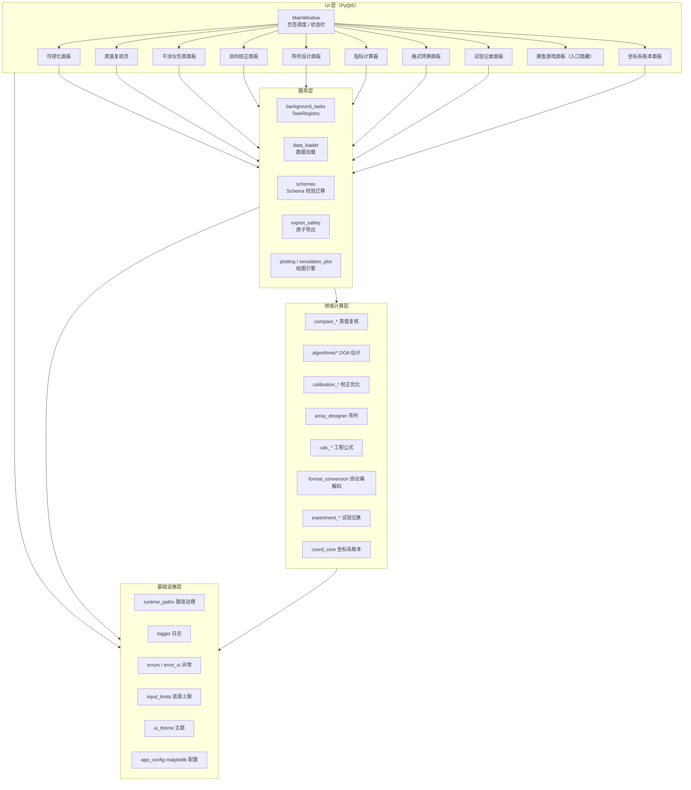
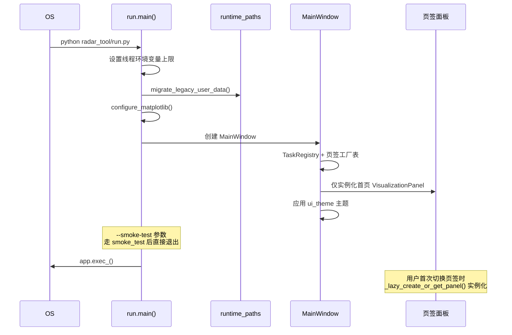

# 便携化工具箱（Portable Radar Toolbox）总体设计文档

> **适用版本**：V1.2.2（`radar_tool/__init__.py` → `__version__ = "1.2.2"`）
> **文档定位**：以实际落地实现为准的总体设计文档，描述程序的总体架构、公共基础设施、模块职责划分、构建发布与质量保障体系，并给出各子模块设计文档的索引。
> **配套文档**：各子模块详细设计见 `docs/设计文档/` 下的同级文档（见 [第 10 章 文档体系](#10-文档体系)）。

---

## 目录

- [1. 项目定位与范围](#1-项目定位与范围)
- [2. 版本演进与开发历程](#2-版本演进与开发历程)
- [3. 总体架构](#3-总体架构)
- [4. 模块清单与职责](#4-模块清单与职责)
- [5. 公共基础设施设计](#5-公共基础设施设计)
- [6. 数据与配置管理](#6-数据与配置管理)
- [7. 安全设计](#7-安全设计)
- [8. 构建、打包与发布](#8-构建打包与发布)
- [9. 测试与质量保障](#9-测试与质量保障)
- [10. 文档体系](#10-文档体系)
- [11. 已知问题与后续计划](#11-已知问题与后续计划)

---

## 1. 项目定位与范围

### 1.1 产品定位

便携化工具箱是一款面向雷达工程师与信号处理研究人员的 **桌面端工程工具集**，基于 **Python 3.11+ / PyQt5 / matplotlib** 构建，采用单窗口多页签（Tab）形态，把雷达外场试验中反复出现的"读数—处理—计算—记录—交付"工作流收敛到一个可离线运行、可 U 盘携带的程序中。

产品解决的核心问题：

1. **数据看得见**：挂飞/试验产生的多列时序数据需要快速加载、切片、过滤、多图对比和高清出图；
2. **真值可复核**：雷达测量结果需要与 GPS 真值对齐后定量评估精度；
3. **算法可预演**：干涉仪测向方案在实装前需要仿真评估 DOA 算法性能与误差敏感度；
4. **参数可标定**：测向校正参数需要从标定数据中自动寻优并按批次沉淀复用；
5. **阵列可设计**：阵列构型与加权需要快速估算方向图与关键指标；
6. **计算可复用**：天线、雷达方程、链路预算、测向精度等公式需要统一入口与单位换算；
7. **协议可转换**：TR 幅相参数在 TXT 与设备 BIN 帧格式之间需要严格互转；
8. **试验可留痕**：外场/暗室试验的步骤、数据与截图需要结构化归档并一键导出 Word 报告；
9. **坐标可治理**：多坐标系之间的变换关系需要统一登记、求解、比对与出报告（坐标系账本）。

### 1.2 设计原则

| 原则 | 在实现中的体现 |
|---|---|
| **离线单机** | 无网络依赖；数据、配置、日志全部落在本地 `var/` 或 `%APPDATA%\PortableRadarToolbox` |
| **可携带** | Nuitka `standalone` 目录型分发；冻结/源码两种运行形态由 `runtime_paths` 统一适配 |
| **启动要快** | 主窗口页签懒加载：启动只创建首页，其余页签首次切换时才初始化 |
| **计算要对** | 关键工程公式建立回归测试；2026-11 项目体检（`PROJECT_AUDIT_ACTION_PLAN.md`）系统性修正了链路预算、测向精度、阵列计算、单位换算等公式 |
| **数据要安全** | 路径穿越防护、JSON 损坏隔离与备份、输入资源上限、导出原子替换、CSV 公式注入转义、日志与弹窗敏感信息脱敏 |
| **界面不卡** | 耗时计算统一走 `background_tasks.TaskRegistry` 后台线程，支持进度、取消与关闭前有界等待 |
| **失败可诊断** | 领域异常层次 + 统一错误页面（带错误编号）+ 按日滚动日志 |

### 1.3 范围边界

**做**：单机桌面工具、本地文件读写、Word/PNG/PDF/CSV/JSON 导出、本地 JSON 持久化。
**不做**：多用户协同、服务端部署、实时数据采集、数据库、在线升级、插件市场。

---

## 2. 版本演进与开发历程

本章按时间顺序记录实际开发过程，作为各模块文档"开发演进"章节的总线索。日期取自 git 提交记录与 README「近期更新」。

### 2.1 时间线

| 时间 | 里程碑 | 主要内容 |
|---|---|---|
| 2026-07-13 | 架构解耦 | 将数据可视化处理从 `MainWindow` 拆出为独立 `VisualizationPanel`；主窗口职责收敛为页签切换与全局状态；引入页签懒加载改善冷启动 |
| 2026-07-14 | 源码入库 | git 初始化（`feat: 初始化工具源码`）；干涉仪测向仿真增强：多目标信号源、非理想因素建模（相位/幅度/位置误差、频偏）、多目标最近邻误差匹配、仿真与蒙特卡洛后台线程化 |
| 2026-08-12 | 试验记录落地 | 试验记录助手与打包前审查；数据记录与截图下沉到试验步骤内部；Word 报告按步骤输出并兼容历史未归属记录 |
| 2026-08-24 | 测向校正自动化 | 四列标定数据导入、`yy_r4_ZT`/`zz_r4_ZT` 自动优化、前后误差指标与双图对比、批次参数库、结果导出 |
| 2026-08-26 | 格式转换 | TR 幅相参数 TXT/BIN 双向转换、严格协议预检、逐帧累加和校验与数据预览 |
| 2026-08-28 | 真值复核 | 数据真值复核模块整体落地：GPS 时间域插值、粗/精两阶段对齐、多维联合剔野、批次完整导出与 UTC 字段保留 |
| 2026-11-04 | 数据安全加固 | 仓库卫生与运行时数据安全：路径穿越防护、JSON 备份/损坏隔离、输入资源限制等 |
| 2026-11-05 | 项目体检 | 生成《项目体检与整改行动计划》（`PROJECT_AUDIT_ACTION_PLAN.md`），确立 P0 数据安全与计算正确性 → P1 数值稳定与依赖 → P2 架构与发布的整改优先级 |
| 2026-11-08 | 加载提速与发布链路 | 编码/分隔符检测共享样本、单次 Pandas 解析（1 万~30 万行加载提速约 54%~75%）；放宽文本兼容性；错误诊断保留原始异常类型；GitHub Release 流水线定稿 |
| 2026-11-09 | 缺陷修复 | 常规 bug 修复 |
| 2026-11-11 | **V1.1.1 发布** | 版本号统一升至 1.1.1（`版本更新1.1.1` / `版本优化1.1.1`）；UI 布局与绘图细节优化（`plotting`/`visualization_panel` 大量改进）、试验记录 Word 导出调整、构建环境固化 |
| 2026-11-14 | **V1.2.1** | 版本号统一升至 1.2.1。**坐标系账本模块落地**（`coord_core/` + `coord_ledger_panel` + `coord_ledger_cli`，接入主窗口第 9 页签）。**v1.1.2 39 项稳定性改点全部完成**：数据保存/删除/关闭的安全防护、任务中心与状态栏进度条（`task_center.py`/`settings_store.py` 新增）、页签懒加载遮罩与失败第三态、文件大小上限（默认 512 MB）、格式转换预检指纹、阵列/指标公式统一等。**UI 视觉重设计**：设计令牌体系 + 结果卡 + 响应式页签 + 图表字体规范，详见《UI视觉规范V2.md》《信息呈现规范V2.md》。缺陷修复：坐标系账本树节点点击、matplotlib findfont 告警刷屏。 |
| 2026-11-16 | **V1.2.2** | 版本号统一升至 1.2.2。**数据可视化页签内新增「DAT 导出 TXT」并行子页**（`workspace_tabs` 双子页）：`dat2txt_core/` 移植成熟软件 `.dat` → txt 导出内核（纯标准库，GBK/CRLF/行尾空格等输出契约逐字节一致）+ `dat2txt_panel.py` PyQt5 工作区，导出完成后一键载入数据集；字段定义 `Config/receive/**.csv` 随包分发（Nuitka `--include-data-dir=Config`，`smoke_test` 校验）。**数据绘图加载取消 512 MB 文件大小上限**（`data_loader`/`preflight_excel` 不再做文件大小预检，行/列与解压上限保留，其他模块预检不变）。 |

### 2.2 演进中的关键架构决策

1. **主窗口瘦身为调度器**（2026-07-13）：早期全部 UI 堆在 `MainWindow`，后拆分为各 `*Panel`，主窗口只保留页签工厂、后台任务注册表与状态栏。这一决策使后续每个新模块都能以"一个面板 + 一个工厂方法"的代价接入。
2. **页签懒加载**（2026-07-13）：启动只实例化首页（数据可视化处理），其余页签以空白占位，首次切换才真正构建。原因是 Nuitka 打包后导入链较重，懒加载直接改善冷启动体验。
3. **后台任务统一注册**（P2 阶段）：早期各模块自建 `QThread`，关闭窗口时难以收敛。后统一为 `background_tasks.TaskRegistry`，提供注册/进度/取消/等待与"同名任务版本作废"语义。
4. **领域异常 + 敏感信息脱敏**（P0 阶段）：建立 `AppError` 层次，所有面向用户的异常文本经 `sanitize_sensitive_text` 处理；未知异常只展示错误编号，完整堆栈进日志。
5. **导出原子化**（P2 阶段）：批量导出先写临时目录再 `os.replace` 原子替换，失败时清理残留并明确报告。
6. **公式回归测试**（P0 阶段）：链路预算、测向精度、阵列参数、单位换算等建立 `tests/test_calc_link_budget.py`、`tests/test_df_accuracy.py`、`tests/test_array_param_calc.py`、`tests/test_unit_conversion.py`，防止"改 UI 顺手改错公式"。

---

## 3. 总体架构

### 3.1 分层视图



### 3.2 进程与线程模型

- **单进程**：程序为单个 PyQt5 进程，入口 `radar_tool/run.py:main()`。
- **UI 主线程**：所有控件操作在 Qt 主线程；耗时计算不得直接在主线程执行。
- **后台 Worker 线程**：`background_tasks.TaskRegistry` 统一登记 `QThread` + worker；同名同 owner 任务重新登记时旧任务标记 `stale`。
- **原生线程池限流**：启动时设置 `RADAR_TOOL_MAX_THREADS`（默认 2）及 OMP/MKL/OpenBLAS 等环境变量，`threadpoolctl` 可用时进一步钳制，避免 numpy/scipy 与 Qt 争抢 CPU 导致界面卡顿。
- **关闭收敛**：`MainWindow.closeEvent` 对活动任务发送取消请求并有界等待 3 秒；超时则拒绝关闭并列出未结束任务。

### 3.3 启动流程



关键代码路径：

1. `run.py` 先固化线程环境变量，再解析资源路径（`runtime_paths`），设置 `MPLCONFIGDIR` 到用户数据目录；
2. `migrate_legacy_user_data()` 把历史遗留的 `日志/`、`测向校正/`、`试验数据/`、`.matplotlib_cache/` 迁入当前用户数据根；
3. `MainWindow._init_ui()` 建立 `_tab_factories` / `_tab_names` / `_tab_panels` / `_tab_loaded` 四张平行表；索引 0 立即创建，其余占位；
4. `_on_tab_changed(index)` 首次进入时调用工厂，成功后用真实面板替换占位页；失败则保留原页并显示内联错误页（`_tab_failed` 第三态，含重试按钮，不跳回首页——G-02，V1.1.2）。

---

## 4. 模块清单与职责

### 4.1 功能页签（用户可见模块）

| # | 页签 | 面板类 | 主要源码 | 设计文档 |
|---|---|---|---|---|
| 1 | 数据可视化处理 | `VisualizationPanel` | `visualization_panel.py`、`dat2txt_panel.py`、`dat2txt_core/`、`data_loader.py`、`models.py`、`plotting.py` | 《数据可视化处理设计文档》 |
| 2 | 数据真值复核 | `CompareAnalysisMixin`（混入 `MainWindow`） | `compare_analysis/core/data/export/plot/workers.py`、`alignment.py` | 《数据真值复核设计文档》（原《挂飞数据处理》） |
| 3 | 干涉仪测向仿真 | `InterferometerSimPanel` | `interferometer_sim.py`、`simulation_*.py`、`algorithms/doa_estimation.py` | 《干涉仪测向仿真工具设计文档》 |
| 4 | 测向校正自动化 | `CalibrationPanel` | `calibration_panel.py` 及 `calibration_*.py` | 《测向校正自动化脚本》 |
| 5 | 阵列设计助手 | `ArrayDesignerPanel` | `array_designer.py`（自带阵列模板生成，不依赖 `algorithms/array_geometry.py`） | 《阵列设计助手设计文档》 |
| 6 | 指标计算器 | `CalcPanel` | `calc_panel.py`、`calc_ui.py`、`calc_formulas.py`、`calc_units.py` | 《指标计算器合集设计文档》 |
| 7 | 格式转换 | `FormatConversionPanel` | `format_conversion_panel.py`、`format_conversion.py` | 《格式转换设计文档》 |
| 8 | 试验记录助手 | `ExpRecorderPanel` | `exp_recorder.py`、`experiment_*.py` | 《试验记录助手设计文档》 |
| 9 | 坐标系账本 | `CoordinateLedgerPanel` | `coord_ledger_panel.py`、`coord_core/*`、`coord_ledger_cli.py` | 《坐标系账本设计文档》 |
| 10 | 摸鱼游戏 | `GamePanel` | `game_panel.py` | 《摸鱼游戏栏设计文档》 |

> **页签 10（摸鱼游戏）默认不显示**：由设置项 `ui/show_game_tab`（`settings_store.py`，默认 `false`）控制（GM-01，V1.2.1）。代码与文档保留，开启设置即可显示。README 功能表仍列出该模块。

### 4.2 模块接入约定

新增功能页签需完成三件事，即可挂进主窗口：

1. **实现面板类**：构造函数签名为 `XxxPanel(parent)`，内部通过 `parent.task_registry` 登记后台任务（有则用，无则自建线程并保持可取消）；
2. **在 `main_window.py` 增加工厂方法** `_create_xxx_tab(self)`，函数内再 `from .xxx import XxxPanel`（保持懒加载，避免顶层 import 拖慢启动）；
3. **登记到 `_tab_factories` 与 `_tab_names`**，两表索引一一对应；`_tab_panels`/`_tab_loaded` 自动按长度适配。

### 4.3 模块间共享与复用

| 共享资产 | 提供方 | 使用方 |
|---|---|---|
| `data_loader` 文本/Excel 加载与列名匹配 | 服务层 | 可视化、真值复核、校正、格式转换等 |
| `schemas` Schema 校验 | 服务层 | 试验记录（`ProjectRecord`）、校正（`CalibrationConfig`）、真值复核（`TruthReviewConfig`） |
| `export_safety` 原子导出与 CSV 转义 | 服务层 | 真值复核批次导出、试验记录、校正结果导出 |
| `background_tasks.TaskRegistry` | 服务层 | 真值复核、干涉仪仿真、测向校正、可视化大数据加载等 |
| `errors` / `error_ui` | 基础层 | 全模块 |
| `logger` | 基础层 | 全模块 |
| `input_limits` 预检 | 基础层 | 所有文件导入入口 |
| `algorithms/array_geometry.py` | 领域层 | 干涉仪仿真（阵列设计助手另有独立的模板生成实现） |
| `calc_units.py` 单位换算 | 领域层 | 指标计算器，并被真值复核/校正/坐标系账本（`coord_core/conventions.py`）等复用 |

---

## 5. 公共基础设施设计

### 5.1 路径治理 `runtime_paths.py`

统一回答"文件该放哪"，屏蔽源码运行与 Nuitka 冻结运行的差异。

| 函数 | 语义 |
|---|---|
| `is_frozen()` | 是否为冻结/编译形态（`sys.frozen` 或 `sys.__compiled__`） |
| `get_bundle_root()` | 资源根：冻结时为可执行文件目录（或 `_MEIPASS`），源码时为仓库根 |
| `get_launcher_dir()` | 启动器目录，用于定位随附资源 |
| `get_user_data_root()` | 用户数据根：冻结时 `%APPDATA%\PortableRadarToolbox`，源码时 `<repo>/var` |
| `get_user_data_dir(*parts)` | 在用户数据根下安全拼接并创建子目录；拒绝 `..`、绝对路径、分隔符逃逸（`_safe_join` + `realpath` 边界校验） |
| `get_resource_path(*parts)` | 读取随附资源（如 `image/rose.ico`），同样走安全拼接 |
| `migrate_legacy_user_data()` | 启动时把旧位置的 `日志/`、`测向校正/`、`试验数据/`、`.matplotlib_cache/` 迁入新的用户数据根；迁移失败保留原文件不删除 |

**设计要点**：所有运行时写入都必须经 `get_user_data_dir`，杜绝各模块自行拼接路径造成的穿越与不一致；用户数据目录结构为：

```
var/  (或 %APPDATA%\PortableRadarToolbox\)
├── 日志/                  # 运行日志（按日文件 + 轮转）
├── 测向校正/              # 校正批次参数库
├── 试验数据/              # 试验记录与截图
├── 坐标系账本/            # 账本工作区数据
└── .matplotlib_cache/     # matplotlib 缓存（MPLCONFIGDIR）
```

### 5.2 日志系统 `logger.py`

- 根 logger 名 `radar_tool`，DEBUG 全量进文件、INFO 以上进控制台；
- 文件：`<用户数据根>/日志/运行日志_YYYYMMDD.log`，`RotatingFileHandler` 单文件 5 MB、保留 5 份；
- `SafeFormatter` 在格式化前调用 `sanitize_sensitive_text`，确保日志本身不落敏感路径与原始长数据序列；
- 各模块通过 `get_logger('<模块名>')` 获取子 logger，名称按模块划分（`main_window`、`calibration` 等），便于过滤定位。

### 5.3 异常体系 `errors.py` / `error_ui.py`

```
Exception
└── AppError(code="app_error")            # 面向用户的领域异常基类
    ├── ValidationError(code="validation_error")   # 输入/Schema/参数校验失败（同时继承 ValueError）
    │   └── DataLimitError(code="data_limit_error") # 超出资源或数据量限制
    │       └── InputResourceError                  # input_limits 预检抛出
    └── ExportError(code="export_error")            # 导出/持久化失败
        └── BatchExportError                        # 批量导出失败（含残留文件清单）
```

处理约定：

- **可预期的领域/参数错误**：抛 `AppError` 子类，`handle_ui_exception` 弹出 `QMessageBox.warning` 并显示安全文本；
- **未知异常**：`handle_ui_exception` 生成 12 位 `error_id` 弹统一错误页面，完整堆栈经脱敏后写日志；`install_global_error_handler` 兜底 `sys.excepthook`；
- **脱敏规则** `sanitize_sensitive_text`：替换绝对路径/文件 URL 为 `<文件路径>`，连续 5 个以上数值序列替换为 `<原始数据已隐藏>`，超长截断。

### 5.4 后台任务 `background_tasks.py`

核心类型：

- `TaskPhase`：`queued → running → (progress)* → succeeded | failed | cancelled`，另有 `cancel_requested` 中间态；
- `TaskSnapshot`：不可变快照（任务 id、名称、阶段、进度、消息、是否完成、结果、错误、版本号、是否 stale），UI 只读快照不直接碰 worker；
- `TaskRegistry`：QObject + 信号（`task_started/progress/succeeded/failed/cancel_requested/cancelled/completed`），按 owner 过滤活动任务。

关键语义：

1. `register(name, owner, thread, worker, cancel_callback)` 登记未启动的 Worker/QThread；
2. **同名任务版本化**：同 owner 同 name 再次登记时，旧记录标记 `stale`，防止旧回调污染新结果；
3. `cancel_active(owner)` 广播取消请求（worker 协作式响应 `cancel_callback`）；
4. `wait_for_tasks(owner, timeout_ms)` 有界等待，供关闭窗口收敛；
5. `describe(snapshot)` 生成状态栏可读文本，`MainWindow._on_background_task_event` 直接消费。

线程池限流见 [3.2 节](#32-进程与线程模型)。

### 5.5 输入资源预检 `input_limits.py`

在 pandas/Excel 真正分配内存之前拦截超限输入：

| 限制项 | 默认上限 |
|---|---|
| 文本表行数 `MAX_ROWS` | 1,000,000 |
| 列数 `MAX_COLUMNS` | 10,000 |
| 样本数 `MAX_SAMPLES` | 1,000,000 |
| BIN 帧数 `MAX_BIN_FRAMES` | 24 |
| Excel 工作表数 `MAX_EXCEL_SHEETS` | 16 |
| Excel 解压总大小 `MAX_EXTRACTED_SIZE` | 200 MB |

`preflight_text_table` 逐行计数并探测列数（支持 UTF-8-SIG / GB18030）；`preflight_excel` 对 XLSX 直接解析 zip 内 worksheet XML 计数，对 XLS 走 `xlrd` 只读预检。超限抛 `InputResourceError`（`DataLimitError` 子类）。

### 5.6 导出安全 `export_safety.py`

- `write_dataframe_csv` / `sanitize_dataframe_for_csv`：对以 `= + - @` 开头的单元格与表头加 `'` 前缀，阻断 CSV 公式注入；
- `build_export_metadata`：统一附加 `version / schema_version / generated_at / input_summary / parameters` 溯源元数据；
- `atomic_export_batch(target_dir, writer)`：先在同级临时目录 `.name.tmp-xxxx` 写完整批次，成功后 `os.replace` 原子替换；失败清理临时目录，清理失败则抛 `BatchExportError` 并列出残留相对路径。

### 5.7 主题与出图规范 `ui_theme.py` / `app_config.py`

- `MAIN_STYLESHEET` / `STATUSBAR_STYLE`：统一 Fusion 风格下的控件样式（页签、按钮、表格、滚动条等）；
- `MATPLOTLIB_RC_PARAMS`：出图字体规范——西文 Times New Roman、中文宋体（`SimSun`/`STSong`）逐级回退；`savefig.dpi=600`、`figure.dpi=160`、`pdf.fonttype=42`（嵌入 Type-42 字体）；
- 颜色循环 `COLORS` 12 色、线型循环 `LINESTYLES` 4 种，供各绘图面板统一取用。

---

## 6. 数据与配置管理

### 6.1 Schema 体系 `schemas.py`

`SCHEMA_VERSION = 1`，三类显式 Schema 与迁移入口：

| Schema | 载体 | 用途 |
|---|---|---|
| `ProjectRecord` | `试验数据/experiments.json` | 试验项目 → 任务 → 记录（含步骤、数据、截图）的树形结构 |
| `CalibrationConfig` | `测向校正/` 下 JSON | 校正批次：数据路径、固定几何参数、3×3 变换矩阵、优化初值、备注 |
| `TruthReviewConfig` | 批次导出 `09_复核配置.json` | 真值复核的维度、时间参数、阈值、对齐结果配置 |

共同机制：`validate_schema` 结构校验（类型、ID 字符集 `[A-Za-z0-9_-]{1,128}`、数值有限性、JSON 嵌套深度 ≤64）、`migrate_json_schema` 版本迁移；校验失败抛 `ValidationError`。

### 6.2 持久化可靠性

1. **损坏隔离**：JSON 解析失败时原文件改名为 `.corrupt-<时间戳>`，不静默覆盖；
2. **备份回滚**：每次成功保存前保留最近一次有效 `.bak`；
3. **逐条容错**：`CalibrationBatchStore._load` 对非法单条配置记录警告并跳过，不让整页加载失败；
4. **体量限制**：JSON 文件大小与嵌套深度受限；
5. **原子替换**：批量导出走 `export_safety.atomic_export_batch`，单文件输出采用临时文件 + `os.replace`。

### 6.3 输入数据格式

- **文本**：TXT/CSV/DAT/LOG，自动识别 UTF-8 / UTF-8 BOM / GB18030；分隔符支持逗号、分号、中文逗号、制表符、空格；引号内分隔符、行尾差异、缺字段短行补空值；
- **Excel**：XLSX（openpyxl）与 XLS（xlrd）；
- **列名文件**：非空行逐行读取；列名少于数据列自动补 `列--N`，多于则忽略；
- **二进制**：TR 幅相 BIN（270 字节/帧，详见格式转换模块文档）。

> 设计立场：**不要依赖列名顺序推断业务含义**，字段关联由用户在界面显式选择（如真值复核的"复核项目与字段映射"）。

---

## 7. 安全设计

面向"内网工程软件被误用/误操作"的威胁模型，重点防数据破坏与信息泄露，不涉及网络攻击面（程序无网络功能）。

| 风险 | 对策 | 落点 |
|---|---|---|
| 路径穿越（恶意项目/记录 ID） | ID 字符集白名单；`_safe_join` + `realpath` 边界校验；图片仅存相对路径 | `runtime_paths`、`exp_recorder`、`schemas` |
| 符号链接/特殊设备越界 | 加载与导出前统一安全路径解析并拒绝 | `exp_recorder` |
| 恶意图片 | 复制前限制大小、像素数、支持格式并校验魔数 | `experiment_images` |
| JSON 炸弹 | 嵌套深度 ≤64、文件大小上限 | `schemas` |
| 资源耗尽（超大表） | `input_limits` 预检 | 全部导入入口 |
| CSV 公式注入 | 危险前缀转义 | `export_safety` |
| 敏感信息进日志/弹窗 | `sanitize_sensitive_text` 路径与数据序列脱敏 | `errors`、`logger` |
| 导出中途失败留半成品 | 临时目录 + 原子替换 + 残留报告 | `export_safety` |
| 用户数据被误删 | 迁移不删源文件；保存前 `.bak`；损坏文件改名保留 | `runtime_paths`、持久化层 |

---

## 8. 构建、打包与发布

### 8.1 运行环境

- Python 3.11+（CI 验证 3.11、3.12；发布构建固定 **CPython 3.12.7 64 位**，见 `build-environment.json`）；
- 运行依赖：PyQt5、matplotlib、numpy、pandas、scipy、openpyxl、python-docx、xlrd（`requirements.txt` → `requirements.lock` 精确锁定 + SHA256 校验 `scripts/verify_lock_hash.py`）；
- 开发依赖：ruff、mypy、pip-audit、pytest（`requirements-dev.txt`）。

### 8.2 Nuitka 打包

- **仅使用 `standalone` 目录型分发**，不使用 `onefile`：避免每次启动解压临时文件，启动更稳定更快；
- 构建脚本 `packaging/nuitka/build.ps1`，验证脚本 `packaging/nuitka/verify_release.ps1`；
- 固定构建环境：Python 3.12.7、MSVC 14.3、Nuitka 4.1.3；
- **正式构建必须提供可信代码签名证书**（`-CertificateThumbprint`）；`-SkipTests -AllowUnsigned` 仅限本地链路验证，产物禁止发布；
- 输出统一到 `artifacts/`（`bin/`、`nuitka/`、`reports/`，已被 gitignore）。

### 8.3 发布流水线

`.github/workflows/release.yml` 在 `v*` 标签或手动触发时执行：

1. 从锁定依赖重建环境；
2. 全量测试；
3. Nuitka standalone 构建；
4. 全 PE 文件 Authenticode 签名；
5. 隔离安装与离线启动冒烟（`--smoke-test`）；
6. Qt/字体/图标/Excel/Word 资源检查；
7. SBOM、第三方清单、构建清单、SHA256；
8. Windows Defender 恶意软件扫描；
9. GitHub Release 发布。

需要配置密钥：`WINDOWS_CERTIFICATE_BASE64`、`WINDOWS_CERTIFICATE_PASSWORD`。

CI 另有 `.github/workflows/tests.yml` 负责日常测试。

### 8.4 冒烟测试

`radar_tool/smoke_test.py` + `python radar_tool/run.py --smoke-test`：在打包产物上做最小启动验证（面板可创建、资源可定位），配合 `tests/test_packaging_smoke.py`、`tests/test_release_pipeline.py` 覆盖发布链路。

---

## 9. 测试与质量保障

### 9.1 测试清单（`tests/`）

| 测试文件 | 覆盖范围 |
|---|---|
| `test_schema_and_errors.py` | Schema 校验、异常层次、脱敏 |
| `test_runtime_safety.py` | 路径安全、运行时数据保护（体量最大之一） |
| `test_input_fuzzing.py` | 异常输入模糊 |
| `test_data_loader_formats.py` | 多格式/编码/分隔符加载 |
| `test_background_tasks.py` | 后台任务注册、取消、版本作废 |
| `test_export_safety.py` | 原子导出、CSV 转义 |
| `test_qt_panels.py` | 各面板基础可构建性 |
| `test_unit_conversion.py` | 单位换算 |
| `test_calc_link_budget.py` / `test_df_accuracy.py` / `test_array_param_calc.py` | 工程公式回归 |
| `test_array_designer.py` | 阵列设计 |
| `test_doa_algorithms.py` | DOA 算法 |
| `test_calibration.py` / `test_calibration_panel.py` | 测向校正 |
| `test_format_conversion.py` / `test_format_conversion_panel.py` | 格式转换协议 |
| `test_experiment_screenshots.py` | 试验截图安全 |
| `test_coord_ledger.py` | 坐标系账本（含 `tests/data/golden_ledger.json` 黄金样本） |
| `test_truth_review.py` / `test_truth_review_panel.py` | 真值复核 |
| `test_packaging_smoke.py` / `test_release_pipeline.py` | 打包与发布 |

基线（2026-11-05 体检）：`pytest -q -W error` 全绿、`compileall` 通过、`mypy --ignore-missing-imports` 51 个源文件通过、`pip check` 正常。

### 9.2 质量门禁

- **静态检查**：ruff（`pyproject.toml` 配置 `line-length=100`，扩展规则 E9/F63/F7/F82）、mypy；
- **依赖供应链**：`requirements.lock` + SHA256、`pip-audit`；
- **发布门禁**：见 [8.3 节](#83-发布流水线)，签名、冒烟、资源检查、SBOM、杀毒扫描缺一不可。

---

## 10. 文档体系

设计文档统一存放于 `docs/设计文档/`，定位为 **以实际落地实现为准** 的工程文档（非空想型提案）。

| 文档 | 对应模块 | 说明 |
|---|---|---|
| 《便携化工具箱总体设计文档》 | 全局 | 本文档 |
| 《数据可视化处理设计文档》 | 页签 1 | 数据加载、切片、过滤、多图绘图与导出、dat 导出 txt 子页 |
| 《数据真值复核设计文档》 | 页签 2 | GPS 插值、两阶段对齐、多维剔野、批次导出（原名《挂飞数据处理》） |
| 《干涉仪测向仿真工具设计文档》 | 页签 3 | 阵列配置、DOA 算法、蒙特卡洛与误差评估 |
| 《测向校正自动化脚本》 | 页签 4 | 标定导入、yy/zz 优化、批次参数库 |
| 《阵列设计助手设计文档》 | 页签 5 | 阵列构型、方向图与指标 |
| 《指标计算器合集设计文档》 | 页签 6 | 天线/雷达/链路/测向公式与单位换算 |
| 《格式转换设计文档》 | 页签 7 | TR 幅相 TXT/BIN 协议编解码 |
| 《试验记录助手设计文档》 | 页签 8 | 试验项目/任务/记录与 Word 报告 |
| 《坐标系账本设计文档》 | 页签 9 | 坐标系/变换登记、求解、比对、报告 |
| 《摸鱼游戏栏设计文档》 | 页签 10 | 内置休闲游戏（默认隐藏，设置项 `ui/show_game_tab` 开启） |
| 《坐标系账本需求论证意见》 | 页签 9 配套 | 历史需求论证记录（保留原文，不随实现改写） |
| 《UI视觉规范V2》 | 全局视觉 | 设计令牌（色阶/语义色/图表色板/字阶/间距）、组件 QSS 规范、禁止清单与迁移映射（V1.2.1） |
| 《信息呈现规范V2》 | 全局输出 | 信息四层模型、数值格式硬规则、ResultCard API 契约、场景与布局宽度公式（V1.2.1） |

各子模块文档统一采用如下章节模板，便于交叉引用与维护：

1. 背景与目标　2. 总体架构　3. 数据模型　4. 功能与算法设计　5. 界面与交互　6. 关键实现与开发演进　7. 测试与验收　8. 已知问题与后续计划

---

## 11. 已知问题与后续计划

### 11.1 已知限制

1. **摸鱼游戏默认隐藏**：功能完整但页签默认不显示，由设置项 `ui/show_game_tab` 开启（GM-01，V1.2.1）；
2. **数据真值复核以 Mixin 形式挂在 `MainWindow`**：状态字段（`compare_*`）仍在主窗口实例上，尚未完全面板化，是后续拆分候选；
3. **坐标系账本较新**：功能已接入但文档与黄金样本测试仍在持续完善；
4. **单机单进程**：无并发多开保护，同一用户数据目录多实例写入有覆盖风险；
5. **Excel 旧格式**：XLS 依赖 `xlrd>=2.0.1`，仅支持读取。

### 11.2 后续方向

1. 真值复核 Mixin → 独立面板（延续"主窗口瘦身"路线）；
2. 指标计算器参数扫描、历史记录等高级特性的增量落地（见该模块文档）；
3. 打包发布操作流程的持续固化（`PROJECT_AUDIT_ACTION_PLAN.md` 步骤 16）；
4. 各模块用户文档（操作手册）与本设计文档体系分离建设。

---

*本文档与代码同步维护：当模块职责、公共接口或发布流程变化时，应同步更新本文档及对应子模块文档。*
