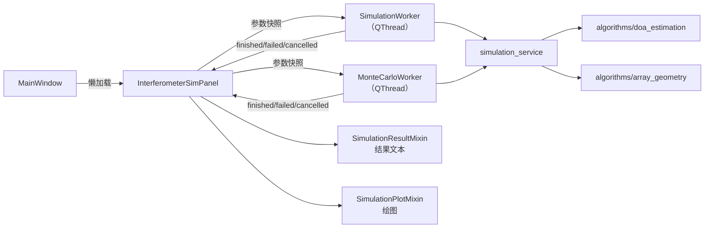
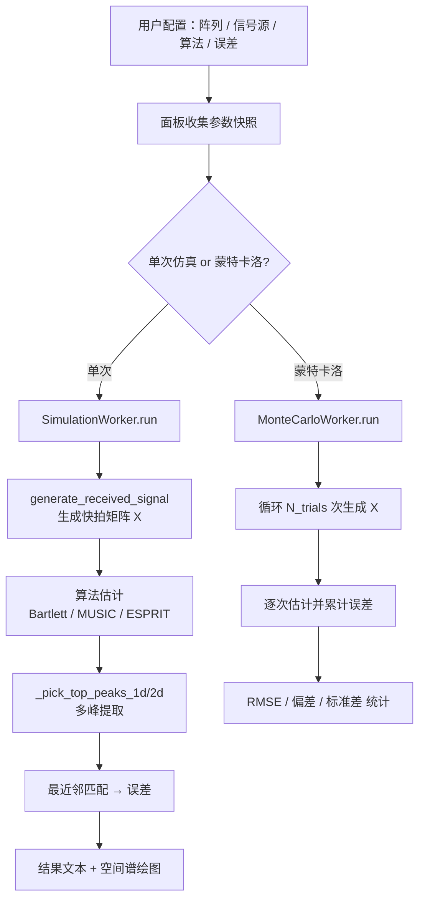

# 干涉仪测向仿真工具设计文档

> **适用版本**：V1.1.1
> **主要源码**：`radar_tool/interferometer_sim.py`、`radar_tool/simulation_service.py`、`radar_tool/simulation_results.py`、`radar_tool/simulation_plot.py`、`radar_tool/algorithms/doa_estimation.py`、`radar_tool/algorithms/array_geometry.py`
> **所属页签**：干涉仪测向仿真（主窗口第 3 页，懒加载）
> **文档定位**：以实际落地实现为准的工程设计文档。理论部分沿用立项时的阵列信号处理推导；界面与功能描述全部对应 V1.1.1 真实代码。

---

## 目录

- [1. 背景与目标](#1-背景与目标)
- [2. 总体架构](#2-总体架构)
- [3. 数据模型](#3-数据模型)
- [4. 功能与算法设计](#4-功能与算法设计)
- [5. 界面与交互](#5-界面与交互)
- [6. 关键实现与开发演进](#6-关键实现与开发演进)
- [7. 测试与验收](#7-测试与验收)
- [8. 已知问题与后续计划](#8-已知问题与后续计划)

---

## 1. 背景与目标

### 1.1 业务背景

干涉仪测向是雷达/侦察系统中常用的测角手段：利用多个天线阵元接收同一来波信号，通过阵元间的**相位差**反推来波方向。工程设计阶段面临的问题是——阵列构型（阵元数、间距、排布）、算法选择（Bartlett / MUSIC / ESPRIT）与非理想因素（幅相误差、位置误差、频偏）对测向精度的影响，只能靠反复试算评估。

在没有本模块之前，工程师通常在 MATLAB 中手写脚本仿真，参数改动、结果对比、多目标场景复现都不方便。本模块把这些工作收敛为一个图形化仿真面板：**配置阵列与信号 → 一键仿真 → 看空间谱与误差 → 蒙特卡洛统计**。

### 1.2 设计目标

1. 支持线阵、L 阵、圆阵、矩形面阵与自定义坐标阵列的可视化配置；
2. 支持多目标信号源（方位、俯仰、频率、幅度、SNR 独立可调）；
3. 内置 Bartlett、MUSIC、ESPRIT 三种经典 DOA 估计算法，支持 1D/2D 空间谱搜索；
4. 支持阵元相位误差、幅度误差、位置误差、频率偏差等非理想因素的随机建模；
5. 多目标场景下按**最近邻匹配**计算误差，避免谱峰强度排序造成目标错配；
6. 支持蒙特卡洛统计评估，且全部耗时计算在后台线程执行，界面可随时取消。

### 1.3 范围边界

**做**：软件数值仿真、算法性能评估、空间谱可视化、蒙特卡洛统计。
**不做**：硬件采集、实时处理、阵列校正、外场数据回放（外场数据走"数据可视化/真值复核"模块）。

---

## 2. 总体架构

### 2.1 在工具箱中的位置

主窗口通过页签工厂懒加载 `InterferometerSimPanel`（`main_window.py` 的 `_create_interferometer_tab`）。面板构造时从父窗口取得 `task_registry`（`background_tasks.TaskRegistry`）用于登记后台任务；耗时计算（单次仿真、蒙特卡洛）不在 UI 线程执行。

### 2.2 模块结构

| 文件 | 类/函数 | 职责 |
|---|---|---|
| `interferometer_sim.py` | `InterferometerSimPanel` | 主面板：参数配置 UI、阵列预览、发起仿真/蒙特卡洛、结果展示、任务清理 |
| 同上（继承） | `SimulationResultMixin` | 测向结果与误差文本格式化（`simulation_results.py`） |
| 同上（继承） | `SimulationPlotMixin` | 阵列 3D 布局、1D/2D 空间谱绘制（`simulation_plot.py`） |
| `simulation_service.py` | `SimulationWorker` | 单次仿真的后台执行体：生成信号 → 估计 DOA → 峰值提取 |
| 同上 | `MonteCarloWorker` | 蒙特卡洛后台执行体 |
| 同上 | `_pick_top_peaks_1d/2d` | 谱峰提取（带最小间隔约束） |
| `algorithms/doa_estimation.py` | `compute_array_manifold_2d` | 二维阵列流形 |
| 同上 | `generate_received_signal` | 多目标信号 + 噪声 + 非理想因素生成 |
| 同上 | `bartlett_doa_1d/2d`、`music_doa_1d/2d`、`esprit_doa` | DOA 估计算法 |
| 同上 | `monte_carlo_evaluation` | 可复现的蒙特卡洛评估 |
| 同上 | `_apply_array_imperfections` | 非理想因素注入 |
| `algorithms/array_geometry.py` | `create_ula/uca/l_array/rect_array` | 标准阵列几何生成与校验 |

### 2.3 数据流与处理流程

---

## 3. 数据模型

### 3.1 阵列配置

阵元坐标在内部统一为 **N×2 的 `numpy` 数组，列为 Y、Z 坐标（单位：米）**（`_validate_array` 强制校验：二维、两列、有限、无重复阵元）。

| 配置项 | 类型 | 说明 |
|---|---|---|
| 阵列类型 | 枚举 | 均匀线阵（ULA）/ 均匀圆阵（UCA）/ L 型阵列 / 矩形面阵 / 自定义坐标 |
| 阵元数 / 间距 / 半径 | 浮点 | 由 `array_geometry` 校验为正有限数 |
| 自定义坐标 | 表格 | 用户逐行录入或 CSV 导入，`_coords_table_apply` 应用前统一校验 |
| 载频 `fc` | 浮点（Hz） | 决定波长 λ = c / f，c = 3.0e8 m/s（`SPEED_OF_LIGHT_M_PER_S`） |

阵列几何生成函数（`algorithms/array_geometry.py`）：

| 函数 | 生成规则 |
|---|---|
| `create_ula(N, d)` | N≥2 个阵元沿 Y 轴等距排布，间距 d |
| `create_uca(N, radius)` | N≥2 个阵元均匀分布在半径圆周上（X-Y 平面） |
| `create_l_array(N_x, N_y, d)` | X 轴 N_x 个 + Y 轴 N_y-1 个（共原点），构成 L 型 |
| `create_rect_array(N_rows, N_cols, dx, dy)` | 网格面阵，行列间距 dx/dy |

### 3.2 信号源配置（多目标）

每个信号源可独立配置，支持表格增删行（`_add_target_row` / `_remove_target_row` / `_sync_target_rows`）：

| 字段 | 含义 | 默认 |
|---|---|---|
| `theta` | 方位角（度） | 0 |
| `phi` | 俯仰角（度） | 0 |
| `amp` | 信号幅度 | 1.0 |
| `freq` | 信号频率（Hz） | 按目标序号递增默认 |
| `snr` | 该目标 SNR（dB） | 空 = 使用全局 SNR |

`_normalize_signal` 同时接受 dict 与序列两种输入形式，统一归一化为 dict 并逐字段做有限性校验。

### 3.3 非理想因素配置

`get_imperfections()` 返回 dict，`_apply_array_imperfections` 消费：

| 键 | 含义 | 注入方式 |
|---|---|---|
| `pos_enabled` / `pos_std` | 位置误差 | 阵元坐标叠加 N(0, pos_std) 高斯扰动（米） |
| `amp_enabled` / `amp_std_db` | 幅度误差 | 阵元增益乘以 10^(N(0,σ)/20) |
| `phase_enabled` / `phase_std_deg` | 相位误差 | 阵元增益乘以 exp(j·N(0,σ)°) |
| `freq_enabled` / `freq_offset_std` | 频率偏差 | 信号频率叠加 N(0,σ) 偏移（Hz） |

随机源由 `numpy.random.Generator` 提供，支持 `seed` 传入以复现实验（蒙特卡洛的可复现性依赖这一点）。

### 3.4 仿真结果结构

`SimulationWorker.run` 最终 emit `finished(dict)`，典型键包括：

| 键 | 内容 |
|---|---|
| `theta_est` / `phi_est` | 估计角度（1D 只有 theta） |
| `peaks` | 多峰提取结果（角度列表） |
| `P` / `thetas` / `phis` | 空间谱矩阵与坐标轴（供绘图） |
| `matched_errors` | 最近邻匹配后的误差 |
| `signals` / `algo_name` | 回显配置，便于结果面板显示 |

蒙特卡洛结果为误差序列的统计量（见 [4.6 节](#46-蒙特卡洛评估)）。

---

## 4. 功能与算法设计

### 4.1 干涉仪测向原理

相关干涉仪利用多个天线间的**相位差**测量来波方向。对于间距为 d 的两个天线：

\[
\Delta\varphi = \frac{2\pi d \sin\theta}{\lambda}
\]

其中 Δφ 为天线间相位差，θ 为来波方位角，λ 为信号波长。

**二维扩展**：对于平面阵列，来波方向由方位角 θ 和俯仰角 φ 共同决定。第 m 个阵元（坐标 (y_m, z_m)，本模块的 Y-Z 平面约定）相对参考阵元的波程差为：

\[
\tau_m = \frac{y_m \cos\phi\sin\theta + z_m \sin\phi}{c}
\]

对应的相位差：

\[
\Delta\varphi_m = \frac{2\pi}{\lambda}\left(y_m \cos\phi\sin\theta + z_m \sin\phi\right)
\]

工作流程：**接收信号 → 阵列流形 → 空间谱/子空间估计 → DOA 输出**。

### 4.2 阵列流形计算

实现函数：`compute_array_manifold_2d(array_pos, theta_deg, phi_deg, fc)`。

阵列流形向量（导向矢量）定义为：

\[
\mathbf{a}(\theta,\phi) = \exp\left(j\cdot\left[-\frac{2\pi}{\lambda}\left(y_m \cos\phi\sin\theta + z_m \sin\phi\right)\right]_{m=1}^{N}\right)
\]

实现要点：

1. 角度输入为**度**，内部转弧度；载频必须为正有限数；
2. 方向余弦：`dir_y = cos(φ)·sin(θ)`，`dir_z = sin(φ)`；
3. 输出形状为 **N×1 复列向量**，便于与快拍矩阵做二次型运算；
4. 阵元坐标经 `_validate_array` 校验（N×2、无重复、有限），奇异阵列直接拒绝。

### 4.3 信号生成

实现函数：`generate_received_signal(array_pos, signals, fc, fs, T, SNR, imperfections, seed, rng)`。

生成模型：

\[
\mathbf{X} = \mathbf{A}\mathbf{S}^T + \mathbf{N}
\]

- **源信号**：第 k 个目标 \(s_k(t) = a_k \exp\big(j(2\pi f_k t + \varphi_{0k})\big)\)，初相 \(\varphi_{0k}\) 均匀随机；
- **快拍数**：\(N_{samples} = T \times f_s\)，至少 1 个；
- **非理想因素**：按 [3.3 节](#33-非理想因素配置) 在阵元坐标、阵元增益、信号频率上注入；
- **噪声功率**：按逐目标 SNR 反推——先算每个目标分量功率 \(\|\mathbf{a}_k s_k\|^2\) 的均值除以线性 SNR，累加得噪声功率；若不可行则退化为用总信号功率与全局 SNR 估计；
- **复高斯噪声**：\(\sqrt{P_n/2}\,(\mathcal{N}(0,1) + j\mathcal{N}(0,1))\)；
- **校验**：生成后检查 X 全部有限，否则抛 `DoaValidationError`。

### 4.4 DOA 估计算法

#### 4.4.1 协方差矩阵与子空间

\[
\hat{\mathbf{R}} = \frac{1}{K}\mathbf{X}\mathbf{X}^H,\quad \hat{\mathbf{R}} \leftarrow \frac{\hat{\mathbf{R}} + \hat{\mathbf{R}}^H}{2}
\]

`_hermitian_subspaces` 对 \(\hat{\mathbf{R}}\) 做特征分解（`numpy.linalg.eigh`），特征值降序排列，前 \(N_{signals}\) 个张成信号子空间，其余张成噪声子空间。**数值防护**：若噪声子空间特征值相对最大特征值 ≤ 1e-12，判定"噪声子空间为零或不可分辨"，拒绝执行 MUSIC（防止除零与伪峰）。

#### 4.4.2 Bartlett 波束形成（1D/2D）

\[
P_{\text{Bartlett}}(\theta) = \frac{\left|\mathbf{a}^H(\theta)\,\hat{\mathbf{R}}\,\mathbf{a}(\theta)\right|}{N^2}
\]

- 1D：`bartlett_doa_1d` 在 φ 固定下扫描 θ，返回谱峰角度、谱向量与扫描轴；
- 2D：`bartlett_doa_2d` 对 (θ, φ) 网格双循环，返回 `P[phi_idx, theta_idx]` 矩阵与最大值位置。

#### 4.4.3 MUSIC（1D/2D）

\[
P_{\text{MUSIC}}(\theta) = \frac{1}{\left|\mathbf{a}^H(\theta)\,\mathbf{E}_n\mathbf{E}_n^H\,\mathbf{a}(\theta)\right|}
\]

实现要点：分母取绝对值并与 `numpy.finfo(float).eps` 取 `max` 防止除零；信号数 `N_signals` 必须满足 `0 < N_signals < N_ant`。

#### 4.4.4 ESPRIT（均匀线阵）

`esprit_doa(X, d, fc, N_signals)`：

1. 由信号子空间 \(\mathbf{E}_s\) 取移位不变结构：\(\mathbf{U}_1 = \mathbf{E}_s[:-1,:]\)，\(\mathbf{U}_2 = \mathbf{E}_s[1:,:]\)；
2. \(\mathbf{\Phi} = \mathbf{U}_1^{+}\mathbf{U}_2\)（伪逆）；
3. 特征值相位 → \(\sin\theta = \frac{\angle(\mu)\,\lambda}{2\pi d}\)；
4. 对 \(\sin\theta\) 做 `np.clip(…, -1, 1)` 后 `arcsin`，**不可观测角度裁剪**而非报错；
5. `matrix_rank(U1) < N_signals` 时抛 `DoaValidationError('ESPRIT 信号子空间不可解')`。

> 限制：ESPRIT 仅适用于均匀线阵（需已知阵元间距 d），不支持任意二维阵列。

#### 4.4.5 扫描轴生成

`_scan_axis(scan_range, step, name)` → `np.arange(start, end+step, step)`；`_validate_scan` 强制：步长 > 0、起点 ≤ 终点、全部有限。2D 仿真在面板侧用 `_validate_scan_load` 预估扫描点数，防止小步长 × 大范围把内存/时间打爆。

### 4.5 多目标检测与最近邻匹配

多目标场景下空间谱有多个峰，`simulation_service` 提取谱峰后再与真实目标匹配：

**峰值提取**（`_pick_top_peaks_1d/2d`）：
- 按谱值降序贪心选取，相邻已选峰需保持最小间隔（1D 默认 2°，2D 默认 3°，2D 用欧氏距离 \(\sqrt{\Delta\theta^2+\Delta\phi^2}\)）；
- 直到取满 `N_signals` 个峰，结果按角度排序返回。

**最近邻匹配**（`SimulationResultMixin._format_matched_errors_*`）：
- 对每个真实目标，在估计峰集合中找角度最近者配对，计算误差；
- **不按谱峰强度排序直接相减**——这是 2026-07-14 修正过的关键行为，避免强目标误差与弱目标误差错配；
- 2D 匹配同样基于 (θ, φ) 联合距离；角度误差经 `_wrap_angle` 归一到 (−180°, 180°]。

### 4.6 蒙特卡洛评估

`monte_carlo_evaluation(array_pos, signals, fc, fs, T, SNR, algorithm_func, N_trials, do_2d, …)`：

1. 校验 `N_trials` 为 ≥1 的整数、扫描步长合法、算法可调用；
2. 用 `seed` 构造 `Generator`，逐次 `generate_received_signal` → `algorithm_func` 估计；
3. 以**第一个信号**为参考基准，累计 θ（及 2D 的 φ）误差；
4. 每完成 1/20 进度回调一次 `progress_callback`；
5. `cancel_event` 置位时抛 `MonteCarloCancelled`，实现协作式取消；
6. 最终返回误差序列统计（均值/标准差/RMSE 等，供结果面板显示）。

> 注意：蒙特卡洛的误差基准当前取 `signals[0]`，多目标场景只统计主目标误差——这是实际实现的行为，评估多目标整体精度时需注意。

---

## 5. 界面与交互

### 5.1 整体布局

`_init_ui` 构建左右分区（参数区 + 结果/绘图区），主要配置分组由 `_create_array_config`、`_create_signal_config`、`_create_algorithm_config`、`_create_results_panel` 创建：

| 区域 | 控件 | 说明 |
|---|---|---|
| 阵列配置 | 类型下拉、参数输入、载频下拉、波长显示 | 切换类型触发 `on_array_type_changed` 重建参数行；`update_wavelength` 实时显示 λ |
| 自定义坐标 | 表格对话框 | `edit_custom_coords` 打开；支持增删行、CSV 导入（`_coords_import_csv`）、应用校验 |
| 信号配置 | 目标表格 | 每行一个目标（θ/φ/幅度/频率/SNR），`_add_target_row`/`_remove_target_row` 增删；单元格修改触发 `_on_target_cell_changed` |
| 非理想因素 | 复选框 + 标准差输入 | 位置/幅度/相位/频率误差开关与强度 |
| 算法配置 | 算法下拉、1D/2D 选择、扫描范围/步长、信号数、SNR、快拍参数 | `get_fc`/`get_targets`/`get_imperfections` 等收集参数 |
| 结果面板 | 文本结果 + 绘图区 | 测向结果、匹配误差、谱图、阵列 3D 布局 |

### 5.2 关键交互流程

**单次仿真**：
1. 点击运行 → `run_simulation` 收集参数并 `_validate_scan_load` 预检扫描规模；
2. 组装 `SimulationWorker` + `QThread`，登记到 `task_registry`；
3. 进度信号 → 状态栏（`_show_status`）；`finished` → `_on_simulation_finished` 更新结果与绘图；`failed`/`cancelled` → 对应提示；
4. `_cleanup_simulation_worker` 回收线程对象。

**蒙特卡洛**：`run_monte_carlo` → `MonteCarloWorker`，流程同上，完成后 `_on_monte_carlo_finished` 显示统计指标。

**取消**：worker 的 `cancel()` 置位协作事件；面板侧 `_on_simulation_cancelled`/`_on_monte_carlo_cancelled` 收尾。

**其他**：`clear_results` 清空结果；主窗口关闭时 `TaskRegistry` 统一取消并有界等待（见总体设计文档第 5.4 节）。

---

## 6. 关键实现与开发演进

### 6.1 关键实现决策

| 决策 | 原因 |
|---|---|
| **算法层与 UI 严格分离** | `algorithms/` 纯 numpy，无 Qt 依赖，可独立测试（`tests/test_doa_algorithms.py`） |
| **输入校验集中在算法入口** | `_validate_*` 系列 + `DoaValidationError`，防止脏参数进入数值内核；错误信息全中文 |
| **后台线程 + 协作取消** | MUSIC 2D 小步长扫描耗时可达分钟级，UI 线程直接跑会假死 |
| **谱峰提取带最小间隔** | 防止同一目标的谱峰泄漏被当成多个目标 |
| **最近邻误差匹配** | 修正早期"按谱峰强度排序相减"的错误（详见 6.2） |
| **ESPRIT 对 sin θ 裁剪** | 端区角度数值越界时给出可解释结果而非崩溃 |
| **可复现随机源** | `seed`/`Generator` 贯穿信号生成与蒙特卡洛，便于回归测试 |

### 6.2 开发过程演进

| 时间 | 事件 |
|---|---|
| 2026-07（立项） | 早期设计文档以"产品提案"形式提出三栏式界面、算法对比、鲁棒性分析等设想（技术栈甚至考虑过 Vue + ECharts，后定为 PyQt5 + matplotlib） |
| 2026-07-14 | **功能增强落地**：多目标信号源增删与独立参数（方位/俯仰/频率/幅度/SNR）；非理想因素建模（相位/幅度/位置误差、频率偏差）接入信号生成与蒙特卡洛；3D 布局与 1D/2D 谱图多目标标注；**误差统计改为最近邻匹配**；单次仿真、MUSIC 2D、蒙特卡洛全部后台线程化 |
| 2026-11 项目体检 | P1「DOA 数值稳定性」加固：`DoaValidationError` 体系、协方差 Hermite 化、噪声子空间可分辨性检查、ESPRIT 秩检查、除零防护（`tests/test_doa_algorithms.py` 覆盖） |
| V1.1.1 | 随整体发布；绘图与结果展示微调 |

### 6.3 与早期设计的差异

| 早期设计 | 实际实现 | 说明 |
|---|---|---|
| 技术栈 Vue 3 + Element Plus + ECharts | PyQt5 + matplotlib | 随工具箱整体技术选型统一 |
| 三栏布局 + 顶部导航 + 导出报告（PDF/HTML） | 左参数 / 右结果绘图的面板布局；导出以图片为主 | 报告级导出未做 |
| "算法对比 Tab 多算法同时对比" | 单次仿真一次选一个算法，对比靠分别运行 | 多算法同屏对比未实现 |
| "鲁棒性分析：SNR 扫描、多径、阵列失配一键分析" | 非理想因素可配置 + 蒙特卡洛；无 SNR 扫描曲线/多径模型 | 规划中的自动扫描未落地 |
| "信号波形 / 相关矩阵可视化 Tab" | 阵列 3D + 空间谱两类图 | 波形与相关矩阵图未做 |
| "分辨率分析模块" | 未实现 | 仅记录在早期文档 |
| 阵列 3D 用 WebGL | matplotlib 3D | 性能够用且零额外依赖 |

---

## 7. 测试与验收

| 测试文件 | 覆盖点 |
|---|---|
| `tests/test_doa_estimation.py`（`test_doa_algorithms.py`） | 阵列流形正确性、Bartlett/MUSIC/ESPRIT 估计精度、非法输入拒绝、数值边界（噪声子空间退化、ESPRIT 不可解、SNR 溢出） |
| `tests/test_array_designer.py` | `array_geometry` 几何生成与校验（共用模块） |
| `tests/test_df_accuracy.py` | 测向精度公式回归（与指标计算器共用约定） |
| `tests/test_qt_panels.py` | `InterferometerSimPanel` 可构建性、控件存在性 |

**验收要点**（手工）：
1. 默认 4 元 ULA 单目标，MUSIC 1D 估计误差 ≤ 扫描步长；
2. 双目标（间隔 > 分辨限）最近邻匹配误差正确，不出现错配；
3. 开启相位误差（σ=5°）后 RMSE 优于劣化前方向正确；
4. 蒙特卡洛 100 次可取消，进度条平滑；
5. 非法输入（信号数 ≥ 阵元数、步长 ≤ 0、重复阵元）弹出明确错误而非崩溃。

---

## 8. 已知问题与后续计划

1. **蒙特卡洛只统计主目标**（`signals[0]`）误差，多目标整体精度评估需扩展；
2. **ESPRIT 仅支持 ULA**，任意二维阵列下建议用 MUSIC/Bartlett；
3. **多算法同屏对比、SNR 扫描、多径模型**等早期规划未落地，列为候选需求；
4. 2D 扫描复杂度为 \(O(N_\theta \times N_\phi)\)，小步长大范围仍较慢，后续可考虑粗-细两级搜索或向量化；
5. 结果导出目前以截图/图片为主，缺少结构化报告（JSON/Word）导出。

---

*维护提示：算法改动必须同步 `tests/test_doa_algorithms.py`；行为描述与代码不一致时以代码为准并更新本文档。*
