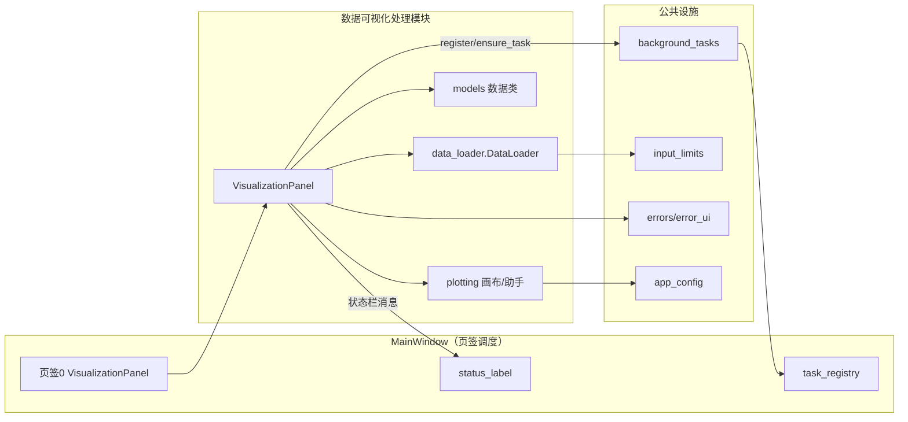
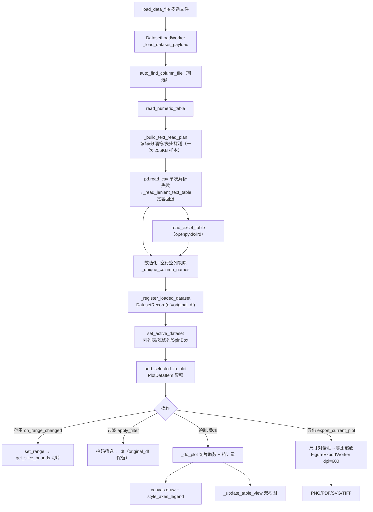

# 数据可视化处理设计文档

> **适用版本**：V1.2.1（`radar_tool/__init__.py` → `__version__ = "1.2.1"`）
> **主要源码**：`radar_tool/visualization_panel.py`（`VisualizationPanel` 主面板）、`radar_tool/data_loader.py`（数据加载器，共享服务）、`radar_tool/models.py`（数据模型）、`radar_tool/plotting.py`（绘图引擎与画布）
> **所属页签**：数据可视化处理（默认首页，主窗口索引 0）
> **文档定位**：以实际落地实现为准的模块设计文档，类名、函数名、行为均与当前代码一致，供维护开发者对照源码使用。全局架构与公共设施见《便携化工具箱总体设计文档》。

---

## 目录

- [1. 背景与目标](#1-背景与目标)
- [2. 总体架构](#2-总体架构)
- [3. 数据模型](#3-数据模型)
- [4. 功能与算法设计](#4-功能与算法设计)
- [5. 界面与交互](#5-界面与交互)
- [6. 关键实现与开发演进](#6-关键实现与开发演进)
- [7. 测试与验收](#7-测试与验收)
- [8. 已知问题与后续计划](#8-已知问题与后续计划)

---

## 1. 背景与目标

### 1.1 业务背景

雷达挂飞/外场试验产生大量多列时序测量数据（距离、速度、方位角、俯仰角及各类原始量测）。工程师的首要诉求是"把数据画出来"：多列数值快速成曲线、按采样段截取、按数值过滤；多文件多参数同图叠加对比；出 600 dpi 高清图交付报告与评审材料。

早期实现全部堆叠在 `MainWindow`，代码膨胀、启动缓慢。2026-07-13 架构解耦后独立为 `VisualizationPanel`，并成为工具箱**默认首页**——启动即进入本页签，加载数据、绘图、导出构成最短使用路径（README「基本工作流」第 2~8 步全部在本模块内）。

本模块同时是共享服务 `data_loader` 的第一使用方："多格式加载 + 列名文件匹配"被数据真值复核、测向校正等复用（真值复核雷达数据导入沿用本模块的导入、列名匹配与字段识别流程）。

### 1.2 设计目标

| 目标 | 实现落点 |
|---|---|
| **多格式容错加载** | 编码（UTF-8 / UTF-8 BOM / GB18030）与分隔符（逗号、分号、中文逗号、制表符、空格）自动识别；引号内分隔符、行尾分隔符、空值、短行补空值均不阻断加载 |
| **列名可维护** | 独立列名文件 + 同名自动查找；列名数与数据列不一致自动补齐/截断 |
| **多数据集会话** | 多文件同时加载，可切换、重载、移除、清空 |
| **切片与过滤** | 采样点索引区间截取 + 按列数值范围筛行，均可恢复 |
| **多图页签** | 新建/删除/拖动排序绘图页，曲线绑定指定页签 |
| **叠加对比** | 绘图项列表累积多曲线（可跨数据集）一次性重绘 |
| **统计量** | 每条曲线 μ/σ/max/min/N |
| **高清导出** | PNG 600dpi、PDF、SVG、TIFF，宽度按厘米预设等比缩放 |
| **界面不卡** | 加载/导出走 `QThread` + `background_tasks`（可取消、版本作废） |
| **布局可压缩** | `_relax_minimum_widths` 收紧最小尺寸，小窗可压缩不撑大 |

### 1.3 范围边界

**做**：本地数据文件加载（TXT/CSV/DAT/LOG/XLSX/XLS）；数据集会话管理；采样切片与数值过滤；多页签绘图、叠加、统计；绘图/表格双视图；高清图导出；matplotlib 原生交互导航。

**不做**：数据编辑回写；数据文件导出（CSV/Excel 导出属真值复核等模块）；坐标变换/对齐（真值复核）；协议解析（格式转换）；远程数据源、数据库、实时采集。

**公共设施边界**：资源上限由 `input_limits` 提供（本模块只调用）；单图导出由 matplotlib `savefig` 直接写文件，不走 `export_safety.atomic_export_batch`（批量原子导出属真值复核/试验记录）；后台线程统一登记 `background_tasks`，关闭时 `MainWindow.closeEvent` 有界等待；出图规范由 `app_config` 统一提供、经 `plotting.py` 消费。

---

## 2. 总体架构

### 2.1 在工具箱中的位置

本模块是主窗口页签工厂 `_tab_factories` 的第 0 项（`MainWindow._create_viz_tab`），也是**唯一在启动时立即实例化**的页签：`_init_ui()` 经 `_lazy_create_or_get_panel(0)` 创建 `VisualizationPanel`，其余页签空白占位、首次切换才初始化（懒加载细节见总体设计文档 3.3 节）。工厂内才 `from .visualization_panel import VisualizationPanel`，保持顶层 import 轻量。

面板与主窗口的耦合仅一处约定：构造签名 `VisualizationPanel(main_window)`；面板经 `self.main_window.status_label` 写状态栏，经 `background_tasks.task_registry_for(owner)` 取 `MainWindow.task_registry`。主窗口 `closeEvent` 对活动任务取消并有界等待 3 秒，本模块加载/导出任务因此可在关闭时收敛。



### 2.2 模块结构：文件 / 类职责表

| 文件 | 类 / 函数 | 职责 |
|---|---|---|
| `visualization_panel.py` | `VisualizationPanel(QWidget)` | 主面板：UI 构建、数据集会话、切片/过滤、绘图项管理、多图页签、绘图与导出编排 |
| 同上 | `_load_dataset_payload(filepath)` | 模块级加载闭包：自动查找列名文件 → `DataLoader.load_data`，返回 `{'filepath','label','col_file','dataframe'}` |
| 同上 | `DatasetLoadWorker(QObject)` | 后台加载 Worker：`QThread` 中循环解析多文件，`progress/succeeded/failed/cancelled` 信号，协作式取消 |
| 同上 | `FigureExportWorker(QObject)` | 后台导出 Worker：`QThread` 中 `figure.savefig(dpi=600,…)`，同四类信号 |
| 同上 | `SeriesTableModel(QAbstractTableModel)` | 只读表格模型：按列持 numpy 数组、可见单元格才取数，百万行不卡顿 |
| `data_loader.py` | `DataLoader` | 共享加载门面：`load_data`、`load_column_names`、`auto_find_column_file`、`normalize_column_names` |
| 同上 | `read_numeric_table` / `read_text_table` / `read_excel_table` | 数值表读取入口与文本/Excel 分支 |
| 同上 | `_build_text_read_plan`、`_detect_text_encoding`、`_choose_text_separator`、`_split_text_line`、`_read_lenient_text_table`、`_read_text_table_with_plan`、`_detect_header`、`_detect_header_from_sample`、`_unique_column_names` 等 | 编码/分隔符探测、单次解析、宽容回退、表头识别、列名归一化（第 4 章） |
| `models.py` | `DatasetRecord` / `PlotDataItem` / `PlotViewRecord` | 数据集记录 / 绘图曲线元数据 / 绘图页控件集（第 3 章） |
| `plotting.py` | `MatplotlibCanvas(FigureCanvas)` | 画布（Figure 11.0×6.8 英寸、dpi=160、白底、单子图） |
| 同上 | `FIG_SIZE_PRESETS` / `ASPECT_PRESETS` / `EXPORT_WIDTH_PRESETS_CM` | 尺寸、纵横比、导出宽度三组预设 |
| 同上 | `compact_series_label` / `default_export_basename` / `style_axes_legend` / `resolve_figure_size` / `apply_figure_size` / `scaled_size_for_width` | 图例标签、导出命名、图例样式、尺寸解析与等比缩放 |
| `app_config.py` | `COLORS`（12 色）、`LINESTYLES`（4 线型）、`MATPLOTLIB_RC_PARAMS` | 出图规范（字体、`savefig.dpi=600`、`pdf.fonttype=42` 等） |
| `main_window.py` | `_create_viz_tab` / `_lazy_create_or_get_panel` | 页签工厂与懒加载（简介） |

`models.py` 顶部另从 `schemas` 引入 `SCHEMA_VERSION`、`CalibrationConfig`、`ProjectRecord`、`TruthReviewConfig`、`migrate_json_schema`、`validate_schema` 形成再导出；本模块只用上述三个数据类。

### 2.3 数据流与处理流程



一句话数据通路：**文件 →（探测 + 单次解析）→ 数值 DataFrame → `DatasetRecord`（切片/过滤）→ `PlotDataItem` 清单（按页签分组）→ `_do_plot` 重绘或 `FigureExportWorker` 导出**。

---

## 3. 数据模型

字段表以 `radar_tool/models.py` 实际定义为准。

### 3.1 数据集 DatasetRecord

```python
@dataclass
class DatasetRecord:
    dataset_id: int          # 会话内自增 id（VisualizationPanel._dataset_counter）
    label: str               # 显示名 = os.path.basename(数据文件)
    data_filepath: str       # 数据文件路径（重载回读用）
    col_filepath: str        # 列名文件路径（无则 ''）
    df: pd.DataFrame         # 当前视图数据（过滤后）
    original_df: pd.DataFrame  # 未过滤原始数据
    start: int = 0           # 切片起始（含）
    end: int = 0             # 切片结束（不含）；0 = 到末尾
```

| 方法 | 行为 |
|---|---|
| `row_count`（property） | `df` 为 None → 0，否则 `len(df)` |
| `set_range(start, end)` | `start = max(0, int(start))`；`end is None` 或 `<=0` → `end=0`（到末尾），否则 `end = max(start+1, int(end))`（至少 1 行） |
| `get_slice_bounds()` | 空表 `(0,0)`；`start` 钳制 `[0, len-1]`；`end<=0` 取 `len(df)`，否则钳制 `[start+1, len]` |

要点：**双 DataFrame**——过滤只换 `df`，`original_df` 保留原始，`clear_filter` 直接恢复；重载后两者同指新数据。**范围是会话状态**——`start/end` 随 SpinBox 实时写入、不落盘；注册默认 `start=0, end=len(df)`。

### 3.2 绘图项 PlotDataItem 与绘图页 PlotViewRecord

```python
@dataclass
class PlotDataItem:
    dataset_id: int = 0    # 所属数据集
    col_name: str = ''     # 所绘列名
    start: int = 0         # 添加时范围快照（仅记录）
    end: int = 0
    color_idx: int = 0     # 颜色/线型循环索引（_color_counter）
    label: str = ''        # 图例标签（compact_series_label）
    chart_id: int = 0      # 所属绘图页 view_id
```

| 成员 | 行为 |
|---|---|
| `color`（property） | `COLORS[color_idx % 12]`（`app_config` 12 色循环） |
| `linestyle`（property） | `LINESTYLES[(color_idx // 12) % 4]`，每 12 条曲线换一轮线型 |
| `get_data(datasets)` | 列缺失/无数据返回 `None`；`pd.to_numeric(df[col], errors='coerce').to_numpy()` 按**数据集当前** `get_slice_bounds()` 切片——`PlotDataItem.start/end` 仅是添加时刻快照 |

```python
@dataclass
class PlotViewRecord:
    view_id: int                 # 绘图页 id（_plot_view_counter）
    name: str                    # 页签名，默认 '图1'、'图2'…
    tab_widget: QWidget
    canvas: object               # MatplotlibCanvas
    toolbar: NavigationToolbar   # matplotlib 原生导航工具栏
    txt_stats: QTextEdit         # 统计/概览区（Consolas 9，最大高 150）
    display_stack: object = None # QStackedWidget：0 画布 / 1 表格
    table_view: object = None    # QTableView
    table_model: object = None   # SeriesTableModel
```

`SeriesTableModel`：`set_series(columns)` 收 `[(表头, np 数组), …]`；`columnCount` = 曲线数 + 1（首列"序号"）；渲染期取数、浮点 `f'{value:.6g}'`、NaN 显示空——大表切换无压力。

### 3.3 列名匹配规则

**（1）自动查找 `DataLoader.auto_find_column_file(data_filepath)`**：候选顺序（第一个存在即返回，无则 `None`）——`<数据文件主名>列名.txt`、`<主名>_列名.txt`、`<主名>_columns.txt`、`<主名>.columns.txt`，再加同目录扫描兜底（文件名含"列名"且 `.txt` 结尾）。

**（2）读取 `DataLoader.load_column_names`**：编码依次 `utf-8-sig`/`utf-8`/`gb18030`/`gbk`/`cp936`；非空行逐行取列名；行数超 `MAX_COLUMNS`（10,000）抛 `InputResourceError`；全编码失败抛 `ValidationError('列名文件编码无法识别，请使用 UTF-8 或 GB18030 编码')`。

**（3）归一化 `normalize_column_names(names, count)` → `_unique_column_names`**：

| 情况 | 规则 |
|---|---|
| 列名数 **少于** 数据列数 | 缺失位补 `列--N`（N 为 1 起列序号） |
| 列名数 **多于** 数据列数 | 多余忽略（只遍历前 `count` 个） |
| 名称空串或 `'nan'` | 同样补 `列--N` |
| 名称重复 | 第 2 次起追加 `_2`、`_3`…（`f'{base}_{occurrence}'`） |

保证"列名数量不一致不再阻断加载"（README 2026-11-08），且不产生重复/空列名。测试 `test_column_name_count_mismatch_does_not_block_numeric_data`：3 列数据配 2 名 `['距离','速度']` → `['距离', '速度', '列--3']`。

**（4）优先级 `read_numeric_table`**：`names = col_names if col_names else detected_headers`——显式列名文件 > 表头识别 > 全补 `列--N`。设计立场与总体文档一致：**不依赖列名顺序推断业务含义**。

---

## 4. 功能与算法设计

### 4.1 多格式加载与编码/分隔符识别（data_loader 加载流程）

#### 4.1.1 入口与格式分派

`read_numeric_table(filepath, col_names=None, validate_limits=True)` 为数值表总入口（`DataLoader.load_data` 直接转发）：

1. 文件不存在 → `ValidationError('数据文件不存在')`；
2. 扩展名分派：`EXCEL_EXTENSIONS = {'.xlsx', '.xls'}` → `read_excel_table`；`TEXT_EXTENSIONS = {'.txt', '.csv', '.dat', '.log'}` **或无扩展名** → `_read_text_numeric_table`；其他 → `ValidationError`（提示选择 TXT/CSV/DAT/XLSX/XLS）；
3. 收尾：`dropna` 剔全空行/列；全表无数值 → `ValidationError('文件中没有识别到数值数据。请检查文件格式、分隔符，或确认选择的是数据文件而不是列名文件。')`（针对"误选列名文件/说明文件"）；`reset_index(drop=True)`；`validate_limits` 时 `validate_table_shape(numeric.shape, label='数值数据表')`；按 3.3 节规则赋列名。

资源上限衔接（`input_limits`）：`ensure_file_size`（默认 `MAX_FILE_SIZE=None` 不限字节）在文本/Excel/列名文件读取前执行；`validate_table_shape` 按 `MAX_ROWS`（1,000,000）/`MAX_COLUMNS`（10,000）校验行列；Excel 另经 `preflight_excel` 校验 `MAX_EXCEL_SHEETS`（16）与 `MAX_EXTRACTED_SIZE`（200 MB）；超限抛 `InputResourceError`（`DataLimitError` 子类）。

> 注意：`_load_dataset_payload` 与 `reload_active_dataset` 传 `validate_limits=False`（跳过行列数复检），文件大小检查仍执行；直接调用 `read_numeric_table`（默认 `True`）的路径完整执行 `validate_table_shape`（测试全部走该路径）。

#### 4.1.2 读取计划：一次采样，共享探测（2026-11-08 提速核心）

`_build_text_read_plan(filepath, delimiter_candidates)` 把编码/分隔符/表头探测合并到**同一次样本读取**：

```
_read_text_sample                 # 唯一一次 open+read：前 256KB 二进制
  → _detect_text_encoding         # BOM / UTF-8 增量试探 / 回落 gb18030
  → sample.decode(检测编码, errors='replace')
  → _meaningful_text_lines        # 去空行、去 # 注释
  → _detect_text_separator        # 候选分隔符打分选优
  → (detected_encoding, separator, encodings回退链, sample_lines)
```

- **编码 `_detect_text_encoding`**：`codecs.BOM_UTF8` 开头 → `'utf-8-sig'`；`codecs.getincrementaldecoder('utf-8')` 试探成功 → `'utf-8'`，`UnicodeDecodeError` → `'gb18030'`。回退链：UTF-8 系 `[detected, 'gb18030']`，否则 `[detected, 'utf-8-sig']`。
- **分隔符 `_choose_text_separator`**：候选 = `SIMPLE_TEXT_DELIMITERS = (',', ';', '，', '\t')` + `r'\s+'`；对样本前 256 有效行统计切分字段数，众数字段数 ≤1 的候选淘汰；得分元组 `(common_count > 1, coverage, common_count, frequency)`（`coverage = 频次/行数`）字典序最大者胜出。
- **行切分 `_split_text_line`**：`None` → 整行单字段；`\s+` → `line.split()`；单字符分隔符 → `csv.reader(…, skipinitialspace=True, strict=False)`（**引号内分隔符不切开**，异常回落 `line.split`）；其他 → `re.split`；字段 `strip()`、**行尾空字段弹出**（容忍行尾多余分隔符），全空返回 `['']`。

（对应测试见 7.1 节。）

#### 4.1.3 解析与宽容回退

`_read_text_table_with_plan(filepath, read_plan, ...)`：

1. 对回退链每个编码执行**单次** `pd.read_csv`：`sep`=探测分隔符（None 时 `TEXT_SEPARATOR = r'[,;，\s]+'`）、`engine='c'`（单字符或 `\s+`）否则 `'python'`、`comment='#'`、`skip_blank_lines`、`skipinitialspace`、`dtype/header/nrows` 按参传入；成功后 `validate_table_shape(table.shape)`（受 `validate_limits` 开关）并返回。
2. 异常：`UnicodeDecodeError` → 换编码；`EmptyDataError` → `ValidationError('文本文件为空或没有有效数据行')`；`ParserError` → **宽容回退** `_read_lenient_text_table`（手工逐行读、跳空行/`#`、全行重选分隔符、逐行切分、短行补 `None` 等宽），仍失败 → `ValidationError('文本文件解析失败：请检查分隔符、引号和每行字段数量')`。
3. 全编码失败 → `ValidationError('文本文件编码无法识别，请使用 UTF-8 或 GB18030 编码')`。

容错语义（与 README「数据文件加载」一致）：**引号内分隔符、行尾分隔符、空值和行字段数差异不会导致整份正常数据加载失败；短行自动补空值。**

#### 4.1.4 表头识别

两套互补：**样本预判** `_detect_header_from_sample`（解析前，样本前 8 行：首行数值占比 `<0.5` 且后续行 `≥0.5` → 首行为表头）；**事后判别** `_detect_header(raw)`（解析后对 raw DataFrame 同比例判别，命中则剥离首行并 `reset_index`）。`_read_text_numeric_table` 策略：先按样本预判决定 `header=0/None` 以 `dtype='float64'` 解析；失败（`ValidationError/ValueError/TypeError`）则改 `str` 全表解析 + 事后判别 + `to_numeric(errors='coerce')`——保证"纯数字无表头"与"文本表头+数字体"都正确落数。

#### 4.1.5 Excel 分支

`read_excel_table`：`.xls` → `pd.read_excel(header=None, dtype=object)`；`.xlsx` → `openpyxl.load_workbook(read_only=True, data_only=True, keep_links=False)` 逐行 `iter_rows(values_only=True)`——`validate_limits=True` 时遍历**全部工作表**计数（每 1024 行 `validate_table_shape`，逐表累计复检）但只收集**第 1 个工作表**数据行，`False` 时仅读第 1 表；短行补 `None` 等宽后拼 `DataFrame(dtype=object)`；结构错误 → `ValidationError('Excel 文件无法读取或结构损坏')`（`preflight_excel` 超限原样抛）。上层对 Excel 结果做与文本一致的 `_detect_header` + `to_numeric` 与收尾。

#### 4.1.6 单次解析的性能验证

2026-11-08 提速本质：早期探测与解析各自完整读文件（两次 Pandas 解析），改造后探测只读 256KB 样本且**正常文本仅一次 `pd.read_csv`**。回归 `test_numeric_loader_reads_sample_and_parses_table_only_once` 用 monkeypatch 计数断言样本读取与 `read_csv` 各恰 1 次。

README「近期更新」（2026-11-08）基准：8 列数字 CSV 上 **1 万、10 万、30 万行加载时间分别降低约 54%、74% 和 75%**。同日"加载兼容性"（引号/行尾/缺字段放宽、列名数不一致不阻断）与"错误诊断"一并落地——`DatasetLoadWorker.run` 把异常对象**原样**经 `failed` 信号发回（`test_dataset_load_worker_preserves_validation_error` 验证 `ValidationError` 不被包装），`handle_ui_exception` 因此显示准确领域错误而非"未预期错误"。

### 4.2 列名文件加载与应用

`load_column_file`：选文件 → `DataLoader.load_column_names` → 应用到**当前活动数据集**：`renamed = active.original_df.copy(deep=False)`（以未过滤原始为基）→ `renamed.columns = DataLoader.normalize_column_names(col_names, renamed.shape[1])` → 记录 `active.col_filepath` → 保留范围边界（`old_start, old_end = active.get_slice_bounds()`）→ `active.df = active.original_df = renamed; active.set_range(old_start, old_end)` → `set_active_dataset` 刷新。无活动数据集提示"请先加载一个数据文件，再单独加载列名文件。"。`reload_active_dataset` 重载时列名文件仍在则重读，否则表头自动识别。

### 4.3 数据切片

- `spin_start`（`0 .. n_rows-1`）/ `spin_end`（`0 .. n_rows`，特殊值"末尾"= 0），`on_range_changed` 写入 `dataset.set_range` 并**已有绘图项时自动 `plot_data()` 重绘**。
- 取数统一走 `get_slice_bounds()`（3.1 节钳制语义），`PlotDataItem.get_data` 与统计量同区间。
- `redraw_current_range_plot` 显式写范围后重绘；`save_range_preset` 仅写会话内记录（范围本就实时生效，不落盘）。

### 4.4 数值过滤

`apply_filter`：取过滤列与最小/最大值文本（留空=不限）→ 掩码 `df[col] >= float(min)` / `<= float(max)` 按需叠加 → `filtered_df = df[mask].copy()` **只替换 `dataset.df`**（`original_df` 不动）→ 范围重置为过滤后全量 → 状态栏报告"移除 N 行, 保留 M 行"；`float()` 转换等异常经 `handle_ui_exception` 弹窗。`clear_filter`：清输入框、`dataset.df = dataset.original_df` 恢复并保留范围边界。过滤是**按行剔除**，绘图 x 轴为过滤后连续样点号 `np.arange(len(data))`。

### 4.5 多图页签

- `plot_tabs`（`QTabWidget`，`setMovable(True)` 可拖动）；页签索引 → view_id 由 `_plot_tab_order` 维护，`plot_views: dict[view_id, PlotViewRecord]` 存控件集；`_get_current_plot_view_id()` 按 `currentIndex()` 查表。
- `_create_plot_view(name=None, set_active=True)`：默认 `图{n}`，创建页签 + `MatplotlibCanvas` + `NavigationToolbar` + `txt_stats` + `QStackedWidget`（画布/表格），登记 `PlotViewRecord`。
- `create_new_plot_view` 新建并设当前；`remove_current_plot_view` 删页并级联清理该页绘图项（删光自动重建"图1"，删前 `blockSignals` 防误触发）；`on_plot_tab_changed` 同步 `lbl_plot_target`、绘图项列表与视图模式。
- 曲线绑定：`add_selected_to_plot` 将新项 `chart_id` 固定为**当前页签** id（`lbl_plot_target` 持续提示"添加的曲线始终绑定到当前页签图"）。

### 4.6 叠加绘制与绘图项管理

**绘图项管理**：`add_selected_to_plot` 候选列 = 勾选项 ∪ 选中项（去重）；同 `col_name + dataset_id + chart_id` 查重跳过；`PlotDataItem`（`color_idx=_color_counter` 自增，`label=compact_series_label(dataset.label, col_name)`）追加进 `plot_items`。`_update_plot_list` 按 `[{图名}] [{color}] {label}` 渲染（前景取曲线色）；`remove_selected_plot_item` 按映射索引弹出；`clear_all_plot_items` 仅清当前页。`compact_series_label` = `文件主名 | 字段名`（主名超 16 字符截断加 `…`，不含采样区间）。

**绘制**：`plot_data` → `ax.clear()` → `_do_plot` → `_update_table_view` → `draw()`；`plot_data_overlay`（"叠加绘制 (保持上一幅)"）调用 `plot_data()` 仅状态栏文案不同——**叠加效果由绘图项列表累积承载**（添加不清单、重绘全量，先前曲线保留）；`_do_plot(ax, plot_view, overlay=False)` 保留 `overlay=True` 不清轴追加分支供未来接线。`clear_overlay` 有项则重绘净图，否则清画布。

**`_do_plot` 细节**：逐项 `get_data` 切片，`ax.plot(np.arange(len(data)), data, color=pi.color, linestyle=pi.linestyle, linewidth=2.0, label=pi.label, antialiased=True)`；网格 `grid(True, linestyle='--', linewidth=0.7, alpha=0.28)`（`chk_grid`）；脊线 `#334155`/1.0；刻度 `labelsize=10, width=1.0, length=4, colors='#111827'`；`margins(x=0.01)`；图例 `style_axes_legend`（8 号、右上、半透明边框）；固定 `xlabel='采样点 (128ms/点)'`、`ylabel='数值'`、`title='雷达数据曲线'`。

### 4.7 统计量计算（μ/σ/Max/Min/N）

`_do_plot` 在 `chk_show_stats` 勾选时逐曲线计算（与绘图同源切片）：

```python
stats = pd.to_numeric(dataset.df[pi.col_name], errors='coerce').to_numpy()
s, e = dataset.get_slice_bounds()
stats = stats[s:e]                       # 与曲线同一范围
stats = stats[~np.isnan(stats)]          # 丢 NaN
mean/std/min/max = np.nanmean/nanstd/nanmin/nanmax(stats)
# 行格式："{数据集label} | {col_name}: μ=…, σ=…, min=…, max=…, N=…"
```

统计区间 = 数据集当前切片（过滤+范围），`N` = 去 NaN 样本数；输出写入本页 `txt_stats`（无数据显 `(无数据)`）。`set_active_dataset` 亦写"📋 数据概览"（行列数、文件、列名列表）入 `txt_stats`。

### 4.8 高清导出（PNG 600dpi / PDF / SVG / TIFF）

`export_current_plot`：

1. 无绘图项 → 提示"当前没有可导出的对比曲线，请先添加绘图项。"；
2. 默认名 `default_export_basename`：`数据文件主名_字段1_字段2…`（非法字符 `\/:*?"<>|` → `_`，去首尾空格/点，≤120 字符），取首条绘图项所属数据集 `label`；
3. 保存对话框过滤器 `PNG 图片 (*.png);;PDF 矢量图 (*.pdf);;SVG 矢量图 (*.svg);;TIFF 图片 (*.tiff);;所有文件 (*.*)`，无扩展名按过滤器补全；
4. "导出尺寸"对话框（`EXPORT_WIDTH_PRESETS_CM`：跟随绘图尺寸/12/16/20/24 cm），高度按纵横比等比缩放（`scaled_size_for_width`），取消即中止；
5. `_do_plot` 重绘保证与界面一致；选定宽度时临时 `set_size_inches` + `tight_layout(pad=1.2)`，原尺寸存 `_export_restore_figsize`；
6. `QThread` + `FigureExportWorker` → `register_background_task`（`高清图导出：{文件名}`）→ `figure.savefig(filepath, dpi=600, bbox_inches='tight', facecolor='white', edgecolor='none')`；
7. `_on_plot_export_thread_finished` 恢复绘图区尺寸并重绘、启用按钮。

出图规范衔接：`MATPLOTLIB_RC_PARAMS`（`savefig.dpi=600`、`figure.dpi=160`、`pdf.fonttype=42`/`ps.fonttype=42` 嵌入 Type-42、Times New Roman + 宋体逐级回退）；worker 显式 `dpi=600` 与白底与之一致。

### 4.9 后台线程与任务版本语义

| 环节 | 实现 |
|---|---|
| 启动前查重 | `ensure_task_can_start`（同 owner 同名运行中 → `ValueError`）；面板另以 `_dataset_load_thread is not None` 置灰按钮 |
| 登记 | `register_background_task(...)` 返回版本号存 `_load_task_version`/`_export_task_version`；同名旧版本标记 `stale` |
| 结果防污染 | 回调先 `task_result_is_current`，非最新版本丢弃 |
| 取消 | worker `threading.Event` 协作式；`cancel()` 后 `run` 抛 `RuntimeError('数据文件加载已取消')`/`('高清图导出已取消')` 转 `cancelled` |
| 信号 | `DatasetLoadWorker`：`succeeded(dict)/failed(object)/cancelled(str)/progress(int,str)`；`FigureExportWorker`：`succeeded(str)/failed(str)/cancelled(str)/progress(int,str)`（失败消息经 `safe_exception_message` 脱敏） |
| 线程收尾 | `thread.quit` + `worker.deleteLater` + `thread.deleteLater`；`finished` 连接面板 `_on_*_thread_finished` 清理句柄、恢复按钮 |
| 关闭收敛 | `MainWindow.closeEvent` `cancel_active` + `wait_for_tasks(3000ms)`，超时拒绝关闭并列出任务 |

`DatasetLoadWorker.run` 逐文件发进度（`index*100/total`，`正在加载 {basename}`），完成发 `succeeded({'results': [...]})`；面板 `_on_dataset_load_succeeded` 逐个 `_register_loaded_dataset`，无活动数据集时激活第一个。

---

## 5. 界面与交互

### 5.1 整体布局

```
VisualizationPanel (QWidget, QVBoxLayout)
├── 顶部「数据控制」QGroupBox（_create_top_controls）
│     行1: 📂 加载数据文件(可多选) | 📄 加载列名文件 | 🗑️ 移除当前数据集 | 🧹 清空全部数据集 | 数据文件: <lbl_data_file>
│     行2: 🗑️ 清除叠加 | ⬇ 导出高清图 | 🔄 重置
└── QSplitter(Horizontal)（左 2 : 右 3，初始 620/1500，两侧不可折叠）
      ├── 左侧（数据管理，最小宽 420）（_create_left_panel）
      │     ├── 「已加载数据集」list_datasets + [设为当前][重载当前]
      │     ├── 「数据范围 (采样点索引)」起始/结束 SpinBox + 总行数 + [保存范围预设][按当前范围重绘对比图]
      │     ├── 「数据过滤 (按值筛选行)」列/最小值/最大值 + [应用过滤][清除过滤]
      │     ├── 「选择要绘制的参数 (可多选)」[全选][全不选][▶ 添加到绘图] + 绘制到指示 + list_columns
      │     └── 「当前绘图项」list_plot_items + [移除选中][清空所有]
      └── 右侧（绘图区）（_create_right_panel）
            ├── plot_tabs（多图页签，可拖动）
            ├── 「绘图控制」行1: [🆕 新建图][🗑 删除当前图][📊 绘制][➕ 叠加绘制 (保持上一幅)]
            │            行2: ☑显示统计信息 ☑网格 | 显示: 绘图/表格 | 图片尺寸 | 比例
            └── 页签内容: NavigationToolbar + QStackedWidget(画布|表格) + txt_stats
```

`_relax_minimum_widths()` 收紧最小尺寸（`QAbstractButton` 84、`QComboBox` 96、`QAbstractSpinBox` 72、`QLineEdit` 80，只下调不抬高；`QAbstractItemView`/`QTextEdit` 最小高 80）——小窗可压缩而非整窗撑大。

### 5.2 数据控制区（顶部）

行 1：`btn_load`「📂 加载数据文件(可多选)」（`QFileDialog.getOpenFileNames`，过滤器 `文本文件 (*.txt);;所有文件 (*.*)`，实际支持 TXT/CSV/DAT/LOG/XLSX/XLS；加载期间置灰）、`btn_load_col`「📄 加载列名文件」、`btn_remove_dataset`/`btn_clear_datasets`、`lbl_data_file`（未加载灰色"未加载"）。
行 2：`btn_clear_overlay`「🗑️ 清除叠加」、`btn_export`「⬇ 导出高清图」、`btn_reset`「🔄 重置」（`relim` + `autoscale_view`）。

### 5.3 数据管理区（左侧）

- **已加载数据集** `list_datasets`：行格式 `{文件名}  [{start}:{end|'end'}][ | 列名文件名]`；单击激活（`blockSignals` 保护刷新）；`btn_set_active`/`btn_reload_active`。
- **数据范围**：`spin_start`/`spin_end`（3.1/4.3 节语义，变更即生效并自动重绘）、`lbl_total_rows`、`btn_save_range`（会话内）、`btn_refresh_plot`「按当前范围重绘对比图」。
- **数据过滤**：`combo_filter_col` + `edit_filter_min`/`edit_filter_max`（占位"不限制"）+ `btn_apply_filter`/`btn_clear_filter`。
- **列选择**：`list_columns` 复选多选；`btn_select_all`/`btn_deselect_all`；`btn_add_to_plot`「▶ 添加到绘图」（勾选∪选中入当前页）；`lbl_plot_target`「绘制到: 图N」。
- **当前绘图项** `list_plot_items`：全局曲线（`[{图名}] [{color}] {label}`，前景取曲线色）；`btn_remove_selected`/`btn_clear_all_plots`（后者仅当前页）。

### 5.4 绘图区（右侧）

- **多图页签 `plot_tabs`**：默认"图1"，`btn_new_plot`/`btn_remove_plot`（删光自动重建图1）；切换触发 `on_plot_tab_changed` 同步目标指示、绘图项列表、视图模式。
- **绘图控制**：`btn_plot` 清轴重绘本页全部绘图项；`btn_overlay`「➕ 叠加绘制 (保持上一幅)」重绘累积列表；`chk_show_stats`/`chk_grid`（默认勾选）；`combo_display_mode`「绘图|表格」切 `display_stack`（切表格时 `_update_table_view` 引用数组填充）；`combo_fig_size`（默认 11.0×6.8 / 窄幅 8.0×5.0 / 宽幅 14.0×8.5 / 方形 9.0×9.0 英寸）与 `combo_aspect`（自动/4:3/16:9/1:1，纵横比优先）即改即绘。
- **导航工具栏**：每页签自带 `NavigationToolbar2QT`（缩放、平移、子图配置、保存）。
- **统计/概览区 `txt_stats`**：Consolas 9、只读、最大高 150（4.7 节）。

### 5.5 导出交互

序列（4.8 节）：缺曲线提示 → 文件名/格式对话框（默认名=数据文件名+字段名）→ "导出尺寸"宽度对话框（可"跟随绘图尺寸"）→ 后台编码（状态栏显示任务进度）→ 成功/失败/取消分别走状态栏、`ExportError` 弹窗、日志；导出线程结束自动恢复绘图区尺寸。导出按钮任务期间置灰，同名任务重复启动被 `ensure_task_can_start` 拒绝。

---

## 6. 关键实现与开发演进

### 6.1 关键实现决策

1. **从 MainWindow 拆出 VisualizationPanel**（2026-07-13）：本模块第一个拆为独立 `QWidget`（构造签名 `XxxPanel(parent)`），主窗口瘦身为页签工厂 + 状态栏 + 任务注册表；文件头注释保留此出身。
2. **页签懒加载，首页例外**：索引 0 立即创建、其余占位首次切换才建（Nuitka 导入链重）；本模块为默认首页必须立即可用。
3. **加载/导出一律后台线程**：`DatasetLoadWorker`/`FigureExportWorker` + `background_tasks` 三件套（`ensure_task_can_start`/`register_background_task`/`task_result_is_current`）。
4. **加载探测与解析共享样本**（2026-11-08）：探测合并一次 256KB 样本读取，正常文件仅一次 `pd.read_csv`，失败才宽容回退——54%~75% 提速的直接来源。
5. **宽容优先于严格**：引号/行尾/短行补空/列名补 `列--N`，宁可补空不整表拒绝；仅"完全无数值"报错并提示疑似选错文件。
6. **双 DataFrame 过滤模型**：`df`/`original_df` 分离，过滤可逆、列名应用可回原始基。
7. **绘图项列表承载叠加语义**：`PlotDataItem` 累积、按 `chart_id` 分组，重绘即叠加对比；`color_idx` 驱动 12 色 + 4 线型循环。
8. **表格视图轻量化**（2026-11-11）：`SeriesTableModel` 渲染期取数，百万行无压力。
9. **出图规范集中化**：尺寸/比例/导出宽度与图例、命名收口 `plotting.py`，字体/DPI/颜色收口 `app_config.py`。

### 6.2 开发时间线

| 时间 | 提交/事件 | 本模块变化 |
|---|---|---|
| 2026-07-13 | 架构解耦（git 入库前） | 从 `MainWindow` 拆出 `VisualizationPanel`；页签懒加载（首页立即创建） |
| 2026-07-14 | `429903d feat: 初始化工具源码` | 源码首次版本化 |
| 2026-11-08 | `a11a479 feat: optimize loading and finalize release workflow` | **加载提速**：共享 256KB 样本、单次 Pandas 解析（README 基准：1 万/10 万/30 万行提速约 **54%/74%/75%**）；**兼容性放宽**（引号/行尾/缺字段、列名数不一致不阻断）；**错误诊断**（`DatasetLoadWorker` 保留原始异常类型）；新增 `DatasetLoadWorker`/`FigureExportWorker`（data_loader +432 行、visualization_panel +363 行） |
| 2026-11-11 | `daa6feb 版本优化1.1.1`（V1.1.1） | **绘图优化**：`plotting.py` 尺寸/纵横比/导出宽度预设、紧凑图例标签、导出命名、图例样式（+100 行）；面板新增 `SeriesTableModel` 表格视图、绘图/表格切换、尺寸与比例选择、导出尺寸对话框、绘制目标指示、`_relax_minimum_widths`（+379 行） |
| 2026-11-05/11-14 | 项目体检与文档化 | `test_data_loader_formats.py` 等回归固化；本设计文档随 V1.1.1 编写 |
| 2026-11-14 | **V1.2.1** | **v1.1.2 改点（VZ-01~03）**：绘图页签拖动后顺序回写并刷新标题（`tabMoved` → `_plot_tab_order`）；移除/清空数据集前确认框（含数据集数与绘图项数）；删除数据集后遍历所有 plot view 剔除旧曲线并重绘。**UI V2**：接入《UI视觉规范V2》设计令牌与结果卡；窄屏（<1280px）页签自动切换短名；图表中文字体按本机可用字体解析（`resolve_cjk_font_stack`）。 |

### 6.3 与早期设计的差异

| 方面 | 早期 | 当前（V1.2.1） |
|---|---|---|
| 代码归属 | UI+业务全在 `MainWindow` | `VisualizationPanel` 独立面板 |
| 启动 | 所有页签随主窗口构建 | 懒加载；本模块默认首页立即构建 |
| 数据加载 | 主线程读文件 | 后台 `DatasetLoadWorker` + 进度/取消/版本作废 |
| 加载解析 | 探测与解析各读全文件（约两次 Pandas 解析） | 共享样本、单次解析 + 宽容回退（提速 54%~75%） |
| 列名不一致 | 可能阻断加载 | 补 `列--N` / 忽略多余 / 重复加 `_2` |
| 图片导出 | 主线程 `savefig`，尺寸固定 | 后台编码；宽度预设等比缩放；导出后恢复尺寸 |
| 数据查看 | 仅曲线图 | 绘图/表格双视图 |
| 图例标签 | 可能带采样区间 | `compact_series_label`"文件主名\|字段名" |
| 叠加绘制 | 依赖上一幅画布保留 | 绘图项累积 + 全量重绘（`overlay=True` 分支保留） |
| 布局 | 最小宽度可撑大整窗 | `_relax_minimum_widths` 统一收紧 |

---

## 7. 测试与验收

本模块行为由以下测试固化（2026-11-14 实测：`tests/test_data_loader_formats.py` + `tests/test_input_fuzzing.py` 共 20 passed；`tests/test_qt_panels.py` 11 passed，含可视化面板用例）。

### 7.1 加载格式与容错 `tests/test_data_loader_formats.py`

| 测试 | 验收点 |
|---|---|
| `test_metadata_loader_accepts_comma_separated_radar_data` | 逗号文本 + 显式列名（`DataLoader.load_data`） |
| `test_text_loader_detects_header_and_semicolon_separator` | 分号分隔 + 表头自动识别 |
| `test_text_loader_detects_gb18030_header` | GB18030 + 中文表头 |
| `test_loader_rejects_file_without_numeric_data` | 纯文本（疑似列名文件）→ `ValueError`"没有识别到数值数据" |
| `test_dataset_load_worker_preserves_validation_error` | `DatasetLoadWorker` 原样传递 `ValidationError` |
| `test_text_loader_accepts_quoted_delimiters_and_trailing_separators` | 引号内分隔符、行尾分隔符容错 |
| `test_text_loader_pads_short_rows_instead_of_rejecting_file` | 短行补空保形状 |
| `test_column_name_count_mismatch_does_not_block_numeric_data` | 列名少于列数 → 补 `列--3` |
| `test_numeric_loader_reads_sample_and_parses_table_only_once` | 单次样本读取 + 单次 `pd.read_csv`（提速回归） |
| `test_text_loader_rejects_row_limit_before_parsing` / `…_column_limit_…` | `MAX_ROWS`/`MAX_COLUMNS` 超限报错 |
| `test_excel_loader_rejects_sheet_and_extracted_size_limits` | Excel 工作表数、解压大小上限 |
| `test_calibration_loader_rejects_sample_limit` | `MAX_SAMPLES`（校正模块复用 data_loader） |

### 7.2 异常输入模糊 `tests/test_input_fuzzing.py`

- `test_large_text_file_is_rejected_before_parsing`：`MAX_FILE_SIZE` 超限 → "大小超限"；
- `test_corrupt_xlsx_is_rejected_as_structural_error`：损坏 xlsx → `ValidationError`"结构损坏"；
- BIN 模糊语料属格式转换模块，不在本模块范围。

### 7.3 面板交互 `tests/test_qt_panels.py`（offscreen）

| 测试 | 验收点 |
|---|---|
| `test_all_lazy_application_tabs_initialize_offscreen`（`run_smoke_test`） | 含本面板在内全部懒加载页签可离屏初始化 |
| `test_visualization_checked_columns_can_be_added_without_selection` | 仅勾选（无选中）可添加绘图项（勾选∪选中语义） |
| `test_visualization_table_mode_size_and_export_naming` | 图例紧凑"文件主名\|字段名"且不含区间；表格模型行/列数（序号+曲线列）；"宽幅"预设 (14.0, 8.5) 英寸；导出默认命名 = `数据文件名_字段名` |

### 7.4 验收口径

1. `pytest -q -W error` 全绿（含上述用例）；
2. 手工清单：多选加载 → 列名 → 勾选添加 → 绘制/叠加 → 范围重绘 → 过滤/清除 → 新建/删除绘图页 → 绘图/表格切换 → μ/σ/min/max/N 正确 → 导出 PNG/PDF/SVG/TIFF 600dpi 与宽度预设 → 导航工具栏可用；
3. 错误路径：误选列名/说明文件提示"没有识别到数值数据"；损坏 Excel 提示"结构损坏"；后台加载错误弹窗显示原始领域错误。

---

## 8. 已知问题与后续计划

### 8.1 已知问题与限制

1. **叠加按钮语义偏文档化**：`plot_data_overlay` 与 `plot_data` 当前行为一致（叠加由绘图项累积承载），`_do_plot(overlay=True)` 分支存在未接 UI；README"保留上一幅曲线"体验实际来自绘图项不删 + 全量重绘。
2. **`save_range_preset` 不落盘**：仅写会话内 `DatasetRecord.start/end`（范围本就实时生效）。
3. **面板加载不复检行列上限**：`_load_dataset_payload`/`reload_active_dataset` 传 `validate_limits=False`，`MAX_ROWS`/`MAX_COLUMNS` 仅在 `read_numeric_table(validate_limits=True)` 强制；`MAX_FILE_SIZE` 默认 `None`，超大文件受内存约束；列名文件仍按 `MAX_COLUMNS` 限行。
4. **应用列名丢弃当前过滤**：`load_column_file` 以 `original_df` 为基重建，过滤被撤销（范围边界保留）。
5. **x 轴标注固定**："采样点 (128ms/点)"/y"数值"/图题"雷达数据曲线"均不可配置。
6. **过滤单列单条件**：一次一列 min/max；非法浮点走异常弹窗而非行内校验。
7. **单图导出无元数据**：`FigureExportWorker` 直接 `savefig`，不附加 `export_safety.build_export_metadata`；数据表不随图导出（表格视图只读）。

### 8.2 后续计划

1. **叠加语义收口**：统一 `plot_data`/`plot_data_overlay`，或把 `overlay=True` 接到"保留画布已有曲线"模式，与 README 对齐；
2. **范围预设落盘**：常用采样区间跨会话复用；
3. **资源上限策略统一**：面板加载启用 `validate_limits` 或改 `preflight_text_table` 预检；
4. **多列过滤**与过滤条件展示；
5. **导出增强**：CSV 数据表、导出元数据、多页签批量导出；
6. **轴标签可配置**：采样间隔/轴标题改为面板选项，与真值复核时间参数体验一致。

---

*本文档与代码同步维护：当 `visualization_panel.py` / `data_loader.py` / `models.py` / `plotting.py` 的行为、接口或性能特征变化时，应同步更新本文档及 README 对应章节。*
