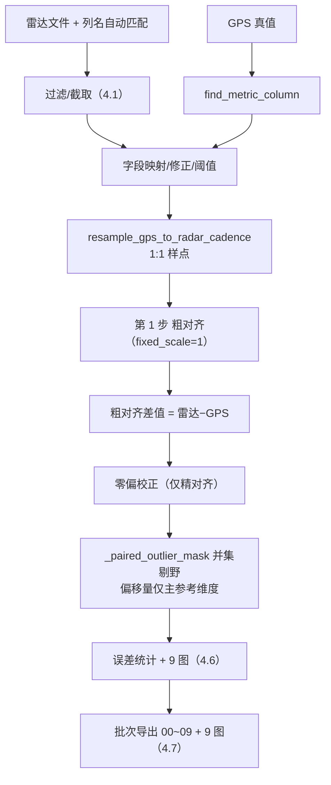

# 数据真值复核设计文档

> **适用版本**：V1.2.1（`radar_tool/__init__.py` → `__version__ = "1.2.1"`）/ **主要源码**：`radar_tool/compare_analysis.py`（`CompareAnalysisMixin`）、`compare_core.py`、`compare_data.py`、`compare_workers.py`、`compare_plot.py`、`compare_export.py`、`alignment.py` / **所属页签**：数据真值复核（页签 2）

**文档定位**：以实际落地实现为准。文中类名、函数名、字段名、按钮文案与导出文件名均取自当前代码；未落地的早期构想见 [6.3](#63-与早期设计的差异)。本文档取代旧文档《挂飞数据处理设计说明》。

---

## 1. 背景与目标

### 1.1 挂飞数据的业务背景

挂飞试验中机载雷达输出距离、速度、方位角、俯仰角等高密度测量序列，机载 GPS/惯导记录参考轨迹。雷达无直接真值可标定，工程上以 **GPS/惯导为参考真值**，两序列对齐后定量比对，评估测距/测速/测角精度。旧文档第 3 章的数据特征分析仍是有效背景：雷达采样高、连续性好（默认 `128 ms`/点）但无标定且含野点；GPS 稀疏（典型为雷达周期 2 倍以上）、有定位误差与掉包，时间基准与雷达时钟存在偏差甚至漂移。因此不能按时间戳逐点对应：时钟不一致、采样率悬殊、两侧长度/间隔/分辨率不同、轨迹动态使单点对齐失真。

### 1.2 设计目标

1. 分别加载雷达与 GPS 真值，沿用"数据可视化处理"的导入、列名匹配与字段识别；
2. 自动识别四维度，可独立勾选，仅对启用维度统计/绘图/导出；
3. GPS 用真实时间列插值到雷达节拍（秒/毫秒/微秒，默认 `128 ms`），全程 `1:1` 样点尺度；
4. 雷达范围截取与过滤在对齐前执行，保留原始样点位置；
5. "粗对齐 → 查雷达减 GPS 差值 → 距离零偏校正 → 精对齐"，零偏修正与剔野仅作用于精对齐；
6. 多维联合剔野（手动/自动 MAD，野点并集、同步删配对样点），**偏移量仅由主参考维度估计**；
7. 提供 RMSE、P95、相关系数等统计与 9 张分析图；
8. 按批次导出中文表头 CSV、配置 JSON、9 张 PNG，保留 UTC 字段与源时间单位。

### 1.3 与旧文档《挂飞数据处理》的关系

旧文档是规划稿（单点/最小二乘/互相关/DTW 统一接口、双主轴重采样）；实际落地（2026-08-28）收敛为**两阶段样点域对齐 + 多维联合剔野**，多算法比较保留在粗对齐内部（`compare_all` 按 RMSE 优选），未采用方案见 [6.3](#63-与早期设计的差异)。旧文档 MATLAB 脚本的人工步骤（`ginput` 分段、硬编码 `-21 m` 零值、`+0.6°` 修正、手工起点）正是本工具自动化掉的对象。

---

## 2. 总体架构

### 2.1 在工具箱中的位置

真值复核是主窗口页签 2（`main_window.py` 的 `_tab_names` 项 `'数据真值复核'`，工厂 `_create_compare_tab`）。与其他页签的独立 `XxxPanel` 不同，本模块以 **Mixin 形态**挂在主窗口：

```python
class MainWindow(QMainWindow, CompareAnalysisMixin):   # main_window.py
    def _create_compare_tab(self):
        return self._create_compare_analysis_page()
```

`MainWindow.__init__` 集中初始化全部 `compare_*` 状态字段（约 20 个，`main_window.py:52-69`），页签懒加载时构建 UI。复用公共设施：`data_loader`、`schemas.TruthReviewConfig`、`export_safety`（原子导出、CSV 转义、`build_export_metadata`）、`background_tasks`（`register_background_task`/`ensure_task_can_start`/`task_result_is_current`）、`errors`/`error_ui`、`logger.get_logger('compare_analysis')`、`ui_theme`、`plotting.style_axes_legend`。

### 2.2 模块结构与职责

- **`compare_core.py`**（纯计算核心）：`METRIC_DEFINITIONS`/`METRIC_BY_KEY`/`METRIC_COLUMN_ALIASES`、`find_metric_column`、`_normalize_column_name`（维度与语义匹配）；`resample_gps_to_radar_cadence`、`_estimate_fixed_scale_alignment`、`_paired_outlier_mask`、`_compute_truth_review`（插值/偏移估计/野点掩码/两阶段主流程，纯函数）；`TruthReviewWorker`、`_sample_mapping`、`_decimate_plot_arrays`、`MAX_PLOT_POINTS=6000`
- **`compare_data.py`**：`CompareDataMixin`、`CompareDataLoadWorker`、`_load_compare_radar_payload`、`_load_compare_truth_payload`、`ASYNC_COMPARE_LOAD_BYTES=2 MiB`（导入/列名/映射/过滤截取/统计/失效联动，大文件后台加载）
- **`compare_workers.py`**：`CompareWorkerMixin`——`run_compare_coarse_alignment`、`run_compare_fine_alignment`、`_run_compare_stage`、`_start_compare_worker`（任务编排、busy 控制、结果接收）
- **`compare_plot.py`**：`ComparePlotMixin`——`_plot_raw_data`/`_plot_range_comparison`/`_plot_interpolation_comparison`/`_plot_coarse_difference`/`_plot_metric_grid`/`_plot_trajectory`/`_plot_algorithm_comparison`（9 图、指标表、统计文本、数据预览）
- **`compare_export.py`**：`CompareExportMixin`——`_build_compare_export_tables`、`_create_compare_export_directory`、`export_compare_result`（8 CSV、批次目录、原子导出 00~09 + 9 图）
- **`compare_analysis.py`**：`CompareAnalysisMixin(CompareDataMixin, CompareWorkerMixin, ComparePlotMixin, CompareExportMixin)`、`_create_compare_analysis_page`（页 UI 组装）
- **`alignment.py`**：`prepare_timed_series`、`interpolate_at`、`apply_time_mapping`、`estimate_time_mapping`、`calculate_error_metrics`、`best_lag_by_xcorr` 等（通用对齐库五方法；真值复核用其插值/映射/指标）

> `alignment.py` 签名沿用历史"time"命名（`query_offset_s` 等），真值复核链路实传**样点单位**（`_run_compare_stage` 注释）；输出经 `_sample_mapping` 改名 `query_offset_samples`/`manual_offset_samples`/`shift_samples`。

### 2.3 数据流与处理流程



两阶段计算在后台线程执行：`CompareWorkerMixin._start_compare_worker` 将 `TruthReviewWorker` 放入 `QThread` 并登记为 `'数据真值复核（粗对齐）'`/`'数据真值复核（精对齐）'`；回调前经 `task_result_is_current` 校验任务版本，并用 `compare_preprocess_revision` 丢弃"预处理已变化"的过期结果。

---

## 3. 数据模型

### 3.1 雷达数据

**加载**（`compare_data._load_compare_radar_payload`）：TXT/CSV/DAT/XLSX/XLS（过滤器 `*.txt *.csv *.dat *.xlsx *.xls`），行为沿用 `read_numeric_table`。列名文件经 `DataLoader.auto_find_column_file` 按 `<数据名>列名.txt`、`<数据名>_列名.txt`、`<数据名>_columns.txt`、`<数据名>.columns.txt` 或任意含"列名"的 `.txt` 查找，`normalize_column_names` 归一（少则补 `列--N`）；未找到提示"未自动找到，可手动加载"（`load_compare_metadata`）。≥ `ASYNC_COMPARE_LOAD_BYTES`（2 MiB）走 `CompareDataLoadWorker`（任务名 `'数据真值复核：加载雷达数据'`）。

**运行态字段**：`compare_test_original_df`（过滤前快照）/ `compare_test_df` / `compare_test_source_indices`（每行**原始样点索引** `np.flatnonzero(mask)`）/ `compare_test_filepath`、`compare_meta_filepath`、`compare_meta_cols` / `compare_preprocess_revision`（预处理修订号，变化自增作废旧结果）。样点轴 `radar_sample = source_indices − source_indices[0]`；导出另给 `雷达原始样点索引(radar_source_sample_index)`。

### 3.2 GPS 真值数据

经 `read_numeric_table` 读纯数值表存 `compare_truth_df`（无列名匹配，不做截取/过滤），≥2 MiB 后台加载（任务名 `'数据真值复核：加载真值数据'`）。**时间列**默认选真值文件第一列（GPS 文件契约：首列为时间戳），可改选；**时间单位** `ms`/`s`/`us` 三选一、**默认秒**；时间列 `pd.to_numeric(errors='coerce')`，需 ≥2 个有效值且有两个不同值。**列位契约** `truth_pos` = 距离 4 / 速度 5 / 方位角 6 / 俯仰角 7（0 基，与历史 MATLAB/IMU 布局一致），**仅作列名匹配失败时的回退位**。

### 3.3 字段识别与复核维度

| key | 标签 | 单位 | `truth_pos` | `angular` |
|---|---|---|---|---|
| `distance` | 距离 | m | 4 | 否 |
| `speed` | 速度 | m/s | 5 | 否 |
| `azimuth` | 方位角 | deg | 6 | 是 |
| `elevation` | 俯仰角 | deg | 7 | 是 |

**自动识别** `find_metric_column`：列名经 `_normalize_column_name`（去空白/下划线/连字符/括号/斜杠，转小写）后与 `METRIC_COLUMN_ALIASES`（距离：`距离/目标距离/斜距/目标斜距/dist/distance/range`；速度：`速度/目标速度/径向速度/speed/velocity/radialspeed`；方位角：`方位角/目标方位角/方位/azi/azimuth`；俯仰角：`俯仰角/目标俯仰角/俯仰/elv/elev/elevation/pitch`）打分；**排除词**防误配——方位/俯仰排除 `速度/速率/rate/velocity/speed`，速度排除 `方位/俯仰/角速度/角速率/azimuth/elevation`，距离排除 `分辨率/分辨力/resolution`；精确匹配 `10000−别名序`、包含匹配 `100+10×别名长−归一名长−别名序`，同分取短名前列。雷达列只按语义名匹配（`_select_suggested_column(fallback_pos=None)`）。

**界面映射表**（`compare_mapping_widgets`）每维度一行：启用勾选、雷达/GPS 列下拉、**雷达修正 `radar_bias`**（tooltip："仅在精对齐中应用。粗对齐差值定义为'雷达 - GPS'，校零时通常输入该平均差值的相反数。"）、**GPS 修正 `truth_bias`**（"仅在精对齐中应用到 GPS 真值。"），均 `QDoubleSpinBox`（±1e9、6 位小数）。**主参考维度**（`combo_cmp_reference`）决定偏移估计与野点主判据，阈值单位联动；**备选野点维度**（`configure_compare_outlier_dimensions`）从"已启用非参考"维度多选、各设阈值（0=自动 MAD），存 `compare_additional_outlier_settings`。`_enabled_metric_configs` 产出 `{key,label,unit,truth_pos,angular,radar_col,truth_col,radar_bias,truth_bias}`；缺列报"请为X选择雷达列和真值列"，全未启用报"请至少启用一个复核维度"。

### 3.4 对齐结果结构

`_compute_truth_review(payload, cancel_event=None, progress_callback=None)` 两阶段共用输出：`stage`、`radar_sample`、`truth_sample`、`gps_interpolated_sample`；`result`（`radar_sample_index`、`paired_sample_kept`、每维度 `radar_<key>`/`gps_aligned_<key>`/`error_<key>`，角度折叠，**无时间列**）；`metric_results`（每维度 `config/radar/truth/raw_radar/raw_truth/gps_interpolated/error/metrics`）；`metrics_summary`（`stage/alignment/reference_metric/alignment_candidates/radar_interval_ms/gps_time_unit/gps_time_column/truth_samples_before_interpolation/truth_samples_after_interpolation/truth_valid_samples_after_interpolation/truth_valid_samples_after_alignment/paired_samples_after_outlier_removal/outlier_removal/interpolation/metrics/fields`）；`mapping`/`alignment_candidates`（经 `_sample_mapping`）；样点计数；`preprocess_revision`。

**mapping 公开字段**：`method`（中文名；精对齐追加"（粗对齐后精调）"；`least_squares_time` 显示"最小二乘样点对齐（固定比例）"）、`query_scale`（恒 1）、`query_offset_samples`、`manual_offset_samples`、`shift_samples`、`lag_samples`、`fit_score`。**outlier_removal**（仅精对齐）：`{dimensions:[{mode:'manual'|'auto_mad',center,threshold,removed,kept,metric_key,metric_label,unit},…], removed, kept}`。结果保存：粗对齐 → `compare_coarse_output`/`compare_coarse_mapping`（并清精对齐）；精对齐 → `compare_last_result`/`compare_last_output`/`compare_last_metrics`/`compare_last_paired_count`，"导出完整批次"此时才可用；映射/时间参数/预处理变化 → `_invalidate_compare_result`，仅修正/野点变化 → `_invalidate_fine_compare_result`。

### 3.5 导出批次文件清单

**目录命名**（`_create_compare_export_directory`）：`YYYYMMDD_HHMMSS_<雷达数据名>_真值复核`。雷达数据名 = 文件主名经 `re.sub(r'[<>:"/\\|?*]+','_')` 清洗、去首尾空格/点/下划线、截 80 字符，空则 `'雷达数据'`；重名追加 `_02`、`_03`…。

**文件清单**（`export_compare_result` 一次写全）：

| 文件 | 内容 |
|---|---|
| `00_导出元数据.json` | `build_export_metadata`：`version`=1.2.1、`schema_version`=1、`generated_at`、`input_summary`（雷达/GPS/列名文件名、行数、导出表清单）、`parameters`（`alignment_mapping`/`field_configuration`/`interpolation`/`outlier_removal`） |
| `01_真值复核结果.csv` | 精对齐全量逐样点表 |
| `02_真值复核有效配对.csv` | `01` 中 `配对样点保留(paired_sample_kept)=True` 的行 |
| `03_雷达测量数据.csv` | 雷达侧原始测量 |
| `04_GPS原始真值数据.csv` | GPS 原始逐行真值 |
| `05_GPS时间插值数据.csv` | 插值到雷达节拍后的序列 |
| `06_粗对齐结果.csv` | 粗对齐逐样点结果 |
| `07_误差指标.csv` | 每维度一行 9 项指标 |
| `08_对齐算法比较.csv` | 候选算法 RMSE/MAE/corr 对比 |
| `09_复核配置.json` | `TruthReviewConfig.to_payload()` + `export_metadata` |
| `图件_01_原始数据.png` … `图件_09_算法对比.png` | 9 张分析图（`savefig(dpi=240, bbox_inches='tight')`） |

9 图与页签对应（key）：`图件_01_原始数据.png`（raw，原始数据：雷达 vs GPS 原始）、`图件_02_过滤截取前后.png`（range）、`图件_03_GPS时间插值.png`（interpolation）、`图件_04_粗对齐差值.png`（coarse_difference：雷达−GPS 差值+平均线）、`图件_05_精对齐曲线.png`（overview）、`图件_06_精对齐误差.png`（error）、`图件_07_误差分布.png`（distribution：直方图 `bins=min(50,max(10,√N))`）、`图件_08_轨迹对比.png`（trajectory：球→直角坐标 2D/3D）、`图件_09_算法对比.png`（algorithms：候选 RMSE/MAE 柱状图）。

**中文表头规则**：所有 CSV 用 `中文名称(english_identifier)` 双语表头，**每列必须同时含 `(` 与 `)`**（测试断言）。`<label>` 为维度标签（距离/速度/方位角/俯仰角），`<key>` 为其英文标识（distance/speed/azimuth/elevation）。各表列（按序）：

- `01`/`02`：`雷达原始样点索引(radar_source_sample_index)`、`雷达相对样点索引(radar_sample_index)`、`GPS粗对齐UTC时间(gps_coarse_aligned_utc_time)`、`GPS精对齐UTC时间(gps_fine_aligned_utc_time)`、`GPS UTC时间单位(gps_utc_time_unit)`、`配对样点保留(paired_sample_kept)`，每维度加 `雷达<label>原始(radar_<key>_raw)`、`雷达<label>修正后(radar_<key>_corrected)`（=原始+radar_bias）、`GPS<label>粗对齐(gps_<key>_coarse_aligned)`、`GPS<label>精对齐(gps_<key>_fine_aligned)`、`<label>精对齐误差(error_<key>)`
- `03`：`雷达原始样点索引(radar_source_sample_index)`、`雷达相对样点索引(radar_sample_index)`、`GPS粗对齐UTC时间(gps_coarse_aligned_utc_time)`、`GPS精对齐UTC时间(gps_fine_aligned_utc_time)`、`GPS UTC时间单位(gps_utc_time_unit)`、每维度 `雷达<label>原始(radar_<key>_raw)`
- `04`：`GPS原始行号(gps_source_row_index)`、`GPS原始UTC时间(gps_utc_time_raw)`、`GPS UTC时间单位(gps_utc_time_unit)`、每维度 `GPS<label>原始(gps_<key>_raw)`
- `05`：`GPS插值样点索引(gps_interpolated_sample_index)`、`GPS插值相对时间毫秒(gps_interpolated_time_ms)`、`GPS插值UTC时间(gps_interpolated_utc_time)`、`GPS UTC时间单位(gps_utc_time_unit)`、每维度 `GPS<label>时间插值原始(gps_<key>_time_interpolated_raw)`、`GPS<label>时间插值修正后(gps_<key>_time_interpolated_corrected)`
- `06`：`雷达原始样点索引(radar_source_sample_index)`、`雷达相对样点索引(radar_sample_index)`、`GPS粗对齐UTC时间(gps_coarse_aligned_utc_time)`、`GPS UTC时间单位(gps_utc_time_unit)`、每维度 `雷达<label>原始(radar_<key>_raw)`、`GPS<label>粗对齐(gps_<key>_coarse_aligned)`、`<label>粗对齐差值(coarse_error_<key>)`
- `07`：`维度(metric)`、`单位(unit)`、`有效样点数(count)`、`平均误差(mean_error)`、`误差标准差(std_error)`、`平均绝对误差(mae)`、`均方根误差(rmse)`、`最大绝对误差(max_abs)`、`绝对误差P95(p95_abs)`、`相关系数(corr)`、`决定系数(r2)`
- `08`：`对齐方法(method)`、`样点比例(query_scale)`、`样点偏移(query_offset_samples)`、`互相关平移样点(lag_samples)`、`均方根误差(rmse)`、`平均绝对误差(mae)`、`相关系数(corr)`、`有效样点数(count)`

**UTC 字段规则**（`_build_compare_export_tables`）：

1. UTC 数值**保持 GPS 源时间单位，不擅自按 Unix 时间转换**；单位随行写入 `GPS UTC时间单位(gps_utc_time_unit)`（`s`/`ms`/`us`）；
2. `GPS原始UTC时间(gps_utc_time_raw)` = 时间列原值（`04` 逐行）；
3. 映射后 UTC：设 `gps_utc_origin` = 时间列首个有限值，Δ = 雷达采样间隔（ms），`u = {'s':1000.0,'ms':1.0,'us':0.001}[gps_time_unit]`，则

   ```
   query_sample = query_scale × radar_sample + query_offset_samples
   UTC = gps_utc_origin + query_sample × Δ / u
   ```

   `GPS插值UTC时间(gps_interpolated_utc_time)`（`05`）取插值网格；`GPS粗对齐UTC时间(gps_coarse_aligned_utc_time)`（`01/03/06`）取粗映射；`GPS精对齐UTC时间(gps_fine_aligned_utc_time)`（`01/02/03`）取精映射并叠加 `paired_sample_kept` 掩码（剔除样点写空）；
4. 查询落在插值网格范围外写空（不外推）。

**导出安全**：CSV 经 `export_safety.write_dataframe_csv`（`index=False, encoding='utf-8-sig'`）对 `= + - @` 开头单元格/表头加 `'` 前缀；整批先写 `.<批次名>.tmp-xxxx` 临时目录再 `os.replace` 原子替换，失败清理，清理失败抛 `BatchExportError` 列残留路径。`09_复核配置.json` 由 `TruthReviewConfig.create(...).to_payload()` 生成并附 `export_metadata`，`review_configuration` 即 `metrics_summary`（对齐/插值/剔野/字段全量配置）。

`TruthReviewConfig`（`schemas.py`）字段：`exported_at/radar_file/gps_truth_file/radar_metadata_file/batch_directory/review_configuration`；`from_payload` 兼容英文键与中文键（如 `导出时间(exported_at)`）；`to_payload` 输出 `schema_version: 1`；迁移 `_truth_review_v0_to_v1` 补版本号。

---

## 4. 功能与算法设计

符号约定：雷达窗口内第 i 点相对样点位置 `i_radar`（= `radar_sample[i]`，0 起整数），GPS 插值网格位置 `i_truth`（= `gps_interpolated_sample`，0 起步长 1），雷达采样间隔 Δ（ms，默认 128）。

### 4.1 雷达数据预处理（范围截取与过滤，在对齐前，保留原始样点位置）

预处理只作用于雷达侧且**固定在任何对齐之前**，先排除无效段（滑跑、丢跟踪、调试段）再与真值配对。**过滤** `apply_compare_filter`：选定过滤列与最小/最大值（留空不限；min>max 报错）→ 对 `compare_test_original_df` 该列 `pd.to_numeric(errors='coerce')` 取 `notna & ≥min & ≤max` 掩码 → `compare_test_df = original.loc[mask]`、`compare_test_source_indices = np.flatnonzero(mask)`（**行携带原始索引**）；`clear_compare_filter` 恢复原始表与 `arange` 索引、**不重置截取范围**。**截取** `_compare_range_bounds`：按原始索引左闭右开选取 `(source_indices ≥ start) & (source_indices < end)`（结束样点 0=末尾；结束<起始报错）；`lbl_cmp_range_count` 显示"交集保留: X / 原始 N 样点"。样点轴 `radar_sample = source_indices[selected] − source_indices[selected][0]`；"截取前后"图灰线画原始 `0..N-1` 全量、蓝线按原始索引画保留段。**失效联动**：过滤/截取变化 → `compare_preprocess_revision += 1`、清空粗精结果与图页；`_on_compare_analysis_succeeded` 丢弃修订号已变的过期结果。

### 4.2 GPS 时间域插值（真实时间列、秒/毫秒/微秒、雷达采样间隔默认 128 ms、1:1 样点尺度）

核心 `resample_gps_to_radar_cadence(gps_time, values, radar_interval_ms, time_unit='ms', method='linear')`：① `f = {'s':1000.0,'ms':1.0,'us':0.001}[time_unit]`，`t_ms = gps_time × f`（非法单位报"不支持的 GPS 时间单位"）；② 原点取首个有限值 `elapsed_ms = t_ms − t_ms[0]`（有效值 <2 或无两个不同值报错）；③ 网格 `grid_ms[k] = k × Δ`（k = 0 … `floor(duration_ms/Δ)`）；④ `interpolated[k] = interpolate_at(elapsed_ms, values, grid_ms[k], method)`；⑤ 返回样点域 `truth_sample = elapsed_ms/Δ`（GPS 原始点位置，可为小数）、`gps_interpolated_sample = grid_ms/Δ = 0,1,2,…`。

插值方式（`alignment.interpolate_at`）：`linear`（默认）/ `nearest` / `cubic`（`CubicSpline`，样本 ≥4，异常回退线性）。先经 `prepare_timed_series`：剔非有限值、稳定排序、同时间戳重复行取均值合并；查询点超出 `[t_min,t_max]` 保持 `NaN`（不外推）。GPS 掉行不拉伸数据（`test_gps_dropped_rows_are_interpolated_by_timestamp_without_stretching`：时间点 `0,1,2,4,5,7,8`（×0.256 s）→ `truth_sample = 0,2,4,8,10,14,16`，网格仍 `0..16`）。

插值后 GPS 与雷达同在样点轴（每点=一个雷达采样周期），对齐/绘图/统计全程在该轴——**不按样点数量拉伸数据，也不切换为时间坐标绘图**。Δ 默认 128 ms（`spin_cmp_radar_interval`，0.001~1e9 ms），对应 MATLAB `gps_index = round(gps_time/128)+1` 的节拍约定。

### 4.3 粗对齐（样点域偏移估计）

回答"雷达样点轴与 GPS 插值样点轴整体错开多少样点"，输出粗映射与"雷达 − GPS"差值图供读零偏。

**映射模型**（`alignment.estimate_time_mapping`，样点域）：

```
i_truth = query_scale × i_radar + query_offset_samples
初值 offset₀ = t_truth[0] − 1 × t_radar[0] − manual_offset_samples
```

真值复核经 `_estimate_fixed_scale_alignment(..., fixed_scale=1.0)` 固定 **`query_scale ≡ 1`（禁止时长拉伸）**，只估 `query_offset_samples`。`manual_offset_samples` 来自"粗对齐样点偏移"（`spin_cmp_manual_offset`，后缀"样点"，tooltip"正值表示将真值样点轴向后平移"；符号约定测试 `test_single_point_manual_offset_uses_documented_sign`）。

**候选算法**（`combo_cmp_method`，默认"互相关平移对齐" `xcorr`）：`compare_all`"多算法比较并优选"——跑 `resample`/`xcorr`/`least_squares_time`/`robust_xcorr` 四法，按主参考维度 RMSE 取最优（`min(candidates, key=rmse)`），候选入 `08_对齐算法比较.csv`；`single_point`"单点/手动偏移"用初值映射（scale=1）；`resample`"基线重采样"同前（scale=1 时等价单点），基线对照；`xcorr`"互相关平移对齐"FFT 互相关估整数样点平移；`least_squares_time`"最小二乘样点对齐"网格搜索最小标准化 MSE（scale 固定 1）；`robust_xcorr`"稳健互相关对齐"差分 + 5/95 分位截断后互相关。

**互相关**（与 `best_lag_by_xcorr` 对照）：参考序列抽稀到 ≤4096 点搜索；当前映射下插值出基线（NaN 空洞仅在相关内部填充）；去均值后任一 std ≤ 1e-12 返回 lag=0（`test_cross_correlation_does_not_shift_constant_series`）；FFT 相关 `corr = irfft(rfft(a₀)·rfft(b₀[::-1]))`，`lag* = argmax_{|lag|≤max_lag} corr`，`max_lag = max(1, int(max_shift_ratio×len))`（默认 0.25，0.01~0.80）；`time_shift = lag×median(diff(search_time))`、`lag_samples = round(time_shift/median(diff(radar_sample)))`、`offset ← offset − scale×time_shift`。延迟恢复测试 `test_cross_correlation_recovers_truth_clock_delay`：0.768 s 延迟误差 <0.15，RMSE <0.04。

**最小二乘**（`least_squares_time`）：参考抽稀到 ≤1200 点；`fixed_scale=1` 时只搜 `shifts = linspace(±max_shift_ratio×T, 61)`；评分 `_standardized_mse`（标准化后均方差，有效重叠须 ≥ max(8, 0.45×长度)，任一 std ≤ 1e-12 退化为原始 MSE）；最优平移入 `shift_samples`、损失入 `fit_score`。

**输出**：粗对齐渲染"粗对齐差值"图（`_plot_coarse_difference`，均值虚线），统计文本："阶段: 粗对齐（尚未应用雷达/GPS修正）/ 固定样点比例: 1（禁止时长拉伸）/ 粗对齐偏移: +N 样点 / 参考维度平均差值: X <单位> / 请根据'粗对齐差值'图设置雷达修正，然后运行第 2 步精对齐。"**粗对齐不应用 bias、不剔野点**（`pair_mask` 全真、`outlier_removal=None`），差值图如实反映零偏（`test_two_stage_review_keeps_zero_bias_for_coarse_and_removes_pairs_for_fine`：`query_scale==1.0`，+5 m 零偏的平均差值恰 5.0）。

### 4.4 距离零偏校正

零偏（任意维度常值偏差）经**雷达修正 `radar_bias` / GPS 修正 `truth_bias`** 校正：① **仅精对齐应用**（`apply_bias = stage=='fine'`；tooltip"仅在精对齐中应用"），粗对齐一律用未修正序列；② 加性常值 `radar_corrected = raw + radar_bias`、`gps_corrected = interpolated + truth_bias`；③ 工程用法（tooltip）："粗对齐差值定义为'雷达 - GPS'，校零时通常输入该平均差值的相反数"——差值图读 `+5 m` 则填 `radar_bias=-5 m`（测试修正后 RMSE <0.02）；④ 修正值入 `fields` 与导出列 `雷达<label>修正后(radar_<key>_corrected)`、`GPS<label>时间插值修正后(gps_<key>_time_interpolated_corrected)`；⑤ 修改 bias 只作废精对齐（粗对齐差值正是校零读数来源）。校正对象不限于距离；MATLAB 硬编码 `-21 m`、`+0.6°` 即对应 `radar_bias=-21`/`-0.6` 的参数化输入。

### 4.5 精对齐与多维联合剔野（主参考维度 + 备选维度、手动/自动 MAD 阈值、并集剔除、偏移量仅由主参考维度估计）

精对齐在"已修正的粗对齐结果"上执行：识别并同步剔野 → 保留样点上重估偏移 → 输出最终结果。

**单维度野点掩码** `_paired_outlier_mask(radar, truth, threshold, angular=False)`：

```
e_i = r_i − g_i                    # angular 时折叠到 (−180°, +180°]：e = (e+180) mod 360 − 180
V = {i : e_i 有限}                 # |V| < 3 报"粗对齐后的有效重叠样点不足（至少需要 3 个）"
c = median({e_i : i∈V})            # 残差中心（中位数抗野点）
d_i = |e_i − c|

手动模式（threshold > 0，mode='manual'）：
    τ = threshold
自动 MAD 模式（threshold ≤ 0，mode='auto_mad'）：
    MAD  = median({d_i : i∈V})
    span = P95({r_i}) − P5({r_i})      # 雷达有效值 95 与 5 分位差
    τ = max( 6.0 × 1.4826 × MAD,  0.01 × span,  1e-12 )

keep = (i∈V) ∧ (d_i ≤ τ)          # 保留 <3 报"同步剔除野点后有效样点不足"
```

`1.4826 = 1/0.6745` 为 MAD→σ 正态一致性常数（`6×1.4826×MAD ≈ 6σ` 门限）；`0.01×span` 是量程下限——插值良好时残差 MAD 极小，量程下限保证放行正常插值残差、剔除雷达尖峰（实现注释 "A tiny MAD is common after good interpolation…"）。界面 tooltip："0 使用 6 倍 MAD 自动阈值"。输出 `mode/center/threshold/removed/kept`。

**多维联合剔野**（`_compute_truth_review` fine 分支）：

1. **主参考维度**始终参与：`ref_radar = radar_source + radar_bias` 对 `coarse_truth = apply_time_mapping(…, gps_interpolated + truth_bias, coarse_mapping, …)` 算 `pair_mask`；
2. **备选维度**（`additional_outlier_dimensions`，兼容旧字段 `secondary_outlier_key`）须已启用并完成映射，各用自己的 bias/angular/阈值再算掩码；
3. **并集剔除** `pair_mask &= dimension_mask`（任一判野即剔）；合并保留 <3 报"多维度合并剔除后有效样点不足"；雷达与对应 GPS 插值样点同置 `NaN`，`paired_sample_kept` 记掩码；`outlier_removal.dimensions` 按"主参考 → 备选（原序）"记录；
4. **偏移量只由主参考维度估计**（备选只投票）：`fine_mapping = _estimate_fixed_scale_alignment(radar_sample, where(pair_mask, ref_radar, NaN), radar_sample, where(pair_mask, coarse_truth, NaN), payload(manual_offset_s=0.0))`，不再叠加手动偏移；
5. **偏移合成** `query_offset_samples_final = 粗偏移 + 精偏移`，`method` 追加"（粗对齐后精调）"，最终映射一次性作用于全部维度。

测试 `test_multiple_outlier_dimensions_remove_union_but_alignment_uses_reference`：三维度各埋 1 野点 → 并集剔 3 点（`kept.sum()==77`）、`query_scale==1.0`、`reference_metric=='distance'`。

### 4.6 误差统计（RMSE、P95、相关系数等）

`alignment.calculate_error_metrics(measured, truth, angular=False)` 对有效重叠样点（双方有限，≥2）：

```
error = measured − truth            # angular 折叠到 (−180°, +180°]
count = 有效样点数；mean_error = mean(error)；std_error = std(error)
mae = mean(|error|)；rmse = sqrt(mean(error²))
max_abs = max(|error|)；p95_abs = percentile(|error|, 95)
corr = corrcoef(measured, truth)[0,1]      # 任一 std ≤ 1e-12 → NaN
r2 = 1 − SS_res/SS_tot                      # SS_res = Σ error²，SS_tot = Σ (m−mean m)²；SS_tot ≤ 1e-12 → NaN
```

角度折叠测试 `test_angular_metrics_wrap_across_180_degrees`（179° vs −179° → `max_abs=2°`）。界面：统计表列头 维度/样点数/均值误差/标准差/MAE/RMSE/最大绝对误差/P95/相关系数/R²；`txt_cmp_stats` 摘要含阶段、对齐方法、`样点映射: i_truth = <scale> × i_radar <offset> 样点`、参考维度、插值方式、雷达采样间隔、野点判断与合并计数、算法比较结论、逐维度 `RMSE= MAE= P95=`。样点计数 7 标签：雷达原始 / 雷达过滤后 / 雷达过滤截取后 / GPS 插值前 / GPS 插值后（有效）/ GPS 对齐后有效 / 精对齐同步保留。

### 4.7 批次导出（原子导出、配置 JSON）

`export_compare_result`：前置粗精结果齐备（否则"请先完成粗对齐和精对齐"）→ `_build_compare_export_tables()` 组 8 表（UTC 推导见 3.5）→ `_create_compare_export_directory` 命名 → `build_export_metadata(input_summary, parameters)` → `TruthReviewConfig.create(...)`+`export_metadata` → `atomic_export_batch` 写 `.<批次名>.tmp-xxxx` 后 `os.replace`。成功提示并记日志；`OSError/ValueError/TypeError/OverflowError` 统一转 `ExportError('复核结果导出失败，请检查目标目录空间和文件权限')`。自检点（`test_complete_export_creates_named_batch_with_bilingual_csv_headers`）：目录名 `^\d{8}_\d{6}_<雷达名>_真值复核`、清单完整、无 `.tmp-` 残留、`00`/`09` 元数据一致（version=1.2.1、schema_version=1）、全列双语表头、UTC 数值等于真值时间列、单位列取源单位、未启用维度不出表。

---

## 5. 界面与交互

### 5.1 页面布局

`_create_compare_analysis_page()`：水平 `QSplitter` 分左右（初始 `[720, 680]`，`_initialize_compare_splitter_sizes` 微调：左区下限 680 px、窄屏保底给绘图区 420 px）；左为 `QScrollArea`（最小宽 680，1400×900 无滚动条）。左侧四分组：**数据导入**（`加载雷达数据`/`加载雷达列名`/`加载真值数据`/`预览已加载数据`/`绘制原始数据`）、**复核项目与字段映射**（每维度一行：启用/雷达字段/GPS 字段/雷达修正/GPS 修正）、**雷达对齐前处理：过滤与截取**（起始/结束样点（0=末尾）/过滤列/最小值/最大值/`应用过滤`/`清除过滤`）、**时间插值、两步对齐与数据统计**（雷达采样间隔 128 ms、GPS 时间列/单位（默认秒）/插值方式（默认线性）、粗对齐样点偏移、对齐方法（默认互相关）、参考维度、最大平移比例 0.25、主维度野点阈值（"自动 MAD"）、`设置备选维度`，`第 1 步：粗对齐`/`第 2 步：精对齐`/`导出完整批次`，7 个数据统计标签）。分组 tooltip："GPS按时间列插值到雷达周期；插值后仅在样点轴上进行粗对齐和精对齐"。右侧 10 页签：原始数据/截取前后/GPS 时间插值/粗对齐差值/精对齐后对比/误差曲线/误差分布/轨迹对比/算法对比（各 `Figure(figsize=(11,5.5), dpi=110)` + `NavigationToolbar`）+ 统计结果（`table_cmp_metrics` + `txt_cmp_stats`）。

### 5.2 八步工作流（README「数据真值复核工作流」）

1. **导入数据**：`load_compare_test_data`/`load_compare_truth_data`/`load_compare_metadata`，自动映射勾选四维度，检查 GPS 时间列；
2. **选择维度**：勾选复核维度、指定主参考维度（`_enabled_metric_configs`）；
3. **预处理雷达数据**：对齐前设范围/过滤（`apply_compare_filter`），核对统计与曲线；
4. **设置时间参数**：GPS 时间单位（秒/毫秒/微秒）、雷达采样间隔（默认 `128 ms`）；
5. **执行粗对齐**（`第 1 步：粗对齐`）：插值→样点域对齐，由差值图判零偏（`run_compare_coarse_alignment`，自动切"粗对齐差值"页）；
6. **设置精对齐**：输入距离零偏校正值，设主参考与备选维度手动/自动 MAD 阈值（仅作废精对齐）；
7. **执行精对齐**（`第 2 步：精对齐`）：联合剔野同步删除，主参考维度估最终偏移（`run_compare_fine_alignment`）；
8. **检查并导出**（`导出完整批次`）：核对曲线/误差图/指标，选根目录生成批次（`export_compare_result`）。

按钮规则：`第 2 步` 粗对齐成功前禁用；`导出完整批次` 精对齐成功前禁用；后台计算中数据/参数控件禁用，但**预处理控件仍可用**（`test_analysis_runs_in_background_and_decimates_plots`）。

### 5.3 结果页签与绘图细节

| 页 | 要点 |
|---|---|
| 原始数据 | 雷达按相对样点、GPS 按真实时间换算（`(t_ms−t₀)/Δ`）；x 轴"样点位置（GPS 由时间列 / 雷达周期换算）" |
| 截取前后 | 灰"截取前（雷达原始）" vs 蓝"截取/过滤后"，均按原始索引 |
| GPS 时间插值 | 灰 GPS 原始点 vs 红虚线"GPS 时间插值后（雷达采样周期）" |
| 粗对齐差值 | `雷达−GPS` + 均值红线 + 0 线；精对齐后改"精对齐后差值" |
| 精对齐后对比/误差曲线/误差分布 | `_plot_metric_grid(mode='overview'/'error'/'distribution')`，>1 维度 2 列子图；直方图 bins `min(50,max(10,√N))` |
| 轨迹对比 | 需启用距离+方位角；球→直角 `x=d·cos(el)cos(az)`、`y=d·cos(el)sin(az)`、`z=d·sin(el)`；有俯仰角 3D，否则等比例 XY |
| 算法对比 | 候选 RMSE/MAE 分组柱状图（单位随参考维度） |

**长序列抽稀**：曲线经 `_decimate_plot_arrays(max_points=MAX_PLOT_POINTS=6000)` 等距抽稀；**统计与导出始终全量有效样点**。

### 5.4 状态反馈与失效联动

状态栏逐步反馈（"正在后台执行…"→"粗对齐完成: …平均差值…"→"精对齐完成: …RMSE…"→"完整复核结果已导出: …"）；worker 进度 5%→25%→55%→95%；失败/取消走 `QMessageBox`。失效分级：时间参数/映射/预处理 → `_invalidate_compare_result`；仅修正/野点 → `_invalidate_fine_compare_result`（提示"修正或野点参数已变化，请重新运行第 2 步精对齐"）。任务版本化（`task_result_is_current`）丢弃过期回调。

---

## 6. 关键实现与开发演进

### 6.1 关键实现决策

1. **Mixin 形态**：`CompareAnalysisMixin` 混入 `MainWindow`，复用主窗口 `task_registry`/`status_label`；代价是约 20 个 `compare_*` 字段挂在主窗口实例（`main_window.py:52-69`）——"主窗口瘦身"中间态（见第 8 章）。
2. **纯计算核心与 UI 分离**：`_compute_truth_review` 无 Qt 依赖，`TruthReviewWorker` 只包信号；算法可直接单测。
3. **后台线程 + 任务注册表**：粗/精对齐与 ≥2 MiB 加载走 `QThread` + `register_background_task`，协作式取消，同名任务版本化。
4. **全程样点域、固定比例 1**：`query_scale` 恒 1（`fixed_scale=1.0`），拒绝时长拉伸——拉伸会把时钟漂移与测量误差混在一起，指标失去物理意义；结果表不设时间列。
5. **偏移量单源**：剔野可多维投票，偏移只由主参考维度估计，物理口径唯一。
6. **抽稀但统计全量**：绘图 6000 点保流畅；指标、CSV、掩码全量。
7. **导出原子化 + 双语表头 + UTC 不换算**：临时目录 + `os.replace`；CSV 公式转义；UTC 保持源单位。
8. **预处理修订号**：`compare_preprocess_revision` 解决"算到一半改过滤"竞态。

### 6.2 开发时间线

| 时间 | 事件 | 与本模块的关系 |
|---|---|---|
| 2026-07-14 | 源码初始化（`feat: 初始化工具源码`） | `alignment.py` 对齐库（五方法、`estimate_time_mapping`、`best_lag_by_xcorr`、`calculate_error_metrics`）与真值复核雏形入库 |
| 2026-08-28 | **真值复核整体落地**（`增加了真值比对和格式转换`） | README 五要点：**时间基准修正**（真实时间列插值，秒/毫秒/微秒，默认 `128 ms`，1:1 样点）；**两阶段对齐**（粗对齐差值、距离零偏校正、精对齐，截取过滤在对齐前）；**多维联合剔野**（手动/自动 MAD，同步剔雷达/GPS 样点）；**批次完整导出**（独立目录 + 全套表 + 9 图）；**UTC 信息保留**（原始/插值/粗/精 + 源单位）。另含对齐后台化、长序列抽稀、布局调整 |
| 2026-11-04 | 数据安全加固 | 原子导出、CSV 转义对批次导出生效 |
| 2026-11-08 | 加载提速 | `data_loader` 共享样本、单次解析，导入链路受益 |
| 2026-11-11 | **V1.1.1 发布** | 本文档对应版本 |
| 2026-11-14 | **V1.2.1** | **v1.1.2 改点（TR-01~04、TR-06）**：第 3 步结果区「用平均差值」一键填充 + 撤销；GPS 时间单位按相邻样点差量级自动推断；野点阈值按参考维度独立记忆；参数变更统一失效（清空指标表 + 全图页失效提示，防旧结果冒充新结果）；1024 宽窗口下左栏最小 520 + 横向滚动、右区最小 420。**UI V2**：接入全局设计令牌与结果卡（数值/单位分离）。 |

### 6.3 与早期设计的差异

旧文档第 5~8 章规划"单点→最小二乘→互相关/DTW/特征点→统一接口多算法"体系与双主轴重采样；实际收敛原因：

1. **DTW 与特征点匹配未采用**：GPS 插值到雷达节拍后已是 1:1 样点对应，失配主要是整体平移+常值零偏，FFT 互相关即可；DTW 非线性规整会把真实动态测量误差"规整掉"、掩盖精度。特征点匹配依赖轨迹拐点，挂飞航段未必够用。
2. **"多算法可切换"收敛为"两阶段 + 内部优选"**：界面保留 6 方法（单点/手动偏移供快速对照），`compare_all` 在粗对齐内按 RMSE 优选四法，候选对比落 `08_对齐算法比较.csv` 与"算法对比"图。
3. **最小二乘降为固定比例只估平移**（`query_scale` 固定 1，6.1-4）；缩放网格代码保留在 `alignment.py`，真值复核以 `fixed_scale=1.0` 关闭。
4. **插值只留线性/最近邻/三次样条**，单向"GPS→雷达节拍"，统一雷达样点轴。
5. **绘图从时间坐标回样点坐标**（README"不再切换为时间坐标绘图"）；旧"时间误差曲线"落地为"对齐后雷达样点索引"横轴，UTC 只在导出表保留。
6. **误差指标落地 9 项**；旧"分段统计"由过滤+截取、逐样点误差曲线、分布图覆盖；旧"多算法对比图"落地为候选 RMSE/MAE 柱状图，误差分布为直方图（未做箱线图）。
7. **MATLAB 人工步骤全部参数化**：`ginput` 分段→过滤+截取；手工起点→原始样点范围；硬编码零值→`radar_bias`/`truth_bias`；`round(gps_time/128)+1`→`resample_gps_to_radar_cadence`；脚本中 `THETA_LFJ2RD` 坐标变换不属本模块（直接用真值文件 4~7 列）。

---

## 7. 测试与验收

验收依据 `tests/test_truth_review.py`（核心算法 9 例）+ `tests/test_truth_review_panel.py`（面板集成 14 例）。

### 7.1 核心算法测试 `tests/test_truth_review.py`

直接调用 `_compute_truth_review`、`resample_gps_to_radar_cadence` 与 `alignment` 纯函数：

| 用例 | 验收点 |
|---|---|
| `test_cross_correlation_does_not_shift_constant_series` | 常数序列不虚假平移 |
| `test_prepare_timed_series_keeps_pairs_and_merges_duplicate_times` | 成对清洗、同时间戳均值合并 |
| `test_interpolation_leaves_extrapolated_samples_invalid` | 插值不外推 |
| `test_cross_correlation_recovers_truth_clock_delay` | `xcorr` 恢复 0.768 s 延迟（RMSE<0.04，corr>0.999） |
| `test_single_point_manual_offset_uses_documented_sign` | 手动偏移符号与 tooltip 一致 |
| `test_angular_metrics_wrap_across_180_degrees` | 角度误差 ±180° 折叠 |
| `test_gps_dropped_rows_are_interpolated_by_timestamp_without_stretching` | GPS 掉行按真实时间插值、样点不拉伸 |
| `test_two_stage_review_keeps_zero_bias_for_coarse_and_removes_pairs_for_fine` | 粗：scale=1、不应用 bias；精：`radar_bias=-5` 后尖峰剔除，RMSE<0.02 |
| `test_multiple_outlier_dimensions_remove_union_but_alignment_uses_reference` | 并集剔 3 点（`kept.sum()==77`）、偏移仅参考维度 |

### 7.2 面板集成测试 `tests/test_truth_review_panel.py`

`QT_QPA_PLATFORM=offscreen`，`TruthReviewHost(QMainWindow, CompareAnalysisMixin)` 承载页面：

| 用例 | 验收点 |
|---|---|
| `test_analysis_runs_in_background_and_decimates_plots` | 2 万点后台计算、结果 2 万行无 `aligned_time_s`、页签 10 个、绘制点 ≤6000 |
| `test_initial_split_shows_complete_left_control_panel` | 1400×900 左区 ≥680 px 无滚动条 |
| `test_radar_load_matches_visualization_flow_and_auto_maps_fields` | 列名自动匹配、四维度自动映射勾选 |
| `test_large_radar_load_runs_in_background` | ≥2 MiB 走 `CompareDataLoadWorker` |
| `test_only_checked_distance_is_analyzed` | 单维度结果表仅 5 列、指标表 1 行 |
| `test_additional_outlier_settings_accept_all_enabled_non_reference_metrics` | 备选维度覆盖全部已启用非参考维度 |
| `test_raw_plot_uses_irregular_gps_timestamps` | 原始图按真实时间定位 GPS 点 |
| `test_radar_filter_and_range_are_applied_and_can_be_reset` | 过滤/截取/恢复行为正确、原始快照不变 |
| `test_selected_range_controls_analysis_length` | 截取控制分析长度；映射字段 `query_offset_samples` |
| `test_radar_filter_is_applied_before_alignment` | 过滤先于对齐；改截取即作废结果 |
| `test_filter_does_not_reset_original_sample_range` | 过滤不重置截取 SpinBox |
| `test_truth_review_and_visualization_keep_independent_data_state` | 与可视化页签数据状态互不影响 |
| `test_complete_export_creates_named_batch_with_bilingual_csv_headers` | 批次命名/清单/双语表头/UTC 保持/无残留 |
| `test_angle_columns_do_not_match_angular_velocity` | "方位角速度/俯仰角速度"不被误识别 |

### 7.3 验收要点

1. `python -m pytest tests/test_truth_review.py tests/test_truth_review_panel.py -q` 全绿；
2. 手工黄金路径：导入→自动映射→过滤/截取→粗对齐（读零偏）→填 `radar_bias`→精对齐→导出，核对 3.5 清单与 UTC 列；
3. 回归防线：与 `test_export_safety.py`、`test_data_loader_formats.py`、`test_background_tasks.py` 共同守护公共设施。

---

## 8. 已知问题与后续计划

### 8.1 已知问题与限制

1. **Mixin 未完全面板化**：`CompareAnalysisMixin` 及四个子 Mixin 混入 `MainWindow`，约 20 个 `compare_*` 字段在主窗口初始化（`main_window.py:52-69`）（体检 P2 整改项）。
2. **`compare_analysis.py` 残留重构痕迹**：尾部留有"Data loading / Analysis / Preview and export"空段注释占位。
3. **`alignment.py` 命名历史包袱**：`*_s`/`*_time` 签名实传样点单位；`run_alignment`/`align_by_least_squares_time`/`resample_series`/`downsample_for_search` 等旧接口与真值复核接口并存。
4. **导出 PNG 固定 240 dpi**：与全局 `savefig.dpi=600` 不一致（界面画布 110 dpi）。
5. **精对齐依赖粗对齐质量**：二次偏移在粗映射上精调，粗对齐落入错误相关峰时需手动偏移或换方法重跑。
6. **单机单进程**：多实例导出仅靠 `_02/_03` 序号去重。

### 8.2 后续计划

1. **Mixin → 独立面板**：拆为 `TruthReviewPanel`（对齐 `VisualizationPanel` 接入约定），状态随迁、公共接口不变；
2. **出图规范统一**：导出 DPI 对齐 `app_config` 或提供清晰度选项；
3. **`alignment.py` 接口梳理**：明确样点域/时间域命名语义，收敛未用旧接口；
4. **用户操作手册**与设计文档分离建设；
5. 按实测数据校核自动 MAD 阈值下限（`0.01×span`）与默认参数。

---

*本文档与代码同步维护：复核维度、对齐算法、导出清单或界面流程变化时，同步更新本文档及 README「数据真值复核」章节。旧文档《挂飞数据处理.md》已由本文档取代并删除。*
