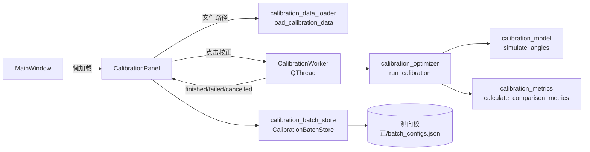
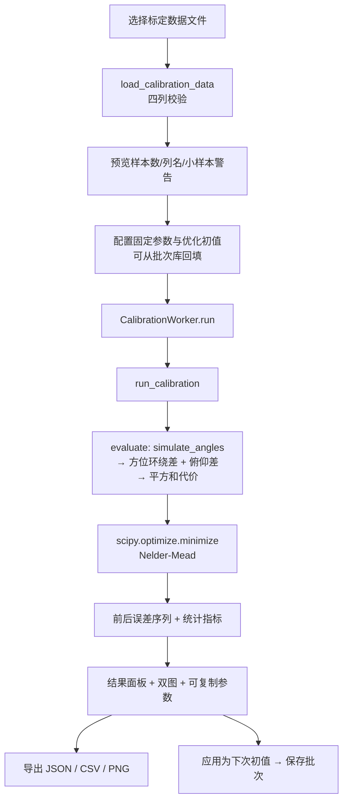

# 测向校正自动化设计文档

> **适用版本**：V1.2.1
> **主要源码**：`radar_tool/calibration_panel.py`、`calibration_data_loader.py`、`calibration_model.py`、`calibration_optimizer.py`、`calibration_metrics.py`、`calibration_batch_store.py`
> **所属页签**：测向校正自动化（主窗口第 4 页，懒加载）
> **文档定位**：以实际落地实现为准的工程设计文档。文件名沿用历史命名《测向校正自动化脚本.md》；立项时的"自动化脚本"定位已演进为集成在工具箱中的 GUI 面板（见 [6.3 节](#63-与早期设计的差异)）。MATLAB 基线源码保留在[附录 A](#附录-amatlab-基线源码)。

---

## 目录

- [1. 背景与目标](#1-背景与目标)
- [2. 总体架构](#2-总体架构)
- [3. 数据模型](#3-数据模型)
- [4. 功能与算法设计](#4-功能与算法设计)
- [5. 界面与交互](#5-界面与交互)
- [6. 关键实现与开发演进](#6-关键实现与开发演进)
- [7. 测试与验收](#7-测试与验收)
- [8. 已知问题与后续计划](#8-已知问题与后续计划)
- [附录 A：MATLAB 基线源码](#附录-amatlab-基线源码)

---

## 1. 背景与目标

### 1.1 业务背景

测向系统装机后，天线阵面与转台/载体坐标系之间存在安装偏差，表现为方位、俯仰测量值相对真值的整体偏移与漂移。工程上通过**暗室标定**：在已知距离上采集一批"真值角度 vs 实测角度"样本，反推坐标系中的安装参数（`yy_r4_ZT`、`zz_r4_ZT` 两个零点坐标），再回填到工程配置中。

手工改参数、跑脚本、比对曲线、记录批次——这套流程重复度高且容易抄错参数。本模块把它固化为：**导入标定数据 → 自动寻优 → 前后误差对比 → 批次沉淀复用 → 一键导出**。

### 1.2 设计目标

1. 支持 Excel/CSV/TXT 等格式的四列标定数据导入与严格校验；
2. 自动优化 `yy_r4_ZT`、`zz_r4_ZT`，**同时纳入方位与俯仰误差**；
3. 展示优化前后均值、标准差、RMSE、最大绝对误差与双图对比；
4. 批次固定参数支持本地保存、选择复用、覆盖修改、另存与删除；
5. 优化结果可一键应用为下一次校正初值，再保存到当前批次配置；
6. 优化在后台线程执行，导出 JSON 参数指标、CSV 样本明细和 PNG 误差曲线。

### 1.3 范围边界（MVP）

**做**：两个零点参数寻优、批次参数库、误差评估与导出。
**不做**：3×3 变换矩阵的自动求解、多批次批量重跑、批次间参数对比（预留结构，见第 8 章）。

---

## 2. 总体架构

### 2.1 在工具箱中的位置

主窗口懒加载 `CalibrationPanel`（`main_window.py` 的 `_create_calibration_tab`）。面板持有 `CalibrationBatchStore`（可注入，便于测试），持久化目录为用户数据根下的 `测向校正/`。



### 2.2 模块结构

| 文件 | 类/函数 | 职责 |
|---|---|---|
| `calibration_panel.py` | `CalibrationPanel` | 主面板：参数区、批次库交互、结果展示、绘图、导出 |
| 同上 | `CalibrationWorker` | 后台执行 `run_calibration`，支持协作取消 |
| `calibration_data_loader.py` | `load_calibration_data` | 四列数据读取、表头识别、数值校验 |
| `calibration_model.py` | `simulate_angles` | 坐标平移 + 旋转 → 反算仿真角度 |
| 同上 | `azimuth_difference` | 方位误差环绕处理（[-180, 180)） |
| `calibration_optimizer.py` | `run_calibration` | Nelder-Mead 寻优 + 前后对比结果组装 |
| 同上 | `CalibrationCancelled` | 取消异常 |
| `calibration_metrics.py` | `calculate_error_metrics` / `calculate_comparison_metrics` | 均值/标准差/RMSE/最大绝对误差 |
| `calibration_batch_store.py` | `CalibrationBatchStore` | 批次配置 JSON 持久化（备份/隔离/逐条容错） |
| 同上 | `create_default_profile`、`DEFAULT_FIXED_PARAMS`、`DEFAULT_INIT_PARAMS` | 默认参数 |

### 2.3 数据流与处理流程



---

## 3. 数据模型

### 3.1 标定数据（四列）

`load_calibration_data(filepath)` 返回 dict：

| 字段 | 含义 | 单位 |
|---|---|---|
| `az_true` | 方位角真值 | 度 |
| `el_true` | 俯仰角真值 | 度 |
| `az_meas` | 方位角实测值 | 度 |
| `el_meas` | 俯仰角实测值 | 度 |

**加载规则**（`calibration_data_loader.py`）：

| 规则 | 说明 |
|---|---|
| 支持格式 | `.xlsx/.xls/.xlsm`（走 `read_excel_table`）；`.csv/.txt/.dat/.log`（走 `read_text_table`，分隔符候选 `, ; ，\t \|`） |
| 表头识别 | 若首行能按别名匹配全部四个字段则按名取列；否则取前 4 列 |
| 字段别名 | 如 `az_true`/`azimuth_true`/`方位角真值`/`方位真值`/`真值方位角` 等（`FIELD_ALIASES`，大小写与空格/连字符归一） |
| 校验 | 至少 4 列；空值/非数值报"第 N 条数据存在空值或非数值内容"；四列长度一致；`validate_sample_count` 行数上限 100 万 |
| 小样本警告 | `sample_count < 30` 时置 `small_sample_warning=True`，界面提示优化可能不稳定 |

### 3.2 固定参数与优化初值

`calibration_batch_store.DEFAULT_FIXED_PARAMS` / `DEFAULT_INIT_PARAMS`：

| 参数 | 默认值 | 单位 | 说明 |
|---|---:|---|---|
| `rho_obj` | 15000.0 | mm | 暗室物理距离（必须 > 0） |
| `xx_r4` | 15576.864 | mm | r4 的 x 坐标（固定不优化） |
| `BS14` / `BS24` / `BS34` | 194.5 / 119.5 / 58.0 | mm | 保留接口，便于后续扩展 |
| `matrixZT2ANT` | 3×3 基线矩阵 | — | 坐标变换矩阵（有限数值校验） |
| `yy_r4_ZT` | 1.999 | mm | **待优化**初值 |
| `zz_r4_ZT` | 1.096 | mm | **待优化**初值 |

`matrixZT2ANT` 默认值：

```
[[ 0.9999946,  0.0015699,  0.0028962],
 [-0.0015826,  0.9999892,  0.0043656],
 [-0.0028893, -0.0043701,  0.9999863]]
```

### 3.3 批次配置（CalibrationConfig）

持久化于 `测向校正/batch_configs.json`（Schema 类型 `calibration_config`，见 `schemas.py`）：

```json
{
  "id": "系统生成的唯一标识",
  "name": "2026-08 暗室 A01",
  "data_path": "D:/calib/MeasData_A01.xlsx",
  "fixed_params": { "rho_obj": 15000, "xx_r4": 15576.864, "matrixZT2ANT": [[...]], "BS14": 194.5, "BS24": 119.5, "BS34": 58.0 },
  "init_params": { "yy_r4_ZT": 1.999, "zz_r4_ZT": 1.096 },
  "notes": "暗室A位，天线重装后首批校正"
}
```

**保存与复用规则**：

- 下拉选择已保存配置后界面自动回填全部参数；
- "保存修改"覆盖当前配置（改名即重命名）；"另存为"复制为新配置；"删除"只删配置不动原始数据与导出结果；
- 批次名称不允许重复；未保存修改在切换/新建/删除前需确认（`_confirm_discard`）；
- 写入采用临时文件 + `os.replace` 原子替换。

**可靠性机制**（2026-11 项目体检步骤 2）：

| 机制 | 实现 |
|---|---|
| 损坏隔离 | JSON 解析失败改名为 `.corrupt-<时间戳>`（`_quarantine_corrupt_file`） |
| 备份回滚 | 每次成功保存前校验当前文件并复制为 `.bak`（`_backup_valid_json`） |
| 体量限制 | 文件 ≤ 10 MB、嵌套深度 ≤ 64（`MAX_JSON_FILE_SIZE` / `MAX_JSON_NESTING_DEPTH`） |
| 逐条容错 | `_load` 对非法单条配置记录警告并跳过，不让整页加载失败；校验 ID 唯一性、矩阵有限性、参数名与数值类型 |

### 3.4 优化结果结构

`run_calibration` 返回 dict：

| 键 | 内容 |
|---|---|
| `success` / `message` / `iterations` | 优化器收敛状态、说明、迭代次数 |
| `sample_count` | 样本数 |
| `initial_params` / `optimized_params` | `{yy_r4_ZT, zz_r4_ZT}` |
| `initial_cost` / `final_cost` | 优化前后代价 |
| `metrics` | `calculate_comparison_metrics` 输出：`azimuth/elevation` × `before/after` × `mean/std/rmse/max_abs` |
| `series` | 原始四列 + 仿真角 + 误差序列（`az_sim_orig/el_sim_orig/az_sim_opt/el_sim_opt/err_az_orig/err_el_orig/err_az_opt/err_el_opt`） |

导出三件套：JSON 参数与指标、CSV 样本明细、PNG 误差曲线（`_export_result`）。

---

## 4. 功能与算法设计

### 4.1 角度仿真核心

实现：`calibration_model.simulate_angles(yy_r4, zz_r4, az_true, el_true, fixed_params)`。

对每个真值角度点：

1. **真值角度 → 空间目标坐标**（注意俯仰取负号的约定）：

\[
\mathbf{obj} = \rho_{obj}\begin{pmatrix}
\cos(-el)\cos(az)\\
\cos(-el)\sin(az)\\
\sin(-el)
\end{pmatrix}
\]

2. **平移**：\(\mathbf{p} = \mathbf{obj} - (xx_{r4}, yy_{r4}, zz_{r4})\)；
3. **变换**：\(\mathbf{a} = \mathbf{p} \cdot \mathbf{M}_{ZT2ANT}\)（行向量右乘 3×3 矩阵）；
4. **反算仿真角**：

\[
az_{sim} = \operatorname{atan2}(a_y, a_x),\qquad
el_{sim} = -\arcsin\!\left(\frac{a_z}{\|\mathbf{a}\|}\right)
\]

（`arcsin` 的自变量 `np.clip(zz/radius, -1, 1)` 防数值越界；半径 ≤ eps 时报"坐标变换后存在位于原点的样本"。）

### 4.2 误差定义与优化目标

**方位误差做环绕处理**（`azimuth_difference`）：

\[
e_{az} = \big((measured - simulated) + 180\big) \bmod 360 - 180 \in [-180^\circ, 180^\circ)
\]

**俯仰误差为直接差**：\(e_{el} = el_{meas} - el_{sim}\)。

**代价函数**（`run_calibration` 的 `evaluate`）：

\[
\mathrm{cost}(yy_{r4}, zz_{r4}) = \sum_{i}\left(e_{az,i}^2 + e_{el,i}^2\right)
\]

> 与 MATLAB 基线的差异：MATLAB 版代价为 `sum((sim − meas).^2, 'all')`，未对方位做环绕、也未区分两角度语义；Python 版**显式合并方位（环绕）和俯仰残差**后再计算总代价（原文档已确认此修正）。

### 4.3 参数寻优

`scipy.optimize.minimize(..., method='Nelder-Mead', options={'maxiter': 1000, 'xatol': 1e-8, 'fatol': 1e-8})`：

- 初值为 `[yy_r4_ZT, zz_r4_ZT]`（可来自批次库或界面临时修改）；
- 迭代回调检查 `cancel_event` 实现协作取消（`CalibrationCancelled`），并按 `min(95, 10 + 85·iter/maxiter)` 上报进度；
- 收敛后用最终参数重新评估一次 `final_cost`，并组装前后对比（初值一组、优化值一组）。

### 4.4 误差指标

`calculate_error_metrics(errors)`：`mean`、`std`、`rmse = sqrt(mean(e²))`、`max_abs`；`calculate_comparison_metrics` 按方位/俯仰 × 优化前/后组装四组指标。空序列或含非有限值直接拒绝。

### 4.5 批次参数库

`CalibrationBatchStore` 提供 `list / get / save / delete / create_default_profile` 等操作（完整接口见源码），关键行为：

- `DEFAULT_FIXED_PARAMS` / `DEFAULT_INIT_PARAMS` 用于首次启动与"新建"；
- `_load` 逐条 `CalibrationConfig` 校验，非法条目跳过并 `logger.warning`；
- 存储文件位于 `get_user_data_dir('测向校正')`，路径安全由 `runtime_paths` 统一保证。

---

## 5. 界面与交互

### 5.1 布局

`_init_ui` 构建左右分区：参数区（`_create_parameter_area`）+ 结果区（`_create_result_area`），结果区含三个摘要卡（`_create_summary_box`：样本数、优化前 RMSE、优化后 RMSE）与误差对比绘图。

| 区域 | 控件 |
|---|---|
| 数据导入 | 文件路径编辑框 + 浏览按钮（`_browse_data_file`）、样本预览（`_update_preview`：样本数、源列名、小样本警告） |
| 固定参数 | `rho_obj`、`xx_r4`、`BS14/BS24/BS34` 双精度 SpinBox、3×3 矩阵表格（`_set_matrix`） |
| 优化初值 | `yy_r4_ZT`、`zz_r4_ZT` SpinBox |
| 批次库 | 配置下拉（`_refresh_profile_combo`）、新建/保存/另存为/删除（`_new_profile/_save_profile/_save_profile_as/_delete_profile`）、备注编辑 |
| 操作 | 开始校正按钮、复制结果参数（`_copy_result_parameters`）、应用为下次初值（`_apply_result_as_initial`）、导出（`_export_result`） |

### 5.2 关键交互流程

1. **导入**：选择文件 → `load_calibration_data` → `_update_preview` 显示样本数与列来源；
2. **参数准备**：手动改参数或从批次库回填；`_connect_dirty_signals` 监听改动并 `_mark_profile_dirty`；
3. **执行校正**：`_start_calibration` 组装 `CalibrationWorker` + `QThread`（登记 `task_registry`）→ 进度/状态栏（`_show_status`）→ `_on_calibration_finished` 更新指标（`_update_metrics`）与绘图（`_plot_result`）；
4. **取消/失败**：`_on_calibration_cancelled/_on_calibration_failed` 提示并 `_cleanup_calibration_thread`；
5. **沉淀**：`_apply_result_as_initial` 把 `yy_opt/zz_opt` 写回初值框 → `_save_profile` 落批次；
6. **导出**：JSON 参数指标 + CSV 样本明细 + PNG 误差曲线（优化前后双曲线 + 零误差线）。

> 行为约定：删除批次只删参数配置，**不删除**原始标定数据和已导出结果；修改名称后保存即完成重命名。

---

## 6. 关键实现与开发演进

### 6.1 关键实现决策

| 决策 | 原因 |
|---|---|
| **只优化 yy/zz 两个零点** | MATLAB 基线验证该二参数已能消除主要安装偏差；矩阵求解留作后续 |
| **方位误差环绕 + 俯仰直接差** | 方位角跨 ±180° 时直接相减会产生假大误差 |
| **Nelder-Mead** | 二维无导数优化、对噪声稳健，与 MATLAB `fminsearch` 同族 |
| **后台线程 + 协作取消** | 千次迭代 × 全样本代价计算，UI 线程会卡死 |
| **批次库 JSON + 备份/隔离** | 参数是外场资产，损坏不可接受（体检步骤 2） |
| **结果可一键应用为初值** | 多轮迭代标定时减少手工抄写错误 |

### 6.2 开发过程演进

| 时间 | 事件 |
|---|---|
| 立项期 | MATLAB 基线走通（`fminsearch` 二参数寻优、前后误差对比曲线），结论：可稳定读取 4 列数据、自动搜索更优 `yy/zz`、结果可直接指导工程参数修改 |
| 2026-08-24 | **Python 版落地**：四列标定数据导入、`yy_r4_ZT`/`zz_r4_ZT` 自动优化、前后误差指标与双图对比；批次参数库（保存/复用/覆盖/另存/删除）；JSON/CSV/PNG 导出；后台线程执行 |
| 2026-11-04/05 | 项目体检步骤 2：批次 JSON 损坏隔离 `.corrupt-*`、保存前 `.bak`、大小/深度限制、逐条容错加载（`tests/test_calibration.py` 的 `CalibrationBatchStoreTests`） |
| V1.1.1 | 随整体发布，界面与导出微调 |
| V1.2.1 | v1.1.2 改点：保存失败红字提示（不再伪装成功）；关闭流程三段式保护；**UI V2** 接入全局设计令牌与结果卡 |

### 6.3 与早期设计的差异

| 早期设计 | 实际实现 | 说明 |
|---|---|---|
| 定位"自动化脚本" | 集成 GUI 面板（`CalibrationPanel`） | 随工具箱统一为页签形态；文件名保留历史命名 |
| "代码模块拆分建议"六文件 | 已按建议落地：data_loader / model / optimizer / metrics / batch_store / panel | 建议的拆分与现实现一一对应 |
| 代价函数直差 | 方位环绕 + 俯仰直差合并 | Python 版修正（原文档已确认） |
| 多批次一键重跑、批次间参数对比 | 未实现 | 批次结构已预留，列入后续 |
| `BS14/BS24/BS34` 用于扩展 | 仅存参数不参与计算 | 保留接口 |

---

## 7. 测试与验收

| 测试文件 | 测试类 | 覆盖点 |
|---|---|---|
| `tests/test_calibration.py` | `CalibrationAlgorithmTests` | `simulate_angles` 几何正确性、`azimuth_difference` 环绕、`run_calibration` 收敛与前后指标、非法输入拒绝 |
| 同上 | `CalibrationDataLoaderTests` | 表头别名、前 4 列回退、空值/非数值报错、样本数上限 |
| 同上 | `CalibrationBatchStoreTests` | 保存/加载/覆盖/删除、损坏 JSON 隔离、`.bak` 备份、非法条目跳过 |
| `tests/test_calibration_panel.py` | — | 面板可构建、批次交互、结果应用为初值等 UI 工作流（offscreen） |

**验收标准**（延续立项 MVP 并对照实现）：
1. 导入 ≥30 点四列数据，校正后方位/俯仰 RMSE 显著低于优化前；
2. `yy_r4_ZT`/`zz_r4_ZT` 输出可直接回填工程配置；
3. 批次保存后重启程序可复用；损坏 JSON 不阻塞加载；
4. 优化过程可取消，取消后界面恢复可用；
5. 导出三件套（JSON/CSV/PNG）齐全且数值与界面一致。

---

## 8. 已知问题与后续计划

1. **矩阵与 BS 参数不参与优化**：`matrixZT2ANT`、`BS14/BS24/BS34` 目前只存不用于目标函数，扩展时需同步扩展优化维度；
2. **多批次一键重跑与批次对比**未实现（结构已预留）；
3. **样本数 < 30** 仅提示不阻断，极端场景仍可能收敛到局部解；
4. Nelder-Mead 无约束，`yy/zz` 可能搜索到物理不合理区间，后续可加边界；
5. 导出 PNG 清晰度与 `app_config` 出图规范的统一待做（见真值复核文档同类条目）。

---

## 附录 A：MATLAB 基线源码

> 以下为立项阶段已走通的 MATLAB 校准脚本，是本模块算法的验证基线（Python 版在此基础上修正了代价函数的环绕与合并方式）。

```matlab
%% === 针对【真值角度 VS 实测角度】的自动化校准脚本 ===
clear; clc;

% 1. 读取你的 Excel 数据 (请确保文件名为 MeasData.xlsx，放在同一目录下)
try
    data = readtable('MeasData.xlsx');
    az_true = data{:, 1};  % 第1列：方位角真值 (度)
    el_true = data{:, 2};  % 第2列：俯仰角真值 (度)
    az_meas = data{:, 3};  % 第3列：方位角实测值 (度)
    el_meas = data{:, 4};  % 第4列：俯仰角实测值 (度)
    fprintf('成功读取Excel，共 %d 组测试点。\n', length(az_true));
catch
    error('读取 Excel 失败！请确认文件名是否为 MeasData.xlsx，且包含4列数据');
end

% 2. 将真值角度转为空间坐标仿真函数
%   引入变量 yy_r4 和 zz_r4，代表你要在第11、12行修改的零点坐标
function [az_sim, el_sim] = calc_sim_angles(yy_r4, zz_r4, az_true, el_true)
    rho_obj = 15000; % 暗室物理距离，单位mm

    % 你的固定物理参数 (参照代码第6-8行，第16-18行)
    BS14 = 0.1945 * 1000; BS24 = BS14 - 75; BS34 = BS24 - 61.5;
    matrixZT2ANT = [0.9999946, 0.0015699, 0.0028962; ...
                    -0.0015826, 0.9999892, 0.0043656; ...
                    -0.0028893, -0.0043701, 0.9999863];
    xx_r4 = 15576.864; % 第10行初始值
    r4 = [xx_r4, yy_r4, zz_r4];

    az_sim = zeros(size(az_true));
    el_sim = zeros(size(el_true));

    for k = 1:length(az_true)
        % 根据真值角度反推目标的直角坐标 (参照代码第46-49行逻辑)
        azi = az_true(k); elv = el_true(k);
        obj = zeros(1,3);
        obj(3) = rho_obj * sind(-elv);
        obj(2) = rho_obj * cosd(-elv) * sind(azi);
        obj(1) = rho_obj * cosd(-elv) * cosd(azi);

        % 坐标变换与角度计算
        obj2r4InZt = obj - r4;
        objInAnt = obj2r4InZt * matrixZT2ANT; % 此处按您原逻辑
        xx = objInAnt(1); yy = objInAnt(2); zz = objInAnt(3);

        az_sim(k) = atand(yy./xx);
        el_sim(k) = -asind(zz./sqrt(xx^2 + yy^2 + zz^2));
    end
end

% 3. 参数寻优：让 MATLAB 自动找到使误差最小的 yy_r4 和 zz_r4
% 代价函数：实测角度 - 优化后仿真角度的差的平方和
cost_func = @(p) sum( (calc_sim_angles(p(1), p(2), az_true, el_true) - [az_meas, el_meas]).^2 , 'all');

% 设定初始搜索点为你代码原有的第11、12行值
init_params = [1.999, 1.096];

disp('正在进行参数自动优化，请稍候...');
% 使用 fminsearch 进行自动寻优
opt_params = fminsearch(cost_func, init_params);
yy_opt = opt_params(1);
zz_opt = opt_params(2);

fprintf('\n=================================================\n');
fprintf('【优化结果】根据实测数据，建议修改您的代码为：\n');
fprintf('代码第 11 行 yy_r4_ZT = %.4f\n', yy_opt);
fprintf('代码第 12 行 zz_r4_ZT = %.4f\n', zz_opt);
fprintf('=================================================\n');

% 4. 画图对比：优化前 vs 优化后 的角度误差
% 4.1 优化前 (用你原来代码里的1.999和1.096)
[az_orig, el_orig] = calc_sim_angles(1.999, 1.096, az_true, el_true);
err_az_orig = az_meas - az_orig;
err_el_orig = el_meas - el_orig;

% 4.2 优化后 (用自动求出的最优值)
[az_opt, el_opt] = calc_sim_angles(yy_opt, zz_opt, az_true, el_true);
err_az_opt = az_meas - az_opt;
err_el_opt = el_meas - el_opt;

figure('Name', '方位角误差对比'); subplot(2,1,1); hold on; grid on;
plot(1:120, err_az_orig, 'r-s', 'LineWidth', 1.5);
plot(1:120, err_az_opt, 'g-o', 'LineWidth', 1.5);
yline(0, 'k--', 'LineWidth', 1.2);
legend('优化前误差', '优化后误差', '零误差线'); title('【方位角 Azimuth】误差对比'); ylabel('误差 (度)');

figure('Name', '俯仰角误差对比'); subplot(2,1,2); hold on; grid on;
plot(1:120, err_el_orig, 'b-s', 'LineWidth', 1.5);
plot(1:120, err_el_opt, 'm-o', 'LineWidth', 1.5);
yline(0, 'k--', 'LineWidth', 1.2);
legend('优化前误差', '优化后误差', '零误差线'); title('【俯仰角 Elevation】误差对比'); ylabel('误差 (度)');
```

---

*维护提示：算法或批次 Schema 变化时，同步 `tests/test_calibration.py` 与 `schemas.py`，并更新本文档第 3、4 章。*
