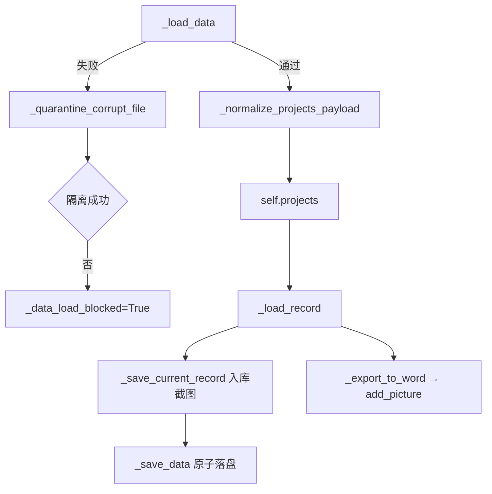

# 试验记录助手设计文档

> **适用版本**：V1.1.1（`radar_tool/__init__.py` → `__version__ = "1.1.1"`）
> **主要源码**：`exp_recorder.py`（`ExpRecorderPanel` 主面板与报告样式常量）、`experiment_word_export.py`（`WordExportMixin` Word 导出）、`experiment_schema.py`（Schema 校验）、`experiment_images.py`（图片安全）、`experiment_storage.py`（JSON 持久化）；公共依赖 `schemas.py`（`ProjectRecord`）、`runtime_paths.py`、`export_safety.py`
> **所属页签**：试验记录助手（主窗口第 8 页签「📋 试验记录助手」，懒加载工厂 `_create_recorder_tab`）
> **文档定位**：以 V1.1.1 实际落地实现为准的工程文档。类名/函数名/行为均取自当前代码；早期提案中未落地的内容集中在 [6.3](#63-与早期设计的差异未落地项清单)。

---

## 1. 背景与目标

### 1.1 痛点分析

外场/暗室试验记录长期依赖 Word 手工排版，痛点可归纳为：

| 痛点 | 具体表现 |
|------|----------|
| **排版地狱** | 插图就乱版，调格式时间超过记录本身 |
| **格式不统一** | 字号、标题层级各写各的，归档后无法横向比对 |
| **截图麻烦** | 截图→粘贴→缩放→对齐→写图注，一张图折腾数分钟 |
| **查找困难** | 几十个 Word 文件散落各处，历史记录检索靠翻文件夹 |
| **容易遗漏** | 环境参数、逐步骤数据没有固定结构，想记什么记什么 |
| **版本混乱 / 数据浪费** | `_最终最终版.docx` 并存；数据埋在正文里，统计还得人工再抄 |

对策：**结构化录入 + 本地 JSON 持久化 + 一键导出规范 Word 报告**——按"项目 → 任务 → 记录 → 步骤"骨架填空，步骤内独立携带数据与截图，程序负责安全归档与工科式排版导出。

### 1.2 设计目标

1. **结构化留痕**：项目 → 任务 → 记录 → 步骤四级结构，步骤内数据/截图与来源步骤一一对应；
2. **报告即产出**：导出 Word 具备封面、可选目录、任务/记录多级标题、基础信息行、图题注、页眉页脚页码；
3. **数据要安全**：截图只进应用管理目录、只存相对路径；ID 白名单；JSON 具备损坏隔离、备份与体量上限；
4. **本地单机 + 失败可诊断**：数据落在 `get_user_data_dir('试验数据')`；图片/JSON 异常均有明确提示与日志，不静默丢数据。

### 1.3 范围边界

**做**：试验记录增删改查、截图归档、Word 单文件导出（记录/任务/项目级）、本地 JSON 持久化与备份。
**不做**：多用户协同、云端同步、PDF/HTML/Markdown 导出、全文检索与统计、图片在线标注、模板编辑器（见 6.3）。

---

## 2. 总体架构

### 2.1 在工具箱中的位置

本模块是工具箱第 8 个功能页签。按主窗口模块接入约定：面板类 `ExpRecorderPanel(parent)` 在 `exp_recorder.py`；`main_window.py` 的 `_create_recorder_tab` 内 `from .exp_recorder import ExpRecorderPanel` 后 `return ExpRecorderPanel(self)`（懒加载，启动不实例化）；工厂登记 `_tab_factories` 索引 8、页签名 `'📋 试验记录助手'` 登记 `_tab_names`。本模块不使用 `background_tasks.TaskRegistry`，也不接 `input_limits`。与公共设施的依赖：`runtime_paths.get_user_data_dir('试验数据')` 取数据根（`_safe_join` 边界校验 + 旧目录迁移），模块内再建 `images/`；`schemas.ProjectRecord`/`migrate_schema`/`SCHEMA_VERSION` 负责 `experiments.json` 显式 Schema 与 v0→v1 迁移；`export_safety.build_export_metadata` 提供导出溯源元数据；`errors.ExportError`/`error_ui.handle_ui_exception`/`logger.get_logger('exp_recorder')` 负责异常弹窗与日志。

### 2.2 模块结构：文件/类职责表

V1.1.1 由 1 个 UI 主模块 + 4 个服务模块组成；`exp_recorder.py` 保留模块级转发函数（`validate_experiment_id`、`_safe_image_path` 等）维持历史公开名称可导入。

| 文件 | 主要类/函数 | 职责 |
|---|---|---|
| `exp_recorder.py` | `ExpRecorderPanel(WordExportMixin, QWidget)` | UI（`_init_ui`/`_build_edit_form`/`_add_step`）、管理（`_new_project`/`_new_task`/`_new_record`/`_load_record`/`_save_current_record`/`_delete_selected`/`_refresh_tree`）、截图入库（`_add_step_screenshot`/`_remove_step_screenshot`/`_normalize_image_item`/`_image_storage_dir`）、持久化（`_save_data`/`_load_data`）、报告样式（`_REPORT_STYLES`/`_IMG_WIDTH_MAP`/`_create_named_styles`/`_set_cn_font`/`_set_font_rpr`） |
| `experiment_word_export.py` | `WordExportMixin` | ` _export_to_word`（对话框+范围+装配）、`_add_record_section`、`_add_cover_page`、`_add_h1/h2/h3`、`_add_body`、`_add_field_info`、`_add_step_item`、`_add_image_caption`、`_add_endnote`、`_pstyle`、`_export_metadata_lines` |
| `experiment_schema.py` | `validate_experiment_id`、`_normalize_record`、`_normalize_projects_payload`、`_normalize_text_fields` | ID 白名单、记录/步骤/图片结构校验归一化、`projects` 载荷校验（调 `migrate_schema`、`ProjectRecord.from_dict`） |
| `experiment_images.py` | `_resolve_inside_images_dir`、`_is_within_directory`、`_contains_symlink_component`、`_validate_image_file`、`_image_dimensions_from_header`、`_tiff_dimensions`、`_validate_source_image`、`_safe_image_path`、`_normalize_image_reference` | 路径安全解析（边界/符号链接/特殊文件）、魔数与尺寸头校验、资源上限、引用相对化 |
| `experiment_storage.py` | `_read_json_with_limits`、`_reject_json_constant`、`_validate_json_depth`、`_quarantine_corrupt_file`、`_backup_valid_json` | JSON 体量限制、损坏隔离改名、有效 `.bak` 备份 |
| `schemas.py`（公共） | `ProjectRecord`、`migrate_schema`、`SCHEMA_VERSION = 1` | 项目记录 Schema、`project_record` v0→v1 迁移 |
| `runtime_paths.py` / `export_safety.py` / `main_window.py`（公共） | `get_user_data_dir`、`build_export_metadata`、`_create_recorder_tab` | 数据目录治理 / 导出元数据 / 页签接入 |

模块级常量（定义于 `exp_recorder.py`，`experiment_*.py` 经 `from . import exp_recorder as _context` 引用）：`DATA_DIR = get_user_data_dir('试验数据')`、`IMAGES_DIR = DATA_DIR/images`；`EXPERIMENTS_SCHEMA_VERSION = SCHEMA_VERSION = 1`、`EXPERIMENTS_SCHEMA_KEYS = {'schema_version','projects'}`；`EXPERIMENT_ID_PATTERN = [A-Za-z0-9_-]{1,128}`；`SUPPORTED_IMAGE_FORMATS = {.png .jpg .jpeg .bmp .tif .tiff .webp}`；`MAX_IMAGE_FILE_SIZE = 50MB`、`MAX_IMAGE_PIXELS = 50_000_000`、`MAX_IMAGE_HEADER_BYTES = 1MB`、`MAX_TIFF_DIRECTORY_ENTRIES = 4096`；`MAX_JSON_FILE_SIZE = 10MB`、`MAX_JSON_NESTING_DEPTH = 64`。

### 2.3 数据流与处理流程



关键路径：① 加载任何一步失败都进损坏隔离分支，内存数据不清空；② 保存先把截图复制入库转相对路径，再原子落盘；③ 导出图片一律经 `_safe_image_path(validate_image=True)`。

---

## 3. 数据模型

### 3.1 项目 → 任务 → 记录 → 步骤 树形结构

```
projects: {pid: 项目}
└── 项目（ProjectRecord）name / description / created_at / updated_at
    └── tasks: {tid: 任务}  name
        └── records: {rid: 记录}
            └── 记录：title date personnel location template conditions
                 content conclusion created updated
                 steps: [步骤…]   （title / desc / data / images）
                 data / images    （历史"未归属步骤"，仅兼容保留）
```

- **ID**：`pid/tid/rid` 是 JSON 映射键，同时是图片目录名，必须匹配 `EXPERIMENT_ID_PATTERN`。UI 新建用 `hashlib.md5((名称+str(datetime.datetime.now())).encode()).hexdigest()[:8]` 生成 8 位 ID；校验入口 `experiment_schema.validate_experiment_id(value, field_name)`。
- **内存与树展示**：`ExpRecorderPanel.projects` 即 `{pid: {...}}`，`current_project_id/current_task_id/current_record_id` 指向编辑中节点；`_refresh_tree` 把树拍平进 `QListWidget`（`tree_projects`），按项目名/任务名/记录标题排序，`Qt.UserRole` 存 `('project',pid)` / `('task',pid,tid)` / `('record',pid,tid,rid)`。

### 3.2 数据记录

| 字段 | 类型 | 说明 |
|---|---|---|
| `title` | str | 记录标题，树节点与 Word H2 |
| `date` | str | `QDateEdit` 编辑，存 `yyyy-MM-dd` |
| `personnel` / `location` / `conditions` | str | 人员 / 地点 / 环境条件 |
| `template` | str | `combo_template` 四选项之一（仅标签） |
| `content` / `conclusion` | str | 试验内容 / 结论与问题（多行文本） |
| `steps` | list | 步骤数组：`{'title','desc','data','images':[{'path','caption'}…]}` |
| `data` / `images` | str / list | 兼容旧数据的"未归属步骤"数据与截图 |
| `created` / `updated` | str | `datetime.now().isoformat()` |

`_normalize_record` 校验记录级 11 个文本字段类型、`steps`/`images` 数组、每个步骤的 `title/desc/data` 类型，并对图片引用过 `_normalize_image_reference`。**保存不破坏兼容字段**：`_save_current_record` 只重写 `steps` 与固定文本字段，不删除记录级 `data`/`images`，旧记录"未归属步骤"内容在导出时仍单独成节。

新建记录初始值（`_new_record`）：`title/date`（今日）/空人员地点/`template='通用试验记录'`/空环境内容结论/`steps=[]`/`created=now`。

### 3.3 截图附件（相对路径存储）

截图引用统一为 `{'path': <相对 IMAGES_DIR 的路径>, 'caption': <图注>}`：

1. **入库**：`_add_step_screenshot` 先 `_validate_source_image`，再 `_normalize_image_item` 复制进 `_image_storage_dir(pid,tid,rid)`（`IMAGES_DIR/<pid>/<tid>/<rid>/`），目标名 `'{stem}_{md5[:8]}{ext}'`（md5 取源路径+修改时间防同名覆盖），返回相对路径；源已在本记录目录内则直接沿用。
2. **持久化**：`_normalize_image_reference` 把字符串或 `{'path','caption'}` 统一为 `{'path':相对路径,'caption':str}`；`_normalize_stored_image_path` 将旧版"安全绝对路径"迁移为相对路径（须仍解析在 `IMAGES_DIR` 内）。
3. **读取**：`_load_record` 与 Word 导出都必须经 `_safe_image_path(path, validate_image=True)`；失败图片在 UI 加载时跳过计数（提示"保存将移除失败引用"），导出时记入 `image_errors`。

收益：JSON 无机器相关绝对路径、目录搬迁仍可用，杜绝越界读取。

### 3.4 experiments.json 持久化格式与 Schema 版本

`DATA_DIR/experiments.json`（UTF-8、`ensure_ascii=False`、indent=2）：

```json
{
  "schema_version": 1,
  "projects": {
    "1a2b3c4d": {
      "name": "XX雷达外场测试", "description": "", "created_at": "", "updated_at": "",
      "tasks": { "5e6f7a8b": {
        "name": "方向图测试",
        "records": { "9c0d1e2f": {
          "title": "方位面方向图", "date": "2026-07-01", "personnel": "张三",
          "location": "外场", "template": "外场雷达试验", "conditions": "晴 25℃",
          "content": "…", "conclusion": "…", "created": "…", "updated": "…",
          "steps": [{ "title": "系统连接与校准", "desc": "…", "data": "角度, 增益…",
            "images": [{"path": "1a2b3c4d/5e6f7a8b/9c0d1e2f/校准_a1b2c3d4.png",
                        "caption": "校准结果"}] }]
        }}
      }}
    }
  }
}
```

Schema 机制：① `migrate_schema(payload,'project_record')` 的 `_project_v0_to_v1` 把旧版裸 `projects` 映射包装为 `{"schema_version":1,"projects":…}`；② 迁移后根必须恰为 `EXPERIMENTS_SCHEMA_KEYS`，否则抛"试验数据 Schema 字段不完整"；③ `_normalize_projects_payload` 对每级 ID 跑 `validate_experiment_id`、对每个项目跑 `ProjectRecord.from_dict`（`name` 非空、映射/数组类型、`_ensure_json_value` 递归检查可序列化且嵌套 ≤64、数值有限），再做 `_normalize_record` 归一化（含图片引用相对化）；④ `_save_data` 写入前先跑同一校验，失败抛错不落盘。

---

## 4. 功能与算法设计

### 4.1 项目管理

- **新建** `_new_project`：`QInputDialog` 取名称（必填）与描述；`pid` 为 8 位 md5；写 `{'name','description','tasks':{}}` 后 `_save_data()` + `_refresh_tree()`。
- **删除** `_delete_selected`：确认"此操作不可恢复"后 `del self.projects[pid]`；若删的是当前编辑记录所属项目，清空 `current_*` 并切回欢迎页。
- 展示：项目节点加粗、前缀 `📁`，按 `name` 排序。项目名/描述新建后无编辑入口；`created_at/updated_at` 由 Schema 兼容保留，UI 未维护。

### 4.2 任务与记录管理

- **新建任务** `_new_task`：`getItem` 选项目名反查 `pid`（并校验 ID）→ 取任务名生成 `tid` → `{'name','records':{}}`。
- **新建记录** `_new_record`：树中须先选中任务或记录节点，取标题生成 `rid`，按 3.2 初始值建记录并 `_load_record` 进入编辑。
- **加载** `_load_record(pid,tid,rid)`：校验三级 ID → 回填表单 → 清空重建步骤控件并回填 `title/desc/data` 与图片列表（图片经 `_safe_image_path(validate_image=True)`，失败计 `skipped_images` 并弹窗）→ 无步骤补一个空步骤 → 切"编辑记录"页、复位 `_record_dirty`。
- **保存** `_save_current_record(quiet=False)`：校验 `current_*` → 组装 `steps_data`（图片经 `_normalize_image_item` 入库，失败计 `dropped_images`）→ 回写字段（`date` 转 `yyyy-MM-dd`）与 `updated` → `_save_data()` + `_refresh_tree()`，状态栏"✅ 已保存 HH:MM"（有失败截图追加警告，`quiet` 只记日志）。
- **切换保护**：`_on_tree_selection` 切换记录前 `_save_current_record(quiet=True)`；`closeEvent` 同样静默保存。各控件信号接 `_mark_record_dirty` 显示"未保存"。
- **删除**：树右键"🗑️ 删除"或"🗑️ 删除选中"，确认后摘除并落盘。

### 4.3 步骤内数据记录与截图

每个步骤是 `_add_step` 构建的 `QFrame`：序号标签（`_renumber_steps` 维护"步骤 N:"）、步骤名 `QLineEdit`、删除按钮 `✕`、操作描述 `QTextEdit`（≤60 高）、**步骤数据** `QTextEdit`（≤80 高，提示"可粘贴Excel表格数据"）、截图行（"🖼️ 添加截图"/"✖ 移除选中"）与截图 `QListWidget`（≤80 高）。

**添加截图** `_add_step_screenshot(frame)`：`QFileDialog`（过滤 7 种扩展名）→ `_validate_source_image` 失败弹"图片无法加载"→ `QInputDialog` 取图注 → `_normalize_image_item` 立即入库（失败回退暂存源路径并标"（源文件待保存时入库）"）→ 列表项 `🖼️ {文件名} → {图注}`，`Qt.UserRole` 存引用 → `_mark_record_dirty`。注意 `clicked(bool)` 会把 `checked` 传给单参 lambda 而覆盖 `frame`，当前代码用零参闭包 `lambda: self._add_step_screenshot(frame)` 并在源码注释固化此约束（`test_step_screenshot_button_persists_and_exports` 回归）。

**入库算法** `_normalize_image_item(data)`：引用 → `_validate_source_image(src)`（拒绝返回 None 计 dropped）→ `_image_storage_dir(pid,tid,rid)`（ID 白名单 + 边界检查后创建）→ 源已在本目录则返回 `{'path': relpath, 'caption'}`，否则 `copy2` 至 `{stem}_{md5[:8]}{ext}` 后 `_safe_image_path(dst, validate_image=True)` 复验 → 返回 `{'path': relpath(dst, IMAGES_DIR), 'caption'}`。

### 4.4 Word 报告生成结构

导出由 `WordExportMixin._export_to_word(level, pid, tid, rid)`（`level ∈ {'record','task','project'}`）完成。

#### 4.4.1 导出设置对话框与范围

设置对话框（`QDialog`"导出设置"）：报告风格（📄 标准正式/🌿 简洁清爽/📦 紧凑密集，仅进元数据不改排版）、包含封面（默认开）、包含页码（默认开）、自动目录（默认关）、图片质量（高清/标准/压缩 → `_IMG_WIDTH_MAP` 宽 `Inches(5.5)/5.0/4.0`）、水印文字（留空不加）。

导出范围与默认文件名：`record` = `{rid:当前记录}`（未传 ID 先 `_save_current_record()` 取 `current_*`）→ `{记录标题}.docx`（`/`、`\`→`_`）；`task` = 任务下全部 records → `{任务名}_汇总.docx`；`project` = 项目下全部任务记录（键 `(tid,rid)`）→ `{项目名}_完整报告.docx`。保存对话框默认目录 `DATA_DIR`；所有 ID 先过 `validate_experiment_id`；空集合提示"没有记录可导出"。

#### 4.4.2 文档骨架（章节层级）

```
封面（include_cover）
  CoverTitle：{项目名 - 完整试验报告 | 任务名 - 汇总报告 | 记录标题}
  CoverSubtitle：试验记录报告
  CoverInfo：导出日期：YYYY年MM月DD日   ── 分页符 ──
目录（include_toc）："目录" + TOC 域（\o "1-3" \h \z \u）── 分页符 ──
任务：{任务名}（Report_H1；project 级按任务分组各出一个，task 级出一个）
  第N条记录：{记录标题}（Report_H2）
    试验日期/试验人员/试验地点/环境条件/模板类型（Report_Field_Info，标签加粗，空值跳过）
    试验内容（Report_H3）→ 逐行 Report_Body
    试验步骤（Report_H3）
      1. {步骤标题}：{操作描述}（Report_Body 取消缩进，序号与标题加粗；无文字但有数据/截图时输出"未命名步骤"）
      步骤1数据记录（Report_H3）→ 逐行 Report_Body（空行跳过）
      步骤1截图附件（Report_H3）→ 居中图片 + "图X  图注"
      2. …（后续步骤同构）
    未归属步骤数据记录 / 未归属步骤截图附件（Report_H3，记录级 data/images 兼容旧数据）
    结论与问题（Report_H3）→ 逐行 Report_Body
  ── 记录之间分页符（rec_idx > 0）──
（页眉/页脚见 4.4.5）
```

记录标题为 `f'第{record_index+1}条记录：{rec_title}'`（`record_index` 为导出范围全局序号）。**数据记录不生成 Word 表格**：`data`/`legacy_data` 按行拆分、非空行各写一段 `Report_Body`。标题分级：H1=任务（project/task 级）、H2=单条记录、H3=试验内容/试验步骤/步骤N数据记录/步骤N截图附件/未归属步骤…/结论与问题。

#### 4.4.3 样式体系（`_REPORT_STYLES` + `_create_named_styles`）

页面边距：上/下 2.5cm、左 2.8cm（装订预留）、右 2.5cm。命名样式批量创建后全部按名引用（禁止零散硬编码）：

| 样式名 | 字体/字号/颜色 | 段落形态 | 用途 |
|---|---|---|---|
| `CoverTitle` | 黑体 22pt（二号）纯黑 | 居中，段前 240pt | 封面主标题 |
| `CoverSubtitle` | 黑体 15pt #666666 | 居中，段前 20pt | "试验记录报告" |
| `CoverInfo` | 宋体 12pt #999999 | 居中，段前 60pt | 导出日期 |
| `Report_H1` | 黑体 16pt 加粗纯黑 | 段前 18pt/段后 12pt | 任务标题 |
| `Report_H2` | 黑体 14pt 加粗纯黑 | 段前 12pt/段后 6pt | 记录标题 |
| `Report_H3` | 黑体 12pt 加粗纯黑 | 段前 8pt/段后 4pt | 各小节标题 |
| `Report_Body` | 宋体 11pt 纯黑 | 1.5 倍行距，首行缩进 0.74cm（≈2 字符） | 正文与步骤条目 |
| `Report_Field_Info` | 宋体 11pt 纯黑 | 段前后各 2pt，无缩进 | 基础信息行 |
| `Report_Image_Caption` | 宋体 9pt（小五）#666666 | 居中 | 图题注 |
| `Report_Endnote` | 宋体 9pt #999999 | 居中 | 尾注（当前路径未调用，见 6.3） |

中文字体兼容：`_set_cn_font(run, name)` / `_set_font_rpr(style_element, name)` 操作 OOXML `w:rFonts`——`w:eastAsia` 设黑体/宋体，`w:ascii`/`w:hAnsi` 固定 Arial，保证 WPS 与 MS Office 双端一致。

#### 4.4.4 图片排版与题注

步骤截图与"未归属步骤截图附件"共用同一段逻辑：兼容字符串（旧数据）与 `{'path','caption'}` 两种引用 → `safe_img_path = _safe_image_path(img_path, validate_image=True)`（只允许 `IMAGES_DIR` 内普通文件）→ `doc.add_picture(safe_img_path, width=img_width)`（宽度按图片质量三档）→ 段落 `WD_ALIGN_PARAGRAPH.CENTER` 居中 → 全局计数 `fig_counter=[0]` 跨记录共享、**全文连续编号**，题注 `图{fig_num}  {caption_text}`（`Report_Image_Caption`；图注为空用文件名）。插入失败不中断：`logger.warning` + 文件名入 `image_errors`，完成弹窗列出前 10 项与总数。

#### 4.4.5 页眉、页脚、水印与元数据

- **页眉**：`sec.header` 写项目/任务/记录标题，居中、宋体小五 #999999；**页脚**（`include_page_num`）：`'第 ' + PAGE 域 + ' 页 共 ' + NUMPAGES 域 + ' 页'`（`OxmlElement('w:fldChar'/'w:instrText')` 插入）；**目录**（`include_toc`）：`TOC \o "1-3" \h \z \u` 覆盖 H1~H3。
- **水印**：填了文字时遍历全文非空 run 改色 `watermark_color`（#CCCCCC 浅灰）——是"浅灰文字"效果，非页背景水印。
- **导出元数据**：`build_export_metadata(input_summary={'scope','project_id','task_id','record_id','record_count'}, parameters={'report_style','include_cover','include_toc','include_page_num','image_quality','watermark_text'})`（含 `version`、`schema_version=EXPORT_SCHEMA_VERSION=1`、`generated_at` ISO），**仅 `logger.info('导出元数据: …')` 记日志，不写正文**。`_export_metadata_lines`/`_add_endnote` 保留但未调用；`test_project_export_has_task_levels_and_no_metadata_hints` 断言正文不含"导出元数据/输入摘要/参数：/本报告由/生成工具"。

### 4.5 图片安全校验流程

从选定文件到嵌入文档的管线（决策详解见 6.1）：`_validate_source_image`（拒符号链接）→ `_validate_image_file`（普通文件 / 1B~50MB / 扩展名白名单）→ 魔数+尺寸头（`_image_dimensions_from_header` 或 TIFF `_tiff_dimensions`）→ 像素总数 ≤ `MAX_IMAGE_PIXELS` → `_normalize_image_item` 复制入库 → `_safe_image_path` 再验（边界+符号链接+普通文件）→ JSON 只存相对路径 → 加载/导出复验 → `doc.add_picture`。

各格式魔数/尺寸解析（`_image_dimensions_from_header`）：PNG 头 + `IHDR`；JPEG `\xff\xd8\xff` 起始、扫描段至 SOF 标记集（`0xC0~0xCF` 除 `0xC4/0xC8/0xCC`）；BMP `BM` + DIB 头 12 或 ≥40 两布局（高度取绝对值）；WebP `RIFF….WEBP` 按 `VP8X`/`VP8 `/`VP8L` 三类块解析；TIFF 走 `_tiff_dimensions` 按字节序读 IFD（条目 ≤4096，tag 256/257 取宽高）。

---

## 5. 界面与交互

### 5.1 实际布局

`_init_ui` 构建 `QSplitter` 两栏（左:右 ≈ 1:3）：

```
┌────────────────────────────────────────────────────────┐
│ 📋 试验记录助手 [📁新建项目][📂新建任务][📝新建记录]    │
│                  未保存/✅已保存 [💾保存][📤导出 ▼]     │
├────────────────┬───────────────────────────────────────┤
│ 📁 项目结构     │ QTabWidget（stacked）                │
│  QListWidget   │ 页签1「欢迎」：功能卡片 2×4 + 提示   │
│  📁 项目A       │ 页签2「编辑记录」表单：              │
│    📂 任务A     │  标题 QLineEdit（16px 加粗）         │
│      📝 记录A1  │  基本信息 QGridLayout：试验日期      │
│ [🗑️ 删除选中]  │   QDateEdit、人员/地点 QLineEdit、   │
│ 右键：导出此   │   模板 QComboBox、环境条件 QLineEdit │
│ 记录/任务/项目 │  试验内容 QTextEdit（≥100 高）       │
│ /🗑️ 删除       │  试验步骤 QGroupBox + [➕添加步骤]   │
│                │  结论与问题 QTextEdit（≥80 高）      │
└────────────────┴───────────────────────────────────────┘
```

- "项目树"实际是 `QListWidget`（`tree_projects`，最小宽 200）：空前缀缩进 + emoji 模拟层级，`Qt.UserRole` 存层级元组；`currentItemChanged` → `_on_tree_selection`，右键 → `_show_tree_context_menu`。
- 步骤帧内含序号标签、`QLineEdit` 步骤名、`✕` 删除、描述/数据两个 `QTextEdit`、截图按钮行与 `img_list`。
- 欢迎页与编辑页由 `stacked` 切换；`lbl_save_status` 承担"未保存 / ✅ 已保存 / 🖼️ 已添加截图 / ⚠️ N 张图片加载失败"等反馈。
- 导出按钮 `btn_export_word`（"📤 导出 ▼"）弹 `export_menu`：📝 导出当前记录 / 📂 导出当前任务（含所有记录）/ 📁 导出当前项目（含所有任务和记录）。

### 5.2 核心交互流程

新建：`[📁新建项目]`→名称/描述→pid；`[📂新建任务]`→选项目→名称→tid；树选中任务后 `[📝新建记录]`→标题→rid→自动载入编辑页。编辑：表单字段 → `[➕添加步骤]` → 步骤内填描述/数据 → `[🖼️添加截图]`（选文件→校验→图注→入库）。保存：`[💾保存]`→截图逐张入库→原子落盘→"✅已保存"；切换节点/关闭面板自动静默保存。导出：`[📤导出 ▼]` 或树右键选层级 → 导出设置 → 选 `.docx` → 装配文档 → 成功弹窗（含图片失败清单）。树右键导出层级须与选中节点匹配；`_export_tree_selected('record')` 先 `_load_record` 再导出，保证导出最新编辑状态。

### 5.3 提示与容错

| 场景 | 行为 |
|---|---|
| 未选记录就保存 | 提示"没有正在编辑的记录"，返回 False |
| 图片源非法 | 弹"图片无法加载"，不入列表 |
| 截图入库失败 | 保存时弹"部分截图未保存"并计数，其余照常保存 |
| 加载时图片缺失 | 跳过并弹窗计数，警告"保存将移除失败引用" |
| `python-docx` 未装 | 检测 `Document is None`，提示 `pip install python-docx` |
| JSON 损坏 | 隔离 + 弹性恢复（6.1.4），不覆盖、不清空内存 |

---

## 6. 关键实现与开发演进

### 6.1 关键实现决策：安全加固

2026-11 数据安全加固与《项目体检与整改行动计划》（`PROJECT_AUDIT_ACTION_PLAN.md`，2026-11-05）步骤 1「修复试验记录路径穿越」、步骤 2「修复配置损坏和数据丢失」把本模块推到"耐误用"。以下五个决策是实现支柱，改相关代码前先读 `tests/test_runtime_safety.py`。

#### 6.1.1 ID 白名单与目录边界

**威胁**：ID 既是 JSON 映射键又是图片目录名，若接受 `../escape`、`..\\escape`、`C:\absolute` 等值，可让程序在任意位置建目录写文件。
**对策**：`EXPERIMENT_ID_PATTERN = re.compile(r'[A-Za-z0-9_-]{1,128}')`，`validate_experiment_id` 以 `fullmatch` 校验，非法抛 `ValueError(f'{field_name} 只能包含字母、数字、下划线或连字符')`；调用点覆盖 `_image_storage_dir`、`_load_record`、`_save_current_record`、`_delete_selected`、`_on_tree_selection`、`_export_to_word` 等所有拼路径/查树位置。`_image_storage_dir` 校验三级 ID 后 `_resolve_inside_images_dir(candidate, must_exist=False)`（`realpath` + `commonpath` 边界比对），`makedirs` 后复查是目录且非符号链接。`test_invalid_experiment_ids_are_rejected` 验证恶意 ID 全拒、UUID 放行。

#### 6.1.2 图片只存相对路径 + 统一安全解析

**威胁**：JSON 持久化绝对图片路径 = 允许数据文件指定程序读任意外部文件（信息泄露），且目录搬迁即失效。
**对策**：① 写入侧 `_normalize_image_item`/`_normalize_stored_image_path` 一律 `relpath(resolved, _resolve_images_root())` 入库，旧版位于 `IMAGES_DIR` 内的绝对路径自动迁移；② 读取侧 `_resolve_inside_images_dir` 是唯一入口——拒绝绝对路径/盘符/空段/`.`/`..`，`realpath` 后必须落在 `_resolve_images_root()` 内，`_contains_symlink_component` 逐段查符号链接，`must_exist` 时 `lstat` 拒绝符号链接与非普通文件；③ 导出侧 `experiment_word_export._safe_image_path`（延迟导入避免循环依赖）强制 `validate_image=True`。对应测试 `test_schema_version_and_legacy_absolute_image_are_migrated`、`test_external_or_traversing_json_image_paths_are_rejected`（外部绝对路径与 `../` 穿越路径加载即拒、内存数据保留）。

#### 6.1.3 图片魔数校验与资源上限

**威胁**：改扩展名的伪装文件、超大图/像素炸弹、畸形头拖垮解析。
**对策**：`_validate_image_file` 依次检查普通文件 → 大小 ∈ (0, 50MB] → 扩展名白名单 → 按格式解析头部取宽高（PNG/JPEG/BMP/WebP 走 `_image_dimensions_from_header`，TIFF 走 `_tiff_dimensions`）→ `width*height ≤ 50_000_000`。TIFF 限 IFD 条目 ≤4096，头读取 ≤1MB。源图入口 `_validate_source_image` 额外拒符号链接。`test_image_size_pixels_magic_and_format_limits` 用超限文件、100000×100000 伪 PNG、`\xff\xd8\xff\xe0` 伪装 PNG、`.gif` 验证拒绝；`test_supported_image_headers_are_accepted` 用手造合法 PNG/BMP/JPEG/WebP/TIFF 头验证放行。

#### 6.1.4 JSON 损坏隔离与 `.bak` 备份

**威胁**：写盘中断/磁盘故障产生损坏 JSON，下次启动若静默覆盖或丢弃，全部试验记录即丢失。
**对策**（`experiment_storage.py` + `_load_data`/`_save_data`）：① `_read_json_with_limits` 先查大小 ≤10MB，`json.load(..., parse_constant=_reject_json_constant)` 拒绝 `NaN`/`Infinity`，`_validate_json_depth` 限嵌套 ≤64，最后跑校验器 `_normalize_projects_payload`；② 加载失败 `_quarantine_corrupt_file` 改名 `experiments.json.corrupt-YYYYmmddHHMMSSffffff`（重名追加 `-N`），内存 `self.projects` 不清空；③ 隔离失败且文件仍在则置 `_data_load_blocked=True`，此后 `_save_data` 抛 `RuntimeError('试验数据文件尚未成功隔离，禁止覆盖')`；④ `_backup_valid_json` 每次保存前对现存文件完整读校验，有效则 `copy2 → .bak.tmp → os.replace` 成 `experiments.json.bak`，损坏则返回 `False` 转入隔离流程。对应测试：`test_load_failure_preserves_existing_memory_state`、`test_successful_save_keeps_previous_valid_backup`、`test_json_size_and_depth_limits_quarantine_file`。

#### 6.1.5 原子保存

`_save_data` 序列化到 `experiments.json.tmp`（`flush` + `os.fsync`）后 `os.replace(tmp, filepath)` 原子替换，异常清理 `.tmp`；`test_save_is_atomic_when_replacement_fails` mock `os.replace` 抛 `OSError` 验证原文件不变、无 `.tmp` 残留。与 `export_safety.atomic_export_batch` 同属"导出原子化"家族，本模块走单文件原子替换路径。

### 6.2 开发时间线

| 时间 | 里程碑 | 对本模块的影响 |
|---|---|---|
| 2026-07-13 | 记录重构（README「近期更新」） | **数据记录与截图下沉到试验步骤内部**，每步独立决定是否记数据/贴截图；Word 按步骤输出并**兼容未归属步骤历史记录**。同期架构解耦与页签懒加载 |
| 2026-08-12 | 试验记录落地（总体设计文档时间线） | 试验记录助手与打包前审查完成：步骤级数据/截图结构、Word 按步骤输出与历史兼容固化为交付形态 |
| 2026-11-04 | 数据安全加固 | 路径穿越防护、JSON 备份/损坏隔离、输入资源限制 |
| 2026-11-05 | 项目体检（`PROJECT_AUDIT_ACTION_PLAN.md`） | **步骤 1 修复试验记录路径穿越**（ID 白名单、目录边界、相对路径、统一安全解析、复制前魔数/资源限制、`schema_version` 校验；验收 59 passed）；**步骤 2 修复配置损坏和数据丢失**（`.corrupt-` 隔离、`.bak` 备份、完整结构校验、JSON 体量上限；验收 67 passed） |
| 2026-11 整改中后期 | 模块拆分（步骤 11）/ 导出安全（步骤 13） | `exp_recorder.py` 拆出 `experiment_storage/images/schema/word_export` 并保留兼容转发；新增 `export_safety.build_export_metadata`，Word 导出仅允许应用管理目录内图片，元数据仅记日志 |
| 2026-11-11 | **V1.1.1 发布** | 版本统一 1.1.1；试验记录 Word 导出调整（含"项目导出三级结构 + 无元数据小字"回归测试固化） |

### 6.3 与早期设计的差异（未落地项清单）

早期文档为产品设计提案，以下内容在 V1.1.1 **未落地**，勿按旧提案"想当然"：

| 早期提案 | V1.1.1 实际状态 |
|---|---|
| **模板系统**（模板中心/自定义模板/分享/版本管理/动态表单） | **未落地**。仅记录字段 `template`（`combo_template` 四选项），作用只是标签 + 导出"模板类型："一行，不驱动表单差异 |
| **数据表格组件**（自定义列/Excel 导入/统计/图表） | **未落地**。步骤数据是多行纯文本，导出为逐行正文，不生成 Word 表格 |
| **截图增强**（拖拽/Ctrl+V/内置截图/标注/网格排版/排序） | **未落地**。仅"按钮选文件 + 图注"，多图按列表顺序上下排布 |
| **多格式导出**（PDF/HTML/Markdown/纯文本）、**批量导出 ZIP** | **未落地**。仅 `.docx`；多记录合并靠任务/项目级导出（单 Word） |
| **检索与统计**（全文检索/筛选/看板） | **未落地**。导航仅限左侧列表树 |
| **项目级元数据**（编号/负责人/成员权限/归档） | **未落地**。项目只有 `name`/`description`/`tasks` |
| **三种报告风格** | **仅占位**。选项只进 `parameters.report_style`，排版恒为 `_REPORT_STYLES`（全黑/灰工科规范） |
| **水印** | **降级**。正文 run 置浅灰 #CCCCCC，非页背景水印 |
| **导出元数据进正文** | **主动取消**。仅记日志；`_add_endnote`/`_export_metadata_lines` 保留未调用 |
| TypeScript 数据模型（Section/DataTable/Attachment/Annotation） | 替换为 Python dict + `schemas.ProjectRecord` |
| Vue 3 / Electron / IndexedDB 选型 | 实际 PyQt5 + python-docx + 本地 JSON，随工具箱 Nuitka standalone 打包 |

---

## 7. 测试与验收

### 7.1 测试清单

| 测试文件 | 用例组 | 覆盖 |
|---|---|---|
| `tests/test_experiment_screenshots.py` | 3 例 | 截图入库/持久化/导出嵌图全链路；非法图片弹窗；项目导出三级结构且无元数据小字 |
| `tests/test_runtime_safety.py::ExperimentPersistenceTests` | 5 例 | 原子保存、加载失败保内存+隔离、`.bak` 备份、大小/深度限制隔离、存取往返 |
| `tests/test_runtime_safety.py::ExperimentPathSafetyTests` | 8 例 | ID 白名单、目录边界、只存相对路径、大小/像素/魔数/格式上限、五格式头放行、符号链接拒绝、旧版绝对路径迁移、外部/穿越路径拒绝、Schema ID 校验、相对路径放行 |
| `tests/test_qt_panels.py`（试验记录部分） | 2 例 | 树选中项刷新后存活；无选中时保存安全返回 |

> `tests/test_truth_review.py` 覆盖真值复核算法，与试验记录助手无交集；本模块的安全与功能回归由上表三个文件承担。验收基线（全量）：`python -m pytest -q -W error` 全绿、`compileall` 通过、`pip check` 正常；安全改造两步的专项结论记录在 `PROJECT_AUDIT_ACTION_PLAN.md` 步骤 1/2"修改结论"栏（59 passed / 67 passed）。

### 7.2 安全类用例（重点）

| 用例 | 断言要点 |
|---|---|
| `test_invalid_experiment_ids_are_rejected` | `../escape`、`..\\escape`、`/absolute`、`C:\absolute`、`.` 全部 `ValueError`；UUID 放行 |
| `test_storage_dir_is_created_inside_images_dir` | 存储目录 realpath 位于 images 根内且为目录 |
| `test_copy_rejects_invalid_source_and_persists_only_relative_path` | 入库路径非绝对；源路径再走 `_safe_image_path` 被拒；非图片返回 None |
| `test_image_size_pixels_magic_and_format_limits` | 超 50MB、100000×100000 伪 PNG、`\xff\xd8\xff\xe0` 伪装、`.gif` 全拒 |
| `test_supported_image_headers_are_accepted` | 手造合法 PNG/BMP/JPEG/WebP/TIFF 头被接受 |
| `test_symlink_and_non_regular_image_paths_are_rejected` | 符号链接与目录被拒 |
| `test_schema_version_and_legacy_absolute_image_are_migrated` | 旧版裸 projects + 绝对图片路径 → 加载变相对、保存带 `schema_version` |
| `test_external_or_traversing_json_image_paths_are_rejected` | 外部绝对路径与 `../` 穿越路径加载即拒、内存保留 |
| `test_schema_rejects_invalid_ids_and_accepts_uuid` / `test_relative_image_path_is_accepted_by_safe_resolver` | 恶意 ID 抛错；合法相对路径放行 |
| `test_load_failure_preserves_existing_memory_state` | 坏 JSON → 内存保留 + `.corrupt-*` 内容原样 |
| `test_successful_save_keeps_previous_valid_backup` | 连续保存产生 `.bak` = 上一有效版本 |
| `test_json_size_and_depth_limits_quarantine_file` | 大小/深度上限注入后加载即隔离 |
| `test_save_is_atomic_when_replacement_fails` | `os.replace` 失败时原文件不变、无 `.tmp` 残留 |

### 7.3 功能与回归用例

| 用例 | 断言要点 |
|---|---|
| `test_step_screenshot_button_persists_and_exports` | 列表出现条目（回归 `clicked(bool)` 覆盖 lambda 缺陷）、图注正确、图片复制为相对路径；保存后 `steps[].images` 引用有效；导出 docx 恰含 1 个 image 关系 |
| `test_step_screenshot_invalid_file_shows_feedback` | 非法图片不入列表且 `QMessageBox.warning` 恰一次 |
| `test_project_export_has_task_levels_and_no_metadata_hints` | 正文含"任务：任务A/任务B"与两条记录标题；不含"导出元数据/输入摘要/参数：/本报告由/生成工具" |
| `test_experiment_tree_selection_survives_refresh` / `test_experiment_save_control_handles_missing_selection_safely` | 刷新后树节点元组仍在；无编辑记录时保存返回 False 且提示一次 |

---

## 8. 已知问题与后续计划

### 8.1 已知问题

1. **报告风格不生效**：`combo_style` 只进元数据/日志，排版恒为 `_REPORT_STYLES`；真正多风格需建多套预设并在 `_create_named_styles` 注入。
2. **"水印"是浅灰文字**：非空时把正文 run 改 #CCCCCC，影响可读性且非页背景水印。
3. **记录级 `data`/`images` 只出不进**：兼容字段可导出但编辑器无录入入口，`_save_current_record` 也不清理——旧数据长期留存，新数据必须挂步骤。
4. **`_export_metadata_lines`/`_add_endnote` 为死代码**：当前路径不调用，保留为将来可选"尾注溯源"，勿误恢复到正文。
5. **截图跨记录不共享**：按 `pid/tid/rid` 各复制一份（同记录内已做"直接沿用"优化）。
6. **无多实例写保护**：同一用户数据目录开两个实例会互相覆盖 `experiments.json`。
7. **项目/任务不可改名**；**图片宽度仅三档**（5.5/5.0/4.0 英寸），不支持自适应或网格排布。

### 8.2 后续计划

1. 落实三套 `_REPORT_STYLES` 预设与真水印（页眉 VML），并补回归测试；
2. 提供记录级 `data`/`images` → 步骤的迁移工具，之后删除兼容导出分支；
3. 如需 PDF/批量 ZIP，优先复用 `export_safety.atomic_export_batch` 批次原子导出模式；
4. 项目负责人/编号/日期筛选与关键词过滤作为树过滤器迭代；表格化数据建议给步骤 `data` 增加结构化字段（Schema v2 + 迁移链），而非文本硬转 Word 表格。

---

*本文档与代码同步维护：`exp_recorder.py` / `experiment_*.py` 的类、函数、数据结构或安全约束变化时，同步更新 2.2、3.x、4.4、6.1 与 7.x。*
