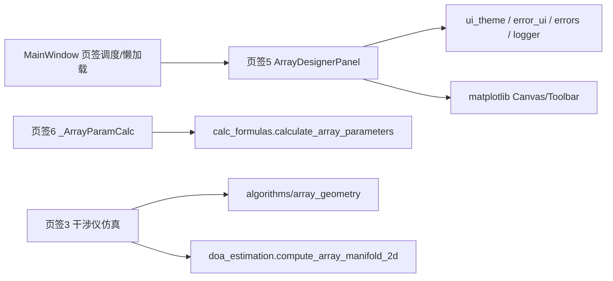
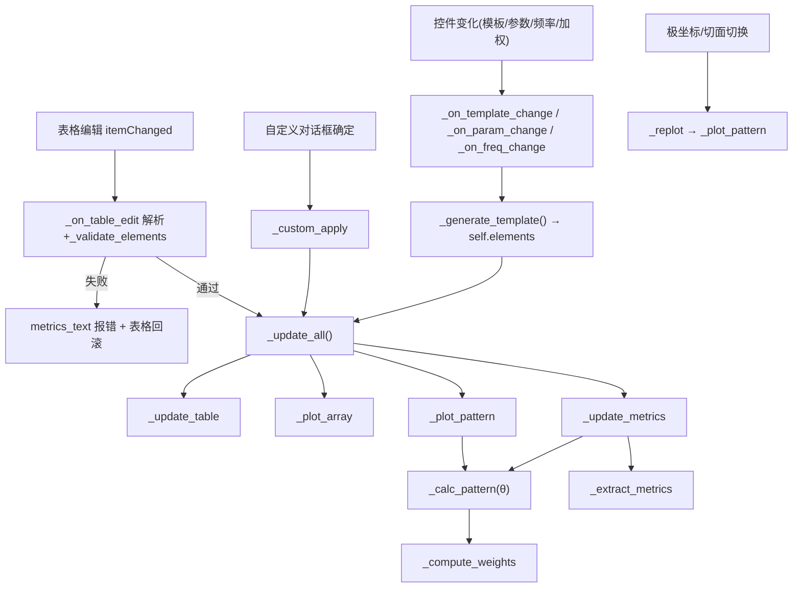

# 阵列设计助手设计文档

> **适用版本**：V1.2.1（`radar_tool/__init__.py` → `__version__ = "1.2.1"`）
> **主要源码**：`radar_tool/array_designer.py`（`ArrayDesignerPanel`，约 37 KB / 922 行）；关联 `radar_tool/calc_formulas.py::calculate_array_parameters`、`radar_tool/calc_ui.py::_ArrayParamCalc`（指标计算器页签内"阵列参数计算"）、`radar_tool/algorithms/array_geometry.py`（共享阵列几何）、`radar_tool/algorithms/doa_estimation.py::compute_array_manifold_2d`（DOA 阵列流形，独立实现）
> **所属页签**：阵列设计助手（主窗口页签 5，页签名 `'📡 阵列设计助手'`）
> **文档定位**：以实际落地实现为准的工程文档（非产品设计提案）。类名、函数名、公式与行为均以当前代码为准；未落地构想统一收敛到 [6.3](#63-与早期设计的差异) 与 [8.2](#82-后续计划规划中未实现) 并标注"未实现"。

---

## 1. 背景与目标

### 1.1 业务背景

方案论证阶段，工程师反复需要回答"这个阵列构型波束多宽、副瓣多高、间距放大后会不会出栅瓣"这类轻量问题——不需要全波电磁仿真，只要理想阵列流形下的快速方向图估算。早期《阵列设计助手设计文档》是产品设计提案（Vue 3 技术栈、方案库、参数扫描、3D 方向图等），与实际开发脱节；本模块以 **PyQt5 + matplotlib 单面板** 落地，本文档按真实实现重写。对应总体设计的"阵列可设计"产品目标（《便携化工具箱总体设计文档》1.1 节）。

### 1.2 设计目标

| 目标 | 在实现中的体现 |
|---|---|
| **秒级响应** | 参数变化触发 `_update_all()` 同步重算（无"计算"按钮）；N≤128 毫秒级 |
| **构型灵活** | 6 种输入：ULA / UCA / 矩形面阵 / L 型 / 十字阵 / 自定义（表格或 CSV） |
| **指标完整** | 增益、3dB 波束宽度（实测+理论）、左右副瓣、主瓣边界、孔径、无模糊范围、栅瓣警告 |
| **幅相可控** | 5 种预设窗 × 每阵元幅相两层激励，编辑即生效 |
| **公式正确** | 2026-11 体检（步骤 6）修正相位项、副瓣搜索与构型公式，回归测试锁死 |

### 1.3 范围边界

**已实现（本模块内）**：模板化构型生成与自定义坐标编辑（含 CSV 导入）；单切面（方位面 XY / 俯仰面 XZ）一维方向图数值计算与直角/极坐标显示；5 种预设加权 × 逐阵元幅相激励；指标提取、构型理论公式、栅瓣数值判定与警告；阵列俯视图、坐标表格即时编辑；自定义频率输入。

**跨页签相关**：① `calculate_array_parameters`/`_ArrayParamCalc`（指标计算器页签"📊 阵列参数计算"）给出 ULA/矩形/UCA 闭式参数，不画方向图；② `algorithms/array_geometry.py` 几何生成实际由干涉仪仿真调用，`ArrayDesignerPanel` **未直接调用**（自带 `_generate_template`），两处并行实现。

**不做（未实现）**：方案保存/加载与方案库、参数扫描、多方案对比、三维方向图、专用导出按钮（仅 matplotlib 工具栏保存）、阵元拖拽、CRB（在指标计算器"测向精度计算"）、稀布优化、互耦分析、泰勒加权。

---

## 2. 总体架构

### 2.1 在工具箱中的位置

阵列设计助手是主窗口 `MainWindow` 第 5 个页签：`_tab_factories[4] = self._create_array_designer_tab`，`_tab_names[4] = '📡 阵列设计助手'`；工厂方法内 `from .array_designer import ArrayDesignerPanel` 并返回实例（懒加载，`main_window.py:179-181`）。



依赖：`ui_theme.style_primary_button`、`error_ui.handle_ui_exception`、`errors.safe_exception_message`、`logger.get_logger('array_designer')`；计算侧仅 `numpy` + `math`/`re`（无 scipy）。

### 2.2 模块结构（文件/类职责表）

| 文件 | 类/函数 | 职责 |
|---|---|---|
| `radar_tool/array_designer.py` | `ArrayDesignerPanel`（QWidget） | 页签主面板：状态（`elements`/`fc`/加权）、UI 构建、全部交互与计算入口 |
| 同上 | `_validate_elements(elements)`（模块级） | 阵元校验：≥2 个阵元；`x/y/amp/phase` 有限数值；幅度非零 |
| 同上 | `_init_default_array` / `_init_ui` | 默认 8 元半波长 ULA（fc=10 GHz）；构建控制栏、左右分栏与信号连接 |
| 同上 | `_get_freq` / `_parse_custom_freq` / `_on_freq_change` | 频率取值（4 预置+自定义）与自定义频率解析（静态方法） |
| 同上 | `_on_template_change` / `_on_param_change` / `_sync_rect_count` | 模板/参数变化：控件显隐、矩形面阵阵元数同步、重生成坐标 |
| 同上 | `_generate_template` | 按模板生成 `self.elements`（ULA/UCA/矩形/L 型/十字/自定义） |
| 同上 | `_compute_weights` / `_chebyshev` | 预设加权系数（归一化到最大值 1） |
| 同上 | `_calc_pattern(theta_deg)` | 方向图数值计算（含逐阵元幅度/相位），返回归一化 dB |
| 同上 | `_extract_metrics` / `_local_peak_indices` | 指标提取：主瓣边界、左右副瓣、栅瓣、孔径与构型理论公式 |
| 同上 | `_plot_array` / `_plot_pattern` / `_replot` | 阵列俯视图、方向图（直角/极坐标）绘制 |
| 同上 | `_update_table` / `_on_table_edit` / `_update_metrics` / `_update_all` | 表格刷新、编辑校验（即改即生效）、指标文本、全量刷新调度 |
| 同上 | `_edit_custom_coords` / `_custom_add_row` / `_custom_remove_row` / `_custom_import_csv` / `_custom_apply` | 自定义坐标对话框：增删行、CSV 导入、应用 |
| `radar_tool/calc_formulas.py` | `calculate_array_parameters(...)` | ULA/矩形/UCA 闭式参数（增益、波束宽度、孔径、栅瓣角、无模糊范围、警告） |
| `radar_tool/calc_ui.py` | `_ArrayParamCalc` | "📊 阵列参数计算"UI：构型显隐、λ/m 换算 `_spacing_lam`、渲染（`last_result`） |
| `radar_tool/calc_panel.py` | 兼容门面 | 再导出上述 API，测试与旧导入路径经此访问 |
| `radar_tool/algorithms/array_geometry.py` | `create_ula` / `create_uca` / `create_l_array` / `create_rect_array`（及 `_positive_integer`/`_positive_length`/`_validated_positions` 校验） | 共享阵列几何（N×2 米制）。**调用方是 `interferometer_sim.py` 与 `tests/test_doa_algorithms.py`；`array_designer.py` 未调用** |
| `radar_tool/algorithms/doa_estimation.py` | `compute_array_manifold_2d(array_pos, theta_deg, phi_deg, fc)` | DOA 阵列流形：Y-Z 平面、`phase = -2π/λ·(y·cosφ·sinθ + z·sinφ)`。与 `_calc_pattern` **独立两套实现**，无代码复用 |
| `radar_tool/main_window.py` | `_create_array_designer_tab` | 页签工厂（懒加载挂接，`main_window.py:179-181`） |

### 2.3 数据流与处理流程

面板内无后台线程、无持久化：计算在 Qt 主线程同步完成，状态只存活于控件与 `self.elements`。核心链路"参数变化 → 重生成阵元 → 全量刷新"：



`_update_all()` 固定顺序：`_update_table()` → `_plot_array()` → `_plot_pattern()` → `_update_metrics()`。方向图与指标共用 `np.arange(-90, 91, 0.5)`（361 点）；极坐标另用 `np.arange(-180, 181, 1)`。

---

## 3. 数据模型

### 3.1 阵元与阵列状态

**阵元元素（`self.elements` 元素）**——dict 四键，坐标单位**米**：

| 字段 | 类型 | 含义 | 来源 |
|---|---|---|---|
| `x` / `y` | float | 阵元 X/Y 坐标（m，Z=0 平面） | 模板生成 / 表格 / 自定义对话框 |
| `amp` | float | 幅度系数（倍数，不得为 0） | 默认 1.0，可逐阵元编辑 |
| `phase` | float | 相位（**度**） | 默认 0.0，可逐阵元编辑 |

`self.elements` 为 `list[dict]`，至少 2 个元素（`_validate_elements` 强制）。坐标表格 4 列 `['X (m)', 'Y (m)', '幅度', '相位(°)']` 一一对应，显示格式 `%.6f / %.6f / %.4f / %.1f`。

**面板级状态**：

| 属性 | 默认 | 含义 |
|---|---|---|
| `self.fc` | `10e9` | 工作频率（Hz）；λ = C/fc，`C = 3e8`（`array_designer.py:36`） |
| `combo_template` 索引 | 0 | 0 ULA / 1 UCA / 2 矩形面阵 / 3 L 型阵列 / 4 十字阵 / 5 自定义 |
| `combo_weight` 索引 | 0 | 0 均匀 / 1 余弦 / 2 汉明 / 3 切比雪夫(-30dB) / 4 切比雪夫(-40dB) |
| `combo_cut` 索引 | 0 | 0 方位面 (XY) / 1 俯仰面 (XZ) |
| `chk_polar` | 未勾选 | 勾选后方向图改用极坐标 |
| `spin_N` | 8（2~128） | 阵元数（矩形面阵被 `_sync_rect_count` 同步为行×列；自定义隐藏） |
| `spin_d` | 0.5（0.1~5.0，λ） | 间距（ULA/L 型/十字阵使用） |
| `spin_radius` | 2.0（0.1~100.0，λ） | UCA 半径（仅 UCA 显示） |
| `spin_rows` / `spin_cols` | 2 / 4（1~128） | 矩形面阵行/列数（仅矩形面阵显示） |
| `spin_dx` / `spin_dy` | 0.5 / 0.5（0.1~5.0，λ） | 矩形面阵 X/Y 间距（仅矩形面阵显示） |
| `self._custom_coords` | None | `[(x, y), ...]`，`_custom_apply` 写入后**无读取方**（预留字段） |
| `self.weight_type` | `'uniform'` | **预留字段**，加权实际以 `combo_weight` 索引为准 |

### 3.2 阵元激励/加权

激励分两层，在 `_calc_pattern` 中相乘：①**预设加权窗** `w_n = _compute_weights()[n]`（`combo_weight` 选择，按 `max(|w|)` 归一化，见 4.3）；②**逐阵元激励** `a_n·e^{jφ_n}`（`a_n = elem['amp']` 倍数、`φ_n` 由度转弧度）。有效复激励即 `w_n·a_n·e^{jφ_n}`。注意表格"幅度"列是**倍数**非 dB；`_plot_array` 散点大小只取预设窗（`size = max(20, w_n*80)`），不含逐阵元幅度。

### 3.3 方向图与指标结果（`_extract_metrics` 返回字典）

`_calc_pattern(theta_deg)` 返回 `np.ndarray`（dB）：`gain = 20·log10(|F| + 1e-30)` 后减去最大值，**峰值恒为 0 dB**（归一化，无绝对增益）。

`_extract_metrics(angles, gains)` 返回 dict（键名与代码一致）：

| 键 | 含义 | 计算来源 |
|---|---|---|
| `gain` | 阵列增益（dBi） | `10*log10(max(N,1)) + 3`（固定 +3 dBi） |
| `beamwidth` | 实测 3dB 波束宽度（°） | 主瓣 -3dB 连续区边界差 |
| `theoretical_beamwidth` | 理论波束宽度（°） | 构型公式（自定义取实测） |
| `beamwidth_formula` | 公式说明字符串 | `'50.8/(N*d)'`/`'50.8/(2R)'`/`'方位…/俯仰…'`/`'由数值方向图测量'` |
| `first_sll` | 第一副瓣电平（dB） | `max(left_sll, right_sll)` |
| `left_sll` / `right_sll` | 左/右副瓣电平（dB） | 各侧局部峰相对峰值；无峰 -99.0 |
| `main_left` / `main_right` | 主瓣边界（°） | -3dB 连续区两端点 |
| `grating_level` / `grating_angle` | 栅瓣电平（dB）/角度（°） | 副瓣峰中 > -15 dB 最高者；无则 -99.0 / 0.0 |
| `grating_formula` | 栅瓣公式/判定说明 | 构型相关（见 4.5） |
| `aperture` / `aperture_x` / `aperture_y` | 孔径（λ） | ULA `(N-1)d/0`；UCA `2R/2R`；RECT `(cols-1)dx/(rows-1)dy`；自定义坐标极差 |
| `unambig` | 无模糊半宽（°） | 构型相关（`±x.x°`；UCA/自定义不显示数值） |
| `array_type` | `'ULA'`/`'UCA'`/`'RECT'`/`'CUSTOM'` | 模板 idx 0/1/2，其余归 `'CUSTOM'` |
| `N` / `d_lam` | 实际阵元数 / 间距（λ） | `len(self.elements)` / 取 `spin_d`（仅 ULA 有公式意义） |

### 3.4 阵列参数计算器结果（`calculate_array_parameters` 返回字典）

`radar_tool/calc_formulas.py:192` 的纯函数 `calculate_array_parameters(config, element_count, spacing_lam, frequency_hz, element_gain, radius_lam=None, rows=None, cols=None, dx_lam=None, dy_lam=None)` 返回：

| 键 | 含义 |
|---|---|
| `array_type` / `element_count` | `'ULA'`/`'RECT'`/`'UCA'`；阵元总数（矩形为 rows×cols） |
| `gain_db` | `element_gain + 10*log10(元素数)` |
| `beamwidth_deg` / `beamwidth_az_deg` / `beamwidth_el_deg` | 3dB 波束宽度（RECT 取方位/俯仰较小者；ULA/UCA 的 el 为 None） |
| `aperture` / `aperture_x` / `aperture_y` | 孔径（λ） |
| `grating_angle_deg` / `unambig_deg` | 第一栅瓣角/无模糊半宽（°）；无栅瓣或 UCA 为 None |
| `warning` / `formula` | 警告文本 / 公式说明字符串（含数值） |

`_ArrayParamCalc._on_calc` 将该字典存入 `self.last_result` 并渲染为 Markdown 风格文本（"## 阵列参数计算结果"与"## 栅瓣分析"两段）。

---

## 4. 功能与算法设计

### 4.1 阵列构型输入与模板生成

三种输入途径汇聚到 `self.elements`：①**模板生成** `_generate_template()`（`array_designer.py:339-393`，`lam = C / self.fc` 换算）；②**坐标表格直编** `_on_table_edit()`（改任意一格即整表解析校验生效）；③**自定义对话框** `_edit_custom_coords()`/`_custom_apply()`（增删行、CSV 导入）。

模板生成规则（**以代码为准**，间距参数以 λ 输入、乘 λ 换算为米）：

| 模板 | 生成规则（代码表达式） | 说明 |
|---|---|---|
| ULA，idx 0 | `x_i = (i-(N-1)/2)·d·lam, y=0`，`i=0..N-1` | X 轴居中，恰 N 元 |
| UCA，idx 1 | `angle=2π i/N`，`(x,y)=(R·cos, R·sin)`，`R=spin_radius·lam` | 圆心原点，0 rad 起均布 |
| 矩形面阵，idx 2 | `x=(c-(cols-1)/2)·dx·lam`，`y=(r-(rows-1)/2)·dy·lam` | 居中网格 rows×cols；`_sync_rect_count` 同步 `spin_N` |
| L 型阵列，idx 3 | `Nx=max(N//2,2)`，`Ny=N-Nx+1`；X 臂 `i=0..Nx-1:(i·d·lam,0)`；Y 臂 `i=1..Ny-1:(0,i·d·lam)` | 共享原点，恰 N 元；非居中 |
| 十字阵，idx 4 | `Nh=N//2`，`Nv=N-Nh`；水平 `i=0..Nh-1:((i-(Nh-1)/2)·d·lam,0)`；竖直 `i=1..Nv-1:(0,i·d·lam)` | **实得 Nh+Nv-1 = N-1 元**（见 8.1）；`Nh` 偶数时水平臂不含原点 |
| 自定义，idx 5 | `_generate_template` 不改动 `self.elements` | 由对话框/表格维护 |

控件可见性规则（`_on_template_change`）：`spin_N` 仅自定义模板隐藏；`spin_d` 在自定义与矩形面阵隐藏；`spin_radius` 仅 UCA 显示；`spin_rows/cols/dx/dy` 仅矩形面阵显示；`btn_edit_custom`（'✏️ 编辑自定义'）仅自定义模板显示。

**输入校验** `_validate_elements`（`array_designer.py:39-54`，模板/表格/对话框共用）：`len >= 2`（否则 `ValueError('自定义阵列至少需要 2 个有效阵元')`）；每阵元 `x/y/amp/phase` 可转 `float` 且 `math.isfinite`（否则 `'阵元 {i} 的{field}必须是有限数值'`）；`abs(amp) != 0`（否则 `'阵元 {i} 的幅度不能为零'`）。

### 4.2 方向图计算

**实现函数**：`ArrayDesignerPanel._calc_pattern(theta_deg)`（`array_designer.py:433-453`）。这是**一维切面**计算：把阵元坐标投影到单根轴上，对 θ 做阵列求和。与 DOA 模块 `compute_array_manifold_2d`（Y-Z 平面、二维角度、负号相位约定）是独立实现，本面板不复用它。

**公式（与代码逐项对应）**：

$$
F(\theta) = \sum_{n=1}^{N} w_n \cdot a_n \cdot e^{\,j\left(k\, u_n \sin\theta + \varphi_n\right)}
$$

$$
G(\theta) = 20\log_{10}\!\left(|F(\theta)| + 10^{-30}\right) - \max_{\theta'}\; 20\log_{10}\!\left(|F(\theta')| + 10^{-30}\right)
$$

代码映射：

| 符号 | 代码 | 说明 |
|---|---|---|
| λ / k | `lam = C / self.fc`（`C = 3e8`）；`k = 2π / lam` | 波长（m）/ 波数 |
| θ | `theta = np.deg2rad(theta_deg)` | 度→弧度 |
| u_n | `u = elem['x'] if cut == 0 else elem['y']` | 切面 0 取 x；切面 1 取 y |
| 几何相位 | `geometric_phase = k * u * np.sin(theta)` | 正号约定 |
| a_n / φ_n | `float(elem['amp'])`；`math.radians(float(elem['phase']))` | 幅度倍数；相位度→弧度 |
| w_n | `amps = self._compute_weights()` | 预设加权 |
| ε | `+ 1e-30` | 防 log10(0) |

求和按阵元循环累加复数数组（`pattern = np.zeros_like(theta, dtype=complex)`），一次调用算完整个 θ 数组；返回**归一化 dB**（峰值 0）。

**角度采样与绘制**（`_plot_pattern`）：指标与直角坐标图用 `np.arange(-90, 91, 0.5)`（361 点）；极坐标用 `np.arange(-180, 181, 1)`，并 `set_thetamin(-90)/set_thetamax(90)`、`set_theta_offset(π/2)`、`set_theta_direction(-1)`（0° 朝上、正角顺时针）。直角坐标下画蓝色曲线（linewidth 2.0）与 `-3dB` 绿色虚线（`axhline(max_g - 3)`，归一化后即 -3 dB 线），`xlim(-90, 90)`、`ylim(max(-50, min(gains)-2), 3)`，横轴按切面标"方位角 (°)"或"俯仰角 (°)"；`tight_layout()` 在 `warnings.catch_warnings` 内执行。

### 4.3 幅相加权

**预设加权** `_compute_weights()`（`array_designer.py:395-415`）按 `combo_weight` 索引计算 N 点实系数，最后归一化 `w = w / max(|w|)`（全零时返回 `np.zeros(N)`）：

| 索引 | 名称 | 公式（代码） |
|---|---|---|
| 0 | 均匀加权 | `w_n = 1` |
| 1 | 余弦加权 | `w_n = cos(linspace(-π/2, π/2, N)[n]) + 0.1`（中心 1.1、边缘 0.1，带 0.1 地板） |
| 2 | 汉明加权 | `w_n = 0.54 - 0.46·cos(2π n / max(N-1, 1))`，`n = 0..N-1` |
| 3 | 切比雪夫(-30dB) | `w = _chebyshev(N, 30)` |
| 4 | 切比雪夫(-40dB) | `w = _chebyshev(N, 40)` |

**切比雪夫近似** `_chebyshev(N, sidelobe_db)`（`array_designer.py:417-431`，docstring 自述"近似"）：

$$
w_n = \left|\sum_{m=0}^{N-1} \cos\!\left(\left(n-\tfrac{N-1}{2}\right)\cdot\tfrac{\pi(2m+1)}{2N}\right)\cdot\cos\!\left(\beta\cdot\tfrac{\pi m}{N}\right)\right|,\quad \beta = 0.5
$$

注意（详见 8.1）：`N < 2` 返回 `np.ones(max(N,0))`；`sidelobe_db` 只算出未使用的 `x0 = cosh((1/N)·arccosh(10^(sidelobe_db/20)))`，故"(-30dB)"与"(-40dB)"**输出完全相同**，副瓣未被真实钳制。

**逐阵元幅相**：见 3.2，与预设窗相乘进入 `_calc_pattern`。这是 2026-11 修正的关键点（修正前忽略 `elem['phase']`）；测试 `test_element_phase_steers_ula_beam_predictably` 验证相位馈电 `φ_n = -2π/λ·x_n·sinθ_0` 可把波束打到 θ_0=20°（±0.5°）。

### 4.4 性能指标计算

**实现函数**：`_extract_metrics(angles, gains)`（`array_designer.py:465-603`）+ `_local_peak_indices`（`:455-463`）；输入为归一化 dB 与角度网格（`len>=3`，否则 `ValueError('方向图采样点不足')`）。

**主瓣与 3dB 波束宽度**：`max_idx=argmax(gains)`、`threshold=max-3`；自峰值向两侧扩展至 `gains[i] < threshold` 得 `[left_boundary, right_boundary]`；`beamwidth = angles[right]-angles[left]`；`main_left/right` 即两端点。

**副瓣电平**（2026-11 修正为左右分别搜索）：局部峰判定——`i ∈ [max(1,start), min(len-2, end)]` 且 `gains[i]>=gains[i-1] and gains[i]>gains[i+1]`（或 `>`/`>=` 互换，兼容平台峰）；左区间 `[1, left_boundary-1]`、右区间 `[right_boundary+1, len-2]`；`left_sll`/`right_sll` = 各侧峰最大值 − 峰值（无峰 -99.0）；`first_sll = max(...)`（显示"第一副瓣"，附"左 x / 右 y dB"）。

**构型相关理论量**（`_extract_metrics` 内按 `template_idx` 分支，λ 归一）：

| 构型 | 孔径 | 理论 3dB 波束宽度 | 栅瓣公式字符串 | `unambig` |
|---|---|---|---|---|
| ULA（idx 0） | `ap_x=(N-1)d`，`ap_y=0` | `50.8/(N·d)` | `d>1`：`'asin(1/d)=x.x°'`；否则 `'d≤1λ，无栅瓣'` | `d>1`：`deg(asin(min(1/(2d),1)))`；`0.5<d≤1`：`90.0`；`d≤0.5`：`180.0` |
| UCA（idx 1） | `ap_x=ap_y=2R` | `50.8/(2R)` | `'圆阵无一维线阵栅瓣公式'` | `180.0` |
| 矩形面阵（idx 2） | `ap_x=(cols-1)dx`，`ap_y=(rows-1)dy`，`ap=hypot` | `min(50.8/(cols·dx), 50.8/(rows·dy))` | `dx>1 或 dy>1`：`'asin(1/dmax)=x.x°'`；否则 `'dx,dy≤1λ，无一维栅瓣'` | 两轴取小（每轴 `>0.5` 取 `90.0` 否则 `180.0`） |
| L 型/十字/自定义 | 坐标 λ 极差，`ap=hypot` | 实测（`'由数值方向图测量'`） | `'自定义阵列按数值峰值判断'` | `180.0` |

**阵列增益**：`gain = 10*log10(max(N,1)) + 3`（dBi），说明列标注"近似 10log10(N)+3"；+3 dBi 为固定阵元增益近似，与计算器的用户输入 `element_gain` 不同源。

**指标文本**（`_update_metrics`）：固定宽度格式渲染到只读 `QTextEdit`（Consolas 9）：阵列类型、阵元数、阵列增益、3dB 波束宽度（附公式）、第一副瓣（附左右电平）、主瓣边界、孔径、无模糊范围、栅瓣电平（附警告）、栅瓣公式，必要时加"栅瓣角度"行。类型映射：ULA→均匀线阵、UCA→均匀圆阵、RECT→矩形面阵、CUSTOM→自定义/复合阵；孔径非 RECT 显示 `x.xx λ`、RECT 显示 `X=…λ, Y=…λ`；无模糊范围 UCA/CUSTOM 显示"圆阵/自定义按数值方向图判断"，其余 `±x.x°`。

### 4.5 栅瓣判定与警告

判定是**数值型**的：在主瓣之外的副瓣峰里找高电平峰：`grating_candidates = [i in sidelobe_indices if gains[i] - max_gain_db > -15]`。有候选取最高者得 `grating_level`/`grating_angle`；无候选为 `-99.0`/`0.0`。

警告分级（`_update_metrics`，仅由 `grating_level` 决定）：

| 条件 | 显示 |
|---|---|
| `grating_level > -10` | `🔴 ⚠️ 栅瓣严重！` |
| `grating_level > -20` | `🟡 注意栅瓣` |
| 其余（含 -99.0） | `🟢 栅瓣正常` |

当 `grating_level > -20` 且构型不是 UCA 时，额外显示"栅瓣角度"行并提示"间距需≤1λ"。因候选过滤线 -15 dB，`grating_level` 实际只落在 `(-15, 0]`（红/黄）或 `-99.0`（绿）；黄色区间实为 `(-15, -10]`。`grating_formula` 与 `unambig` 仅作参考显示，不参与判定；自定义/L 型/十字阵完全依赖数值峰值判定。

**与指标计算器口径的关系**：`calculate_array_parameters` 用解析判据（`spacing > 1λ` 判栅瓣、`grating_angle_deg = deg(asin(min(1/d,1)))`）并在 `warning` 给文本；本面板用数值峰值判据。两者互补，不共享代码。

### 4.6 阵列参数计算（指标计算器页签内的闭式入口）

**函数**：`calculate_array_parameters`（`radar_tool/calc_formulas.py:192`）；**UI**：`_ArrayParamCalc`（`radar_tool/calc_ui.py:709`，页签 6 "指标计算器"的第 6 个子计算器"📊 阵列参数计算"）。

**输入域校验**：`frequency_hz > 0` 且有限；`element_gain` 有限；`element_count ≥ 2`；间距/半径 `> 0` 且有限；矩形面阵 `rows≥1, cols≥1, rows*cols≥2`。配置按 `config.startswith('均匀线阵' / '矩形面阵' / '均匀圆阵')` 分派，末尾兜底 `ValueError('未知阵列构型')`。

**闭式公式（λ 归一）**：

- **ULA**：`aperture=(N-1)d`；`θ3dB=50.8/(N·d)`；`d>1` 时 `grating=deg(asin(min(1/d,1)))`、警告"存在栅瓣"，否则 `None`（警告按 `d>0.5` 分"收窄"/"无风险"）；`unambig=deg(asin(min(1/(2d),1)))`（`d>0.5`）否则 180。
- **矩形面阵**：`ap_x=(cols-1)dx`、`ap_y=(rows-1)dy`；`θaz=50.8/(cols·dx)`、`θel=50.8/(rows·dy)`、`beamwidth_deg=min`；`max(dx,dy)>1` 时 `grating=deg(asin(min(1/max(dx,dy),1)))`；`unambig` 两轴取小。
- **UCA**：`θ3dB≈50.8/(2R)`；`aperture=2R`；`grating_angle_deg=None`、`unambig_deg=None`；`warning='圆阵按半径和角间距评估，不套用线阵栅瓣公式'`。
- 共同：`gain_db = element_gain + 10*log10(元素数)`。

**UI 交互**（`_ArrayParamCalc`）：`combo_config` 三项，`_on_config_change` 按构型显隐 `spin_d + combo_d_unit(λ/m)`、`spin_radius`、`spin_rows/cols/dx/dy`；`_spacing_lam(value)` 将 m 按 `λ = C/f` 换算；`_on_calc` 调用纯函数，`ValueError/OverflowError` 走 `safe_exception_message`，成功写 `self.last_result` 并输出 Markdown 结果（构型/阵元数/增益/波束宽度/公式/孔径 +"栅瓣分析"段）。此处波束宽度为闭式值，无实测对比。

### 4.7 频率输入解析

`_parse_custom_freq(text)`（静态方法，`array_designer.py:267-286`）：`strip()` 去逗号/空格后按正则 `(?i)([+-]?(?:\d+\.?\d*|\.\d+)(?:e[+-]?\d+)?)(ghz|mhz|khz|hz|g|m|k)?` 全匹配；单位因子 `{hz:1, khz/k:1e3, mhz/m:1e6, ghz/g:1e9}`，无单位按 Hz；结果须有限且 >0。示例 `'1500'`/`'2.4e9'`/`'3.5 GHz'`/`'900MHz'`/`'1,500'` 接受；`''`/`'abc'`/`'-3 GHz'`/`'0'`/`'1e400'` 拒绝。

`_on_freq_change`：选"自定义"才显示 `edit_freq_custom`；解析失败红框+tooltip 并**保留上次有效 fc**；预置映射 `['10 GHz','2.4 GHz','5.8 GHz','1 GHz','自定义'] → [10e9, 2.4e9, 5.8e9, 1e9]`。

---

## 5. 界面与交互

### 5.1 整体布局

单面板纵向布局（`_init_ui`，外边距 6px）：标题行（'📡 阵列设计助手'，18px 粗体）→ 控制栏（单行）→ `QSplitter` 左右分栏：

```
┌ 控制栏 ───────────────────────────────────────────────────────────────┐
│ 阵列类型:[combo] 阵元数:[spin] 间距(λ):[spin] (UCA半径/行列/XY间距     │
│ 按构型显隐) 频率:[combo]+[自定义框] 加权:[combo] [✏️编辑自定义]        │
├ 左(权重1) ──────────────────┬ 右(权重2) ─────────────────────────────┤
│ 阵列俯视图 [array_canvas    │ [NavigationToolbar] [pattern_canvas     │
│            3×3in]           │                  5×3.5in 方向图]        │
│ 阵元坐标 [table 4列]        │ [x]极坐标  切面:[方位面XY/俯仰面XZ]     │
│                             │ metrics_text (只读, 高≤130px, Consolas9)│
└─────────────────────────────┴────────────────────────────────────────┘
```

- 左侧 `array_figure`（3×3 in, dpi=100）：俯视图散点 `#1d4ed8`、大小 `max(20, w_n*80)`、标注序号（1 起）、`aspect('equal')`、虚线网格、边距 `max(ptp(xs)*0.3, 0.02)`。
- 右侧 `pattern_figure`（5×3.5 in, dpi=120）带 `NavigationToolbar`——当前唯一"导出"途径（matplotlib 自带保存）。
- 坐标表格 4 列 `['X (m)', 'Y (m)', '幅度', '相位(°)']`，表头 Stretch，`itemChanged → _on_table_edit`。
- 显示控制行 `chk_polar`、`combo_cut` 变化只触发 `_replot()`（不动表格/俯视图/指标）。

### 5.2 控件与交互流程

| 交互 | 触发 | 行为 |
|---|---|---|
| 切换阵列类型 | `combo_template → _on_template_change` | 显隐参数控件；矩形先 `_sync_rect_count`；`_generate_template` + `_update_all` |
| 改参数/加权 | `*_valueChanged → _on_param_change` | 矩形同步阵元数 → 重生成 → 全量刷新 |
| 切换频率 | `combo_freq / edit_freq_custom → _on_freq_change` | 校验解析（失败红框、保留旧值），成功走 `_on_param_change` |
| 表格编辑 | `itemChanged → _on_table_edit` | 整表解析+校验；失败 `metrics_text` 显示 `❌ …` 并回滚表格；成功更新 `self.elements` 并重画 |
| 极坐标/切面 | `chk_polar / combo_cut → _replot` | 仅重绘方向图 |
| 编辑自定义 | `btn_edit_custom → _edit_custom_coords` | 模态对话框（见 5.3） |

所有路径**输入即计算**，无"计算/应用"按钮（自定义对话框"确定"除外）。

### 5.3 自定义坐标编辑对话框

`_edit_custom_coords()`（`array_designer.py:778-846`）创建 `QDialog`（"自定义阵元坐标编辑"，最小 500×400）：说明标签（XY 平面、Z=0）；表格 4 列（同主表），打开时**载入当前 `self.elements` 全部四列**（保留已编辑幅相）；按钮行 `➕ 添加行`（`_custom_add_row`，默认 `0.0/0.0/1.0/0.0`）、`➖ 删除选中`（`_custom_remove_row`，倒序删行）、`📂 从CSV导入`（`_custom_import_csv`）；底部 `确定`（`style_primary_button`，`_custom_apply`）/ `取消`。

**CSV 导入** `_custom_import_csv`：`QFileDialog` 过滤 `*.csv;*.txt;*`，`np.loadtxt(delimiter=',')`；须 ≥2 列（否则警告"CSV文件至少需要2列数据 (X, Y)"）；第 3/4 列取幅度/相位（缺省 1.0/0.0）；行数 <2 抛 `ValueError('自定义阵列至少需要 2 个有效阵元')`；异常走 `handle_ui_exception(..., '导入阵列坐标', e)`。

**应用** `_custom_apply(dialog)`：逐行解析 → `_validate_elements` → 写 `self._custom_coords` 与 `self.elements` → `_update_all()` → `dialog.accept()` + 弹窗；异常走 `handle_ui_exception(..., '应用阵列坐标', e)`，返回 False（对话框保持打开）。

---

## 6. 关键实现与开发演进

### 6.1 关键实现决策

1. **一维切面求和而非二维方向图**：`_calc_pattern` 只做单轴投影 `u_n·sinθ` 求和（切面 0 取 x、切面 1 取 y），不计算 `F(θ,φ)`。切面图足以支撑快速评估；代价是"俯仰面 (XZ)"实为沿 y 轴的 sinθ 切面，平面阵 φ 向特性无法呈现。
2. **归一化 dB 显示**：减去峰值（恒 0 dB），副瓣/栅瓣为相对电平；绝对增益只按 `10log10(N)+3` 单独给出，不随加权变化。
3. **指标双轨并存**：`_extract_metrics` 为"数值实测+公式字符串"混合体，`calculate_array_parameters` 为纯闭式；二者在步骤 6 一并修正（`calc_panel.py` 同时拆为 `calc_formulas/calc_ui/calc_units`），但无共享代码、栅瓣口径不同，须分别回归。
4. **L 型/十字阵指标回落数值测量**：idx 3/4/5 归 `'CUSTOM'`，理论波束宽度取实测、栅瓣数值判定，避免复合阵套线阵公式（体检要修的错误）。
5. **两层激励相乘**：预设窗 × 逐阵元幅相；表格编辑即时校验（红字+回滚），`self.elements` 恒已校验，`_calc_pattern` 入口再校验双保险。
6. **同步主线程计算**：361 点求和毫秒级，不引入 `background_tasks`，换取"输入即算"。
7. **校验集中在边界**：`_validate_elements`/`_parse_custom_freq`/计算器输入域检查各管一段，中文错误经 `safe_exception_message` 脱敏。

### 6.2 开发时间线（含 2026-11 公式修正）

| 时间 | 提交/节点 | 内容 |
|---|---|---|
| 2026-07-14 | `429903d` `feat: 初始化工具源码` | `array_designer.py` 首版入库：`ArrayDesignerPanel` 主体（模板、方向图、指标、表格、自定义对话框）随工具箱落库 |
| 2026-11-05 | `PROJECT_AUDIT_ACTION_PLAN.md` 立项 | 体检确立整改优先级；**步骤 6「修复阵列设计计算」**列 6 项任务与 3 项验收测试（涉及 `array_designer.py` 与 `calc_panel.py`） |
| 2026-11-08 | `a11a479` | **步骤 6 落地**：`_calc_pattern` 纳入 `elem['phase']`；副瓣左右分别搜索、主瓣按 -3dB 连续区定界；ULA/矩形/UCA 分用各自孔径/波束宽度/栅瓣公式；`_validate_elements` 强制 ≥2 有效阵元（坐标/幅相有限、幅度非零）；界面新增 UCA 半径、矩形行列与 X/Y 间距。同提交计算器拆出 `calc_formulas.py`/`calc_ui.py`，新增 `test_array_designer.py`（7 例）与 `test_array_param_calc.py`（4 例）。全量 92 passed |
| 2026-11-09 | `4d695df` `bug修复` | 频率增强：`combo_freq` 加"自定义"、`edit_freq_custom` + `_parse_custom_freq`（带单位解析、非法输入红框并保留上次有效值）；`test_array_designer.py` 增至 9 例 |
| 2026-11-11 | `daa6feb` `版本优化1.1.1` | 版本号统一 1.1.1；本模块无功能改动 |
| 2026-11-14 | **V1.2.1** | **v1.1.2 改点（AR-01~05、CC-08）**：模板态/手工态状态机（手工修改不被参数重建覆盖，可一键恢复模板）；切面变更统一刷新指标（文案改「XZ 切面（沿 Y 投影）」并注明单轴投影）；十字阵中心+四臂对称生成（输入 N 得 N 元）；切比雪夫-30/-40 合并为一项（副瓣约束标注「暂未实现」）；增益与无模糊范围下沉公共函数（与指标计算器页统一，d=1λ 时 30°）。**UI V2**：接入《UI视觉规范V2》设计令牌与《信息呈现规范V2》结果卡（数值/单位分离）。 |

**步骤 6 修改结论**（原文见 `PROJECT_AUDIT_ACTION_PLAN.md`，与实现核对一致）：方向图纳入阵元相位；表格/自定义对话框幅相编辑即时刷新；主瓣按 -3dB 连续区定界、左右副瓣分别搜索；ULA/矩形/UCA 各用对应孔径/波束宽度/栅瓣公式；自定义阵列强制 ≥2 有效阵元（坐标/幅相有限、幅度非零）；界面新增 UCA 半径与矩形行列/XY 间距。

### 6.3 与早期设计的差异

早期文档是产品设计提案（Vue 3 + TS + Element Plus + ECharts、4 阶段路线图）。下表列差异；标注**未实现**者当前代码不存在，不得当作既有功能：

| 提案内容 | V1.2.1 实现 |
|---|---|
| 技术栈 Vue 3 + TS + Element Plus + ECharts + Three.js | **不同**：PyQt5 + matplotlib |
| 坐标表格 `序号/X(λ)/Y(λ)/增益`，λ 单位可切 | 实为 `X (m)/Y (m)/幅度/相位(°)` 米制；λ 仅用于间距/半径参数 |
| 8 种预设模板（T 型/三角形栅格/稀布线阵等） | 6 种（ULA/UCA/矩形/L 型/十字/自定义）；T 型/三角形/稀布 **未实现** |
| 参数化生成器（7 类） | **未实现**（模板+自定义即全部输入途径） |
| 方案管理/方案库、保存加载、JSON 导入导出 | **未实现**（无持久化，重启回默认 8 元 ULA） |
| 参数扫描 / 多方案对比 / 三维方向图 | 均**未实现** |
| 方向图公式 `F(θ,φ)` 二维形式 | 实际一维切面 `Σ w_n a_n e^{j(k u_n sinθ + φ_n)}`（见 4.2） |
| 泰勒加权 | **未实现**；已实现均匀/余弦/汉明/切比雪夫近似 |
| 10dB 波束宽度 | **未实现**（仅 3dB） |
| CRB 指标卡 | 面板内**未实现**（CRB 在指标计算器"测向精度计算"） |
| 栅瓣警告 4 级 | 3 级（🟢🟡🔴），阈值 -20/-10 dB；无"点击看优化建议" |
| 导出 PNG/SVG/CSV/MATLAB/JSON/报告 | **未实现**专用导出；仅 matplotlib 工具栏保存 |
| 阵元拖拽/悬停高亮/点击联动 | **未实现**（俯视图为静态散点） |
| 界面三栏 | 左右两栏（左：俯视图+表格；右：方向图+控制+指标） |
| 改参数 <100ms 响应 | 已实现（同步计算，N≤128） |
| 极坐标/直角坐标、方位/俯仰切面、3dB 线 | 已实现（`chk_polar`、`combo_cut`、`axhline(max-3)`） |
| 默认 8 元半波长线阵 | 已实现（`_init_default_array`） |

---

## 7. 测试与验收

测试为 `unittest` 风格，模块顶部 `os.environ.setdefault('QT_QPA_PLATFORM', 'offscreen')` 离屏运行（`tests/conftest.py` 另提供 autouse fixture 在每例后 `plt.close('all')`）。

### 7.1 `tests/test_array_designer.py`（9 例，`ArrayDesignerTests`）

直接驱动 `ArrayDesignerPanel` 与 `_validate_elements`：

| 用例 | 验证点 |
|---|---|
| `test_element_phase_steers_ula_beam_predictably` | 相位馈电 `φ_n = -2π/λ·x·sin(20°)` 峰值 ≈20°（±0.5°），置零回 0°——锁定相位项 |
| `test_symmetric_array_reports_left_and_right_sidelobes` | 对称 ULA 左右 sll > -90 dB 且互差 <1 dB，`main_left<0<main_right`——左右副瓣分别统计 |
| `test_uca_and_rectangle_use_configuration_specific_formulas` | UCA 含 `'2R'`/`'圆阵'`；RECT 含 `'方位'`/`'俯仰'`、`aperture_x/y>0`——构型公式分支 |
| `test_table_edit_applies_amplitude_and_phase_immediately` | 表格改幅度 0.25/相位 90° 后方向图立即变化——编辑即生效 |
| `test_custom_array_requires_two_finite_nonzero_amplitude_elements` | 单阵元/NaN/零幅度分别抛 `'至少需要 2'`/`'有限数值'`/`'幅度不能为零'` |
| `test_custom_dialog_apply_preserves_amplitude_and_phase` | `_custom_apply` 返回 True、`dialog.accept()`、元素 amp=0.4/phase=45 保留 |
| `test_custom_frequency_parsing_accepts_values_and_units` | 接受 `'1500'`/`'2.4e9'`/`'3.5 GHz'`/`'900MHz'`/`'1,500'` |
| `test_custom_frequency_parsing_rejects_invalid_text` | 拒绝 `''`/`'abc'`/`'-3 GHz'`/`'0'`/`'1e400'` |
| `test_custom_frequency_selection_updates_fc` | `'7.5 GHz'` 更新 `fc`；非法输入后保持 7.5e9——保留上次有效值 |

### 7.2 `tests/test_array_param_calc.py`（4 例，`ArrayParameterTests`）

该文件是 **2026-11 体检步骤 6「修复阵列设计计算」的回归测试**（背景见 `PROJECT_AUDIT_ACTION_PLAN.md` 步骤 6；公式现居 `calc_formulas.py`，UI 现居 `calc_ui.py`，测试经兼容门面 `calc_panel` 导入）：

| 用例 | 验证点 |
|---|---|
| `test_ula_uses_linear_array_formula` | `('均匀线阵(ULA)', 8, 0.5, 10e9, 5)` → ULA、`beamwidth=50.8/4.0`、`aperture=3.5`、公式含 `'50.8/(N'` |
| `test_rectangle_uses_rows_columns_and_two_spacings` | `(rows=2, cols=4, dx=0.5, dy=0.75)` → `element_count=8`、`θaz=50.8/(4·0.5)`、`θel=50.8/(2·0.75)`、`ap_x=1.5`、`ap_y=0.75`、公式含方位/俯仰 |
| `test_uca_uses_radius_formula_without_linear_grating_result` | `(radius_lam=2.0)` → `beamwidth=50.8/4.0`、`aperture=4.0`、`grating_angle_deg is None`、公式含 `'2R'` |
| `test_ui_switches_visible_inputs_and_returns_domain_errors` | `_ArrayParamCalc` 切矩形面阵后行数控件可见；3×3、dx=1.5 时 `_on_calc()` True、`element_count==9`、`grating_angle_deg` 非 None；`dx_lam=0` 抛 `ValueError('…间距…')` |

### 7.3 验收结论

- 步骤 6 落地时 `python -m pytest -q -W error` 92 passed、`compileall`/`pip check` 通过（见体检文档步骤 6）；
- 2026-11-09 频率增强后 9+4 例持续纳入 CI（`.github/workflows/tests.yml` 严格 pytest 阻断）；
- `tests/test_packaging_smoke.py` / `python -m radar_tool.run --smoke-test` 覆盖页签可构建性。

---

## 8. 已知问题与后续计划

### 8.1 已知问题（已实现行为中的缺陷/限制）

1. **切比雪夫加权副瓣参数不生效**：`_chebyshev` 中 `sidelobe_db` 只算出 `x0` 后未使用（`array_designer.py:422`），"切比雪夫(-30dB)"与"(-40dB)"输出完全相同，且非真正 Dolph-Chebyshev 综合（`beta=0.5` 固定核）。需重写并补测试。
2. **十字阵阵元数与输入不符**：idx 4 生成 `Nh+Nv-1 = N-1` 个阵元（如输入 8 实得 7 元），且 `Nh` 为偶数时水平臂不含原点；指标 `N` 显示实际阵元数，与"阵元数"输入框不一致。
3. **无模糊范围两处口径不一致**：`0.5<d≤1` 的 ULA，面板 `_extract_metrics` 取 `90.0`，计算器取 `deg(asin(1/(2d)))`（d=1 时 30°）；仅 `d>1` 时同为 `asin(1/(2d))`。勿混引。
4. **阵列增益口径不同源**：面板 `10log10(N)+3`（固定 +3 dBi）；计算器 `element_gain + 10log10(N)`。面板口径不随加权变化。
5. **栅瓣过滤线与警告线错位**：候选过滤 `> -15 dB`、警告阈值 -20/-10 dB，"🟡"实覆盖 `(-15, -10]`；`(-20, -15]` 高副瓣仍显示"🟢"，需人工复核。
6. **"俯仰面 (XZ)"语义受限**：切面 1 用 y 坐标做 `sinθ` 投影，对真实俯仰切面只是近似。
7. **L 型/十字阵无闭式指标**：理论波束宽度=实测；`d_lam` 在非 ULA 构型取自 `spin_d`，仅参考。
8. **预留字段与未用导入**：`weight_type`、`_custom_coords` 写后不读；`statusBar()` 无调用方；`set_button_icon`/`style_warning_button` 导入未用。
9. **无持久化**：重启回默认 8 元 ULA；`_update_all` 全量重算（当前规模无性能问题）。
10. **与 `array_geometry.py` 双实现**：总体设计 4.3 节列其为共享资产，但 `array_designer.py` 自带 `_generate_template` 不导入该模块；两处构型规则不完全一致。

### 8.2 后续计划（规划中，未实现）

以下均为早期提案或整改遗留候选，**代码当前均未实现**：

1. 修复 8.1-1 切比雪夫加权（按 `sidelobe_db` 真实综合），并补泰勒加权；
2. 修缮十字阵生成规则（阵元数、原点对称）或 UI 明示实际阵元数；
3. 统一面板与计算器的无模糊范围/栅瓣口径，或在界面标注差异；
4. 方案保存/加载（JSON）、参数扫描、多方案对比（可结合 `background_tasks` 避免大扫描卡 UI）；
5. 方向图 CSV/图片专用导出；
6. 与 `array_geometry.py` 收敛单一几何入口（涉干涉仪仿真，需连带回归 `test_doa_algorithms.py`）；
7. 三维方向图、阵元拖拽、互耦/容差分析（早期提案 Phase 3/4，有需求再立项）。

---

**文档结束**：改方向图/指标逻辑必跑 `tests/test_array_designer.py`；改构型闭式公式必跑 `tests/test_array_param_calc.py`（同属体检步骤 6 验收面，勿只跑其一）。
